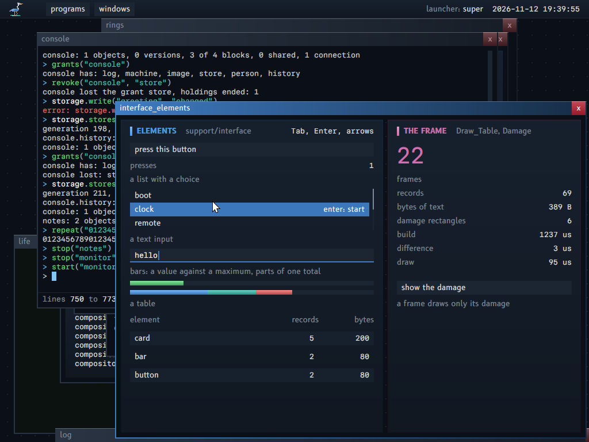
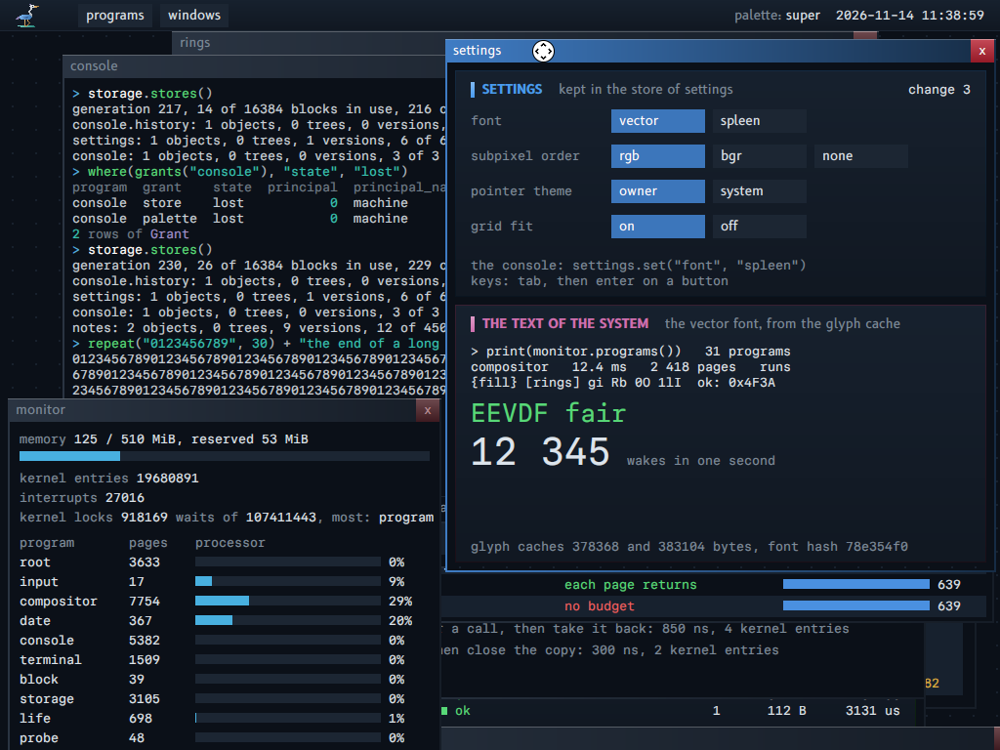
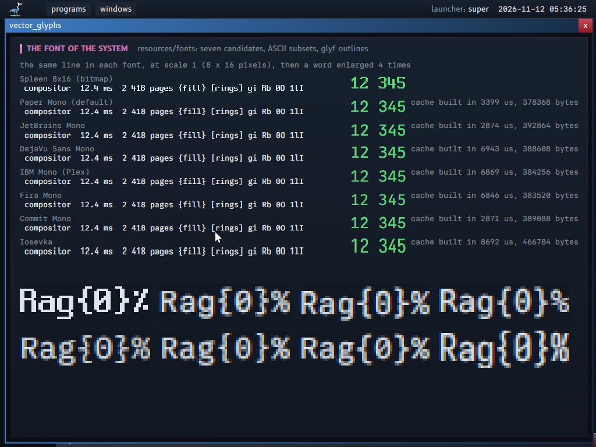
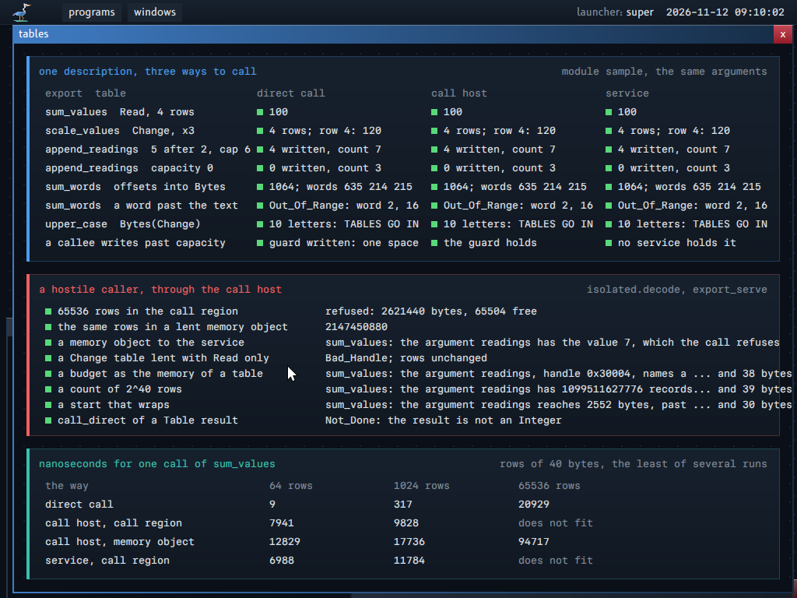
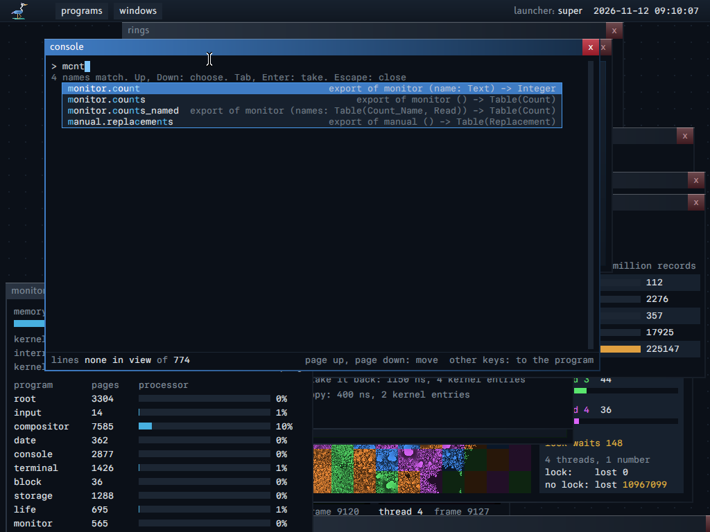
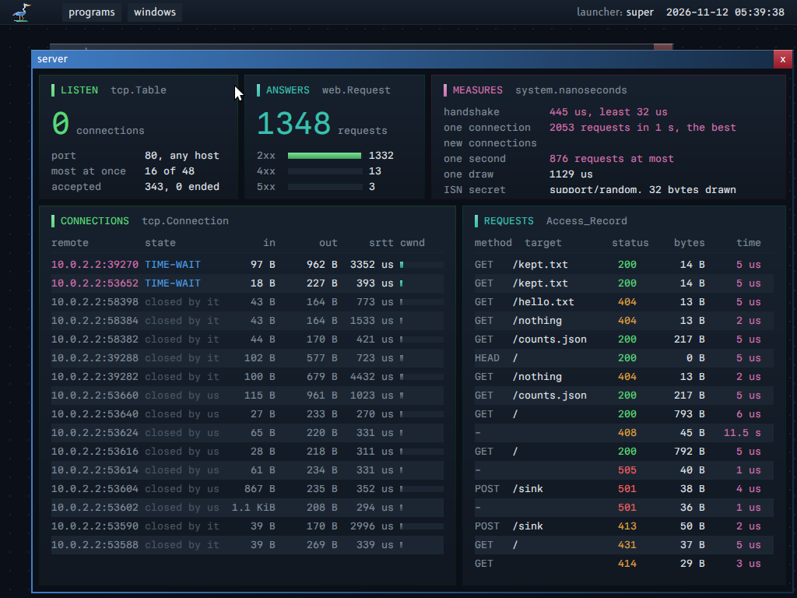
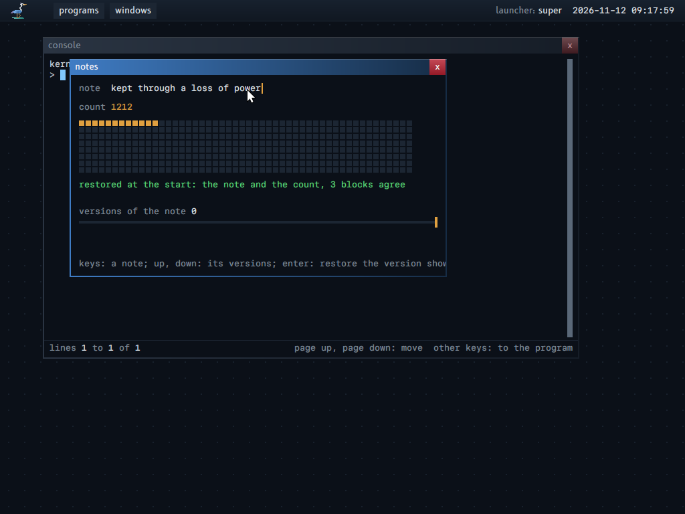
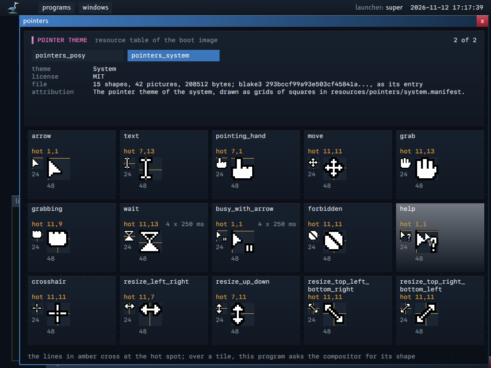
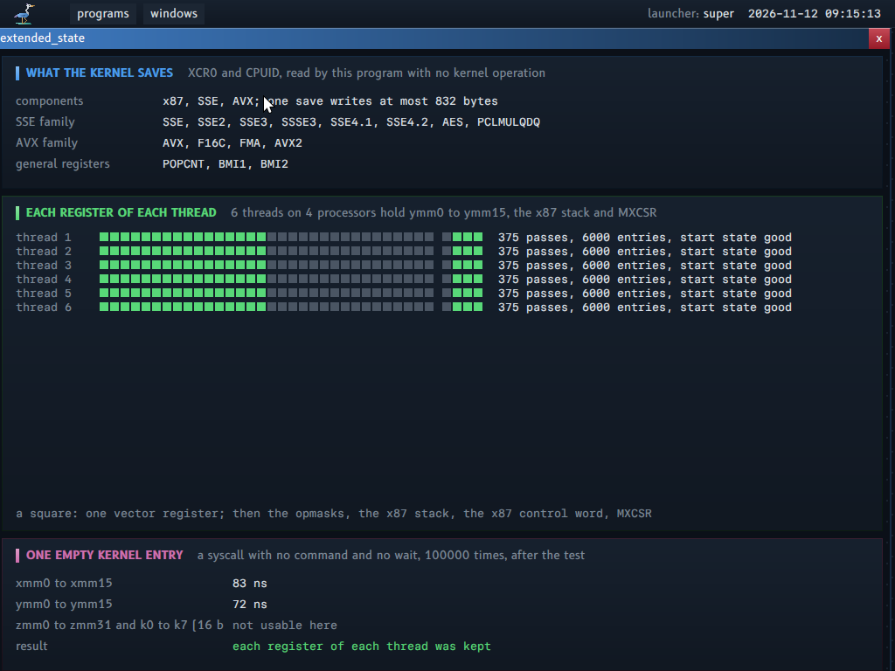
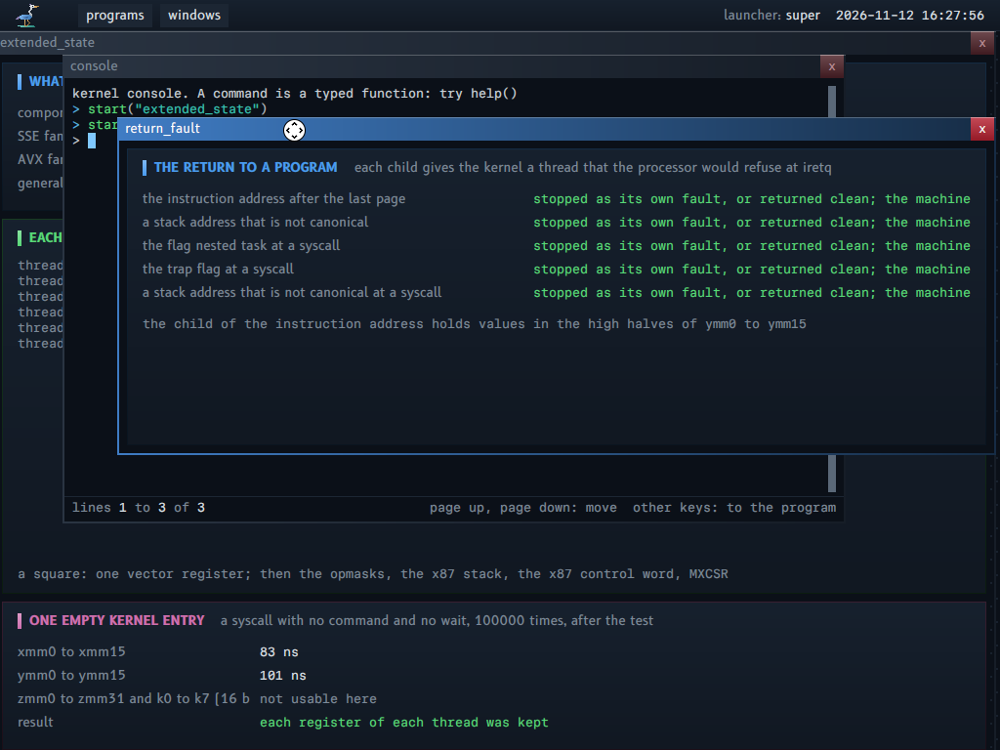

<p align="center"><picture><source media="(prefers-color-scheme: light)" srcset="resources/logo/modus_light_transparent.png"></picture></p>

# modus

An operating system in which each program reaches only what it was given.
Programs call each other's functions with typed values, never with text to parse, and a console calls the same functions by name. Every change that a program makes is kept at once, with its earlier versions, so no program has a save action. It starts to a desktop with a console, developer tools and demonstration programs.

## What makes it different

Each claim names the program that shows it, and its picture below.

| Claim | Shown by |
|---|---|
| **A program starts with nothing.** It holds only the handles that it was given, with their rights, and every gift can be taken back through each chain of copies. | `rights`: the kernel does the operations that the rights allow and refuses the others (`docs/screenshots/rights.png`). `origin`: twelve cases of copies, gifts and revocations (`docs/screenshots/origin.png`) |
| **A command is a function.** No program parses the text of another. A module describes each export, so the console completes it, checks its arguments and calls it; the same file is a program, a service, a library and a sandboxed program. | `tally` in its four roles (`docs/screenshots/roles.png`); the completion list of the console (`docs/screenshots/console_completion.png`) |
| **No save action.** Each change is one commit that a loss of power never cuts in half, and the state before it stays as a version. | `notes` after a restart and after a loss of power (`docs/screenshots/notes.png`, `docs/screenshots/power_loss.png`); the versions of an object (`docs/screenshots/storage_versions.png`) |
| **A fault stops one program, never the system.** Drivers are programs too, and a module that faults in an isolated call stops alone. A program can repair its own faults from a record in memory. | An isolated call that faults or loops (`docs/screenshots/isolated.png`); the fault ring (`docs/screenshots/fault_ring.png`); the disk driver as a program (`docs/screenshots/disk.png`) |
| **A small, counted kernel.** 33 kernel operations, asked through one ring for each thread, with no driver, file system or network code in the kernel. | `threads`, `locks` and `scheduler` (`docs/screenshots/threads.png`, `docs/screenshots/locks.png`, `docs/screenshots/scheduler.png`) |
| **A verified start.** The boot program checks a signed list of the hashes of the system before the kernel starts, and stops with the file and its two hashes when one differs. | The boot display, and a start that fails (`docs/screenshots/boot.png`, `docs/screenshots/boot_fails.png`) |
| **Errors that say why.** A refusal of the kernel, the loader, a module or a service is a record with the argument, its value and what was found; a fault gives its stack trace with source lines. | `errors` (`docs/screenshots/errors.png`); `inspect` on a program that faulted (`docs/screenshots/inspect_stopped.png`) |

## Try it

The Nix flake supplies every tool. `nix develop`, then `kerneltool run`, builds the system and starts it in a virtual machine. In the machine, type `help()` in the console, or open the menu of the programs with the button "programs" of the bar. The section "Use" lists the other commands.

[`CHANGELOG.md`](CHANGELOG.md) lists what each release brings. `kerneltool release_number` prints the newest release.

## Pictures








Tables as parameters: one description, three ways to call (a direct call, a call host, a service), the same answers, the hostile cases and the cost of each way.




| | |
|---|---|
|  |  |




| | |
|---|---|
|  |  |










The repository holds no picture of the same window with the pointer theme Posy's Cursor (CC BY-NC 4.0): it holds no file of that theme.






`kerneltool screenshots` makes these pictures from the running machine.

## What works

- A UEFI boot program loads the kernel module and the boot image, then leaves the firmware.
- The kernel has one entry point. Each kernel operation is a command record in the kernel ring.
- Each program has its own address space and its own handle table. A program reaches only the objects of its handles.
- The root service loads all other programs in user space and grants their handles.
- The input service reads the keyboard and the mouse through granted ports and interrupts.
- A block service drives a virtio disk with device memory and a message interrupt; its client gives the memory that the device reads and writes.
- The storage service keeps a private store for each program on the data disk: each change is one commit, and a stop of the machine never shows a part of one. `notes` finds its state after a restart of the machine, after QEMU was ended during its commits, and after its last root block was cut. An object is a tree of blocks of up to 4 TiB, and a block of zero bytes costs nothing; a program writes ranges and commits them in one step, and a commit hashes the blocks that it changed, never the whole object.
- The network: a frame service drives a virtio network device, and the network service gives a program an endpoint of UDP datagrams that reaches only the remote of its grant. The kernel has no network code.
- `kerneltool call <key> "monitor.programs()"` calls an export of a service of the running machine from the host, and prints the typed result: a table with its field names, a record, a text, or the sentence of its error record. The call goes over QUIC to the program `remote`, whose public key (`<key>`, in its window) the host pins; the root service decides which services it reaches, and the console revokes its grant with `revoke("remote", "acts_for_principal")`. The test reads the place of the pointer from the compositor before each press, and waits for log records with typed fields through `log.records()`.
- The debugger is a service, `debugger`: `debug("clock")` in the console attaches it to a program, then `break_at("fault::three")`, `stack(0)`, `locals(0, 0)`, `value(0, 0, "pair.next^.first")`, `step(0)` and `watch(...)` give tables with the procedures, the lines, the types and the variables of the debug objects. The root service gives the debug access by one rule over grants: a program with no grant can be debugged, a service cannot. The same exports are called from the host: `kerneltool call <key> "debugger.stack(0)"` (`docs/TOOLS.md`, "The debugger").
- `inspect` shows one program live: its address space, its modules, its threads with the state of the scheduler, the stop report of a program that faulted, and the bytes of its own memory, from reports of the kernel that give no byte of another program.
- The compositor owns the framebuffer. Each program draws into a surface in shared memory.
- The console is a normal program. A command is a typed function: `hash("abc")`, `start("life")`, `programs()`. A command gives a result and never prints: the console draws a number, a text, a record, a table, a handle, bytes or an error, each with its own drawer, and a line filters the table of a built-in command as the table of an export: `where(grants("notes"), "state", "held")`. The log records of the programs that a line calls show under the line.
- The line of the console has a caret, a completion list that opens while a line is typed (a fuzzy match over the commands, the exports of the descriptions, the services, the variables, the modules), the signature of the call at the caret, and a history of 256 lines with Control-R and Control-S (`docs/CONSOLE.md`).
- `load("math")` loads a module: its exports become commands. The module describes them: the tool makes each description from the source (parameter names, types, help).
- `isolate("probe")` runs a module in a sandboxed program with no handle. The same calls go through a ring. A module that faults, loops or tries to stop the machine does not harm the console.
- `rings` shows communication between programs: six programs pass records through six rings in shared memory. Stop one program: its records wait in the ring. Start it again: they continue.
- `threads` shows several threads in one program: four threads draw in one surface, each with its own kernel ring. The kernel preempts them. Key `3` stops one thread.
- `rights` shows the rights on handles: the program holds the machine with Inspect and the boot image with Read, and the kernel refuses each operation that needs another right.
- `origin` shows revocation: the kernel keeps the handle that each handle and each mapping came from, and a program takes back what came from a handle that it holds. `revoke("monitor", "machine")` in the console ends one grant of a program that runs.
- `budget` shows the budgets: no object comes from nothing. The program creates memory and threads until its budget cannot pay, and each page returns when it frees them. `memory()` shows that the budgets hold all the free pages.
- `frames` shows paging as a tool of the system: a page gets its page frame at its first use, and the budget paid at creation, so no access fails; programs of one module map one memory object for its code, and a write to it is a page fault.
- `limits` shows the limits of a budget: processor time and log records for each second. The kernel counts the time with the cycle counter and stops a thread at the limit of its budget.
- `processors` shows several processors: the kernel says that four processors run threads of one program at the same time, and the same picture takes less time with 2 and 4 threads.
- `locks` shows the locks of the kernel, split by data: four programs that work on their own objects enter the kernel 3.5 times as often as one, and the window gives the waits of each lock and the frame cache of each processor (a stack of free frames that pages on first use take with no frame lock).
- `address_space` shows a program that drives its own virtual memory: 1 GiB of addresses in one mapping that pays only the pages that it commits, pages that return to the budget at once, a protection change with its shoot-down, a guard page, and large pages.
- `scheduler` shows the scheduling strategies, which the machine changes while it runs: two threads that wake each other on a busy machine make about 80 wakes in one second under round robin and more than 300 000 under EEVDF, and the weights 1, 2 and 4 give shares of about 4, 7.5 and 13.5 %. It also writes the weight and the request of threads that run, through the machine handle, and checks that the written weights order the shares.
- `workers` shows the lock and the word wait: four threads take tiles from one queue. Four threads add to one number: with the lock no addition is lost, with no lock millions are lost.
- The pointer has pictures in a format of the system (`docs/POINTERS.md`): the tool converts the Xcursor theme Posy's Cursor from a build input, and a theme of the system drawn as grids of squares; each is a resource of the boot image with its hash. The compositor chooses the shape from what is under the pointer (a title bar, a close button, a text input) and blends its picture at its hot spot; a program asks for a shape over its own surface. `pointers` shows each theme.
- A program that faults stops alone. The system continues.

`docs/FIRST_MILESTONE.md` gives the details, the design choices and the gaps.

## Documents

| File | Content |
|---|---|
| `docs/PROPERTIES.md` | The 21 properties that the system is built on: each rule, what it forbids, what it costs, and its state |
| `docs/ARCHITECTURE.md` | The systems of the kernel and of user space, what each owns and how they connect; then the inside of the kernel: its locks, the virtual memory of a program, the extended state, the return to a program, kernel events |
| `docs/MODULE_CONTRACT.md` | The module format, the loader, the call form (direct, isolated, from the host), the types, the context of a program, and the errors that diagnose |
| `docs/FIRST_MILESTONE.md` | What the code does now, the choices made, the gaps |
| `docs/TOOLS.md` | The developer tools, and what each one reads |
| `docs/SITE.md` | The site of the system: what `kerneltool site` writes, and where each part of the page comes from |
| `docs/GLOSSARY.md` | The terms of the project. One term per concept: its short definition, then what it is for, how it works, and what it is not |
| `docs/DESIGN.md` | The design rules: how a program of the system looks. The boot display is the model |
| `docs/POINTERS.md` | The pointer pictures: Xcursor, hyprcursor and the others; the format and the manifest of the system; the license of the Posy theme |
| `docs/TRUSTED_BOOT.md` | The trusted boot: what verifies what at the start, with which key; the signing key; the measure; what each layer does not protect |
| `docs/DEMONSTRATIONS.md` | For each of the 21 properties: what the machine test shows, the picture, and what no test shows yet |
| `docs/PRINCIPALS.md` | The principals: the machine, a named principal, its unlock and its lock, the session of each program, the store of a principal, and what is not built |
| `docs/CONSOLE.md` | The line of the console: the caret, the completion list, the history and its search, the colors of the code |
| `docs/CRYPTOGRAPHY.md` | The cryptography of QUIC and TLS 1.3: which proven code the system takes, and how it checks it |
| `docs/STORAGE.md` | The stored data: objects, trees and stores; what a program reaches, the format on the disk, and the steps that are not built |
| `docs/FONTS.md` | The text of the system: the vector font, the grid fit, the subpixel bands and the cache of the glyphs |
| `docs/INTERFACE.md` | The interface package of the programs: the draw records, the damage, the layout, the input and the focus |
| `docs/NETWORK.md` | The network: the frame service, the network service, and TCP as a library in the program |
| `docs/QUIC.md` | QUIC version 1: packet protection, TLS 1.3, the transport of a connection, a server of several connections |
| `docs/RANDOMNESS.md` | Where a program gets random bytes, and how the system measures the strength of its seed |
| `docs/REPRODUCIBLE_BUILD.md` | One source gives one module: the build, and the threads of the compiler |
| `docs/SCHEDULING.md` | The scheduling strategies: what the system takes from CFS, EEVDF and `sched_ext`, and how it changes strategy while it runs |
| `docs/SIMD.md` | Which procedures compute with vectors, in which form, and how to measure each one |
| `CHANGELOG.md` | What each release brings, newest first. `changelog.d/` holds the changes that are not in a release yet |
| `docs/DECISIONS.md` | The record of the decisions of the project, the open questions and the rules of work |
| `docs/REVIEWS.md` | The reviews: each concession found, and what removes it |
| `docs/research/` | Research notes with sources, and video transcripts |

## Code

| Folder | Content |
|---|---|
| `boot/` | The boot program (UEFI) |
| `kernel/` | The kernel. It compiles with the contract library only |
| `runtime/` | `memory.asm`: the copy and the fill of every module, of the kernel and of the boot program (`copy_bytes_without_overlap`, `copy_bytes_with_overlap`, `fill_bytes_with_value`), with its host tests |
| `contract/` | The source library `contract:`: what two parties agree on. `operation` (the kernel operations), `boot_info` (the record from the boot program to the kernel), `module` (the module format and the loader code), `store` (the format of the data disk), `pointer_pictures` (the pointer theme file and its validation), `blake3` (the hash), `ring` (two queues in shared memory, and the shared queue), `isolated` (the isolated call), `glyph_cache` (the drawn glyphs of the vector font), `settings` (the settings page of the principal), `date` (the date page: the date of the time 0 of the system), `system_description` (the signed list of the hashes of the system, and its checks) |
| `support/` | The source library `support:`: what a program compiles in. `system` (kernel operations, text, loader, grants, services), `graphics` (drawing, and the table of the design rules), `interface` (the elements of the windows as draw tables, the damage by difference), `vector_font` (the vector font: a reader of TrueType outlines, a rasterizer in fixed point with subpixel bands, the builder of the glyph cache), `display` (the protocol of the compositor), `terminal` (the terminal ring), `bootscreen`, `bar` (the names of the programs and the places of the bar, its menus and the filter of the launcher), `relay` (the records of the `rings` demonstration), `twins` (the modes of the program `twin`) |
| `programs/` | `root`, `input`, `compositor`, `console`, `host`, `monitor`, `plasma`, `life`, `paint`, `fault`, `temple`, `rings`, `node`, `threads`, `workers`, `rights`, `origin`, `budget`, `limits`, `processors`, `locks`, `locker`, `scheduler`, `address_space`, `shortage`, `boot`, `pages`, `frames`, `twin`, `log`, `flow`, `crowd`, `clock`, `tally`, `manual`, `terminal`, `flood`, `pointers`, `debugger`, `debug_target` |
| `resources/` | The sources of the resources of the boot image: the pointer manifests (`resources/pointers/`), the ASCII subsets of the seven candidate vector fonts with their licenses (`resources/fonts/`, `docs/FONTS.md`), and the test signing key, whose private key is published (`resources/keys/`) |
| `modules/` | Modules of commands (`math`, `probe`) and the test modules of the host load test |
| `tools/kerneltool/` | The kernel tool: all the automation of the project |

## Use

The Nix flake supplies the compiler, the linker, the assembler, QEMU and the UEFI firmware.

```
nix develop
kerneltool run
```

| Command | Action |
|---|---|
| `build` | Build the modules, the boot image and the boot program. One process for each module, as many at once as the processors; `build <processes>` sets the count. A module or a boot volume whose inputs are the same as at its last build is kept; `build whole` builds all |
| `module` | `module <name> with_checks\|without_checks with_debug_information\|without_debug_information [compile\|convert]`: build one module of the table, or run one of its two steps alone (the parallel build runs it for each step) |
| `volume` | `volume <name>`: build one boot volume (the build runs it for each boot volume that it must build, several at once) |
| `run` | Build, then start the machine under QEMU, with the log of the kernel on the terminal of the host |
| `test` | Build, start the machine, act as the input (keys, pointer), check the log, save pictures |
| `screenshots` | `test`, then copy the pictures to `docs/screenshots/`. The pictures are compressed PNG files; `screenshots compress` compresses, with no machine, each PNG file of `docs/screenshots/` and `resources/` that is not compressed yet |
| `film` | Build, start the machine, film the terminal, write `build/film/terminal.mp4` (not a test) |
| `font` | Convert the BDF file of the font to `support/graphics/font.odin` |
| `pointers` | Convert the pointer manifests of `resources/pointers/` to pointer theme files in `build/pointers/`, and print a table of each theme (`build` does it too) |
| `vector_fonts` | Subset the candidate vector fonts to `resources/fonts/`, and draw the picture of the choice `build/fonts/candidates.png` |
| `portrait` | Convert `programs/temple/portrait.jpg` to `programs/temple/portrait.pixels` |
| `repeat` | `repeat <module> <count>`: build one module again and again, and count the distinct modules, LLVM IR files and objects; `repeat all <count>`: every module and the boot program, one row each. Each distinct result is kept in `build/different_builds/` |
| `check` | `odin check -vet` and `odin test` of the host code, then `test` |
| `site` | Write the site of the system in `build/site/`: one page from the documents, the pictures and the logs of the last machine tests (`docs/SITE.md`) |

`nix flake check` runs the formatting hooks and `check`.

In the machine, type `help()` in the console. The button "programs" of the bar opens the menu that starts programs.

## Licences

The default font is Paper Mono, with its SemiBold for the titles (SIL Open Font License 1.1), as ASCII subsets in `resources/fonts/`; the other candidates are there with their licenses (`OFL.txt`, `BITSTREAM_VERA_LICENSE.txt`, and a `.license` file for each). The fallback font is Spleen 8x16 by Frederic Cambus, BSD 2-Clause. See `support/graphics/FONT_LICENSE`.

The portrait of the `temple` program is a public domain picture from Wikimedia Commons. See `programs/temple/PORTRAIT_LICENSE`.

The default pointer theme, when the build has it, is "Posy's Cursor" by Michiel de Boer (Posy), http://www.michieldb.nl/other/cursors/, in the Linux port of simtrami, https://github.com/simtrami/posy-improved-cursor-linux (version 1.6, the package `posy-cursors` of nixpkgs), under CC BY-NC 4.0, https://creativecommons.org/licenses/by-nc/4.0/: non-commercial use only. The repository holds none of its files: the build fetches it and converts it (the sizes 32 and 64, no pixel changed). The program `pointers` shows the attribution. The pointer theme of the system (`resources/pointers/system.manifest`) is under the license of the repository.
