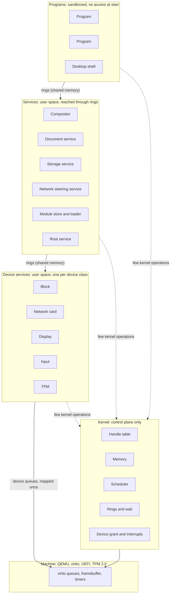
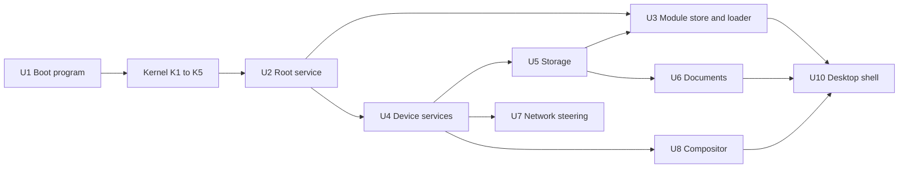
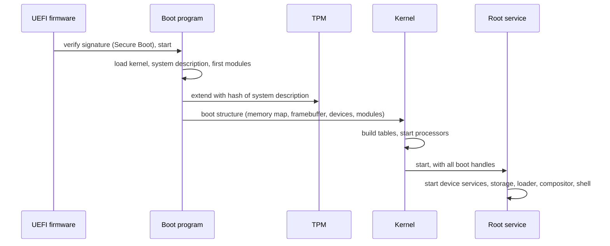
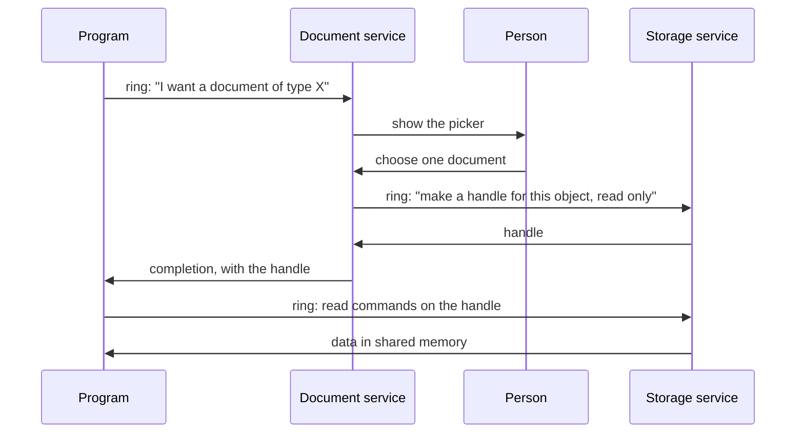
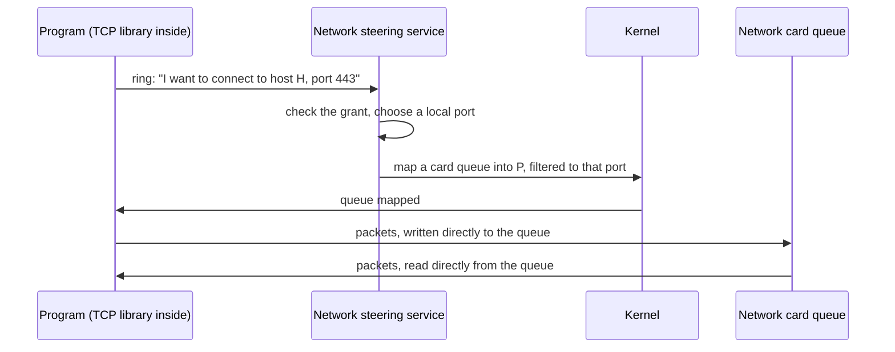

# Architecture

Status: draft 1, 2026-11-09. Proposal for review by the owner. `FIRST_MILESTONE.md` says which parts are implemented, and how.

This document names the key systems and shows how they connect.
It does not design the inside of each system.
`PROPERTIES.md` gives the rules that each system must obey. References such as (P4) point to a property number.

## Vocabulary

`GLOSSARY.md` defines every term of this document.

## The whole system



Solid arrows carry data. They do not enter the kernel (P5, P6).
Dotted arrows are kernel operations. They set up mappings, transfer handles, and wait.

The same picture in text:

```
 Programs            program   program   desktop shell
                        |         |           |
                  ======|=========|===========|======  rings in shared memory
 Services          compositor  documents  storage  network  module store  root
                        |         |           |
                  ======|=========|===========|======  rings in shared memory
 Device services     display    block    network card   input   TPM
                        |         |           |
                  ======|=========|===========|======  device queues, mapped once
 Machine             virtio queues, framebuffer, timers

 Kernel (at the side of every layer, not between the layers):
   handle table | memory | scheduler | rings and wait | device grant and interrupts
```

## Kernel systems

The kernel has five systems. Each one owns a small set of flat tables (P13).

### K1. Handle table

- **Does**: Keeps, per program, the table of handles. Checks the type and the rights of each handle that a kernel operation receives. Moves and copies handles between programs.
- **Owns**: one object table per object type; one handle table per program.
- **Object types**: memory region, address space, program, thread, ring, device queue, interrupt source, timer.
- **Does not**: know names, paths, users or files.

### K2. Memory

- **Does**: Tracks physical page frames. Builds address spaces. Gives "reserve address space", "commit pages", and "map this region in that program" (P14).
- **As implemented** (paging, second part): `Memory_Create` reserves: the budget pays for each page, and each page gets its page frame at its first use, by the program (a page fault) or by the kernel. The flag `Frames_Now` gives all the frames at creation. Map is a separate operation. No access fails for lack of memory: a reserved page always has a free frame.
- **Owns**: the page frame table; one address space record per program; the frame list of each memory object.
- **Does not**: page to disk, cache files, or allocate hidden memory for a caller.

### K3. Scheduler

- **Does**: Chooses which thread runs on each processor. Keeps time. Wakes threads.
- **As implemented** (2026-11-11, `docs/SCHEDULING.md`): three strategies behind one table of six functions (round robin, fair, EEVDF), one for the whole machine, which a program with the right Schedule changes while the system runs (`Strategy_Set`). Wake preemption, also on another processor. A weight and a request for each thread, at its creation.
- **Owns**: one run queue per processor; the thread table, split in a hot part and a cold part.
- **Does not**: know about priorities of services by name. Policy is data that the root service sets.

### K4. Rings and wait

- **Does**: Creates a ring as a memory region with a fixed layout. Gives the one blocking operation of the system: "wait until one of these rings has entries". Executes the commands that programs put in their kernel ring.
- **Owns**: the ring table; the wait table.
- **Note**: A program has one ring to the kernel. All kernel operations except "enter and wait" are records in that ring. This keeps the count of kernel entry points near one (P1, P4).

### K5. Device grant and interrupts

- **Does**: Maps the queues and registers of one device into one device service. Turns each interrupt into a completion record in a ring. Programs the IOMMU so that a device reaches only the memory of its service.
- **Implemented** (2026-11-10): device memory over the registers of a device (`Device_Create`, kind `Memory`), message interrupts (kind `Message`), and the physical address of a memory object for a holder of the right Physical (`Memory_Physical`). The root service finds the devices on the bus, not the kernel. Not done: the IOMMU.
- **Owns**: the device table; the interrupt routing table.
- **Does not**: contain code for any device (P7).

### What the kernel does not contain

File systems, network protocols, device drivers, the module loader, the module store, graphics, the TPM protocol, names, users.

## User-space systems

### U1. Boot program

A UEFI program (P17). It runs before the kernel.

- Verifies and loads the kernel, the system description and the first modules.
- Measures the system description into the TPM.
- Collects the memory map, the framebuffer and the device list.
- Gives all of this to the kernel in one fixed structure, then leaves the firmware.

### U2. Root service

The first program. The kernel gives it every handle that exists at boot.

- Starts the other services and gives each one only the handles that it needs.
- Holds the system description and the grant records.
- Is the only program that can create access from nothing. All other access is a handle that came from it, directly or through a chain.

### U2b. Resources of the boot image

A resource is a file of the boot image that is not a module: data that a program reads in place, such as a pointer theme file (`docs/POINTERS.md`). This section is the one description of the mechanism; each kind of resource has its own format and its own document.

- **In the image** (`contract/boot_info`): after the table of the modules (`Image_Header.count` entries), a second table of `Image_Header.resource_count` entries of the same record, `Image_Entry`: a name of 31 bytes at most, the BLAKE3 hash of the bytes, the offset and the size. Each file starts on a page. A reader of modules reads the first table only, so a resource is never taken for a module; an image with `resource_count` 0 has no resource.
- **Identity** (P11): the hash of the bytes, as for a module. The name is for people and for the code that chooses.
- **The build** (`tools/kerneltool/modules.odin`, `build_boot_image`): a command of the tool makes each resource in `build/` (`kerneltool pointers` today), and `build` puts it in the image with its hash. The same input gives the same bytes: `kerneltool check` builds each resource two times and compares them.
- **The grant** (P8, P20): no program reads the resource table by itself. The root service finds a resource by its name, checks the hash of its bytes against the entry, and gives it to one program as a read-only mapping of the pages of the image at an address of the context, with its size in a value of the context (`programs/root/resources.odin`, `resource_mapping`; the log has "root: the resource pointers_posy (883008 bytes, its hash checked in 1395 us) is given to compositor, read-only"). The program validates the bytes with the reader of its format: the root service checks the identity, not the format. A program with the grant `Image` (the whole image, read-only) finds resources with `system.image_resources` and `system.image_resource_find`.
- **Users**: the compositor (the pointer theme file, `programs/compositor/pointer_picture.odin`) and the program `pointers` (all pointer theme files, through the grant `Image`).

### U3. Module store and loader

- **Store**: keeps modules by content hash. Answers "give me the module with this hash". It has no separate index: functions read the flat tables of the modules (P11, P12).
- **Loader**: builds a new program. It asks the kernel for an empty address space, maps the segments of the module and of the modules that it imports, and starts it.
- The loader is in user space. The kernel only maps memory.
- The first modules are loaded by the boot program, because the store does not run yet.

### U4. Device services

One service per device class: block, network card, display, input, TPM.

- Each one owns the queues of its device. It translates between the device protocol and the ring protocol of its class.
- For virtio, this translation is thin, because a virtio device is already a set of queues.
- A program with a granted device queue talks to the device with no service in the path (P5).

### U5. Storage service

- Owns the block device queues. Gives transactional object stores (P9).
- Creates one private store per program. Gives clones and snapshots.
- **Implemented** (2026-11-10, `programs/storage`): a native engine. The owner removed SQLite from the system on 2026-11-10. Copy on write with two places for the root block and a check of each block in the block that names it. The storage service is a service with exports; the root service names the private store of each connection and its limit of blocks. Not done: versions, snapshots, clones. The format of the disk is the contract `store`. A block with a wrong check damages its object only: the service serves the others, and does not give the bytes of a damaged object.

### U6. Document service

- Owns the objects that belong to the person and not to one program.
- Shows the picker that lets the person choose a document. Returns a handle to the program that asked (P2, P8).
- Records each grant, so that the person can list and revoke them.

### U7. Network steering service

- Owns the network identity of the machine: address, ports.
- Gives a program a network queue and a port range, then leaves the data path.
- The TCP stack is a library inside each program (P5).
- **Implemented, first layer** (2026-11-10, `programs/frame`, `programs/network`, `contract/frame`, `contract/datagram`, `support/network`): the frame service drives the virtio network device; the network service is its one client and gives each program with the grant one endpoint of UDP datagrams, with a grant of one remote. Not as written above: the virtio device of QEMU has one pair of queues, so the network service is on the data path (one copy) and writes the headers of UDP and IPv4 that it must check anyway. The plan keeps TCP and QUIC as libraries in the program (choice 194 of `FIRST_MILESTONE.md`).
- **TCP** (2026-11-11, `support/tcp`, `programs/server`, `programs/fetch`): the design is in `NETWORK.md`. TCP is a library in the program; the network service checks each segment against a client grant or a listen grant, and keeps no state of a connection.

### U7b. The remote service

- The calls of the host: the program `remote` holds an endpoint whose grant names the host, and connections to the services that the root service names for it. The tool encodes an isolated call with the description of the export; `remote` relays it and sends the typed result back. See `MODULE_CONTRACT.md`, section 4, "A call from the host".

### U8. Graphics: WebGPU library and compositor

- **WebGPU library**: the one graphics interface, linked into each program that draws. It has one back end per display type. The first back end is software (P18).
- **Compositor**: a service that owns the display. Each program draws into a surface in shared memory. The compositor combines the surfaces and sends input events to the program that has focus.

### U9. Base library

A set of modules that most programs use. It is not a C library and no program is forced to use it.

- Ring access, with blocking functions built above the rings.
- Arena allocators above reserve and commit.
- Functions that give the information of the modules from their flat tables (P12).
- The TCP library.

### U10. Desktop shell

The program that the person sees: starts programs, shows windows, shows grants. It is a normal program with handles from the root service.

## Locks of the kernel

Status: done on 2026-11-10 (the step "the kernel lock split by data", choices of `FIRST_MILESTONE.md`). The code follows this section: no kernel entry takes a lock for all the kernel.

Before this step, one kernel lock covered all kernel data: a processor took it at each kernel entry. The owner decided that the kernel runs on all processors with no single lock as the final design (`HANDOFF.md`, "Full queues and speed", item 8, and "Truly multi-threaded"). A lock protects data: a table, or a part of a table. It does not protect a code path.

### The data of the kernel

Paths: **op** a kernel operation; **tick** the timer of a processor; **dev** a device interrupt; **fault** a page fault of a program; **wake** a word wake, an event or a deadline; **revoke** `Handle_Revoke`; **stop** the stop of a program or of a thread.

| Data | Read by | Written by | Protection | Ties to other data |
|---|---|---|---|---|
| `processors`, `processor_count`, `gates`, `kernel_table`, `frame_count`, `cycle_frequency`, `timer_count`, APIC addresses, `boot_record`, `stage_cycles`, `time_region`, `log_head`; the tables of the strategies (`STRATEGIES`) and their lengths in cycles (`fair_latency`, `fair_least_turn`, `fair_wake`, `fair_credit`, `tick_cycles`) | all paths | boot only | none: read-only after boot | |
| Processor record: `slice_left`, `charged_from`, `turn_start`, `busy_time`, `record_thread`, `fpu_area`, the counts of entries, interrupts, faults and locks, the counts of the scheduler (`picks`, `preemptions`, `moves`, `pick_cycles`), the report buffers, the log text buffer | its processor; reports read the counts (`Processor_Report`, volatile loads) | its processor only | none: data of one processor | |
| Processor record: `current` | its processor; a strategy of its run queue (`eevdf_average`, `thread_ready_held`) on any processor, under the run lock; with no lock: `busiest_queue` (a hint), `Processor_Report`, `kernel_interrupt` of its processor, `processors_with_table` and `sync_acknowledge` (atomic loads) | its processor, in `queue_pick` and `schedule` | run lock of the processor (a running thread has this processor as its home) | `current` names a thread whose `processor` is this one |
| Processor record: `look_first` | its processor (`schedule_pick`) | a waker that wakes it from idle (`kick`); its processor clears it | atomic | a hint: a lost or old value gives the pick of before |
| Processor record: `preempted_at` | a waker of a thread whose home is this processor (`thread_ready_held`) | the same | run lock of the processor | at most one wake preemption by another program in each millisecond |
| Processor record: `preempt_from`, `interrupt_preemptions`, `preempt_cycles` | its processor; `Processor_Report` reads the counts | its processor only | none: data of one processor | |
| Processor record: `table` | `unmap`, the cleanup of a program (which processors to synchronize) | its processor only | atomic store and load, ordered with the page table writes | the page table in `cr3` |
| Processor record: `pending`, `idle`, `preempt` | its processor | another processor sets them (`preempt`: `kick`, after a strategy said that a woken thread preempts); its processor clears them | atomic | `processor_sync`, the wake of an idle processor, wake preemption |
| Processor record: port bitmap, `ports_loaded`, `ports_serial` | the processor (hardware) | its processor only, in `run` | none: data of one processor | the Ports handles of the program that runs; `program.ports_serial` |
| Run queue of a processor: head, tail, count, `weight` (the sum of the weights in the list) | its processor, a processor that takes work from it, a strategy; reports read `count` (atomic) | **op** thread create, **wake**, **tick** (end of a turn), **stop** | run lock of the processor | a thread is in one queue at most |
| Run queue: `strategy`, `virtual` (the queue clock) | the strategy functions, `queue_pick`; reports read `strategy` (atomic) | `strategy`: the first processor at boot (`strategy_start`, before the other processors start), then **op** `Strategy_Set` (`queue_convert`); `virtual`: the strategy functions | run lock of the processor | the strategy fields of each thread whose home is this queue are zero or belong to `strategy` |
| `strategy_chosen`, `strategy_changes` | **op** `Strategy_Set`, reports | **op** `Strategy_Set` | atomic | each queue converts to the value that it reads under its run lock |
| Thread: `state`, `processor`, `home`, queue links, `wait_serial`, `woken`, deadline | **wake**, scheduler, `Thread_State`, reports | **op** (wait), **wake**, scheduler, **stop** | run lock of `home` | Ready and not on a processor: in the queue of `home`. A thread leaves its queue and gets its processor in one section of the run lock |
| Thread: the strategy fields `virtual`, `virtual_deadline`, `lag`, `placed` | the strategy of the queue of `home` (**wake**, **tick**, scheduler, **op** `Strategy_Set`) | the same | run lock of `home` | zero, or the state of the strategy of the queue of `home` |
| Thread: `weight`, `request` | the strategies, `queue_push` and `queue_remove` (`Run_Queue.weight`) | **op** thread create, before the thread enters a list | none: written once, before any other processor reads them | |
| Thread: `program`, `events`, `finished`, `serial` | **dev** and **stop** (`program_event`), scheduler | **op** (create, under the program lock and the control lock), **stop** (`thread_finish`) | program lock of `program`; `serial` changes for each new thread in the slot | a finished thread has `program` 0 and `events` nil, so `program_event` of its old program never reads the slot again |
| Thread: frame, floating-point state, kernel ring, `in_enter`, `run_time`, `words` | its processor while it runs; a waker reads `words` of a thread that waits | the processor that runs it | the rule of the owner (below) | |
| Thread: `stop_requested` | the processor that runs it | **stop** | atomic | |
| Thread: `references`, `budget` | **op**, **tick** (budget) | **op**, budget end | `references` atomic (a copy of a handle in its own program adds 1 with no control lock); `budget` written under the frame lock | |
| Wait table: buckets of entries (word, thread, serial) | **wake** | **op** (`Word_Wait`), the start of the next entry, **stop** | wait lock of the bucket | an entry is valid while its serial is the `wait_serial` of its thread |
| Program: `handles`, `mappings`, `next_address`, the lower half of its page table, `thread_areas`, `thread_count`, `mapped_pages`, `modules`, `stop`, `state`, `code`, `has_ports` | **op**, **fault**, **revoke**, **stop**, reports | **op**, **fault**, **revoke**, **stop** | program lock | a mapping names a memory object with one reference; a handle names an object with one reference |
| Program: `references` | **op** | **op**, **revoke**, **stop** | atomic; the change to 0 under the control lock | the program runs while a handle names it |
| Program: `holds` | scheduler, **stop**, `stop_wait` | scheduler, **stop** | atomic | the processors that run a thread of it, plus the stop in progress |
| Program: `cleaned`, `serial` | `program_free`, `stop_wait` | `program_cleanup`, `program_create` | control lock; `serial` read with no lock | the slot is free only when `cleaned` and no handle names the program |
| Program: `entries`, `run_time` | reports | **op**, **tick** | atomic | |
| Program: `budget` | **op** (page tables, `Log`, the error record of a refused `Log`) | budget end | frame lock; an atomic store and load. A reader that holds a handle to that budget under the program lock reads it with no frame lock: it changes only when that budget ends | |
| Memory object (region): slot (`page_count`), `serial`, `budget` | all paths that hold a handle or a mapping | **op** (create), the last release | frame lock | free frames, reserved pages, pages of budgets |
| Memory object: frame list, `present` | **fault**, **op** (`user_range`, map), **revoke** | **fault**, **op** | region lock of the object | a page with a frame keeps it until the object ends |
| Memory object: `references` | | **op**, **revoke**, **stop** | atomic; the one that makes it 0 frees the object | |
| Frame table: `frame_bits`, `frame_hint`, `free_frames`, `reserved_pages` | **op**, **fault**, reports | **op**, **fault**, **stop** | frame lock | `free_frames` + the frames of the stacks = pages of all budgets + `reserved_pages` - the `taken` of the stacks |
| Processor record: the frame cache (`frames`, `count`, `taken`) | its processor (**fault**, the end of a memory object); a drain and `System_Report` on any processor | its processor; a drain on any processor | cache lock of the stack; a change of `count + taken` also holds the frame lock | each frame of a stack has its bit set in `frame_bits` and is in no memory object |
| Processor record: the counts of the frame cache (`batches_taken`, `batches_given`, `drains`, `refills`) | `Processor_Report` (with no lock) | under the cache lock of the stack | cache lock | |
| Budget: `amounts.pages`, `live` | **op** | **op**, budget end | frame lock | the same invariant |
| Budget: `parent`, `amounts.programs`, `amounts.threads`, limits | **op**, **tick** (`parent`) | **op** (create, end) | control lock; `parent` read with no lock (below). The limits are written only when the budget is made: a reader that holds a handle to the budget reads them with no lock | |
| Budget: `references` | **op** | **op** (copy, close) | atomic; the change to 0 under the control lock | the budget ends when no handle names it |
| Budget: `spent`, `spent_total`, `logged`, `refused` | **tick**, **op** (`Log`) | **tick**, **op** | atomic | |
| Origin table, `revoke_lost`, `revoking` | **op**, **revoke**, **stop** | **op** (map, unmap, give, close), **revoke**, **stop** | origin lock | each holding with links is a live holding |
| Interrupt objects: `interrupt_owner`, `interrupt_references` | **dev** | **op** (create, close) | control lock; **dev** reads `interrupt_owner` with no lock | |
| Interrupt objects: `interrupt_pending` | **op** (`Interrupt_Read`) | **dev** | atomic | |
| `time_milliseconds`, the time page; `period_time` (the first processor only) | all paths | the tick of the first processor | atomic | |
| Log: the serial port, the log records, `written` | readers in programs | **op** (`Log`), kernel messages | log lock | |
| `machine_stopping` | all processors | `machine_stop` | atomic | |

### The locks, in their order

A processor takes locks only in this order. It takes a lock of a kind only if it holds no lock of a later kind. The kernel checks the order at each take, and stops the machine with a report if it is broken (`TEST_BUILD_CHECKS_LOCK_ORDER`). A cycle of waits needs a processor that waits for an earlier kind while it holds a later one: the order forbids it, so no deadlock exists.

1. **Control lock** (one). The paths that change the relations between programs or the life of an object that several programs name: create, start and stop a program; create and stop a thread; give a handle to another program; map or unmap in another program; revoke; close a handle of a program, a thread, a budget, an interrupt or ports; create a budget; create a device object; read the state of another program or thread; the record of a module in another program; the stop of a program on a fault. It is not a temporary lock. These paths touch an unbounded set of programs (a revocation follows the origins through any program; a stop closes handles that stop other programs). One order among them makes each one atomic for the others, with no cycle. They are rare: a program does them when it starts, stops, or gives access, not in its work (property 3). The measures show that the hot paths do not take it.
2. **Program lock** (one for each program). Two at a time only under the control lock, so the order between two program locks does not matter: one processor at most holds two.
3. **Origin lock** (one).
4. **Region lock** (one for each memory object). One at a time.
5. **Frame lock** (one).
6. **Cache lock** (one for each processor: its stack of free frames). One at a time.
7. **Log lock** (one).
8. **Wait lock** (one for each bucket of the wait table). One at a time.
9. **Run lock** (one for each processor). Two at a time only to move a thread from a queue to another, in the order of the processor index.

Interrupts are off in the kernel, so a processor never takes a lock again in an interrupt. A processor that waits for a lock answers `processor_sync` while it waits.

### Rules that keep each path correct

- **The owner of a running thread.** A thread that runs on a processor belongs to that processor: only it reads and writes the frame, the floating-point state, the kernel ring and the word list of the thread. Another processor that stops the thread sets `stop_requested` and sends an interrupt. The processor ends the thread itself, at its next pass in the kernel. No processor takes a thread away from another one.
- **Three rules against the forms of error that a review found** (2026-11-10). (1) A state that is true only between two sections of one lock is a state that another processor sees: a thread is taken from its queue and given to a processor in one section of the run lock (`queue_pick`). (2) A slot named by its index across a wait for a lock can serve another object when the wait ends: a path that names a thread or a program across such a wait also keeps its serial and checks it (`thread_finish`, `stop_wait`), or holds a lock that keeps the slot (`program_free` only after `cleaned`). (3) A state checked before a work must mean that the work is done: Stopped means that the threads were marked, not that the program was cleaned up (`cleaned`); a new thread is refused in a program that is not Created or Ready.
- **A program ends after its last thread leaves its processor.** `holds` counts the processors that run a thread of the program. A stop adds 1, marks the program Stopped, marks each thread (a thread that waits or is in a queue ends at once; a thread on a processor gets `stop_requested`), then subtracts 1 and sets the bit Stopped in the same atomic addition. The one subtraction that leaves exactly the bit Stopped does the cleanup: unmap, close the handles, free the page tables. So no processor uses the page table or the mappings of a program while they are freed, and the cleanup runs one time. The slot of the program is free (`program_free`) only after the cleanup: by the cleanup if no handle names the program, else when the last handle closes.
- **A stop returns after the threads left their processors.** `Thread_Stop` and `Program_Stop` mark the threads under their locks; the operation then frees all its locks and waits until each marked thread that ran on another processor left it (`stop_wait`): after the operation, no thread of what stopped runs an instruction. A stop of a program that another stop already marked waits in the same way: the state Stopped does not say that the threads left. A wait inside the locks could wait for a thread that waits for these locks. The wait ends at once if the thread that waits is stopped too: two threads that stop each other do not wait for each other.
- **The page tables of a program change under its program lock.** `user_range` and the `user_copy` that follows run under the program lock: no unmap runs between them. An entry that becomes present needs no message to other processors. An entry that becomes 0 (`unmap`, and the undo of a `map_region` that failed on a later page) is followed by `processor_sync` to each processor whose `table` is the table of the program, before the memory object can free a frame. A processor answers `processor_sync` at each kernel entry, in idle, and while it waits for a lock: then it reloads `cr3`, so it keeps no old translation. Two processors that synchronize each other at one time do not wait for ever: each answers while it waits.
- **The frame caches** (`kernel/memory.odin`, "The frame cache of each processor"). Each processor has a stack of at most 256 free frames in its processor record, with its own cache lock (kind Cache, after Frame in the order). A first use takes a frame from the stack of its processor under the cache lock only, and counts it in `taken` of the stack: a reserved page that the stack served. An empty stack takes one frame for the page and a batch of 128 for the stack in one section of the frame lock, and subtracts `taken` from `reserved_pages` there. The end of a memory object puts its frames on the stack of its processor (the frame lock is held there for the budget); a full stack gives a batch of 128 back to the frame table in the same section. The invariant, true whenever the frame lock and the cache locks are free: `free_frames + the frames of all stacks = the pages of all budgets + reserved_pages - the taken of all stacks`. Each step keeps it: a take from a stack moves 1 from the frames of the stack to `taken` (the two in one section of the cache lock); a batch and a give back move frames between `free_frames` and a stack under the frame lock and the cache lock; the fold of `taken` moves it to `reserved_pages` under the two. So the sum of each stack (frames + taken) changes only under the frame lock: `System_Report` holds the frame lock and reads each stack under its cache lock, one after the other, and gets the exact difference free pages - reserved pages, with no stop of the other processors. The free pages alone and the reserved pages alone are not values of one instant: a take from a stack after the report read it is in neither sum, a take before is in both. The leak check of the console ("budgets N pages: all the free pages") and the checks of `locks` compare the pages of the budgets with that difference only. When the frame table has no free frame for a take that cannot fail (a reserved page, a list page, a page table) or for a contiguous object, the taker, under the frame lock, takes each cache lock in turn and moves the frames of each stack to the frame table (`caches_drain`), then takes again. No frame can stay in a stack while a take fails: a stack is never touched under a cache lock that waits for the frame lock (the order is frame, then cache), so the drain always gets each stack. Frames on a stack are not zero: a frame gets its zeros when a page takes it, as before, after the locks are free (P20: a program never sees the old content of a frame).
- **Pages.** Each move of pages between a budget, the reserved pages and the frame table is one section under the frame lock. So `free_frames` = pages of all budgets + `reserved_pages` holds at each moment that the lock is free, and `System_Report` reads it under the lock. A page fault takes the region lock (to give the frame of one page one time), then the frame lock. The zero fill of a frame is done after the frame lock is free.
- **References.** A reference count is an atomic count. A holder adds 1 only while it holds a handle or a mapping of the object, so a count never goes from 0 to 1. The processor that subtracts the last 1 frees the object: no other processor can name it.
- **Budgets and the tick.** The tick adds the processor time to the budget of the thread and each budget above, with atomic additions, and with no lock. When a budget ends, its objects and its children move to its parent (control lock and frame lock), and its slot is used again only after `processor_sync` to all processors: a tick that walked through the old budget has finished its walk. The log limit uses one word with the second and the count: a record is accepted only if each budget of the chain accepted it; a refusal takes back the counts that it added, in the same second only.
- **The word wait.** A word is named by its physical address. A thread registers each word in the bucket of the word, under the wait lock of the bucket, after it compared the value: a waker changes the word before it enters the kernel, so either the waker finds the entry, or the thread finds the new value. The waker then takes the run lock of the thread: a thread that waits becomes Ready; a thread that still registers (in its own entry) gets `woken` and does not wait. An entry carries the `wait_serial` of its thread; the serial changes when the wait ends, so a late waker of an old wait does not count a thread that runs as woken. A thread removes its entries at its next kernel entry.
- **Revocation.** It holds the control lock. It sets `revoking` and lists the holdings that came from the handle, under the origin lock. While `revoking` is set, a path that adds a holding to the origin tree without the control lock stops and runs again under the control lock, after the revocation. Then the revocation ends each holding under its program lock, after it checks under the origin lock that the tree did not change since it chose the holding: the count of changes travels from the choice of the first holding (`revoke`) through each step (`revoke_under`). If another processor changed the tree, it looks again from the handle: a slot that a close freed can hold a new handle.
- **The kernel half of the page tables** changes only at boot, on one processor. A report reads it and never makes a table (`kernel_entry` with no create).
- **Ports.** A processor changes only its own port bitmap, in `run`, when the program that runs or its `ports_serial` changed. A change of the Ports handles of a program adds 1 to `ports_serial`, then synchronizes all processors: each one checks again before it returns to a program.
- **The scheduler.** Each processor has a run queue. A new thread goes to the queue of the processor that created it; a woken thread goes to the queue of its `home`. If the processor of that queue is idle, the waker sends it an interrupt; else the waker sends one to another idle processor, which takes the thread. When a processor chooses its next thread (after a wait, at the end of a turn, or idle), it takes a thread from the queue of another processor whose load (the threads in its queue, plus 1 if it runs one) is above the count of threads in its own queue. So the ready threads move to the processors that have less, as with one queue for all. The order inside a queue is the strategy of the queue (`kernel/strategy.odin`, `docs/SCHEDULING.md`): six functions that run under the run lock of the queue (`move` under the two run locks of a move). The time slice (10 ticks) is the longest turn under each strategy, so each processor passes through the balance at least each 10 ms while it has a thread.
- **Wake preemption.** If the home of the woken thread is busy and another processor is idle, the waker wakes that processor and stores the home in its `look_first`, after the exchange of `idle` (the order of the idle protocol does not change); its next pick takes from that queue first. With no idle processor, the waker asks the strategy of the home queue, in the same section of its run lock as the wake, if the woken thread preempts the thread of the home (`processors[home].current`, under the same lock). A thread of another program than the thread of the home preempts that processor at most once in each millisecond (`preempted_at`, under the same run lock). If yes, it ends the turn of its own thread when the home is its processor, else it sets `preempt` of the home and sends an interrupt; the home processor ends the turn of its thread when the interrupt comes from a program. The decision is made under the lock and acted on after it: if the home runs another thread then, that thread loses its turn (one more pass through `schedule`), or the woken thread waits for the end of the turn (at most the time slice). No state is wrong in either case: a turn is not a state of a thread. Interrupts are off in the kernel, so the interrupt arrives either when the processor returns to a program, where it ends the turn, or while it waits idle with no thread, where it clears the flag and the processor picks a thread anyway.
- **The change of strategy** (`Strategy_Set`, `strategy_change`, `queue_convert`). The operation writes `strategy_chosen` (atomic), then for each processor in turn takes its run lock, converts its queue to the value of `strategy_chosen` that it reads under the lock, and frees the lock. It holds the program lock of the caller (`execute_locked`) and one run lock at a time: program before run, so the lock order holds (the test build checks it on each take; the full check ran 104 changes, no report). A conversion changes no list, no `state`, no `home`, no `processor`: no thread leaves a queue or a processor, so no thread is lost. It clears the strategy fields of each thread whose home is the queue and that is in the list, on the processor, or Waiting, sets `strategy`, and places each thread of the list with `ready(New)`, in the order of the list. The invariant: the strategy fields of a thread are zero or belong to the strategy of the queue of its home. The interleavings, step by step:
  1. **The tick of the processor of the queue.** `strategy_tick` takes the same run lock. Before the conversion: the old strategy charges the thread, then the conversion clears its fields. After: the thread is not placed; `strategy_tick` places it with the new strategy (`ready(New)`), then charges it. The strategy word and the fields change in one section, so the tick never sees one without the other.
  2. **A wake on another processor.** The waker takes `run_lock(thread)`, which is the lock of the home (it reads `home` again under the lock). Before the conversion: the thread enters the list, placed by the old strategy; the conversion then clears and places it again (it is in the list). After: the conversion cleared the thread (it was Waiting with this home), and `ready(Woken)` of the new strategy sees it not placed and places it as new. The decision of preemption is made in the same section, with the strategy that the queue has in that section.
  3. **A move.** `queue_move` holds the run locks of the two queues. If the two have the same strategy, its `move` keeps the virtual time or the lag. If they differ (the change visited one queue and not yet the other), `queue_pick` clears the fields of the thread: it runs on its new home not placed, and the strategy of that queue places it at its next tick or when it leaves. After the move, its home is the new queue and its fields are zero: the invariant holds.
  4. **A new thread.** `thread_create` writes the thread record with no run lock, while the thread is Ready, in no list and on no processor, and `home` holds the home of the last thread of the slot. The conversion skips such a thread, so it never writes a record that a creation writes. `thread_queue` then takes the run lock of its processor, stores `home`, and places the thread with the strategy that this queue has in that section; its fields are zero, which is valid for each strategy.
  5. **A stop.** `thread_stop` and `program_stop` take the thread out of its list under the run lock of its home, and `schedule` ends a thread that its processor ran under the same lock: each is one section, before or after a conversion.
  6. **Two changes at one time.** Let B be the operation whose write of `strategy_chosen` is the last one. B visits each queue after its write, and at its visit the word holds the value of B, so the queue gets it; a later visit of another operation reads the same value. So when the last operation returns, each queue has the strategy of the word.

## How the systems depend on each other



An arrow means "must exist before". This is also the order of construction.

## Three flows

### Boot



### A program opens a document



The program never sees a path or a list of other documents.
The kernel takes part only to move the handle and to wake the programs.

### A program sends data on the network



After the mapping, the kernel and the service are not in the path.

## Direction

Status: Decided by the owner on 2026-11-09.

- **First use**: a dedicated machine. The system is not a general replacement for an existing desktop at first.
- **Compatibility**: none at first. The project defines a small, fundamental interface that shows its concepts. Later layers are built above it. A POSIX layer and a Win32/NT layer are possible later, as layers above the interface and not as parts of it.
- **Console**: a normal program. It has a terminal: it writes text records and reads key records. A terminal is a normal program too. The system has no terminal concept in the kernel and no equivalent of the Linux TTY.
- **Composition of programs**: the console uses a real programming language. A person calls the exported functions of modules directly, with typed data. The system has no pipes of text and no shell script language.
- **Concepts to research first**: the contract between modules; identity and several machines.
- **Other concepts** (program distribution, failures and quotas, observability, guaranteed latency): the owner expects the answers to come from the design as it grows. They are not researched ahead of need.
- **Persistence**: no save action. Each change goes to storage when it occurs, and storage keeps earlier versions for all programs. See property 9.

## Open questions about the architecture

1. **Kernel ring or direct operations.** Closed on 2026-11-09: kernel ring only. Every kernel operation is a record in the kernel ring, plus one "enter and wait" entry point.
2. **Loader location.** U3 puts the loader in user space. The first programs then need the boot program to load them. The alternative is a minimal loader in the kernel.
3. **Queue filtering for the network.** A program must receive only its own packets. This needs a card with several queues and filters, or a software switch in the network card service. virtio-net under QEMU needs the second form.
4. **Compositor and the WebGPU library.** Which side owns the display device: the compositor alone, or each program through the library.
5. **Root service size.** It holds all power at boot. It must stay small enough to read completely.
6. **Threads.** Closed on 2026-11-09. The owner asked for the choice that Blow would make, and for no complication of the execution model. Choice: a program can have several threads in one address space. A thread is a plain kernel object: a stack and a register state. The system has no `fork`, no signals, no asynchronous runtime, and no thread state hidden in a language runtime. Blow reasons in threads and asks for a thread with limited write permission. [Blow, STAG-2026 00:00] This choice is an inference from his statements, not a quotation. Implemented on 2026-11-10 (`kernel/program.odin`, `system.thread_start`): the kernel operations `Thread_Create`, `Thread_Stop` and `Thread_State`. Each thread has its own kernel ring, so a completion never goes to another thread. The stack is memory of the program: the kernel does not know it. A fault in one thread stops the program, because the threads share all their memory. One processor runs all the threads, with preemption.

## Order of construction

Each step adds one system to a system that already works.

1. U1 boot program, and a kernel that prints.
2. K2 memory, K1 handles, K3 scheduler: two programs run, isolated.
3. K4 rings: the two programs exchange a record.
4. U2 root service: programs get handles from it and not from the kernel.
5. K5 and one device service: the console, then block.
6. U3 module store and loader, then U5 storage.
7. U8 software graphics and compositor, then input.
8. U6 documents, U10 shell.
9. U7 network.
10. Secure Boot and TPM measurement, on the boot program that exists since step 1.
