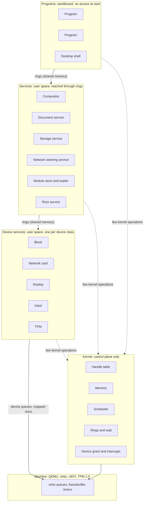
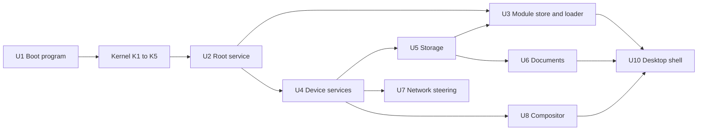
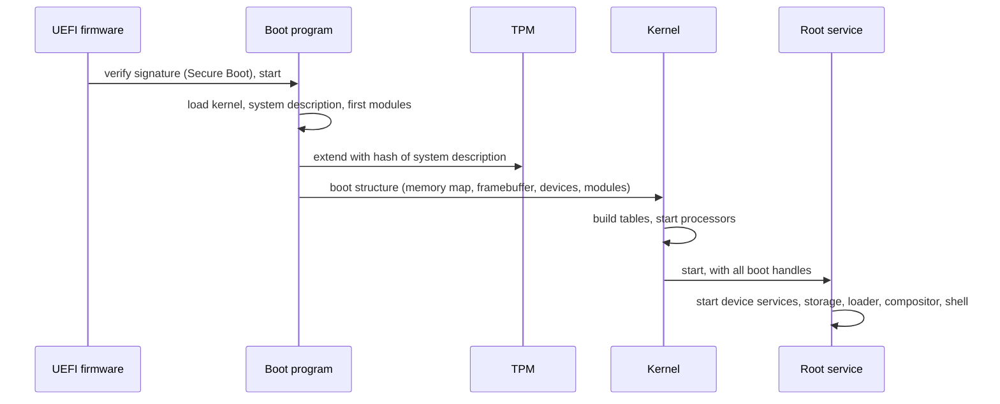
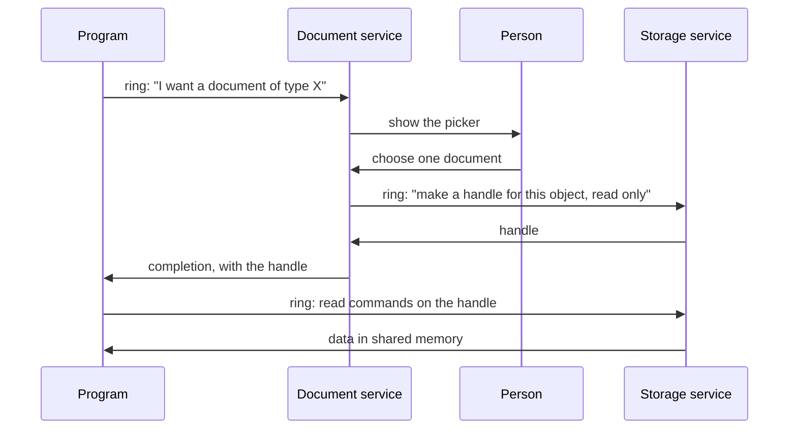
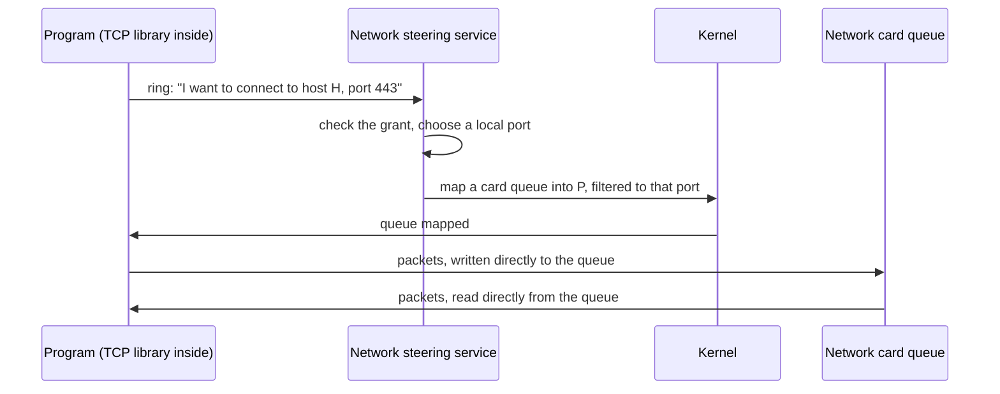

# Architecture

Status: draft 1, 2026-11-09. Proposal for review by the owner. `FIRST_MILESTONE.md` says which parts are implemented, and how.

This document names the key systems and shows how they connect.
It does not design the inside of each system.
`PROPERTIES.md` gives the rules that each system must obey. References such as (P4) point to a property number.

## Vocabulary

`GLOSSARY.md` defines every term of this document.

## The whole system



Solid arrows carry data. They do not enter the kernel (P5, P6).
Dotted arrows are kernel operations. They set up mappings, transfer handles, and wait.

The same picture in text:

```
 Programs            program   program   desktop shell
                        |         |           |
                  ======|=========|===========|======  rings in shared memory
 Services          compositor  documents  storage  network  module store  root
                        |         |           |
                  ======|=========|===========|======  rings in shared memory
 Device services     display    block    network card   input   TPM
                        |         |           |
                  ======|=========|===========|======  device queues, mapped once
 Machine             virtio queues, framebuffer, timers

 Kernel (at the side of every layer, not between the layers):
   handle table | memory | scheduler | rings and wait | device grant and interrupts
```

## Kernel systems

The kernel has five systems. Each one owns a small set of flat tables (P13).

### K1. Handle table

- **Does**: Keeps, per program, the table of handles. Checks the type and the rights of each handle that a kernel operation receives. Moves and copies handles between programs.
- **Owns**: one object table per object type; one handle table per program.
- **Object types**: memory region, address space, program, thread, ring, device queue, interrupt source, timer.
- **Does not**: know names, paths, users or files.

### K2. Memory

- **Does**: Tracks physical page frames. Builds address spaces. Gives "reserve address space", "commit pages", and "map this region in that program" (P14).
- **As implemented** (paging, second part): `Memory_Create` reserves: the budget pays for each page, and each page gets its page frame at its first use, by the program (a page fault) or by the kernel. The flag `Frames_Now` gives all the frames at creation. Map is a separate operation. No access fails for lack of memory: a reserved page always has a free frame.
- **Owns**: the page frame table; one address space record per program; the frame list of each memory object.
- **Does not**: page to disk, cache files, or allocate hidden memory for a caller.

### K3. Scheduler

- **Does**: Chooses which thread runs on each processor. Keeps time. Wakes threads.
- **Owns**: one run queue per processor; the thread table, split in a hot part and a cold part.
- **Does not**: know about priorities of services by name. Policy is data that the root service sets.

### K4. Rings and wait

- **Does**: Creates a ring as a memory region with a fixed layout. Gives the one blocking operation of the system: "wait until one of these rings has entries". Executes the commands that programs put in their kernel ring.
- **Owns**: the ring table; the wait table.
- **Note**: A program has one ring to the kernel. All kernel operations except "enter and wait" are records in that ring. This keeps the count of kernel entry points near one (P1, P4).

### K5. Device grant and interrupts

- **Does**: Maps the queues and registers of one device into one device service. Turns each interrupt into a completion record in a ring. Programs the IOMMU so that a device reaches only the memory of its service.
- **Implemented** (2026-11-10): device memory over the registers of a device (`Device_Create`, kind `Memory`), message interrupts (kind `Message`), and the physical address of a memory object for a holder of the right Physical (`Memory_Physical`). The root service finds the devices on the bus, not the kernel. Not done: the IOMMU.
- **Owns**: the device table; the interrupt routing table.
- **Does not**: contain code for any device (P7).

### What the kernel does not contain

File systems, network protocols, device drivers, the module loader, the module store, graphics, the TPM protocol, names, users.

## User-space systems

### U1. Boot program

A UEFI program (P17). It runs before the kernel.

- Verifies and loads the kernel, the system description and the first modules.
- Measures the system description into the TPM.
- Collects the memory map, the framebuffer and the device list.
- Gives all of this to the kernel in one fixed structure, then leaves the firmware.

### U2. Root service

The first program. The kernel gives it every handle that exists at boot.

- Starts the other services and gives each one only the handles that it needs.
- Holds the system description and the grant records.
- Is the only program that can create access from nothing. All other access is a handle that came from it, directly or through a chain.

### U3. Module store and loader

- **Store**: keeps modules by content hash. Answers "give me the module with this hash". It has no separate index: functions read the flat tables of the modules (P11, P12).
- **Loader**: builds a new program. It asks the kernel for an empty address space, maps the segments of the module and of the modules that it imports, and starts it.
- The loader is in user space. The kernel only maps memory.
- The first modules are loaded by the boot program, because the store does not run yet.

### U4. Device services

One service per device class: block, network card, display, input, TPM.

- Each one owns the queues of its device. It translates between the device protocol and the ring protocol of its class.
- For virtio, this translation is thin, because a virtio device is already a set of queues.
- A program with a granted device queue talks to the device with no service in the path (P5).

### U5. Storage service

- Owns the block device queues. Gives transactional object stores (P9).
- Creates one private store per program. Gives clones and snapshots.
- **Implemented** (2026-11-10, `programs/storage`): a native engine. The owner removed SQLite from the system on 2026-11-10. Copy on write with two places for the root block and a check of each block in the block that names it. The storage service is a service with exports; the root service names the private store of each connection and its limit of blocks. Not done: versions, snapshots, clones. The format of the disk is the contract `store`. A block with a wrong check damages its object only: the service serves the others, and does not give the bytes of a damaged object.

### U6. Document service

- Owns the objects that belong to the person and not to one program.
- Shows the picker that lets the person choose a document. Returns a handle to the program that asked (P2, P8).
- Records each grant, so that the person can list and revoke them.

### U7. Network steering service

- Owns the network identity of the machine: address, ports.
- Gives a program a network queue and a port range, then leaves the data path.
- The TCP stack is a library inside each program (P5).
- **Implemented, first layer** (2026-11-10, `programs/frame`, `programs/network`, `contract/frame`, `contract/datagram`, `support/network`): the frame service drives the virtio network device; the network service is its one client and gives each program with the grant one endpoint of UDP datagrams, with a grant of one remote. Not as written above: the virtio device of QEMU has one pair of queues, so the network service is on the data path (one copy) and writes the headers of UDP and IPv4 that it must check anyway. The plan keeps TCP and QUIC as libraries in the program (choice 194 of `FIRST_MILESTONE.md`).

### U8. Graphics: WebGPU library and compositor

- **WebGPU library**: the one graphics interface, linked into each program that draws. It has one back end per display type. The first back end is software (P18).
- **Compositor**: a service that owns the display. Each program draws into a surface in shared memory. The compositor combines the surfaces and sends input events to the program that has focus.

### U9. Base library

A set of modules that most programs use. It is not a C library and no program is forced to use it.

- Ring access, with blocking functions built above the rings.
- Arena allocators above reserve and commit.
- Functions that give the information of the modules from their flat tables (P12).
- The TCP library.

### U10. Desktop shell

The program that the person sees: starts programs, shows windows, shows grants. It is a normal program with handles from the root service.

## Locks of the kernel

Status: done on 2026-11-10 (the step "the kernel lock split by data", choices of `FIRST_MILESTONE.md`). The code follows this section: no kernel entry takes a lock for all the kernel.

Before this step, one kernel lock covered all kernel data: a processor took it at each kernel entry. The owner decided that the kernel runs on all processors with no single lock as the final design (`HANDOFF.md`, "Full queues and speed", item 8, and "Truly multi-threaded"). A lock protects data: a table, or a part of a table. It does not protect a code path.

### The data of the kernel

Paths: **op** a kernel operation; **tick** the timer of a processor; **dev** a device interrupt; **fault** a page fault of a program; **wake** a word wake, an event or a deadline; **revoke** `Handle_Revoke`; **stop** the stop of a program or of a thread.

| Data | Read by | Written by | Protection | Ties to other data |
|---|---|---|---|---|
| `processors`, `processor_count`, `gates`, `kernel_table`, `frame_count`, `cycle_frequency`, `timer_count`, APIC addresses, `boot_record`, `stage_cycles`, `time_region`, `log_head` | all paths | boot only | none: read-only after boot | |
| Processor record: `current`, `slice_left`, `charged_from`, `busy_time`, `record_thread`, `fpu_area`, the counts of entries, interrupts, faults and locks, the report buffers, the log text buffer | its processor; reports read the counts | its processor only | none: data of one processor | `current` names a thread whose `processor` is this one |
| Processor record: `table` | `unmap`, the cleanup of a program (which processors to synchronize) | its processor only | atomic store and load, ordered with the page table writes | the page table in `cr3` |
| Processor record: `pending`, `idle` | its processor | another processor sets them | atomic | `processor_sync`, the wake of an idle processor |
| Processor record: port bitmap, `ports_loaded`, `ports_serial` | the processor (hardware) | its processor only, in `run` | none: data of one processor | the Ports handles of the program that runs; `program.ports_serial` |
| Run queue of a processor: head, tail, count | its processor, a processor that takes work from it | **op** thread create, **wake**, **tick** (end of a slice), **stop** | run lock of the processor | a thread is in one queue at most |
| Thread: `state`, `processor`, `home`, queue links, `wait_serial`, `woken`, deadline | **wake**, scheduler, `Thread_State`, reports | **op** (wait), **wake**, scheduler, **stop** | run lock of `home` | Ready and not on a processor: in the queue of `home`. A thread leaves its queue and gets its processor in one section of the run lock |
| Thread: `program`, `events`, `finished`, `serial` | **dev** and **stop** (`program_event`), scheduler | **op** (create, under the program lock and the control lock), **stop** (`thread_finish`) | program lock of `program`; `serial` changes for each new thread in the slot | a finished thread has `program` 0 and `events` nil, so `program_event` of its old program never reads the slot again |
| Thread: frame, floating-point state, kernel ring, `in_enter`, `run_time`, `words` | its processor while it runs; a waker reads `words` of a thread that waits | the processor that runs it | the rule of the owner (below) | |
| Thread: `stop_requested` | the processor that runs it | **stop** | atomic | |
| Thread: `references`, `budget` | **op**, **tick** (budget) | **op**, budget end | `references` atomic (a copy of a handle in its own program adds 1 with no control lock); `budget` written under the frame lock | |
| Wait table: buckets of entries (word, thread, serial) | **wake** | **op** (`Word_Wait`), the start of the next entry, **stop** | wait lock of the bucket | an entry is valid while its serial is the `wait_serial` of its thread |
| Program: `handles`, `mappings`, `next_address`, the lower half of its page table, `thread_areas`, `thread_count`, `mapped_pages`, `modules`, `stop`, `state`, `code`, `has_ports` | **op**, **fault**, **revoke**, **stop**, reports | **op**, **fault**, **revoke**, **stop** | program lock | a mapping names a memory object with one reference; a handle names an object with one reference |
| Program: `references` | **op** | **op**, **revoke**, **stop** | atomic; the change to 0 under the control lock | the program runs while a handle names it |
| Program: `holds` | scheduler, **stop**, `stop_wait` | scheduler, **stop** | atomic | the processors that run a thread of it, plus the stop in progress |
| Program: `cleaned`, `serial` | `program_free`, `stop_wait` | `program_cleanup`, `program_create` | control lock; `serial` read with no lock | the slot is free only when `cleaned` and no handle names the program |
| Program: `entries`, `run_time` | reports | **op**, **tick** | atomic | |
| Program: `budget` | **op** (page tables) | budget end | frame lock | |
| Memory object (region): slot (`page_count`), `serial`, `budget` | all paths that hold a handle or a mapping | **op** (create), the last release | frame lock | free frames, reserved pages, pages of budgets |
| Memory object: frame list, `present` | **fault**, **op** (`user_range`, map), **revoke** | **fault**, **op** | region lock of the object | a page with a frame keeps it until the object ends |
| Memory object: `references` | | **op**, **revoke**, **stop** | atomic; the one that makes it 0 frees the object | |
| Frame table: `frame_bits`, `frame_hint`, `free_frames`, `reserved_pages` | **op**, **fault**, reports | **op**, **fault**, **stop** | frame lock | `free_frames` = pages of all budgets + `reserved_pages` |
| Budget: `amounts.pages`, `live` | **op** | **op**, budget end | frame lock | the same invariant |
| Budget: `parent`, `amounts.programs`, `amounts.threads`, limits | **op**, **tick** (`parent`) | **op** (create, end) | control lock; `parent` read with no lock (below) | |
| Budget: `references` | **op** | **op** (copy, close) | atomic; the change to 0 under the control lock | the budget ends when no handle names it |
| Budget: `spent`, `spent_total`, `logged`, `refused` | **tick**, **op** (`Log`) | **tick**, **op** | atomic | |
| Origin table, `revoke_lost`, `revoking` | **op**, **revoke**, **stop** | **op** (map, unmap, give, close), **revoke**, **stop** | origin lock | each holding with links is a live holding |
| Interrupt objects: `interrupt_owner`, `interrupt_references` | **dev** | **op** (create, close) | control lock; **dev** reads `interrupt_owner` with no lock | |
| Interrupt objects: `interrupt_pending` | **op** (`Interrupt_Read`) | **dev** | atomic | |
| `ticks`, the time page | all paths | the tick of the first processor | atomic | |
| Log: the serial port, the log records, `written` | readers in programs | **op** (`Log`), kernel messages | log lock | |
| `machine_stopping` | all processors | `machine_stop` | atomic | |

### The locks, in their order

A processor takes locks only in this order. It takes a lock of a kind only if it holds no lock of a later kind. The kernel checks the order at each take, and stops the machine with a report if it is broken (`LOCK_ORDER_CHECK`). A cycle of waits needs a processor that waits for an earlier kind while it holds a later one: the order forbids it, so no deadlock exists.

1. **Control lock** (one). The paths that change the relations between programs or the life of an object that several programs name: create, start and stop a program; create and stop a thread; give a handle to another program; map or unmap in another program; revoke; close a handle of a program, a thread, a budget, an interrupt or ports; create a budget; create a device object; read the state of another program or thread; the record of a module in another program; the stop of a program on a fault. It is not a temporary lock. These paths touch an unbounded set of programs (a revocation follows the origins through any program; a stop closes handles that stop other programs). One order among them makes each one atomic for the others, with no cycle. They are rare: a program does them when it starts, stops, or gives access, not in its work (property 3). The measures show that the hot paths do not take it.
2. **Program lock** (one for each program). Two at a time only under the control lock, so the order between two program locks does not matter: one processor at most holds two.
3. **Origin lock** (one).
4. **Region lock** (one for each memory object). One at a time.
5. **Frame lock** (one).
6. **Log lock** (one).
7. **Wait lock** (one for each bucket of the wait table). One at a time.
8. **Run lock** (one for each processor). Two at a time only to move a thread from a queue to another, in the order of the processor index.

Interrupts are off in the kernel, so a processor never takes a lock again in an interrupt. A processor that waits for a lock answers `processor_sync` while it waits.

### Rules that keep each path correct

- **The owner of a running thread.** A thread that runs on a processor belongs to that processor: only it reads and writes the frame, the floating-point state, the kernel ring and the word list of the thread. Another processor that stops the thread sets `stop_requested` and sends an interrupt. The processor ends the thread itself, at its next pass in the kernel. No processor takes a thread away from another one.
- **Three rules against the forms of error that a review found** (2026-11-10). (1) A state that is true only between two sections of one lock is a state that another processor sees: a thread is taken from its queue and given to a processor in one section of the run lock (`queue_pick`). (2) A slot named by its index across a wait for a lock can serve another object when the wait ends: a path that names a thread or a program across such a wait also keeps its serial and checks it (`thread_finish`, `stop_wait`), or holds a lock that keeps the slot (`program_free` only after `cleaned`). (3) A state checked before a work must mean that the work is done: Stopped means that the threads were marked, not that the program was cleaned up (`cleaned`); a new thread is refused in a program that is not Created or Ready.
- **A program ends after its last thread leaves its processor.** `holds` counts the processors that run a thread of the program. A stop adds 1, marks the program Stopped, marks each thread (a thread that waits or is in a queue ends at once; a thread on a processor gets `stop_requested`), then subtracts 1 and sets the bit Stopped in the same atomic addition. The one subtraction that leaves exactly the bit Stopped does the cleanup: unmap, close the handles, free the page tables. So no processor uses the page table or the mappings of a program while they are freed, and the cleanup runs one time. The slot of the program is free (`program_free`) only after the cleanup: by the cleanup if no handle names the program, else when the last handle closes.
- **A stop returns after the threads left their processors.** `Thread_Stop` and `Program_Stop` mark the threads under their locks; the operation then frees all its locks and waits until each marked thread that ran on another processor left it (`stop_wait`): after the operation, no thread of what stopped runs an instruction. A wait inside the locks could wait for a thread that waits for these locks. The wait ends at once if the thread that waits is stopped too: two threads that stop each other do not wait for each other.
- **The page tables of a program change under its program lock.** `user_range` and the `user_copy` that follows run under the program lock: no unmap runs between them. An entry that becomes present needs no message to other processors. An entry that becomes 0 (`unmap`, and the undo of a `map_region` that failed on a later page) is followed by `processor_sync` to each processor whose `table` is the table of the program, before the memory object can free a frame. A processor answers `processor_sync` at each kernel entry, in idle, and while it waits for a lock: then it reloads `cr3`, so it keeps no old translation. Two processors that synchronize each other at one time do not wait for ever: each answers while it waits.
- **Pages.** Each move of pages between a budget, the reserved pages and the frame table is one section under the frame lock. So `free_frames` = pages of all budgets + `reserved_pages` holds at each moment that the lock is free, and `System_Report` reads it under the lock. A page fault takes the region lock (to give the frame of one page one time), then the frame lock. The zero fill of a frame is done after the frame lock is free.
- **References.** A reference count is an atomic count. A holder adds 1 only while it holds a handle or a mapping of the object, so a count never goes from 0 to 1. The processor that subtracts the last 1 frees the object: no other processor can name it.
- **Budgets and the tick.** The tick adds the processor time to the budget of the thread and each budget above, with atomic additions, and with no lock. When a budget ends, its objects and its children move to its parent (control lock and frame lock), and its slot is used again only after `processor_sync` to all processors: a tick that walked through the old budget has finished its walk. The log limit uses one word with the second and the count: a record is accepted only if each budget of the chain accepted it; a refusal takes back the counts that it added, in the same second only.
- **The word wait.** A word is named by its physical address. A thread registers each word in the bucket of the word, under the wait lock of the bucket, after it compared the value: a waker changes the word before it enters the kernel, so either the waker finds the entry, or the thread finds the new value. The waker then takes the run lock of the thread: a thread that waits becomes Ready; a thread that still registers (in its own entry) gets `woken` and does not wait. An entry carries the `wait_serial` of its thread; the serial changes when the wait ends, so a late waker of an old wait does not count a thread that runs as woken. A thread removes its entries at its next kernel entry.
- **Revocation.** It holds the control lock. It sets `revoking` and lists the holdings that came from the handle, under the origin lock. While `revoking` is set, a path that adds a holding to the origin tree without the control lock stops and runs again under the control lock, after the revocation. Then the revocation ends each holding under its program lock, after it checks under the origin lock that the tree did not change since it chose the holding: the count of changes travels from the choice of the first holding (`revoke`) through each step (`revoke_under`). If another processor changed the tree, it looks again from the handle: a slot that a close freed can hold a new handle.
- **The kernel half of the page tables** changes only at boot, on one processor. A report reads it and never makes a table (`kernel_entry` with no create).
- **Ports.** A processor changes only its own port bitmap, in `run`, when the program that runs or its `ports_serial` changed. A change of the Ports handles of a program adds 1 to `ports_serial`, then synchronizes all processors: each one checks again before it returns to a program.
- **The scheduler.** Each processor has a run queue. A new thread goes to the queue of the processor that created it; a woken thread goes to the queue of its `home`. If the processor of that queue is idle, the waker sends it an interrupt; else the waker sends one to another idle processor, which takes the thread. When a processor chooses its next thread (after a wait, at the end of a slice, or idle), it takes a thread from the queue of another processor whose load (the threads in its queue, plus 1 if it runs one) is above the count of threads in its own queue. So the ready threads move to the processors that have less, as with one queue for all. The choice of the next thread is in one procedure (`queue_pick`): the step of the scheduling strategies changes it.

## How the systems depend on each other



An arrow means "must exist before". This is also the order of construction.

## Three flows

### Boot



### A program opens a document



The program never sees a path or a list of other documents.
The kernel takes part only to move the handle and to wake the programs.

### A program sends data on the network



After the mapping, the kernel and the service are not in the path.

## Direction

Status: Decided by the owner on 2026-11-09.

- **First use**: a dedicated machine. The system is not a general replacement for an existing desktop at first.
- **Compatibility**: none at first. The project defines a small, fundamental interface that shows its concepts. Later layers are built above it. A POSIX layer and a Win32/NT layer are possible later, as layers above the interface and not as parts of it.
- **Console**: a normal program. It has a terminal: it writes text records and reads key records. A terminal is a normal program too. The system has no terminal concept in the kernel and no equivalent of the Linux TTY.
- **Composition of programs**: the console uses a real programming language. A person calls the exported functions of modules directly, with typed data. The system has no pipes of text and no shell script language.
- **Concepts to research first**: the contract between modules; identity and several machines.
- **Other concepts** (program distribution, failures and quotas, observability, guaranteed latency): the owner expects the answers to come from the design as it grows. They are not researched ahead of need.
- **Persistence**: no save action. Each change goes to storage when it occurs, and storage keeps earlier versions for all programs. See property 9.

## Open questions about the architecture

1. **Kernel ring or direct operations.** Closed on 2026-11-09: kernel ring only. Every kernel operation is a record in the kernel ring, plus one "enter and wait" entry point.
2. **Loader location.** U3 puts the loader in user space. The first programs then need the boot program to load them. The alternative is a minimal loader in the kernel.
3. **Queue filtering for the network.** A program must receive only its own packets. This needs a card with several queues and filters, or a software switch in the network card service. virtio-net under QEMU needs the second form.
4. **Compositor and the WebGPU library.** Which side owns the display device: the compositor alone, or each program through the library.
5. **Root service size.** It holds all power at boot. It must stay small enough to read completely.
6. **Threads.** Closed on 2026-11-09. The owner asked for the choice that Blow would make, and for no complication of the execution model. Choice: a program can have several threads in one address space. A thread is a plain kernel object: a stack and a register state. The system has no `fork`, no signals, no asynchronous runtime, and no thread state hidden in a language runtime. Blow reasons in threads and asks for a thread with limited write permission. [Blow, STAG-2026 00:00] This choice is an inference from his statements, not a quotation. Implemented on 2026-11-10 (`kernel/program.odin`, `system.thread_start`): the kernel operations `Thread_Create`, `Thread_Stop` and `Thread_State`. Each thread has its own kernel ring, so a completion never goes to another thread. The stack is memory of the program: the kernel does not know it. A fault in one thread stops the program, because the threads share all their memory. One processor runs all the threads, with preemption.

## Order of construction

Each step adds one system to a system that already works.

1. U1 boot program, and a kernel that prints.
2. K2 memory, K1 handles, K3 scheduler: two programs run, isolated.
3. K4 rings: the two programs exchange a record.
4. U2 root service: programs get handles from it and not from the kernel.
5. K5 and one device service: the console, then block.
6. U3 module store and loader, then U5 storage.
7. U8 software graphics and compositor, then input.
8. U6 documents, U10 shell.
9. U7 network.
10. Secure Boot and TPM measurement, on the boot program that exists since step 1.
