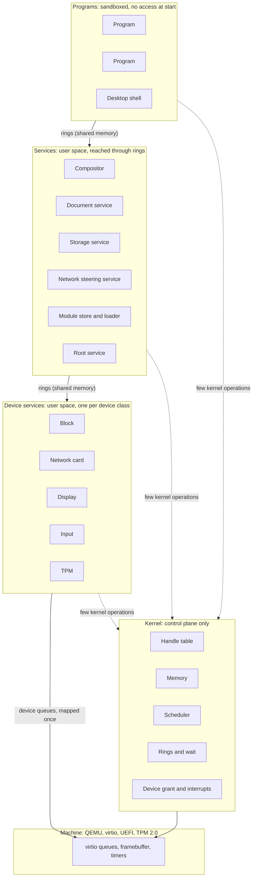
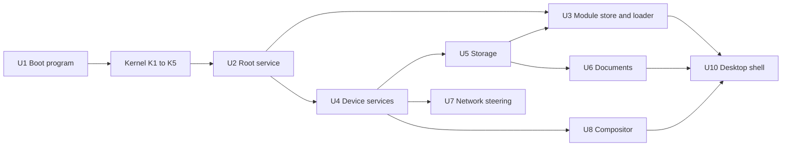
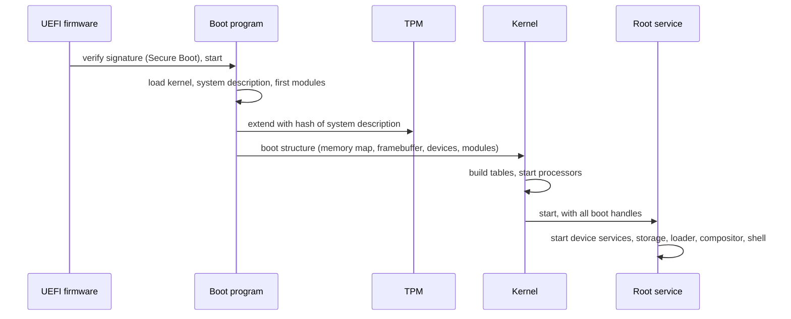
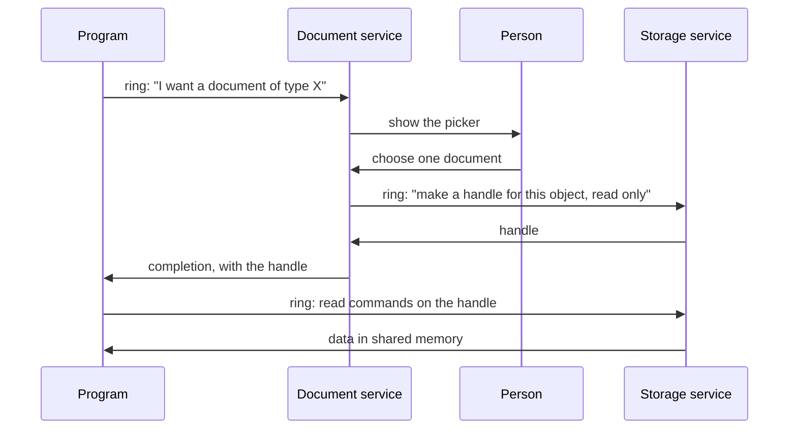
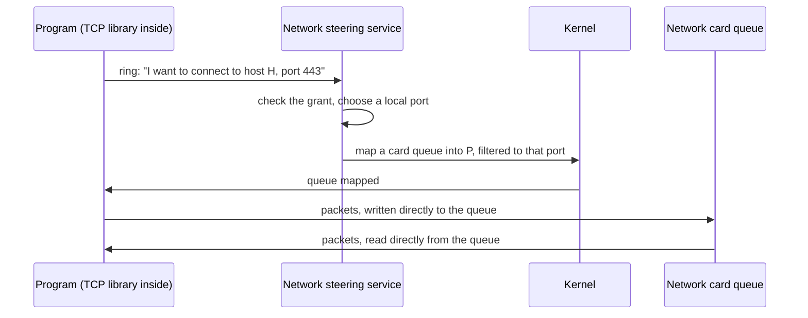

# Architecture

Status: draft 1, 2026-11-09. Proposal for review by the owner. `FIRST_MILESTONE.md` says which parts are implemented, and how.

This document names the key systems and shows how they connect.
It does not design the inside of each system.
`PROPERTIES.md` gives the rules that each system must obey. References such as (P4) point to a property number.

## Vocabulary

`GLOSSARY.md` defines every term of this document.

## The whole system



Solid arrows carry data. They do not enter the kernel (P5, P6).
Dotted arrows are kernel operations. They set up mappings, transfer handles, and wait.

The same picture in text:

```
 Programs            program   program   desktop shell
                        |         |           |
                  ======|=========|===========|======  rings in shared memory
 Services          compositor  documents  storage  network  module store  root
                        |         |           |
                  ======|=========|===========|======  rings in shared memory
 Device services     display    block    network card   input   TPM
                        |         |           |
                  ======|=========|===========|======  device queues, mapped once
 Machine             virtio queues, framebuffer, timers

 Kernel (at the side of every layer, not between the layers):
   handle table | memory | scheduler | rings and wait | device grant and interrupts
```

## Kernel systems

The kernel has five systems. Each one owns a small set of flat tables (P13).

### K1. Handle table

- **Does**: Keeps, per program, the table of handles. Checks the type and the rights of each handle that a kernel operation receives. Moves and copies handles between programs.
- **Owns**: one object table per object type; one handle table per program.
- **Object types**: memory region, address space, program, thread, ring, device queue, interrupt source, timer.
- **Does not**: know names, paths, users or files.

### K2. Memory

- **Does**: Tracks physical page frames. Builds address spaces. Gives "reserve address space", "commit pages", and "map this region in that program" (P14).
- **As implemented** (paging, second part): `Memory_Create` reserves: the budget pays for each page, and each page gets its page frame at its first use, by the program (a page fault) or by the kernel. The flag `Frames_Now` gives all the frames at creation. Map is a separate operation. No access fails for lack of memory: a reserved page always has a free frame.
- **Owns**: the page frame table; one address space record per program; the frame list of each memory object.
- **Does not**: page to disk, cache files, or allocate hidden memory for a caller.

### K3. Scheduler

- **Does**: Chooses which thread runs on each processor. Keeps time. Wakes threads.
- **As implemented** (2026-11-11, `docs/SCHEDULING.md`): three strategies behind one table of six functions (round robin, fair, EEVDF), one for the whole machine, which a program with the right Schedule changes while the system runs (`Strategy_Set`). Wake preemption, also on another processor. A weight and a request for each thread, at its creation.
- **Owns**: one run queue per processor; the thread table, split in a hot part and a cold part.
- **Does not**: know about priorities of services by name. Policy is data that the root service sets.

### K4. Rings and wait

- **Does**: Creates a ring as a memory region with a fixed layout. Gives the one blocking operation of the system: "wait until one of these rings has entries". Executes the commands that programs put in their kernel ring.
- **Owns**: the ring table; the wait table.
- **Note**: A program has one ring to the kernel. All kernel operations except "enter and wait" are records in that ring. This keeps the count of kernel entry points near one (P1, P4).

### K5. Device grant and interrupts

- **Does**: Maps the queues and registers of one device into one device service. Turns each interrupt into a completion record in a ring. Programs the IOMMU so that a device reaches only the memory of its service.
- **Implemented** (2026-11-10): device memory over the registers of a device (`Device_Create`, kind `Memory`), message interrupts (kind `Message`), and the physical address of a memory object for a holder of the right Physical (`Memory_Physical`). The root service finds the devices on the bus, not the kernel. Not done: the IOMMU.
- **Owns**: the device table; the interrupt routing table.
- **Does not**: contain code for any device (P7).

### What the kernel does not contain

File systems, network protocols, device drivers, the module loader, the module store, graphics, the TPM protocol, names, users.

## User-space systems

### U1. Boot program

A UEFI program (P17). It runs before the kernel.

- Verifies and loads the kernel, the system description and the first modules.
- Measures the system description into the TPM.
- Collects the memory map, the framebuffer and the device list.
- Gives all of this to the kernel in one fixed structure, then leaves the firmware.

### U2. Root service

The first program. The kernel gives it every handle that exists at boot.

- Starts the other services and gives each one only the handles that it needs.
- Holds the system description and the grant records.
- Is the only program that can create access from nothing. All other access is a handle that came from it, directly or through a chain.

### U2b. Resources of the boot image

A resource is a file of the boot image that is not a module: data that a program reads in place, such as a pointer theme file (`docs/POINTERS.md`). This section is the one description of the mechanism; each kind of resource has its own format and its own document.

- **In the image** (`contract/boot_info`): after the table of the modules (`Image_Header.count` entries), a second table of `Image_Header.resource_count` entries of the same record, `Image_Entry`: a name of 31 bytes at most, the BLAKE3 hash of the bytes, the offset and the size. Each file starts on a page. A reader of modules reads the first table only, so a resource is never taken for a module; an image with `resource_count` 0 has no resource.
- **Identity** (P11): the hash of the bytes, as for a module. The name is for people and for the code that chooses.
- **The build** (`tools/kerneltool/modules.odin`, `build_boot_image`): a command of the tool makes each resource in `build/` (`kerneltool pointers` today), and `build` puts it in the image with its hash. The same input gives the same bytes: `kerneltool check` builds each resource two times and compares them.
- **The grant** (P8, P20): no program reads the resource table by itself. The root service finds a resource by its name, checks the hash of its bytes against the entry, and gives it to one program as a read-only mapping of the pages of the image at an address of the context, with its size in a value of the context (`programs/root/resources.odin`, `resource_mapping`; the log has "root: the resource pointers_posy (883008 bytes, its hash checked in 1395 us) is given to compositor, read-only"). The program validates the bytes with the reader of its format: the root service checks the identity, not the format. A program with the grant `Image` (the whole image, read-only) finds resources with `system.image_resources` and `system.image_resource_find`.
- **Users**: the compositor (the pointer theme file, `programs/compositor/pointer_picture.odin`) and the program `pointers` (all pointer theme files, through the grant `Image`). The glyph cache of the vector font (`docs/FONTS.md`): the root service checks its hash once at start and maps it into each program with a surface, each terminal and the compositor, with the settings page, whose address is in the value 13 of the context (`programs/root/text_settings.odin`); the size is in the settings page, not in a value.

### U3. Module store and loader

- **Store**: keeps modules by content hash. Answers "give me the module with this hash". It has no separate index: functions read the flat tables of the modules (P11, P12).
- **Loader**: builds a new program. It asks the kernel for an empty address space, maps the segments of the module and of the modules that it imports, and starts it.
- The loader is in user space. The kernel only maps memory.
- The first modules are loaded by the boot program, because the store does not run yet.

### U4. Device services

One service per device class: block, network card, display, input, TPM.

- Each one owns the queues of its device. It translates between the device protocol and the ring protocol of its class.
- For virtio, this translation is thin, because a virtio device is already a set of queues.
- A program with a granted device queue talks to the device with no service in the path (P5).

### U5. Storage service

- Owns the block device queues. Gives transactional object stores (P9).
- Creates one private store per program. Gives versions and clones; a snapshot is the versions of a store at one generation.
- **Implemented** (2026-11-10, `programs/storage`): a native engine. The owner removed SQLite from the system on 2026-11-10. Copy on write with two places for the root block and a check of each block in the block that names it. The storage service is a service with exports; the root service names the private store of each connection and its limit of blocks. Not done: versions, snapshots, clones. The format of the disk is the contract `store`. A block with a wrong check damages its object only: the service serves the others, and does not give the bytes of a damaged object. The open of the disk (`support/storage_mount`) is the same code in the service and in the kernel tool, which checks on the host each image of the disk that a loss of power can leave: the tool serves the data disk with the Network Block Device protocol and knows each write and each flush (`FIRST_MILESTONE.md`, choices 382 to 384 of the power loss).

#### Versions (property 9, "no save action, and versions for all programs")

Designed on 2026-11-11, before the code. The terms are in `GLOSSARY.md`, section Storage.

- **What a version is.** The state of one object at one commit: its size, its list (and through it its blocks of data), the generation and the time of that commit. A version of a whole private store (a snapshot) is not kept apart: the state of a store at a generation G is, for each object, its version with the highest generation at or below G. So one structure serves both, and a program asks for the versions of the object that the person sees.
- **Who makes it.** Each commit that changes an object: the program makes no call for it. The state before the commit goes into the version index of the object; the new state is the current version. A damaged state (a block with a wrong check) is not kept as a version: the change replaces it. A remove ends the object and its versions (an explicit act of the program; see the gaps).
- **Where it is on the disk** (`contract/store`). The object entry names a version index (one block: up to 254 leaf blocks); a leaf holds 85 version entries of 48 bytes (generation, time, date, size, list). Up to 21590 versions for each object. A commit rewrites the index and the leaf that it changes: 2 blocks, copy on write as each other block. The entry of an object grows from 72 to 104 bytes: a table has 39 objects (it had 48).
- **What a version costs.** Nothing more for its bytes: the blocks of the state before a commit are on the disk already, and copy on write never wrote over them. A commit now keeps them in place of making them free. A block of data whose bytes did not change is not written again: the new list names the old block (a shared block), so a change of one block of an object of 32 blocks costs 1 block of data, 1 list, the leaf and the index (and the table and the root, as before). The version holds the blocks that only it names: its list and its changed blocks. The extra writes of each commit: the index and the leaf (2 blocks), and one read of each.
- **The accounting.** The blocks of a store are its distinct blocks: a shared block is counted one time (the reference count of each block, in the memory of the service, made again by the open from the disk). The limit of the store (the grant of the root service) counts the versions too: a program cannot fill the disk with versions (P20, and the rule of the budget: each thing is paid by its owner).
- **Thinning.** The retention rule: each version is kept 10 minutes; after that, one version for each hour (the newest of the hour) until it is one day old; after that, one for each day. The service applies it to an object at a commit of that object, at most one time each minute (a full read of its leaves). At the limit of the store, a change that does not fit thins the oldest versions of the store (the lowest generations, in any object of the store), in the same commit as the change, until it fits: a commit is still one change, and a loss of power never keeps a thinning without its change. The order is the generation: the version that the change itself makes can go too, when each other version of the store is newer. A change that does not fit with every earlier version thinned is refused before any thinning, so a refused change destroys no history: Over_Limit, with the blocks that the current objects need with the change and the limit, and the sentence says "with no earlier version kept". The count of the current objects counts a block that two clones share two times: such a refusal can come early.
- **The time of a version.** Each version keeps the time since the format of the disk (the root block keeps it at each commit; the service adds its own time since its start) and the date (seconds since 1970, UTC; 0 when the system had no date). The age of a version for the retention rule is the smaller of its age by the date and its age by the time since the format (`storage_retention.age`): the date counts the time when no machine ran, but a clock can be wrong on one start (an empty battery) and right on the next, and then the versions of the wrong start would look years old; the time since the format never makes a version older than it is. A date at or after the year 10000 is no date. The generation orders the versions in all cases.
- **The exports** (P19, each with a description and error records). `versions(store, name)`: a Table of the versions (generation, time, date, bytes, the blocks that only this version holds). `version(store, name, generation)`: the bytes. `restore(store, name, generation)`: a commit whose current version has the list of that version (no block of data is written); the current version before it becomes a version. `compare(store, name, first, second)`: a Table of the byte ranges that differ: two equal pointers are equal bytes, so only the blocks that differ are read. `clone(store, name, new_name)`: a new object with the same list. The argument `store` is empty for the store of the caller; another store needs a caller that acts for the person (the console, `remote` for the host): No_Grant Person else.
- **The open and the checks.** The open walks the versions too: each list once, each block of data once, and it counts the names of each block (32 bits: a disk that the engine wrote cannot pass 39 objects of 21590 versions in a store; a count that would pass 2^32 - 1 refuses its commit with Over_Limit, unit References). A count that the format does not permit is damage, as a wrong check: an index of more than 254 leaves, a leaf of 0 or more than 85 entries, a state whose size needs more than 32 blocks. The count of each store is its recount by the open: the blocks under a wrong block are not counted, and they are free in memory too, so they leave the limit of the store (a root whose count is not the recount, in a store with no damage, is a fault of the engine that wrote it: the log says it, and the open takes the recount). A block of a table, an index or a leaf named two times, a block named from two stores, or a count that passes its type, is a fault of the engine: the service makes no change in those stores until its next start (Damaged, unit Counts), and it gives their objects. A commit that would take a count below 0 is refused in the same way: that is a fault of the engine too.
- **Damaged versions.** A version index or a leaf with a wrong check, or with a count that the format does not permit, does not lock its object: the next commit of the object drops those versions (they are not known) and writes no block in their place; its lists are not released, because the open did not count them. A write or a remove of the object works, and thinning at the limit skips them. `versions`, `version` and `restore` of that object give Damaged until then. A list that goes wrong while the service runs keeps its blocks in use until the next start, which counts again: the safe direction, as no block in use is given to another name.
- **Compaction.** The retention rule leaves a few versions in each leaf. When the index has its 254 leaves and the last one is full, the commit moves the versions to the first leaves, in their order (`storage_mount.version_leaves_compact`), and writes them again: up to 254 reads and 254 writes, one time in many commits. At 21590 versions the oldest goes first.
- **The capacities of one commit.** One commit changes the names of at most 65536 blocks and writes at most 1024. A commit that needs more is refused with Full, unit Commit_Blocks, not with a full disk. No store can reach them today: the largest limit is 4500 blocks.
- **The disk format** stays `STORAGE2`: these corrections change no byte of the disk; the counts of names are in memory only, and the open makes them again from the disk. A disk of `STORAGE1` is not read.

#### The date (designed and built on 2026-11-11)

- **Who reads the clock.** A small service, `date`, not the kernel and not the root service: a driver is a program (P7), and the root service gives `date` the two ports of the real-time clock (0x70, 0x71) and the date page with Write, and nothing else. `date` reads the clock at its start, then each 10 s: it waits for the clock to change its second, so the date of the time 0 of the system is exact to about one millisecond (the clock gives whole seconds). Each read has a bound: a clock that never ends an update, or whose registers change at each read, gives no date. Each field is checked in its mode (two decimal digits, or binary; 12 or 24 hours) and its range (`calendar.clock_seconds`, host tests).
- **The year.** The clock gives two digits. The century register is not read: only the ACPI table FADT says if a machine has one, and where, and `date` does not read that table. The two digits give 2020 to 2099; 00 to 19 give no date, because a clock with an empty battery starts again at 2000.
- **The cost of the grant.** The processor gives a program a port, not a value of a port, and not a read alone: the port bitmap of the kernel (`ports_allow`) lets `date` write any index to 0x70 and read or write any byte of the memory of the clock, the settings of the firmware and their check included, and set bit 7 of the index (the mask of the non-maskable interrupt). A narrower grant needs a change of the kernel (a kernel operation that reads named registers of the clock for its caller, or a trap of each access to the two ports); none is written.
- **Where the date lives.** The date page (`contract/date`), on the model of the settings page: one page that the root service creates, with one writer, mapped read-only at a fixed address into each program that the root service starts (the context value 15 gives the address; 0: none). It holds the date of the time 0 of the system, in milliseconds since 1970 UTC. The date of now is that plus `system.time()`: no kernel entry and no call. A change of the page is guarded by an even and odd counter, as the settings page. A reader of the page gives up after 64 reads of a page that changes, or that a writer left in the middle of a change (a writer stopped between its two stores): it gives no date then, and never waits on another program. A date that is not from 1970 to 9999 is no date.
- **What a program does with it.** `support/calendar` gives the year, the month, the day, the time of day and the weekday from seconds since 1970, and back (the algorithm of eras of 400 years), the text of ISO 8601 and the date of HTTP (RFC 9110, IMF-fixdate). Host tests check known dates, the leap years 2000 and 2024, the year 2100 (no leap year), dates before 1970, and each day from 1900 to 2500.
- **The time zone**: a setting of the person, in the page (`zone_offset_seconds`), but no program sets it: the settings service has no such setting yet. The date is in UTC, and the bar says nothing more.
- **Leap seconds** are ignored: a day has 86400 seconds, as in POSIX time and in the real-time clock.
- **Drift.** Between two reads the date follows the time of the system (the cycle counter, with the frequency that the kernel measured at boot). That time drifts: in a full check on a loaded host it ran 22 s behind the clock in 5 minutes. So `date` reads the clock again each 10 s and corrects the page: the date can move by the drift of one interval, forward or back. No network time.
- **Who reads it now.** The bar of the compositor shows the date and the time of day; the HTTP server sends the field Date (RFC 9110, 6.6.1); the storage service keeps the date of each commit and each version, and ages the versions by their date for the retention rule; `date.now()` gives it to a caller, with the remote service for the host.

### U6. Document service

- Owns the objects that belong to the person and not to one program.
- Shows the picker that lets the person choose a document. Returns a handle to the program that asked (P2, P8).
- Records each grant, so that the person can list and revoke them.

### U7. Network steering service

- Owns the network identity of the machine: address, ports.
- Gives a program a network queue and a port range, then leaves the data path.
- The TCP stack is a library inside each program (P5).
- **Implemented, first layer** (2026-11-10, `programs/frame`, `programs/network`, `contract/frame`, `contract/datagram`, `support/network`): the frame service drives the virtio network device; the network service is its one client and gives each program with the grant one endpoint of UDP datagrams, with a grant of one remote. Not as written above: the virtio device of QEMU has one pair of queues, so the network service is on the data path (one copy) and writes the headers of UDP and IPv4 that it must check anyway. The plan keeps TCP and QUIC as libraries in the program (choice 194 of `FIRST_MILESTONE.md`).
- **TCP** (2026-11-11, `support/tcp`, `programs/server`, `programs/fetch`): the design is in `NETWORK.md`. TCP is a library in the program; the network service checks each segment against a client grant or a listen grant, and keeps no state of a connection.

### U7b. The remote service

- The calls of the host: the program `remote` holds an endpoint whose grant names the host, and connections to the services that the root service names for it. The tool encodes an isolated call with the description of the export; `remote` relays it and sends the typed result back. See `MODULE_CONTRACT.md`, section 4, "A call from the host".

### U8. Graphics: WebGPU library and compositor

- **WebGPU library**: the one graphics interface, linked into each program that draws. It has one back end per display type. The first back end is software (P18).
- **Compositor**: a service that owns the display. Each program draws into a surface in shared memory. The compositor combines the surfaces and sends input events to the program that has focus.

### U9. Base library

A set of modules that most programs use. It is not a C library and no program is forced to use it.

- Ring access, with blocking functions built above the rings.
- Arena allocators above reserve and commit.
- Functions that give the information of the modules from their flat tables (P12).
- The TCP library.

### U10. Desktop shell

The program that the person sees: starts programs, shows windows, shows grants. It is a normal program with handles from the root service.

## Locks of the kernel

Status: done on 2026-11-10 (the step "the kernel lock split by data", choices of `FIRST_MILESTONE.md`). The code follows this section: no kernel entry takes a lock for all the kernel.

Before this step, one kernel lock covered all kernel data: a processor took it at each kernel entry. The owner decided that the kernel runs on all processors with no single lock as the final design (`HANDOFF.md`, "Full queues and speed", item 8, and "Truly multi-threaded"). A lock protects data: a table, or a part of a table. It does not protect a code path.

### The data of the kernel

Paths: **op** a kernel operation; **tick** the timer of a processor; **dev** a device interrupt; **fault** a page fault of a program; **wake** a word wake, an event or a deadline; **revoke** `Handle_Revoke`; **stop** the stop of a program or of a thread.

| Data | Read by | Written by | Protection | Ties to other data |
|---|---|---|---|---|
| `processors`, `processor_count`, `gates`, `kernel_table`, `frame_count`, `cycle_frequency`, `timer_count`, APIC addresses, `boot_record`, `stage_cycles`, `time_region`, `log_head`; the tables of the strategies (`STRATEGIES`) and their lengths in cycles (`fair_latency`, `fair_least_turn`, `fair_wake`, `fair_credit`, `tick_cycles`) | all paths | boot only | none: read-only after boot | |
| Processor record: `slice_left`, `charged_from`, `turn_start`, `busy_time`, `record_thread`, the counts of entries, interrupts, faults and locks, the counts of the scheduler (`picks`, `preemptions`, `moves`, `pick_cycles`), the report buffers, the log text buffer | its processor; reports read the counts (`Processor_Report`, volatile loads) | its processor only | none: data of one processor | |
| Processor record: `current` | its processor; a strategy of its run queue (`eevdf_average`, `thread_ready_held`) on any processor, under the run lock; with no lock: `busiest_queue` (a hint), `Processor_Report`, `kernel_interrupt` of its processor, `processors_with_table` and `sync_acknowledge` (atomic loads) | its processor, in `queue_pick` and `schedule` | run lock of the processor (a running thread has this processor as its home) | `current` names a thread whose `processor` is this one |
| Processor record: `look_first` | its processor (`schedule_pick`) | a waker that wakes it from idle (`kick`); its processor clears it | atomic | a hint: a lost or old value gives the pick of before |
| Processor record: `preempted_at` | a waker of a thread whose home is this processor (`thread_ready_held`) | the same | run lock of the processor | at most one wake preemption by another program in each millisecond |
| Processor record: `preempt_from`, `interrupt_preemptions`, `preempt_cycles` | its processor; `Processor_Report` reads the counts | its processor only | none: data of one processor | |
| Processor record: `table` | `unmap`, the cleanup of a program (which processors to synchronize) | its processor only | atomic store and load, ordered with the page table writes | the page table in `cr3` |
| Processor record: `pending`, `idle`, `preempt` | its processor | another processor sets them (`preempt`: `kick`, after a strategy said that a woken thread preempts); its processor clears them | atomic | `processor_sync`, the wake of an idle processor, wake preemption |
| Processor record: port bitmap, `ports_loaded`, `ports_serial` | the processor (hardware) | its processor only, in `run` | none: data of one processor | the Ports handles of the program that runs; `program.ports_serial` |
| Run queue of a processor: head, tail, count, `weight` (the sum of the weights in the list) | its processor, a processor that takes work from it, a strategy; reports read `count` (atomic) | **op** thread create, **wake**, **tick** (end of a turn), **stop** | run lock of the processor | a thread is in one queue at most |
| Run queue: `strategy`, `virtual` (the queue clock) | the strategy functions, `queue_pick`; reports read `strategy` (atomic) | `strategy`: the first processor at boot (`strategy_start`, before the other processors start), then **op** `Strategy_Set` (`queue_convert`); `virtual`: the strategy functions | run lock of the processor | the strategy fields of each thread whose home is this queue are zero or belong to `strategy` |
| `strategy_chosen`, `strategy_changes` | **op** `Strategy_Set`, reports | **op** `Strategy_Set` | atomic | each queue converts to the value that it reads under its run lock |
| Thread: `state`, `processor`, `home`, queue links, `wait_serial`, `woken`, deadline | **wake**, scheduler, `Thread_State`, reports | **op** (wait), **wake**, scheduler, **stop** | run lock of `home` | Ready and not on a processor: in the queue of `home`. A thread leaves its queue and gets its processor in one section of the run lock |
| Thread: the strategy fields `virtual`, `virtual_deadline`, `lag`, `placed` | the strategy of the queue of `home` (**wake**, **tick**, scheduler, **op** `Strategy_Set`) | the same | run lock of `home` | zero, or the state of the strategy of the queue of `home` |
| Thread: `weight`, `request` | the strategies, `queue_push` and `queue_remove` (`Run_Queue.weight`) | **op** thread create, before the thread enters a list | none: written once, before any other processor reads them | |
| Thread: `program`, `events`, `finished`, `serial` | **dev** and **stop** (`program_event`), scheduler | **op** (create, under the program lock and the control lock), **stop** (`thread_finish`) | program lock of `program`; `serial` changes for each new thread in the slot | a finished thread has `program` 0 and `events` nil, so `program_event` of its old program never reads the slot again |
| Thread: frame, extended state area, kernel ring, `in_enter`, `run_time`, `words` | its processor while it runs; a waker reads `words` of a thread that waits | the processor that runs it | the rule of the owner (below) | |
| Thread: `stop_requested` | the processor that runs it | **stop** | atomic | |
| Thread: `references`, `budget` | **op**, **tick** (budget) | **op**, budget end | `references` atomic (a copy of a handle in its own program adds 1 with no control lock); `budget` written under the frame lock | |
| Wait table: buckets of entries (word, thread, serial) | **wake** | **op** (`Word_Wait`), the start of the next entry, **stop** | wait lock of the bucket | an entry is valid while its serial is the `wait_serial` of its thread |
| Program: `handles`, `mappings`, `next_address`, the lower half of its page table, `thread_areas`, `thread_count`, `mapped_pages`, `modules`, `stop`, `state`, `code`, `has_ports` | **op**, **fault**, **revoke**, **stop**, reports | **op**, **fault**, **revoke**, **stop** | program lock | a mapping names a memory object with one reference; a handle names an object with one reference |
| Program: `references` | **op** | **op**, **revoke**, **stop** | atomic; the change to 0 under the control lock | the program runs while a handle names it |
| Program: `holds` | scheduler, **stop**, `stop_wait` | scheduler, **stop** | atomic | the processors that run a thread of it, plus the stop in progress |
| Program: `cleaned`, `serial` | `program_free`, `stop_wait` | `program_cleanup`, `program_create` | control lock; `serial` read with no lock | the slot is free only when `cleaned` and no handle names the program |
| Program: `entries`, `run_time` | reports | **op**, **tick** | atomic | |
| Program: `budget` | **op** (page tables, `Log`, the error record of a refused `Log`) | budget end | frame lock; an atomic store and load. A reader that holds a handle to that budget under the program lock reads it with no frame lock: it changes only when that budget ends | |
| Memory object (region): slot (`page_count`), `serial`, `budget` | all paths that hold a handle or a mapping | **op** (create), the last release | frame lock | free frames, reserved pages, pages of budgets |
| Memory object: frame list, `present` | **fault**, **op** (`user_range`, map), **revoke** | **fault**, **op** | region lock of the object | a page with a frame keeps it until the object ends, or until a decommit |
| Memory object: the state bits of a slot (`SLOT_COMMITTED`, `SLOT_DENY_WRITE`, `SLOT_DENY_EXECUTE`, `SLOT_NO_ACCESS`) | **fault** (`page_give`, `region_frame`), **op** (map, `user_range`, diagnose with no lock: atomic loads) | **op** `Memory_Commit` (commit: region lock and frame lock; decommit: program lock, region lock, frame lock, cache lock), `Memory_Protect` (program lock, region lock); `region_frame` keeps them when it writes a frame | region lock; each slot is one atomic word | a page that is not committed has no frame; the bits of protection only take away from the bits of the mapping |
| Memory object: `uncommitted`, `large_pages` | all paths that hold a handle or a mapping | **op** (create) | frame lock (written before the object has a handle) | |
| Memory object: `committed` | reports (with no lock: one word), the release | **op** `Memory_Commit` | region lock and frame lock | the count of the slots with `SLOT_COMMITTED` (checked at the release in the test build) |
| Mapping: `bits`, `protected` | **fault** (`page_give`), **op**, reports | **op** (map, `Memory_Protect`) | program lock | `bits` is the protection of the mapping now; 0 is no access |
| Mapping: `limit_bits`, `large` | **op** (`Memory_Protect`, unmap), reports | **op** (map) | program lock | `bits` never has more than `limit_bits` |
| Memory object: `marked_pages` | **op** (map, `Handle_Give`, diagnose: atomic loads) | **op** `Memory_Protect` | region lock; atomic | the count of the slots with a mark; not 0: the object is mapped once and not given |
| Processor record: `range_table` | its processor, in `Memory_Commit` and `Memory_Protect` | its processor | none: data of one processor | |
| Memory object: `references` | | **op**, **revoke**, **stop** | atomic; the one that makes it 0 frees the object | |
| Frame table: `frame_bits`, `frame_hint`, `free_frames`, `reserved_pages` | **op**, **fault**, reports | **op**, **fault**, **stop** | frame lock | `free_frames` + the frames of the stacks = pages of all budgets + `reserved_pages` - the `taken` of the stacks |
| Processor record: the frame cache (`frames`, `count`, `taken`) | its processor (**fault**, the end of a memory object); a drain and `System_Report` on any processor | its processor; a drain on any processor | cache lock of the stack; a change of `count + taken` also holds the frame lock | each frame of a stack has its bit set in `frame_bits` and is in no memory object |
| Processor record: the counts of the frame cache (`batches_taken`, `batches_given`, `drains`, `refills`) | `Processor_Report` (with no lock) | under the cache lock of the stack | cache lock | |
| Budget: `amounts.pages`, `live` | **op** | **op**, budget end | frame lock | the same invariant |
| Budget: `parent`, `amounts.programs`, `amounts.threads`, limits | **op**, **tick** (`parent`) | **op** (create, end) | control lock; `parent` read with no lock (below). The limits are written only when the budget is made: a reader that holds a handle to the budget reads them with no lock | |
| Budget: `references` | **op** | **op** (copy, close) | atomic; the change to 0 under the control lock | the budget ends when no handle names it |
| Budget: `spent`, `spent_total`, `logged`, `refused` | **tick**, **op** (`Log`) | **tick**, **op** | atomic | |
| Origin table, `revoke_lost`, `revoking` | **op**, **revoke**, **stop** | **op** (map, unmap, give, close), **revoke**, **stop** | origin lock | each holding with links is a live holding |
| Interrupt objects: `interrupt_owner`, `interrupt_references` | **dev** | **op** (create, close) | control lock; **dev** reads `interrupt_owner` with no lock | |
| Interrupt objects: `interrupt_pending` | **op** (`Interrupt_Read`) | **dev** | atomic | |
| `time_milliseconds`, the time page; `period_time` (the first processor only) | all paths | the tick of the first processor | atomic | |
| Log: the serial port, the log records, `written` | readers in programs | **op** (`Log`), kernel messages | log lock | |
| `machine_stopping` | all processors | `machine_stop` | atomic | |

### The locks, in their order

A processor takes locks only in this order. It takes a lock of a kind only if it holds no lock of a later kind. The kernel checks the order at each take, and stops the machine with a report if it is broken (`TEST_BUILD_CHECKS_LOCK_ORDER`). A cycle of waits needs a processor that waits for an earlier kind while it holds a later one: the order forbids it, so no deadlock exists.

1. **Control lock** (one). The paths that change the relations between programs or the life of an object that several programs name: create, start and stop a program; create and stop a thread; give a handle to another program; map or unmap in another program; revoke; close a handle of a program, a thread, a budget, an interrupt or ports; create a budget; create a device object; read the state of another program or thread; the record of a module in another program; the stop of a program on a fault. It is not a temporary lock. These paths touch an unbounded set of programs (a revocation follows the origins through any program; a stop closes handles that stop other programs). One order among them makes each one atomic for the others, with no cycle. They are rare: a program does them when it starts, stops, or gives access, not in its work (property 3). The measures show that the hot paths do not take it.
2. **Program lock** (one for each program). Two at a time only under the control lock, so the order between two program locks does not matter: one processor at most holds two.
3. **Origin lock** (one).
4. **Region lock** (one for each memory object). One at a time.
5. **Frame lock** (one).
6. **Cache lock** (one for each processor: its stack of free frames). One at a time.
7. **Log lock** (one).
8. **Wait lock** (one for each bucket of the wait table). One at a time.
9. **Run lock** (one for each processor). Two at a time only to move a thread from a queue to another, in the order of the processor index.

Interrupts are off in the kernel, so a processor never takes a lock again in an interrupt. A processor that waits for a lock answers `processor_sync` while it waits.

### Rules that keep each path correct

- **The owner of a running thread.** A thread that runs on a processor belongs to that processor: only it reads and writes the frame, the extended state area, the kernel ring and the word list of the thread. Another processor that stops the thread sets `stop_requested` and sends an interrupt. The processor ends the thread itself, at its next pass in the kernel. No processor takes a thread away from another one.
- **Three rules against the forms of error that a review found** (2026-11-10). (1) A state that is true only between two sections of one lock is a state that another processor sees: a thread is taken from its queue and given to a processor in one section of the run lock (`queue_pick`). (2) A slot named by its index across a wait for a lock can serve another object when the wait ends: a path that names a thread or a program across such a wait also keeps its serial and checks it (`thread_finish`, `stop_wait`), or holds a lock that keeps the slot (`program_free` only after `cleaned`). (3) A state checked before a work must mean that the work is done: Stopped means that the threads were marked, not that the program was cleaned up (`cleaned`); a new thread is refused in a program that is not Created or Ready.
- **A program ends after its last thread leaves its processor.** `holds` counts the processors that run a thread of the program. A stop adds 1, marks the program Stopped, marks each thread (a thread that waits or is in a queue ends at once; a thread on a processor gets `stop_requested`), then subtracts 1 and sets the bit Stopped in the same atomic addition. The one subtraction that leaves exactly the bit Stopped does the cleanup: unmap, close the handles, free the page tables. So no processor uses the page table or the mappings of a program while they are freed, and the cleanup runs one time. The slot of the program is free (`program_free`) only after the cleanup: by the cleanup if no handle names the program, else when the last handle closes.
- **A stop returns after the threads left their processors.** `Thread_Stop` and `Program_Stop` mark the threads under their locks; the operation then frees all its locks and waits until each marked thread that ran on another processor left it (`stop_wait`): after the operation, no thread of what stopped runs an instruction. A stop of a program that another stop already marked waits in the same way: the state Stopped does not say that the threads left. A wait inside the locks could wait for a thread that waits for these locks. The wait ends at once if the thread that waits is stopped too: two threads that stop each other do not wait for each other.
- **The page tables of a program change under its program lock.** `user_range` and the `user_copy` that follows run under the program lock: no unmap runs between them. An entry that becomes present needs no message to other processors. An entry that becomes 0 (`unmap`, and the undo of a `map_region` that failed on a later page) is followed by `processor_sync` to each processor whose `table` is the table of the program, before the memory object can free a frame. A processor answers `processor_sync` at each kernel entry, in idle, and while it waits for a lock: then it reloads `cr3`, so it keeps no old translation. Two processors that synchronize each other at one time do not wait for ever: each answers while it waits.
- **The frame caches** (`kernel/memory.odin`, "The frame cache of each processor"). Each processor has a stack of at most 256 free frames in its processor record, with its own cache lock (kind Cache, after Frame in the order). A first use takes a frame from the stack of its processor under the cache lock only, and counts it in `taken` of the stack: a reserved page that the stack served. An empty stack takes one frame for the page and a batch of 128 for the stack in one section of the frame lock, and subtracts `taken` from `reserved_pages` there. The end of a memory object puts its frames on the stack of its processor (the frame lock is held there for the budget); a full stack gives a batch of 128 back to the frame table in the same section. The invariant, true whenever the frame lock and the cache locks are free: `free_frames + the frames of all stacks = the pages of all budgets + reserved_pages - the taken of all stacks`. Each step keeps it: a take from a stack moves 1 from the frames of the stack to `taken` (the two in one section of the cache lock); a batch and a give back move frames between `free_frames` and a stack under the frame lock and the cache lock; the fold of `taken` moves it to `reserved_pages` under the two. So the sum of each stack (frames + taken) changes only under the frame lock: `System_Report` holds the frame lock and reads each stack under its cache lock, one after the other, and gets the exact difference free pages - reserved pages, with no stop of the other processors. The free pages alone and the reserved pages alone are not values of one instant: a take from a stack after the report read it is in neither sum, a take before is in both. The leak check of the console ("budgets N pages: all the free pages") and the checks of `locks` compare the pages of the budgets with that difference only. When the frame table has no free frame for a take that cannot fail (a reserved page, a list page, a page table) or for a contiguous object, the taker, under the frame lock, takes each cache lock in turn and moves the frames of each stack to the frame table (`caches_drain`), then takes again. No frame can stay in a stack while a take fails: a stack is never touched under a cache lock that waits for the frame lock (the order is frame, then cache), so the drain always gets each stack. Frames on a stack are not zero: a frame gets its zeros when a page takes it, as before, after the locks are free (P20: a program never sees the old content of a frame).
- **Pages.** Each move of pages between a budget, the reserved pages and the frame table is one section under the frame lock. So `free_frames` = pages of all budgets + `reserved_pages` holds at each moment that the lock is free, and `System_Report` reads it under the lock. A page fault takes the region lock (to give the frame of one page one time), then the frame lock. The zero fill of a frame is done after the frame lock is free.
- **References.** A reference count is an atomic count. A holder adds 1 only while it holds a handle or a mapping of the object, so a count never goes from 0 to 1. The processor that subtracts the last 1 frees the object: no other processor can name it.
- **Budgets and the tick.** The tick adds the processor time to the budget of the thread and each budget above, with atomic additions, and with no lock. When a budget ends, its objects and its children move to its parent (control lock and frame lock), and its slot is used again only after `processor_sync` to all processors: a tick that walked through the old budget has finished its walk. The log limit uses one word with the second and the count: a record is accepted only if each budget of the chain accepted it; a refusal takes back the counts that it added, in the same second only.
- **The word wait.** A word is named by its physical address. A thread registers each word in the bucket of the word, under the wait lock of the bucket, after it compared the value: a waker changes the word before it enters the kernel, so either the waker finds the entry, or the thread finds the new value. The waker then takes the run lock of the thread: a thread that waits becomes Ready; a thread that still registers (in its own entry) gets `woken` and does not wait. An entry carries the `wait_serial` of its thread; the serial changes when the wait ends, so a late waker of an old wait does not count a thread that runs as woken. A thread removes its entries at its next kernel entry.
- **Revocation.** It holds the control lock. It sets `revoking` and lists the holdings that came from the handle, under the origin lock. While `revoking` is set, a path that adds a holding to the origin tree without the control lock stops and runs again under the control lock, after the revocation. Then the revocation ends each holding under its program lock, after it checks under the origin lock that the tree did not change since it chose the holding: the count of changes travels from the choice of the first holding (`revoke`) through each step (`revoke_under`). If another processor changed the tree, it looks again from the handle: a slot that a close freed can hold a new handle.
- **The kernel half of the page tables** changes only at boot, on one processor. A report reads it and never makes a table (`kernel_entry` with no create).
- **Ports.** A processor changes only its own port bitmap, in `run`, when the program that runs or its `ports_serial` changed. A change of the Ports handles of a program adds 1 to `ports_serial`, then synchronizes all processors: each one checks again before it returns to a program.
- **The scheduler.** Each processor has a run queue. A new thread goes to the queue of the processor that created it; a woken thread goes to the queue of its `home`. If the processor of that queue is idle, the waker sends it an interrupt; else the waker sends one to another idle processor, which takes the thread. When a processor chooses its next thread (after a wait, at the end of a turn, or idle), it takes a thread from the queue of another processor whose load (the threads in its queue, plus 1 if it runs one) is above the count of threads in its own queue. So the ready threads move to the processors that have less, as with one queue for all. The order inside a queue is the strategy of the queue (`kernel/strategy.odin`, `docs/SCHEDULING.md`): six functions that run under the run lock of the queue (`move` under the two run locks of a move). The time slice (10 ticks) is the longest turn under each strategy, so each processor passes through the balance at least each 10 ms while it has a thread.
- **Wake preemption.** If the home of the woken thread is busy and another processor is idle, the waker wakes that processor and stores the home in its `look_first`, after the exchange of `idle` (the order of the idle protocol does not change); its next pick takes from that queue first. With no idle processor, the waker asks the strategy of the home queue, in the same section of its run lock as the wake, if the woken thread preempts the thread of the home (`processors[home].current`, under the same lock). A thread of another program than the thread of the home preempts that processor at most once in each millisecond (`preempted_at`, under the same run lock). If yes, it ends the turn of its own thread when the home is its processor, else it sets `preempt` of the home and sends an interrupt; the home processor ends the turn of its thread when the interrupt comes from a program. The decision is made under the lock and acted on after it: if the home runs another thread then, that thread loses its turn (one more pass through `schedule`), or the woken thread waits for the end of the turn (at most the time slice). No state is wrong in either case: a turn is not a state of a thread. Interrupts are off in the kernel, so the interrupt arrives either when the processor returns to a program, where it ends the turn, or while it waits idle with no thread, where it clears the flag and the processor picks a thread anyway.
- **The change of strategy** (`Strategy_Set`, `strategy_change`, `queue_convert`). The operation writes `strategy_chosen` (atomic), then for each processor in turn takes its run lock, converts its queue to the value of `strategy_chosen` that it reads under the lock, and frees the lock. It holds the program lock of the caller (`execute_locked`) and one run lock at a time: program before run, so the lock order holds (the test build checks it on each take; the full check ran 104 changes, no report). A conversion changes no list, no `state`, no `home`, no `processor`: no thread leaves a queue or a processor, so no thread is lost. It clears the strategy fields of each thread whose home is the queue and that is in the list, on the processor, or Waiting, sets `strategy`, and places each thread of the list with `ready(New)`, in the order of the list. The invariant: the strategy fields of a thread are zero or belong to the strategy of the queue of its home. The interleavings, step by step:
  1. **The tick of the processor of the queue.** `strategy_tick` takes the same run lock. Before the conversion: the old strategy charges the thread, then the conversion clears its fields. After: the thread is not placed; `strategy_tick` places it with the new strategy (`ready(New)`), then charges it. The strategy word and the fields change in one section, so the tick never sees one without the other.
  2. **A wake on another processor.** The waker takes `run_lock(thread)`, which is the lock of the home (it reads `home` again under the lock). Before the conversion: the thread enters the list, placed by the old strategy; the conversion then clears and places it again (it is in the list). After: the conversion cleared the thread (it was Waiting with this home), and `ready(Woken)` of the new strategy sees it not placed and places it as new. The decision of preemption is made in the same section, with the strategy that the queue has in that section.
  3. **A move.** `queue_move` holds the run locks of the two queues. If the two have the same strategy, its `move` keeps the virtual time or the lag. If they differ (the change visited one queue and not yet the other), `queue_pick` clears the fields of the thread: it runs on its new home not placed, and the strategy of that queue places it at its next tick or when it leaves. After the move, its home is the new queue and its fields are zero: the invariant holds.
  4. **A new thread.** `thread_create` writes the thread record with no run lock, while the thread is Ready, in no list and on no processor, and `home` holds the home of the last thread of the slot. The conversion skips such a thread, so it never writes a record that a creation writes. `thread_queue` then takes the run lock of its processor, stores `home`, and places the thread with the strategy that this queue has in that section; its fields are zero, which is valid for each strategy.
  5. **A stop.** `thread_stop` and `program_stop` take the thread out of its list under the run lock of its home, and `schedule` ends a thread that its processor ran under the same lock: each is one section, before or after a conversion.
  6. **Two changes at one time.** Let B be the operation whose write of `strategy_chosen` is the last one. B visits each queue after its write, and at its visit the word holds the value of B, so the queue gets it; a later visit of another operation reads the same value. So when the last operation returns, each queue has the strategy of the word.

## The virtual memory of a program

Status: design and implementation of 2026-11-11 (owner, 2026-11-10: "a program drives its own virtual memory", "use paging and virtual memory as a design tool"). The terms are in `GLOSSARY.md`: uncommitted object, committed page, decommit, page protection, shoot-down, large page, fault ring.

### What a program can do, and with which operation

| Need | Form | Why this form |
|---|---|---|
| Reserve a range of addresses with no memory behind it | `Memory_Create` with the new flag `Uncommitted`, then `Memory_Map` | An uncommitted object pays only its frame list; its pages are paid when they are committed. The reservation of addresses is the mapping of it: one mapping for a range of any size, so the 128 mappings of a program are not spent by parts of an arena or of a table. No new operation: an object with pages that are not paid yet is a kind of memory object |
| Commit and decommit pages | the new operation `Memory_Commit` (memory, address of a table of `Page_Range`, count, flags): the flag `Decommit` takes pages back | A new operation: the existing ones create an object, map it, unmap it; none changes what the budget pays for some pages of an object that lives. One operation for the two ways, as `Handle_Give` and `Handle_Close` are not one: here the two ways change the same three counts (budget, reserved pages, frames) in opposite directions over the same table |
| Change the protection of pages | the new operation `Memory_Protect` (address of a table of `Address_Range`, count, `Map_Flags`) | The protection of a mapping is set by `Memory_Map` for all its pages; changing it for some pages of a mapping that lives is a new act. The flag `No_Access` is new in `Map_Flags` |
| Large pages | `Memory_Create` with the new flag `Large_Pages` (contiguous, a whole number of 2 MiB, aligned on 2 MiB); `Memory_Map` uses large pages for each 2 MiB that is aligned in the mapping | No new operation: the program asks for an object whose frames can be large pages; the kernel uses them where the mapping allows it |
| A fault that the program answers | the fault ring: designed below, not built in this step | |
| What the program reads about itself | `Program_Mapping` has the committed pages and the flags `Uncommitted`, `Large`, `Protected` | |

Batches: `Memory_Commit` and `Memory_Protect` take a table of ranges in memory of the caller, at most 256 ranges, in one command. The kernel ring already batches 32 commands in one entry, but each command takes the program lock again, checks its handle again, and a protection change does its own shoot-down; a table of ranges in one command takes the lock once, checks the handle once, and does one shoot-down for all the ranges (property 13: many records in one call; property 14: the table is memory of the caller).

### The state of a page

The frame list of an object that is not contiguous has one slot of 8 bytes for each page. A frame is aligned on 4096 bytes, so the low 12 bits of a slot are free; the kernel keeps there the state of the page that is not a frame:

- bit 0, `committed`: only for an uncommitted object. A page of an uncommitted object is committed when its budget paid for it; a page of another object is always committed. A page that is not committed has no frame, and an access to it is a fault.
- bit 1, `deny write`, and bit 2, `deny execute`: the protection of the page is the protection of its mapping less what these bits deny.
- bit 3, `no access`: any access is a fault.

The frame of the slot is `slot & PAGE_ADDRESS`; 0 is no frame. A slot changes under the region lock of the object (a first use) or under the program lock and the region lock (commit, decommit, protection); the frame lock is held where frames or budgets move.

### Who pays a commit (owner, 2026-11-11: "budget delegation")

`Memory_Commit` takes a budget handle as its second argument, and that budget must be the budget of the object: one payer for each object, and the pages of a decommit go back to it. The right Write on the object does not spend the budget of its maker. The handle needs the new right `Commit` (pay pages of an object that this budget already pays for, and nothing else) or `Spend`. `Spend` is wide: it also makes objects, threads, programs and budgets; so a program that lets another one commit gives it the narrow right `Commit`. Delegation uses what exists: A makes a child budget, makes the uncommitted object on it, and gives B the object and the child budget with `Commit` only. A decommit reads no budget handle: it gives pages back to the payer, and it needs an object that only this program names, so B cannot take pages from an object that A uses. The cases, each shown by `address_space` with two programs and its error record:

1. B commits up to the child budget, then one more page: `No_Budget`; the record does not describe the budget, since B's handle has no right Read (choice 231).
2. B has the object with Write and no budget handle: it reads and writes the committed pages; a commit gives `Bad_Handle` (no handle).
3. B makes an object with the `Commit` handle: `No_Right` (the call needs `Spend`).
4. B presents a budget that does not pay for the object: `Bad_Handle`, kind `Not_Payer`: the record says nothing of that budget.
5. A revokes B's budget handle: B commits no more (`Handle_Ended`, revoked); the committed pages stay committed and paid by the child budget.
6. A takes the pages back while B maps the object: A revokes B's object handle (the kernel unmaps B and wakes its waiters), then decommits with no mapping of its own. A cannot decommit under a live B: the pages have entries in B's page table, and the decommit holds one program lock and shoots down one page table.
7. B decommits pages of an object that A holds too: `Bad_State`, kind `Object_Shared`.
8. The child budget ends while the object lives (A closes it after the revocation): the object moves to the parent budget (`budget_release`); a commit then needs the parent's handle; the old handle names nothing.
9. B gives its `Commit` handle on: only with the right `Give`, which A did not give (`No_Right`); a revocation by A reaches each copy through the origin chain.
10. A service that receives an object of a client cannot be made to pay for it (the budget must be the object's), and cannot spend the client's budget without a handle to it.

The open point of the read, verified: a revocation of a budget handle ends the holdings that came from it (handles and mappings), not the objects that were made with it. An object that B made with a `Spend` handle lives on after A revokes the handle, paid by A's budget, and A has no handle to end it (case 10 of the program shows it). This is why the delegation uses `Commit`.

### Commit and decommit

- **Commit** of a range of an uncommitted object: under the program lock of the caller, the region lock of the object and the frame lock, in one section for the table: the budget of the object pays one page for each page that is not committed, `reserved_pages` grows by as much, the bit `committed` is set. A budget that cannot pay the whole table refuses the whole table (`No_Budget`, its error record names the range): no table is half done.
- **Decommit**: the same locks. For each committed page: the bit is cleared; a page with a frame loses its page table entry (the shoot-down below), its frame goes to the frame cache of this processor (in the section of the frame lock, as the end of an object does), `present` of the object falls by one; a page with no frame gives back its reserved page; the budget receives one page for each page. The content of a page that is committed again is zero (a new frame at its first use: P20, ZII).
- Decommit and a protection change of a part of a mapping need an object that only this program names, with one mapping at most (the references of the object are the handles of this program to it and its mapping): its pages have no page table entry in another program, so the shoot-down is the one of this program. Another object gives `Bad_State`, kind `Object_Shared`.
- A thread of the program that waits on a word of a page that is decommitted wakes before the frame returns (its wait names the frame: a later wake through a new frame would not reach it, and the next owner of the frame could wake it).
- One call changes at most `RANGE_TABLE_PAGE_LIMIT` (65 536) pages: each page is walked with interrupts off. A whole protection change of a mapping of 4 KiB pages counts its present pages (it changes only those, and its walk stops after the last of them); a large page counts one. The longest decommit call measured in `address_space` is logged.
- A revocation and a decommit wake the threads with a word in a frame that leaves with one sorted search: the words (at most 256) are sorted, then the slots are read in order with a binary search for each frame, and the walk stops at the last frame of the object. `unmap` walks one table at a time and stops after the last present entry; the release of an object stops after its last frame. What stays: an object whose last page has a frame is one pass over its slots (2 MiB for 1 GiB, read in order), with interrupts off.
- The sums of the frames (`TEST_BUILD_CHECKS_FRAME_SUMS`) hold at each step: a commit moves pages from a budget to `reserved_pages`, a decommit moves them back, or moves a frame to a stack and a page to the budget.

### Protection and the shoot-down

`Memory_Protect` sets, for each page of each range, the protection of the page: Read only, Read and Write, Read and Execute, or `No_Access`. A part of a mapping takes away from the protection of its mapping now, as marks in the slots of its pages; a part that gets the protection of its mapping has no mark, and a whole mapping clears the marks of its pages. While an object has marks (`marked_pages`), it is not mapped again and not given (`Bad_State`, kind `Object_Marked`): the marks are of the object, so they would reach another mapping. The other form, the marks in each mapping (a table of ranges in the mapping), lets an object with parts protected be shared; it costs a table in each of the 128 mappings of each program, or a second table to allocate, for a case that no program needs now; the count is one word and keeps the slots as the one place of the state of a page. It can only take away what the mapping was made with: a range of a mapping made without Write cannot become writable (the handle was checked for the rights of the mapping). Write and Execute together are refused (no page is both). For an object with a frame list, the state is in the slots (above): a page that gets its frame later gets the protection of its slot. For a contiguous object (device memory, large pages) the protection is of the whole mapping: a range must cover the mapping. The page table entries that exist are rewritten; then one `processor_sync` to the processors whose page table is the one of the program, for all the ranges of the call. A processor answers it at its next kernel entry, its idle wait or its wait for a lock, and reloads its page table: it keeps no old translation. The cost is measured with 1, 2 and 4 processors running threads of the program.

### Large pages

An object made with `Large_Pages` takes its frames in one run aligned on 2 MiB (`frames_take_aligned`). A mapping of it uses a large page for each 2 MiB of the mapping whose address and first page are aligned: one entry of the second level, with the bit `PAGE_LARGE`; other parts use 4 KiB pages. The walk of the page table (`page_entry`) gives the entry of the second level for an address in a large page; each path that reads or writes entries knows it: the end of a mapping clears the large entries, the free of the page tables of a program does not free the frame of a large page as a table, the reports count 512 present pages for a large entry. A protection change of a part of a large page is refused (a range must cover the mapping); a decommit of such an object is refused (it is contiguous). The benefit is measured: random reads over 64 MiB, with large pages and with 4 KiB pages of the same object; under QEMU with KVM the numbers are those of the processor of the host, with the nested page tables of the host.

### The addresses that the kernel chooses

A mapping with no address takes the lowest address from `CHOSEN_BASE` where its pages fit with one page with no mapping before and after them: the first gap between the mappings of the program (`chosen_address`, at most 129 passes over the 128 mappings). Before, a counter gave each such mapping a new range: a program that maps and unmaps at each call made new page tables until its budget refused (found by the agent of the tables: a call host refused its 61st call). Now the range of a mapping that ended serves again, with its page tables: `address_space` maps and unmaps one object 100 000 times and its budget is the same after as after the first time.

### The interleavings

The locks: a commit holds the program lock of the caller (the operation), then the region lock of the object, then the frame lock; a decommit also the cache lock of its processor; a protection change the program lock, then for a part the region lock. The order is program, region, frame, cache: the order of the locks of the kernel.

1. **A commit and a first use on another processor.** The first use of a page of the object runs `region_frame`, which reads the slot, then takes the region lock and reads it again. A commit sets `SLOT_COMMITTED` under the region lock. A first use that read the slot before the commit sees a page that is not committed and gives no frame: the program faults, as it accessed a page that was not committed at that moment. A first use after it takes a frame. A commit never takes a frame: there is no frame to lose.
2. **A decommit and a first use.** A decommit holds the program lock for the whole operation, and the program of the object is this one (the object is named only here): each first use of a page of the object comes from a thread of this program, through `page_fault` or `user_range`, which take this program lock. So no frame of the object is given between the first step (the entries are cleared, the shoot-down) and the second (the frames return). The shoot-down comes before the frames go to the frame cache: no processor can write a frame after it is free.
3. **A decommit and a report or a drain.** The frames go to the frame cache of this processor under the frame lock and its cache lock, in the section where the budget and `reserved_pages` change: the sums of the frames hold whenever these locks are free.
4. **A protection change and a thread that runs on another processor.** The entries are rewritten under the program lock; then the shoot-down: each processor whose page table is the one of the program reloads it at its next kernel entry, its idle wait, or its wait for a lock, and the operation returns after each of them did. A thread that used an old entry before that moment used the protection of before; after it returns, no thread does. A page with no entry takes its protection at its first use, under the program lock.
5. **A large page and the free of a table.** A large page is placed where a table of the last level was (a mapping that ended left it): the entry is cleared, the shoot-down runs, then the page of the table returns. A processor that kept the entry of the upper level that names the table forgets it before the table is free.
6. **Another program that names the object.** Decommit and the protection of a part need the references of the object to be this one mapping and the handles of this program: another program that holds a handle to it counts in the references, so it cannot have an entry of a page of the object while the decommit runs.

### The fault ring (designed, not built in this step)

A fault of a program stops it today, with a stop report. The form in the style of the system (no signal: property 16; an error is a value): a program gives the kernel a ring (`Fault_Ring_Set`, with a ring of fault records and the thread that serves it). A thread that faults on a page of a mapping with the flag `Faults_To_Ring` is not stopped: the kernel writes a record (address, kind of access, the thread, the mapping) in the ring, wakes the serving thread, and makes the thread wait. The serving thread commits or changes the protection (the operations above) and answers with `Fault_Resume` (the thread runs the instruction again) or `Fault_Stop` (the program stops as today, with the record). A supervisor program that holds the program handle with Control can serve the ring of another program. What cannot be served: a fault of the serving thread itself, a fault of a thread while the ring is full (the program stops), a fault in the kernel half, a fault in the thread area. The design needs a wait state of a thread that no word ends (only `Fault_Resume`), a record of the ring that names the faulting thread and its serial, and a decision for a thread that stops while it waits for its answer: it is a step of its own, with the review of these states.

## The extended state of the processor

Status: designed and written on 2026-11-11 (owner: "Nah évidemment qu'il faut donc ajouter le support mdrr. On va pas se faire artificiellement limiter par fxsave"). Before this, the kernel saved 512 bytes with `fxsave64` (x87 and SSE) and kept the `CR4` and `XCR0` that the firmware left: a program that used AVX on a firmware that enabled it got the high halves of its ymm registers from another thread, with no error.

Changed on 2026-11-12, after a measure: the kernel saves and restores the extended state only at a switch of threads, and has no vector code (sections 3 and 3a). The form of 2026-11-11 saved at each kernel entry and made each entry 29 to 41 % slower.

The terms are in `GLOSSARY.md`: extended state, state component, extended state area, start state, switch of threads, usable instruction set. The code is `kernel/extended_state.odin`, the save and the restore in `kernel/processor.asm`, the switch in `kernel/schedule.odin`, the check of the build in `tools/kerneltool/vector_check.odin`, and `support/instruction_sets`. The test is the program `extended_state`.

### 1. The state components that the kernel enables

The rule: a bit of `XCR0` is set only if the kernel saves its component. The kernel writes `CR4` and `XCR0` itself on each processor; it does not keep what the firmware left.

| Component | `XCR0` bit | Offset and size in the area (standard form) | Enabled |
|---|---|---|---|
| x87 | 0 | 0, 160 (in the legacy area of 512 bytes) | always |
| SSE (xmm0 to xmm15, `MXCSR`) | 1 | 160, 256 (in the legacy area) | always |
| header (`XSTATE_BV`, `XCOMP_BV`) | none | 512, 64 | with `xsave` |
| AVX (high halves of ymm0 to ymm15) | 2 | 576, 256 | when the processor has AVX |
| MPX (`BNDREGS`, `BNDCSR`) | 3, 4 | 960, 128 | no: MPX is removed from the processors and from the compilers |
| AVX-512 opmask (k0 to k7) | 5 | 1088, 64 | when the processor has AVX-512 F |
| AVX-512 `ZMM_Hi256` (high halves of zmm0 to zmm15) | 6 | 1152, 512 | with the opmask |
| AVX-512 `Hi16_ZMM` (zmm16 to zmm31) | 7 | 1664, 1024 | with the opmask |
| PKRU | 9 | 2688, 8 | no: the kernel does not use protection keys (`CR4.PKE` stays clear) |
| AMX `XTILECFG`, `XTILEDATA` | 17, 18 | 2752, 64 and 2816, 8192 | no: out of scope |

One save therefore writes at most 512 bytes (`fxsave`), 576 (`xsave` with x87 and SSE), 832 (with AVX) or 2688 (with AVX-512). The area of each thread entry is 2688 bytes in every case (section 2). The boot log says both: "kernel: extended state: x87, SSE, AVX; one save writes at most 832 bytes, in an area of 2688 bytes in each thread entry; saved at a switch of threads with xsaveopt". The offsets of the table are those of the processors of Intel and AMD; the kernel does not trust them: after it writes `XCR0`, it reads the size that the processor needs (`CPUID` leaf `0xD`, subleaf 0, `EBX`). If that size is more than the area of a thread, the kernel drops AVX-512 and tries again; x87 and SSE with `xsave` need 576 bytes, which always fit.

Why AVX-512 is in: it costs 1856 more bytes in each thread entry of the thread table of the kernel, and nothing at an entry of a program that does not use it (section 3). Why AMX is out: its tile data is 8 KiB for each thread, and its use needs a permission model (Linux asks each program to request it), and the tile configuration has rules of its own. A program that executes an AMX instruction gets an invalid opcode and stops. It is its own step, if the owner wants it.

On each processor, the kernel sets `CR4.OSFXSR` (bit 9) and `CR4.OSXMMEXCPT` (bit 10). It sets `CR4.OSXSAVE` (bit 18) and writes `XCR0` when the processor has `xsave` and `xsaveopt`, and clears `CR4.OSXSAVE` when it does not. The first processor chooses the components. Each other processor checks that it has the same components with the same offsets and sizes, and sets the same `XCR0`. A processor that does not have them stays stopped, and the kernel logs a line for it: the machine runs on the other processors. The reason: the area of a thread is restored on any processor, so the format must be the same on all. The reason against a lower common choice: the first processor chose before the others started, and the processors of one machine report the same components (Intel and AMD give the same `CPUID` leaf `0xD` on the cores of a hybrid processor).

### 2. Where the area of a thread lives

The area is a fixed field of 2688 bytes, aligned on 64 bytes, in the entry of each thread in the thread table of the kernel (`Thread.extended_state`), as the frame of the general registers is. It is not pages that the budget of the thread pays. The reasons:

- The thread table is already a fixed table of 256 entries. A budget pays for a thread with its `threads` amount: the slot, its frame and its area. The area is a part of the slot, as the frame is.
- Pages of the budget would cost 4096 bytes for each thread for 832 bytes of use, a refusal path in `Thread_Create`, a free in the end of a thread, and a pointer in place of a field.
- The cost: 256 x 2688 bytes = 672 KiB of kernel memory, against 128 KiB with 512 bytes: 544 KiB more, the same on every machine, before any program starts. The processor records do not have an area: a save always goes to the area of the thread that the processor leaves (section 3).

The kernel writes an area at one time only: `Thread_Create` writes the start state. The start state is the bytes of a zero area with the x87 control word `0x037F` (offset 0), `MXCSR` `0x1F80` (offset 24), and, with `xsave`, `XSTATE_BV` = 3 (offset 512): x87 and SSE come from the area, and every other component starts in its init state (zero). With `fxsave`, the header is not read. A new thread therefore never sees a register of another thread.

### 3. When the kernel saves and restores: at a switch of threads only

The rule: **the kernel saves the extended state of a thread only when a processor leaves it for another thread, and restores it only when a processor takes a thread from a run queue. A kernel entry, an interrupt, and the return to the same thread neither save nor restore.** Between a restore and the next save, the registers of the thread stay live through every entry, because no code of the kernel changes an x87, MMX, SSE, AVX or opmask register (section 3a).

The reason is measured (2026-11-12). The first form of this section saved at each entry from a program and restored at each resume, with `xsaveopt64` and `xrstor64`. `kerneltool measure` gave one kernel entry of `locks` in 177 ns on `master` (`fxsave64` at each entry, `fxrstor64` at each resume; two runs within 0.4 %) and in 229 and 249 ns with that form: 29 to 41 % more. On the host (AMD Ryzen 7 5800X, one pinned core, the least of 200 batches, in cycles): `fxsave64` 72, `fxrstor64` 167, `xsaveopt64` 101, `xrstor64` 327, `vzeroupper` 2; the pair is 227 cycles with `fxsave64`, 430 with `xsaveopt64`, and 446 with `xsave64`. The instructions themselves are the cost, and the pair of `master` was already about 60 ns of the 177 ns of an entry. Other kernels save at a switch of threads for the same reason.

The places, all in `kernel/schedule.odin`:

- **A processor leaves a thread** (`schedule`, at the start of the part for the current thread): `extended_state_save` into the area of the thread. This one place covers each way to leave a thread: the end of a time slice (the timer), a wake preemption (the interrupt of another processor), a wait (the word wait, a deadline, a wait for a ring), a stop of the thread or of its program, and a fault of the program. The save comes before the thread can reach another processor: a thread on a processor is in no run queue (`thread_ready_held` only marks it Ready while its `processor` is not 0), it enters a queue only later in `schedule` (`queue_ready`, under the run lock), and the release of the run lock orders the save before the pick of the other processor. An ended thread is saved too; its slot is freed after the save (`thread_finish`), so the save never writes the area of a new thread.
- **A processor takes a thread** (`schedule`, after `schedule_pick`): `extended_state_restore` from the area of the thread, just before `run`. This covers a new thread (its start state), a thread that moved from another processor, and a thread that comes back. It also restores a thread that the processor took just after it left it: a restore costs little at a switch, and the alternative needs a rule of who owns the registers (below).
- **A thread continues after an entry** (`kernel_interrupt` calls `run` for the same thread): nothing. Its registers are live.
- **The idle wait**: nothing. The registers keep the state of the last thread, whose area is complete already.

Not done: a processor that takes again the thread whose state its registers still hold could skip the restore. That needs a field of the processor, "the thread whose state is in the registers, and its serial", set at each restore, and a field of the thread, "the processor whose registers hold its state", set by the processor that restores it, so that a thread that ran elsewhere in between is restored. It saves one restore when a processor runs one thread alone; it is a separate step, with a measure.

The instructions: `xsaveopt64` and `xrstor64` with `EDX:EAX` = all ones (every component that `XCR0` enables); with no `xsave` or no `xsaveopt` on the first processor, `fxsave64` and `fxrstor64`. The first processor chooses the form at boot (`extended_state_form`); the scheduler passes it to the two procedures of `kernel/processor.asm`. No `vzeroupper`: the kernel has no SSE code, so no high half of a ymm register can slow an instruction of the kernel.

Why `xsaveopt64` (Intel SDM, volume 1, sections 13.6 and 13.9): the init optimization (a component in its init state is not written, and `xrstor` sets it to its init state without a read), and the modified optimization (a component that did not change since the last `xrstor` of this processor from this same address is not written). On the host the gain over `xsave64` is small (430 against 446 cycles for the pair); it costs nothing.

The trap of the modified optimization: if another writer changes an area between the `xrstor` of a processor from it and the next `xsaveopt` of that processor into it, the `xsaveopt` can skip a component, and the area keeps the bytes of the other writer. The kernel never makes this case:

- A processor saves a thread only in `schedule`, and that thread is the one that it restored last: it restored it when it took it, and it restores no other area until it leaves it. Between the two, only that thread and the kernel run on the processor, and the kernel restores nothing.
- No other processor writes the area while the thread is on this processor: a thread runs on one processor at a time, and the kernel writes an area only at `Thread_Create`, for a slot whose thread runs nowhere.
- The proofs at boot restore their own areas; the first thread on the first processor is restored before it runs.

A future operation that writes the extended state of a thread (a debugger) writes it only while the thread is on no processor: its area is complete then, and the next restore reads the new bytes. An operation that writes the area of a thread while its state is live on a processor breaks the rule, and must not exist. An operation that reads the extended state of a thread reads it only while the thread is on no processor: while it runs, the area is old.

Why not `xsavec` or `xsaves`: they write the compacted form, whose offsets depend on the components in use; `xsaves` also saves supervisor components (`IA32_XSS`) that the kernel does not use. The standard form has fixed offsets: the start state and the test read them directly.

A processor without `xsave` (a processor of x86-64 before about 2011, the default processor `qemu64` of QEMU, or `-cpu max,-xsave`): the kernel keeps `fxsave64` as its one other form, chosen once at start, and logs it. A processor with `xsave` but no `xsaveopt` (the first AMD processors with AVX, family 15h) gets the `fxsave64` form too.

### 3a. The kernel has no vector code

**A rule of the kernel**: no code that runs in the kernel executes an instruction that reads or changes an x87, MMX, SSE, AVX or opmask register, or `MXCSR`, except the three procedures of `kernel/processor.asm` that save and restore a thread (`extended_state_save`, `extended_state_restore`) and read the registers in the proof at boot (`extended_state_restore_and_read`). An interrupt handler runs kernel code while the registers of the interrupted program are live: the rule holds for it too, with no exception. So do the fault report, the idle wait and each kernel operation.

How the build keeps the rule:

- **The compiled code.** Odin writes the kernel as LLVM IR, and `llc` makes the object (`tools/kerneltool/modules.odin`). The IR has no target features on its functions, so the features of `llc` hold for all of it: `-mattr=-x87,-mmx,-sse,-sse2,-sse3,-ssse3,-sse4.1,-sse4.2,-avx,-avx2,-avx512f,+soft-float` (`KERNEL_TARGET_FEATURES`), the flags that the Linux kernel uses in the form of `llc`. The IR has vector types that the optimizer of Odin made (`<2 x i64>` for loops of copies): `llc` splits them into general registers. Copies of records become moves of general registers, or calls of the copy procedures.
- **Floating point.** The x86-64 calling convention passes `f32` and `f64` values in xmm registers; with no SSE, `+soft-float` passes them in general registers and makes their arithmetic calls of procedures. The kernel has no floating-point value of its own (`grep` of `f16`, `f32`, `f64`, `float` and `core:simd` in `kernel/` finds none). The IR has four procedures of the Odin runtime with floating point, the conversions of `f16` (`__extendhfsf2`, `__gnu_h2f_ieee`, `__truncsfhf2`, `__truncdfhf2`); no code of the kernel calls them, and the link drops them (`--gc-sections`).
- **The copies of memory.** `runtime/memory.asm` has a kernel form (`WITHOUT_VECTOR_REGISTERS`): 17 to 64 bytes in general registers, every read before the first write; more with `rep movsb` and `rep stosb`; a copy down in blocks of 8 bytes. Programs and the boot program keep the form with xmm0 to xmm4. The host tests of the kernel form are in `runtime/without_vector_registers`.
- **The proof.** After the link of the kernel, the build disassembles it (`llvm-objdump -d`, AT&T syntax) and refuses it when an instruction outside the three procedures names `%xmm`, `%ymm`, `%zmm`, `%st`, `%mm` or `%k0` to `%k7`, or is an x87, VEX, EVEX or opmask instruction, `emms`, `ldmxcsr`, `stmxcsr`, `xsave` or `xrstor` (`tools/kerneltool/vector_check.odin`, with its host tests). The start code of the other processors is in the data section and is not executed in the kernel's mode of 64 bits before `processor_entry`; its `fninit` and `ldmxcsr` run before any thread.
- **Modules.** No module of a program runs in the kernel: the kernel is one module, `kernel = true` in the module table, and only that module is built with these features and checked. A module that would run in the kernel gets the same features and the same check.

### 4. The cost

| | `master` (`fxsave64`, `fxrstor64` at each entry and resume) | Now |
|---|---|---|
| Each kernel entry that returns to the same thread | one save and one restore: 227 cycles on the host | nothing: the entry does not touch the extended state |
| Each switch of threads on a processor | one entry and one resume, as above | one save of the thread that leaves and one restore of the thread that comes: `xsaveopt64` and `xrstor64`, 430 cycles on the host for x87 and SSE |
| A thread that uses the ymm high halves | it could not, with a correct result | + 256 bytes in the save and the restore of each switch |
| A thread that uses AVX-512 | it could not | up to + 1600 bytes in each switch (the opmask and the two parts of zmm) |
| A thread that never used AVX | | the AVX component stays in its init state: `xsaveopt` writes nothing of it, and `xrstor` reads nothing of it |

What the coordinator measures (`kerneltool measure`):

- `locks: kernel entries in one second, each locker on its own objects: 1 locker ...`: one entry with no switch; compare with 5 657 386 and 5 634 346 on `master`.
- `locks: word wait, two threads wake each other: ...`: each wake is a switch; it pays the save and the restore that the entries no longer pay.
- `extended_state: a hand-over between two threads by the word wait (...): ... ns with x87 and SSE in use, ... ns with the ymm high halves in use`: the cost of one switch with each state, in the program.
- `extended_state: the parts of a save and a restore, each alone in this program, ...` and `each instruction alone ...`: the cycles of each instruction of the save and the restore on the machine, measured by the program on its own area (`fxsave`, `xsave`, `xsaveopt` and `xrstor` are not privileged).
- `extended_state: an empty kernel entry, 100000 times: ...`: with xmm, ymm or zmm in use, now the same entry.

### 5. A hostile program

- **Can a program write its own area?** No. The area is in the thread table of the kernel, in the kernel half of the address space, whose pages no program maps (the page tables of the kernel half have no user bit, and the paging audit of each boot proves it). The processor writes the area at a switch; the kernel writes the start state; no kernel operation copies bytes of a program into an area.
- **A bad header.** `xrstor` faults (general protection) when a bit of `XSTATE_BV` is set for a component that `XCR0` does not enable, or when bytes 8 to 23 of the header (`XCOMP_BV` at offset 520, and the 8 bytes after it) are not zero in the standard form (Intel SDM, volume 1, section 13.8.1). Such a fault in `schedule` is a fault of the kernel and stops the machine. The kernel never makes such a header: the start state has `XSTATE_BV` = 3 and zeros after it, and an `xsaveopt` writes only bits of `XCR0`, which is the same on each processor that runs threads. The first processor runs two proofs at boot, before any program, and stops the machine with a sentence if one fails. First it restores an area with an x87 control word (`0x027F`), an `MXCSR` (`0x3F80`), the low half of xmm0 and, with AVX, the high half of ymm0 that are not their init state, and reads the registers back in the same routine: so the processor reads these values where the kernel writes them. Then it restores the start state and saves it again: this shows only that the start state does not fault and that the header of a save has no bit outside `XCR0`, because x87 and SSE in the start state are their init state, which `xsaveopt` does not write.
- **`MXCSR`.** `fxrstor` and `xrstor` fault if a reserved bit of `MXCSR` is set. `MXCSR` in an area comes from the start state (`0x1F80`) or from a save of the register. A program sets the register only with `ldmxcsr`, `fxrstor` or `xrstor` of its own memory, and these fault in the program (the program stops) when a reserved bit is set. So the register never holds a reserved bit, and a save never writes one.
- **The state of the program in the kernel.** The kernel runs with the registers, the `MXCSR` and the x87 control word of the program that entered. It never uses them (section 3a), so no value of a program can make the kernel fault, and the kernel cannot change a register of a program.

### 6. How a program knows what it can use

With no kernel operation: the processor tells it. `CPUID` leaf 1 gives `OSXSAVE` (`ECX` bit 27), which is the bit `CR4.OSXSAVE` that the kernel set; with it, `xgetbv` with `ECX` = 0 reads `XCR0`, the components that the kernel saves. An instruction set is usable when the processor has it (`CPUID` leaves 1 and 7) and when the kernel saves its registers. `support/instruction_sets` reads both once (`cpuid` and `xgetbv` as `asm` templates) and gives a `bit_set` of usable instruction sets: SSE to SSE4.2, POPCNT, AES, PCLMULQDQ; AVX, F16C, FMA, AVX2 when `XCR0` has x87, SSE and AVX; AVX-512 F, DQ, CD, BW, VL when `XCR0` also has the three AVX-512 components; BMI1 and BMI2, which use general registers. A program reads it once at its start: `CPUID` is slow in a virtual machine (an exit to the host). A program that uses an instruction that is not usable stops with an invalid opcode, its own fault.

### 7. The other parts

- **The other processors**: the start code of a processor sets `CR4` to `0x620` (PAE, `OSFXSR`, `OSXMMEXCPT`) before the kernel runs there; `processor_entry` writes the `CR4` of the first processor without `OSXSAVE`, then the extended state setup of section 1.
- **The idle wait**: a processor with no thread saves and restores nothing: it saved the last thread when it left it.
- **The boot program** (UEFI): not changed. It runs before the kernel, with the `CR4` of the firmware, and uses no AVX.
- **The faults of the kernel**: an interrupt or a fault of the kernel saves nothing, and the report of a fault of the kernel reads no extended state.
- **The readers of the state of a thread**: none. `Thread_State`, the reports of `Inspect` and the stop report of a program give no register of the extended state; the area is read only by the restore. A future reader (a debugger) reads a thread that is on no processor (section 3).
- **A thread that ends**: it is saved when its processor leaves it, then its slot is freed; the next thread of the slot gets the start state.

## How the systems depend on each other



An arrow means "must exist before". This is also the order of construction.

## Three flows

### Boot



### A program opens a document



The program never sees a path or a list of other documents.
The kernel takes part only to move the handle and to wake the programs.

### A program sends data on the network



After the mapping, the kernel and the service are not in the path.

## Direction

Status: Decided by the owner on 2026-11-09.

- **First use**: a dedicated machine. The system is not a general replacement for an existing desktop at first.
- **Compatibility**: none at first. The project defines a small, fundamental interface that shows its concepts. Later layers are built above it. A POSIX layer and a Win32/NT layer are possible later, as layers above the interface and not as parts of it.
- **Console**: a normal program. It has a terminal: it writes text records and reads key records. A terminal is a normal program too. The system has no terminal concept in the kernel and no equivalent of the Linux TTY.
- **Composition of programs**: the console uses a real programming language. A person calls the exported functions of modules directly, with typed data. The system has no pipes of text and no shell script language.
- **Concepts to research first**: the contract between modules; identity and several machines.
- **Other concepts** (program distribution, failures and quotas, observability, guaranteed latency): the owner expects the answers to come from the design as it grows. They are not researched ahead of need.
- **Persistence**: no save action. Each change goes to storage when it occurs, and storage keeps earlier versions for all programs. See property 9.

## Open questions about the architecture

1. **Kernel ring or direct operations.** Closed on 2026-11-09: kernel ring only. Every kernel operation is a record in the kernel ring, plus one "enter and wait" entry point.
2. **Loader location.** U3 puts the loader in user space. The first programs then need the boot program to load them. The alternative is a minimal loader in the kernel.
3. **Queue filtering for the network.** A program must receive only its own packets. This needs a card with several queues and filters, or a software switch in the network card service. virtio-net under QEMU needs the second form.
4. **Compositor and the WebGPU library.** Which side owns the display device: the compositor alone, or each program through the library.
5. **Root service size.** It holds all power at boot. It must stay small enough to read completely.
6. **Threads.** Closed on 2026-11-09. The owner asked for the choice that Blow would make, and for no complication of the execution model. Choice: a program can have several threads in one address space. A thread is a plain kernel object: a stack and a register state. The system has no `fork`, no signals, no asynchronous runtime, and no thread state hidden in a language runtime. Blow reasons in threads and asks for a thread with limited write permission. [Blow, STAG-2026 00:00] This choice is an inference from his statements, not a quotation. Implemented on 2026-11-10 (`kernel/program.odin`, `system.thread_start`): the kernel operations `Thread_Create`, `Thread_Stop` and `Thread_State`. Each thread has its own kernel ring, so a completion never goes to another thread. The stack is memory of the program: the kernel does not know it. A fault in one thread stops the program, because the threads share all their memory. One processor runs all the threads, with preemption.

## Order of construction

Each step adds one system to a system that already works.

1. U1 boot program, and a kernel that prints.
2. K2 memory, K1 handles, K3 scheduler: two programs run, isolated.
3. K4 rings: the two programs exchange a record.
4. U2 root service: programs get handles from it and not from the kernel.
5. K5 and one device service: the console, then block.
6. U3 module store and loader, then U5 storage.
7. U8 software graphics and compositor, then input.
8. U6 documents, U10 shell.
9. U7 network.
10. Secure Boot and TPM measurement, on the boot program that exists since step 1.
