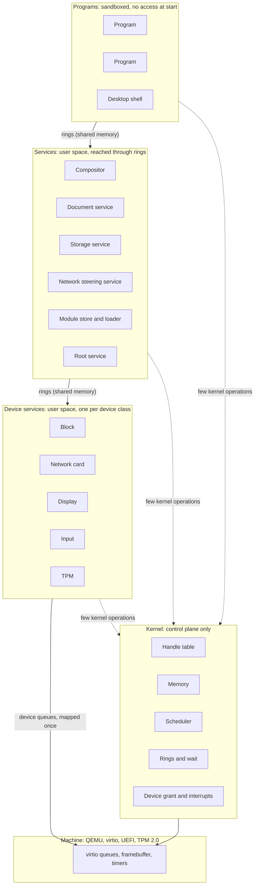
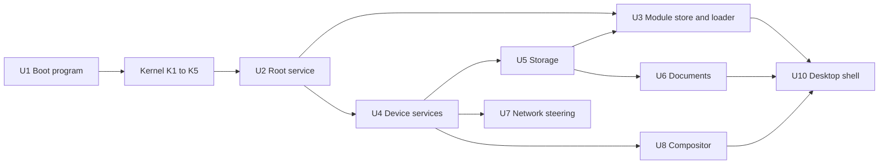
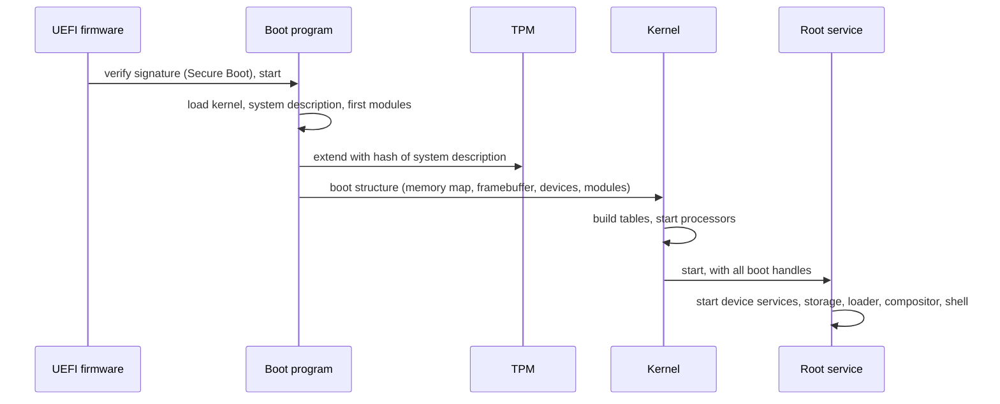
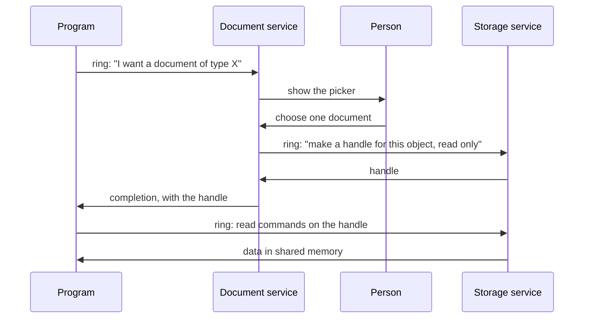
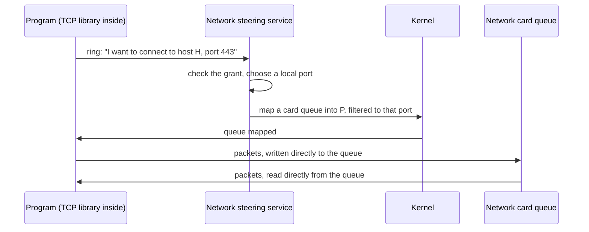

# Architecture

Status: draft 1, 2026-11-09. Proposal for review by the owner. `FIRST_MILESTONE.md` says which parts are implemented, and how.

This document names the key systems and shows how they connect.
It does not design the inside of each system.
`PROPERTIES.md` gives the rules that each system must obey. References such as (P4) point to a property number.

## Vocabulary

`GLOSSARY.md` defines every term of this document.

## The whole system



Solid arrows carry data. They do not enter the kernel (P5, P6).
Dotted arrows are kernel operations. They set up mappings, transfer handles, and wait.

The same picture in text:

```
 Programs            program   program   desktop shell
                        |         |           |
                  ======|=========|===========|======  rings in shared memory
 Services          compositor  documents  storage  network  module store  root
                        |         |           |
                  ======|=========|===========|======  rings in shared memory
 Device services     display    block    network card   input   TPM
                        |         |           |
                  ======|=========|===========|======  device queues, mapped once
 Machine             virtio queues, framebuffer, timers

 Kernel (at the side of every layer, not between the layers):
   handle table | memory | scheduler | rings and wait | device grant and interrupts
```

## Kernel systems

The kernel has five systems. Each one owns a small set of flat tables (P13).

### K1. Handle table

- **Does**: Keeps, per program, the table of handles. Checks the type and the rights of each handle that a kernel operation receives. Moves and copies handles between programs.
- **Owns**: one object table per object type; one handle table per program.
- **Object types**: memory region, address space, program, thread, ring, device queue, interrupt source, timer.
- **Does not**: know names, paths, users or files.

### K2. Memory

- **Does**: Tracks physical page frames. Builds address spaces. Gives "reserve address space", "commit pages", and "map this region in that program" (P14).
- **Owns**: the page frame table; one address space record per program.
- **Does not**: page to disk, cache files, or allocate hidden memory for a caller.

### K3. Scheduler

- **Does**: Chooses which thread runs on each processor. Keeps time. Wakes threads.
- **Owns**: one run queue per processor; the thread table, split in a hot part and a cold part.
- **Does not**: know about priorities of services by name. Policy is data that the root service sets.

### K4. Rings and wait

- **Does**: Creates a ring as a memory region with a fixed layout. Gives the one blocking operation of the system: "wait until one of these rings has entries". Executes the commands that programs put in their kernel ring.
- **Owns**: the ring table; the wait table.
- **Note**: A program has one ring to the kernel. All kernel operations except "enter and wait" are records in that ring. This keeps the count of kernel entry points near one (P1, P4).

### K5. Device grant and interrupts

- **Does**: Finds the devices that the boot program reported. Maps the queues and registers of one device into one device service. Turns each interrupt into a completion record in a ring. Programs the IOMMU so that a device reaches only the memory of its service.
- **Owns**: the device table; the interrupt routing table.
- **Does not**: contain code for any device (P7).

### What the kernel does not contain

File systems, network protocols, device drivers, the module loader, the module store, graphics, the TPM protocol, names, users.

## User-space systems

### U1. Boot program

A UEFI program (P17). It runs before the kernel.

- Verifies and loads the kernel, the system description and the first modules.
- Measures the system description into the TPM.
- Collects the memory map, the framebuffer and the device list.
- Gives all of this to the kernel in one fixed structure, then leaves the firmware.

### U2. Root service

The first program. The kernel gives it every handle that exists at boot.

- Starts the other services and gives each one only the handles that it needs.
- Holds the system description and the grant records.
- Is the only program that can create access from nothing. All other access is a handle that came from it, directly or through a chain.

### U3. Module store and loader

- **Store**: keeps modules by content hash. Answers "give me the module with this hash". Its index is a SQLite database (P11, P12).
- **Loader**: builds a new program. It asks the kernel for an empty address space, maps the segments of the module and of the modules that it imports, and starts it.
- The loader is in user space. The kernel only maps memory.
- The first modules are loaded by the boot program, because the store does not run yet.

### U4. Device services

One service per device class: block, network card, display, input, TPM.

- Each one owns the queues of its device. It translates between the device protocol and the ring protocol of its class.
- For virtio, this translation is thin, because a virtio device is already a set of queues.
- A program with a granted device queue talks to the device with no service in the path (P5).

### U5. Storage service

- Owns the block device queues. Gives transactional object stores (P9).
- Creates one private store per program. Gives clones and snapshots.
- First version: SQLite on the raw block device. Later: a native engine below the same interface.

### U6. Document service

- Owns the objects that belong to the person and not to one program.
- Shows the picker that lets the person choose a document. Returns a handle to the program that asked (P2, P8).
- Records each grant, so that the person can list and revoke them.

### U7. Network steering service

- Owns the network identity of the machine: address, ports.
- Gives a program a network queue and a port range, then leaves the data path.
- The TCP stack is a library inside each program (P5).

### U8. Graphics: WebGPU library and compositor

- **WebGPU library**: the one graphics interface, linked into each program that draws. It has one back end per display type. The first back end is software (P18).
- **Compositor**: a service that owns the display. Each program draws into a surface in shared memory. The compositor combines the surfaces and sends input events to the program that has focus.

### U9. Base library

A set of modules that most programs use. It is not a C library and no program is forced to use it.

- Ring access, with blocking functions built above the rings.
- Arena allocators above reserve and commit.
- SQLite.
- The TCP library.

### U10. Desktop shell

The program that the person sees: starts programs, shows windows, shows grants. It is a normal program with handles from the root service.

## How the systems depend on each other



An arrow means "must exist before". This is also the order of construction.

## Three flows

### Boot



### A program opens a document



The program never sees a path or a list of other documents.
The kernel takes part only to move the handle and to wake the programs.

### A program sends data on the network



After the mapping, the kernel and the service are not in the path.

## Direction

Status: Decided by the owner on 2026-11-09.

- **First use**: a dedicated machine. The system is not a general replacement for an existing desktop at first.
- **Compatibility**: none at first. The project defines a small, fundamental interface that shows its concepts. Later layers are built above it. A POSIX layer and a Win32/NT layer are possible later, as layers above the interface and not as parts of it.
- **Console**: a normal program. A console is one buffer that a program draws into. The system has no terminal concept in the kernel and no equivalent of the Linux TTY.
- **Composition of programs**: the console uses a real programming language. A person calls the exported functions of modules directly, with typed data. The system has no pipes of text and no shell script language.
- **Concepts to research first**: the contract between modules; identity and several machines.
- **Other concepts** (program distribution, failures and quotas, observability, guaranteed latency): the owner expects the answers to come from the design as it grows. They are not researched ahead of need.
- **Persistence**: no save action. Each change goes to storage when it occurs, and storage keeps earlier versions for all programs. See property 9.

## Open questions about the architecture

1. **Kernel ring or direct operations.** Closed on 2026-11-09: kernel ring only. Every kernel operation is a record in the kernel ring, plus one "enter and wait" entry point.
2. **Loader location.** U3 puts the loader in user space. The first programs then need the boot program to load them. The alternative is a minimal loader in the kernel.
3. **Queue filtering for the network.** A program must receive only its own packets. This needs a card with several queues and filters, or a software switch in the network card service. virtio-net under QEMU needs the second form.
4. **Compositor and the WebGPU library.** Which side owns the display device: the compositor alone, or each program through the library.
5. **Root service size.** It holds all power at boot. It must stay small enough to read completely.
6. **Threads.** Closed on 2026-11-09. The owner asked for the choice that Blow would make, and for no complication of the execution model. Choice: a program can have several threads in one address space. A thread is a plain kernel object: a stack and a register state. The system has no `fork`, no signals, no asynchronous runtime, and no thread state hidden in a language runtime. Blow reasons in threads and asks for a thread with limited write permission. [Blow, STAG-2026 00:00] This choice is an inference from his statements, not a quotation. Implemented on 2026-11-10 (`kernel/program.odin`, `system.thread_start`): the kernel operations `Thread_Create`, `Thread_Stop` and `Thread_State`. Each thread has its own kernel ring, so a completion never goes to another thread. The stack is memory of the program: the kernel does not know it. A fault in one thread stops the program, because the threads share all their memory. One processor runs all the threads, with preemption.

## Order of construction

Each step adds one system to a system that already works.

1. U1 boot program, and a kernel that prints.
2. K2 memory, K1 handles, K3 scheduler: two programs run, isolated.
3. K4 rings: the two programs exchange a record.
4. U2 root service: programs get handles from it and not from the kernel.
5. K5 and one device service: the console, then block.
6. U3 module store and loader, then U5 storage.
7. U8 software graphics and compositor, then input.
8. U6 documents, U10 shell.
9. U7 network.
10. Secure Boot and TPM measurement, on the boot program that exists since step 1.
