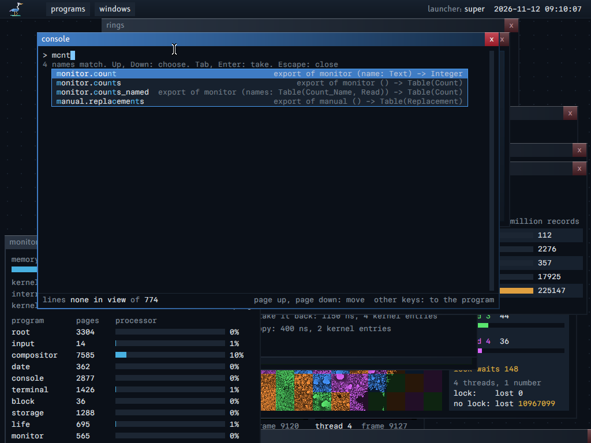
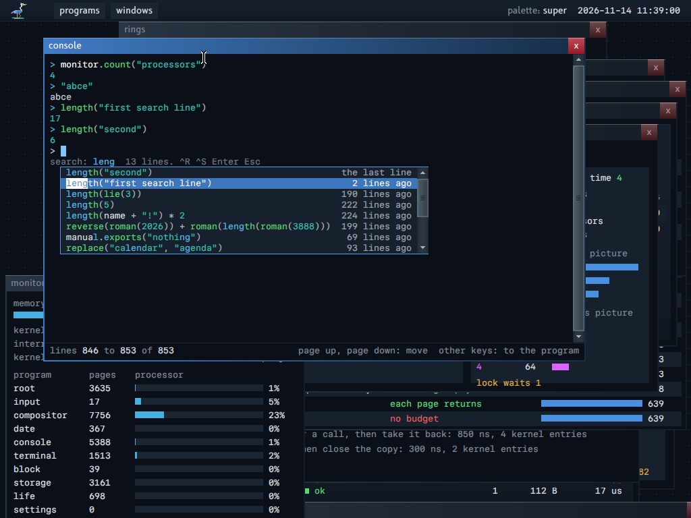
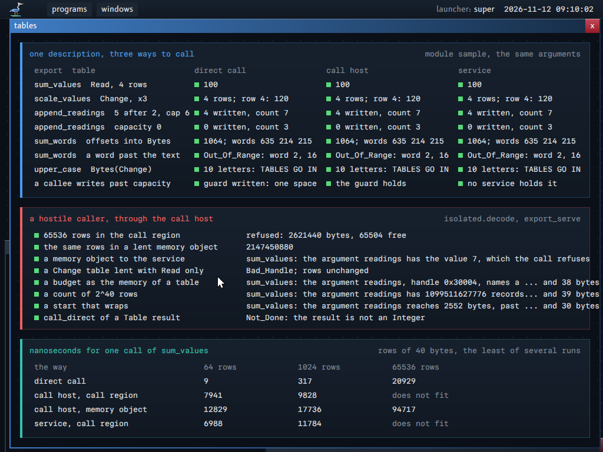

# The line of the console

This guide describes the line that is typed at the console: the language that the line is written in, the keys that edit it, the completion list that opens while it is typed, the line history that survives a stop, and the colors of its code.

## About this guide

**The idea in plain words.** The console is the program in which the principal calls the functions of the system directly, with typed values, in place of a shell that passes text to programs. Each name that it can call comes from the description of a module, so the console can complete every name and show the signature of every call while the line is typed, with no code in the called program.

**For whom.** A reader who uses the console, and a reader who changes `programs/console`, `support/line_editor` or `support/terminal`.

**Read before.** `PROPERTIES.md`, "19. A command is a function: no text between programs". The terms edit line, line editor, hint line, free row, completion list, chosen row, fuzzy match, line history, history search and terminal are in `GLOSSARY.md`, group Communication.

**The map of this guide.**

| Section | What it says |
|---|---|
| "The language of the console" | What a line can say: values and their kinds, calls, variables, records, tables as values, how a line composes, and its errors |
| "1. The keys" | What each key does, with the list closed, the completion list open, or the history search open |
| "2. What the console completes" | Which names come where the caret is, and from which table |
| "3. The fuzzy match" | How a query matches a name, and the score that orders the list |
| "4. The bounds, and the cost of one key" | The limits that keep one key fast against a hostile description |
| "5. Who draws the list, and the line under the edit line" | What the console sends and what the terminal lays out |
| "6. The line history across a stop" | The store of the history, its load, its save and who can read it |
| "7. The colors of the code" | The kinds of the parts of a line, their colors, and the records that carry them |

**An example.** Type `mcnt`: the completion list opens with `monitor.count` first, its matched characters in the accent color. Tab takes the name and adds `(`; the hint line under the edit line then shows `count(name: Text) -> Integer` with the parameter at the caret marked.





## What the console owns

The console owns the line that the input edits: its bytes, the caret, the line history, and the completion list. The terminal draws them and gives the keys. The procedures that change the line are in `support/line_editor`: they have no state of their own and make no kernel call, so host tests run each key (`support/line_editor/line_editor_test.odin`). The console uses them in `programs/console/main.odin` and `programs/console/completion.odin`.

## The language of the console

A line of the console is one expression of a small language, or a variable that takes the value of one. The console reads the line, calls the functions that it names with typed values, and prints the value that comes back. No program receives the text of the line: the text stops at the console, and only typed values go to the functions (`PROPERTIES.md`, "19. A command is a function: no text between programs").

The code is `programs/console/language.odin` (the parser and the values), `programs/console/commands.odin` (the commands and the calls) and `programs/console/tables.odin` (the commands of tables).

### The form of a line

```
line       = name "=" expression | expression
expression = term { ("+" | "-") term }
term       = factor { ("*" | "/" | "%") factor }
factor     = "-" factor | integer | "text" | name | name "(" arguments ")" | "(" expression ")"
```

- **A name** starts with a letter or `_`, and goes on with letters, digits, `_` and `.`: `monitor.count` and `r.value` are one name each.
- **An integer** is decimal digits. It has 64 bits with a sign; the console does not check an overflow of a number or of an operation.
- **A text** is the bytes between two quotes. A text has no escape, so it cannot hold a quote.
- **The operators**: `+`, `-`, `*`, `/` and `%` on two integers, with the usual order; `-` before an integer; `+` on two texts joins them. A division by zero is an error.

Examples:

```
> 6 * 7
42
> "abc" + "def"
abcdef
> length(repeat("ab", 3))
6
```

### Values and their kinds

Each value has one kind. The kinds are those of the module contract (`MODULE_CONTRACT.md`), so an export of a module takes and gives the same values as a command of the console.

| Kind | What it holds | How the console prints it |
|---|---|---|
| `Integer` | A whole number of 64 bits | `42` |
| `Text` | Bytes | The bytes |
| `Record` | The bytes of one record, with the description of its record in a module | `Rectangle{x = 1, y = 2}` |
| `Handle` | A handle that the console holds | `Handle 65541: Memory (Give, Read, Write)`: the kind of the object and the rights, which the console asks of the kernel |
| `Table` | Records of one description, one after the other | A line of the names of the fields, a line for each row, then the count: `2 rows of Import` |

A parameter has one more kind, `Bytes`: a `Text` value is its argument. A built-in command can have a parameter of the kind `Value`, which takes a value of any kind; the command checks it itself (the third parameter of `where`).

A command with no result prints its answer as lines and gives no value. `help()` shows this in each signature: a command with `->` gives a value of that kind, and a command with no `->` gives nothing.

### Calls

A call is `name(argument, ...)`, with at most 6 arguments. Each argument is an expression: a number, a text, a variable, an operation, or another call.

**Where a command comes from.** A name can be called when the command table of the console has it. A command comes from one of three places:

- **The console itself**: the built-in commands. They exist before any module is loaded.
- **A module of the boot image**, after `load("sample")` or `isolate("sample")`: each export becomes a command with the name of the export, and each record of the description of the module becomes a command that makes a record from its fields.
- **A service that runs**, after `connect("monitor")`: each export becomes a command named `service.export`, as `monitor.count`.

When two commands have one name, the command added last runs.

**The check before the call.** The console checks the count of the arguments and the kind of each one against the description of the parameters, before the call. A record or a table argument must have a description equal to the description of the parameter: equal records of two modules agree. A wrong argument is refused with its number and the two types, and the call does not run:

```
> sum_values(columns(t, "sensor value"))
error: sum_values: argument 1 is Table(Reading, Read), not Table(Reading)
```

Here `columns` made a table of another record, with fewer fields, so the export of `sample`, which reads the whole record, refuses it.

**How the call runs.** A built-in command runs in the console. An export of a module that `load` added is a direct call in the memory of the console. An export of a module that `isolate` added is an isolated call to a sandboxed program, and an export of a service is a call to that service; the arguments and the results go through the call region (`MODULE_CONTRACT.md`, section 4). A record argument is a copy: the export can write in it, and the variable that gave it does not change.

### Variables

`name = expression` keeps a value under a name for the lines after it. A name alone gives the value back; `name.field` gives one field of a record variable.

```
> t = readings(4)
> sum_values(where(t, "sensor", 2))
210
> r = row(t, 1)
> r.value
```

The bounds:

- 16 variables. A new name takes a free slot; a name that exists takes its new value.
- A name of 16 bytes at most, and a text value of 96 bytes at most.
- A table of 32 KiB of rows at most (`TABLE_KEPT`).
- An expression with no value (a call of a command with no result) cannot be kept: "error: the expression has no value".

`variables()` lists them. A variable lives in the memory of the console: it does not survive a stop of the console.

### Records

A record is a group of named fields, as a module describes it. The command with the name of a record makes one from its fields, in the order of its description. `variable.field` reads one field: an integer, a text or a handle.

### Tables as values

A table is the records of one description, one after the other. An export with a `Table` result gives one, and the console holds it as one value: it passes the table to the next call with no parsing. Seven built-in commands work on a table of any record, because each one reads only the description of the records:

| Command | Gives |
|---|---|
| `where(table, field, value)` | The rows whose field has the value: an `Integer` for an integer or handle field, a `Text` for a text field |
| `sort(table, field)` | The rows in the increasing order of a field: integers by value, texts byte by byte. Rows with one value keep their order, so two sorts give an order by two fields |
| `join(left, right, field)` | One row for each pair of rows with one value of the field. The new record has the fields of the left record, then the fields of the right one that the left one does not have, at most 40; its name is `<left>_<right>` |
| `columns(table, "a b c")` | The rows with only the fields that the text names, in its order. The record keeps its name |
| `first(table, count)` | The first rows, at most the count |
| `rows(table)` | The count of rows, as an `Integer` |
| `row(table, number)` | One row as a `Record`, from 1 |

`join` and `columns` make a new record description. The console writes it in the format of the module contract, so the next command reads it as it reads the description of a module. A command that gives a table gives a new table; the table of its argument does not change.

The tables of one line share 256 KiB (`TABLE_ARENA`). When the console prints a table, a text field longer than 24 characters ends with `..`: that is a cut of the column on the screen, not of the value.



### How a line composes

A line composes by calls in calls. The console evaluates each argument before its call, from left to right, and the innermost call runs first. Each step takes a typed value and gives one:

```
> connect("manual")
> columns(where(manual.running(), "module", "calendar_fixed"), "program slot module replaces")
> join(columns(manual.running(), "program hash"), columns(manual.modules(), "hash name code exports"), "hash")
> rows(manual.exports("")) - rows(manual.exporters("show"))
```

The first line lists the programs that run a module, keeps the rows of one module, and shows four of their fields. The second joins two tables of the service `manual` on the hash of a module. The third subtracts two counts.

**What does not compose today.** A line can filter and combine only values. Of the 37 built-in commands, 23 print text and give no result: `help`, `programs`, `memory`, `modules`, `load`, `isolate`, `unload`, `connect`, `start`, `stop`, `grants`, `revoke`, `principal_create`, `lock`, `principals`, `replace`, `replacements`, `release`, `variables`, `clear`, `shutdown`, `history_clear` and `measure_completion`. So a line cannot filter, sort or count what they show: `rows(programs())` is refused, because `programs()` gives no value. An export of a module or of a service gives a table, and much of the same information comes from there as a table: `manual.running()` gives the modules of each program that runs, as rows of `Running`, which `where`, `sort` and `rows` take. The 14 other built-in commands give a value: the 7 commands of tables, and `time`, `hash`, `length`, `text`, `repeat`, `buffer` and `byte`.

### Errors

A line that fails prints one line that starts with `error: `, and gives no value. The first error ends the line: the rest of the line does not run, and the console prints no second error.

| When | The line |
|---|---|
| No command has the name | `error: no command has the name x; try help()` |
| A command named with no parentheses | `error: help is a command: write help(...)` |
| No variable has the name | `error: no variable has the name x` |
| A record variable has no such field | `error: Reading has no field x` |
| The count of the arguments is wrong | `error: length takes 1 arguments, not 2` |
| An argument has the wrong kind | `error: sum_values: argument 1 is Table(Reading, Read), not Table(Reading)` |
| An operator on the wrong kinds | `error: "-" does not take Text and Text` |
| A division by zero | `error: division by zero` |
| A text with no end quote | `error: the text has no end quote` |
| A field that the records do not have | `error: where: the records ... have no field x; their fields are ...` |
| A value of the wrong kind for a field | `error: where: the field code is Integer, the value is Text` |
| An export that fails | `error: manual.exports: the argument name names none of the modules (-1)`: the sentence of its error record (`MODULE_CONTRACT.md`, section 8) |
| A call in an isolated program that faults | `error: the program agenda stopped: invalid instruction`, then the instruction and the frames of its stop report |

A call that runs before the error keeps its effect: in `length(programs())`, `programs()` runs and prints its lines, then `length` refuses its argument.

## 1. The keys

The keys edit one line, as in a text field. The same key does a different thing in three states: with no list open, with the completion list open, and with the history search open. The table gives each key in each state.

| Key | List closed | Completion list open | History search open |
|---|---|---|---|
| A character | Goes in at the caret; opens the list at the first character of a name | Goes in at the caret; the list follows | Goes in the search |
| Left, Right, Home, End | Move the caret | Move the caret; the list follows | Nothing |
| Backspace, Delete | Remove the byte before, after the caret | The same; the list follows | Backspace removes a byte of the search |
| Tab | Opens the list (one name: it goes in at once) | Takes the chosen name | Takes the chosen line |
| Enter | Runs the line | Takes the chosen name; if the name is already the name at the caret, runs the line | Takes the chosen line: it goes in the input, and does not run |
| Up, Down | An older, a newer line of the history; after the newest, the line that was typed | The choice moves | The choice moves |
| Control-R | Opens the history search | The choice moves down (an older line in the search) | The choice moves down: the next older line of equal score |
| Control-S | Nothing: no line is newer than the line that is typed | The choice moves up | The choice moves up |
| Escape | Nothing | Closes the list; the next character opens it again | Closes the search; the line stays as it was typed |

Control-R and Control-S: the console tests the character of the key (`r`, `s`) with the modifier Control, not the code of the key. The input service gives the character of the US layout from the table of the Shift state, and gives it also when Control is held: the machine test sends `ctrl-r` and `ctrl-s` through QEMU and they work. With Shift also held the character is `R`, and the console takes the key as no search. The system has only the US layout today; with another layout, the input service gives the character of that layout, so Control-R follows the letter R wherever the layout puts it, as it is printed on the key. A test of the code follows the place of the key instead, and breaks with such a layout.

While a line runs, each key but Escape waits, in order, and the edit line shows them (`|` Enter, `<` Backspace, `>` Tab, `^` a key with no character). Escape stops an isolated call, as before.

A chosen name replaces the whole name at the caret, also its part after the caret, up to a dot. A command or an export gets its `(`, unless a `(` follows; a name in quotes gets its closing quote, unless one follows.

## 2. What the console completes

The console completes the name at the caret from what it knows at that moment: its command table, its variables, the modules of the boot image, and the programs that run. Which of these it offers depends on where the caret is.

| Where the caret is | The names | From |
|---|---|---|
| A name with no dot | Each command (with its full name: `monitor.count`), each connected service, each variable | The command table: the commands of the console, and the exports of the modules and services, from their descriptions |
| After the name of a service and a dot (`storage.`) | The exports of that service | The commands whose name starts with that name and a dot. If none does, the whole name is matched against all the names |
| Inside the quotes of the first argument of `load`, `isolate`, `start`, `replace` | The modules of the boot image | The image that the root service granted |
| Inside the quotes of `connect`, `stop`, `grants`, `revoke` | The programs that run | `Inspect` on the machine, with the grant that the console holds. The root service has no command that lists its services: the console asks for none, and gets no new grant. With no grant to inspect, the list names the services that the console is connected to |
| Inside the quotes of `unload` | The modules that `load` and `isolate` added | The table of the console |

Not completed: the second argument of a call (the grant names of `revoke`), the fields of a record variable (`r.x`), the common start of several names (the list replaces it).

When the call at the caret is open, the line under the edit line shows its signature, dim, from the description, and marks the parameter at the caret: `write(name: Text, data: Text) -> Integer`.

## 3. The fuzzy match

A few characters of a name are enough to find it: the console finds each name that holds the typed characters in their order, and puts first the names where they fall at the start of a word.

The characters of the query appear in the name in their order, with gaps allowed: `mcnt` matches `monitor.count`, `stwr` matches `storage.write`. Lower and upper case are equal. The match finds the first place where the whole query has matched (a pass forward), then the latest start before it (a pass back): the shortest window that ends there. The places of that window give the score, and the list draws the same places in the accent color.

| Rule | Points | Why |
|---|---|---|
| Each matched character | +16 | A longer query that matches says more |
| A match at the first byte of the name | +32 | Names are typed from their start |
| A match right after `.` or `_` | +24 | The start of a part of the name |
| A match right after the match before | +16 | A run that was typed, held as one run |
| A gap between two matches | -3, and -1 for each byte of the gap after its first | A spread match is less likely what the typed text means |
| A tie | The smaller tie order, then the shorter name, then the order of the bytes | The history gives the age as the tie order: the newest line first |

The tests pin these orders on real names of the system (the exports of `monitor`, `storage`, `manual`, `compositor`, `settings`, `date`):

| Query | Order |
|---|---|
| `mcnt` | monitor.count (123), monitor.counts (123), monitor.counts_named (123), manual.replacements (94) |
| `cnt` | monitor.count (84), monitor.counts, monitor.counts_named, compositor.pointer (81), manual.replacements (59) |
| `set` | settings.get (112), settings.set (112), storage.stores (69), storage.write (67), storage.restore (67), storage.objects (65), manual.segments (64) |
| `mod` | manual.modules (104), monitor.served (65), monitor.counts_named (59), compositor.windows (34) |
| `stwr` | storage.write (144) |

The pass back takes the latest place of each character: `set` in `manual.segments` takes the second `e`, not the `e` beside the `s`. A search of the best window costs more work for each name; the order above is the result of the bounded rule.

## 4. The bounds, and the cost of one key

The names in the list come from descriptions that other programs wrote, and a hostile description can hold very many or very long names. Each bound below keeps the work of one key below a fixed count of steps, whatever the names are.

Each bound holds against a description that another program wrote:

- The match reads at most the first 128 bytes of a name (`NAME_SCAN_LIMIT`): two passes of 128 and 64 places of score, at most 320 steps for a name. A longer name matches only in its start.
- A query of more than 64 bytes matches nothing.
- One ranking reads at most 4096 names (`CANDIDATE_SCAN_LIMIT`), and keeps the best 64 (`RANKED_CAPACITY`). The place of a name in the kept ones is a binary search: at most 7 orders of two names. An order reads at most 256 bytes of the names (`NAME_COMPARE_LIMIT`, a whole line of the history); after them the shorter name comes first, and two names of one length are equal. The search of the history skips a line equal to a kept one: at most 64 compares of 256 bytes for each line. So one key costs at most 4096 x (320 + 1792 + 64) steps, about 8.9 million, and one key of the search at most 256 x (320 + 1792 + 64 + 16 384), about 4.8 million. Before, an order read whole names: long names of one length with a long common start made a key cost names x 64 x their length. The console reads at most 512 names today (`CANDIDATE_CAPACITY`: 128 commands, 8 services, 16 variables, the modules of the boot image, 64 programs), so 10 000 exports of one service never reach the list: the console refuses a service whose commands do not fit in its table.
- The console measures each ranking with the cycle counter, and writes the longest one on the log when Tab opens a list ("one ranking takes N us at most, over K keys").
- When the names are more than the console reads (512), the line under the edit line says it: "N names match, and more names than the list reads: type more characters" (short form: "N names and more").
- A name of 0 bytes is not a name. A byte of a name under 32 or over 126 is drawn as `?` by the terminal; a line takes only the bytes 32 to 126, so such a name cannot go in a line.
- In the quotes of `connect`, `stop`, `grants` and `revoke`, the console reads the names of the programs that run once, when the quote opens (up to 64 `Inspect` calls), and keeps them while the caret stays in that quote and no line runs. A key in the quote makes no kernel call.

The measure: the command `measure_completion()` times the four parts of one key with the list open, for the query `mcnt`: the collect (the table of names), the rank (the match of each name, and the best 64), the rows (the text of the 8 rows that the terminal receives), the colors (the runs of code of an edit line of 200 bytes with more parts than 64 runs hold, and of the 8 rows: section 7). Each number is the least of 20 batches of 10 keys, in microseconds. It writes two lines: one for the names of the console as they are, one for the worst case, 512 names of 128 bytes whose matched characters are far apart, so that the two passes read each whole name:

```
console: one key with the completion list: the collect N us, the rank N us, the rows N us, the colors N us, over K names (the names of this console, the least of 20 batches of 10)
console: one key with the completion list: the collect N us, the rank N us, the rows N us, the colors N us, over 512 names (512 names of 128 bytes, the least of 20 batches of 10)
```

The main machine and `kerneltool measure` (the machine with only the desktop and `locks`) run it. The command runs in the second thread, with its own table of names: the list of the first thread stays as it is.

## 5. Who draws the list, and the line under the edit line

The console knows the names; the terminal owns the cells and the keys. The console sends the rows to show (`terminal.List_Row`: the name, what it is, the places that matched) and then the list (`terminal.List`: the count of rows, the chosen row, the place of the first row in all the names and their count, and the byte of the edit line where the name starts). The terminal lays it out: under the edit line and its hint line when the rows below hold it, above the edit line if not, at the column of the start of the name, as wide as the longest row and cut to the terminal. It has at most 8 rows, and a scroll mark at the right when there are more names.

So no record has a place on the screen, and the terminal stays a program with no knowledge of the language of the console. The rows go through the text region of the console and its terminal: no third program reads it, and the terminal already shows each name that `help()` prints.

The look follows `docs/DESIGN.md`: the cells of the list have the card color, the chosen row the chosen blue `COLOR_CHOSEN` with its text in white, the matched characters the accent (on the chosen row: the chosen blue on a white cell), what a name is at the right of its row, in the colors of its code (section 7); a border of one pixel in the color of the kernel, as the menus of the bar; no shadow, no round corner. A cell of the text grid has a fill color for this (`interface.Text_Grid_Cell.filled` and `background`, draw record version 5): a cell is 12 bytes in place of 8, and the damage by difference redraws only the rows of the list that change. The border is four records after all the others, so the records before keep their places when the list opens or closes.

The line under the edit line (the hint line) and the list are drawn over the grid. The terminal keeps one free row under the edit line at all times, with or without a hint: the hint is drawn in that row. So the text never moves by one row when a hint comes or goes. When the view follows the text, the free row is the last row of the view, and the edit line the row above it. The list opens under the free row when the rows below hold it; when the edit line is near the bottom, it opens above the edit line, over the text.

A hint line has two forms: a long one, and a short one for a terminal that is too narrow (`terminal.hint_form_choose`): the long form when it has no more bytes than the columns; if not, the short form when the program gave one; the form chosen is cut to the columns. The console gives a short form for the list ("12 names. Tab: take. Esc: close") and for the search ("search: leng  2 lines. ^R ^S Enter Esc"); a signature has one form, cut at the right.

The status line of the terminal names the lines of the text that the view shows: "lines 709 to 736 of 737", or "lines none in view of 737" when the view shows no line of the text. The edit line and the free row are not lines of the text. After `clear()`, the terminal forgets its lines and the first row of the view is the edit line: a status that named the first row of the view would say "line 738 of 737".

## 6. The line history across a stop

The console remembers the lines that were entered, and keeps them in a small store of its own, so they come back after a stop of the console or of the machine. Up and Down walk through them; Control-R searches them.

The history lives in the memory of the console: 256 lines at most in a ring of 16 384 bytes (`line_editor.History`), and fewer when the lines are long (81 lines of 200 bytes). A line never wraps at the end of the ring, so each line is one slice of it. The same line two times in a row is kept one time. It also survives a stop of the console and a stop of the machine.

**Why a store of its own.** The history is the state of the console, not a file of the principal; a grant for one purpose with a small limit is what property 20 asks for; the store of the principal and its checks stay as they are.

**The history store.** The root service gives the console a second connection to the storage service, for its history only (`Root_Command.Connect_History`, the role `History_Store`, the grant `history`):

- The store is named after the console with `.history` (`console.history`): the storage service names the store of a connection by the name that the root service sends with it, and no module of the boot image has a dot in its name.
- Its limit is 4 blocks. One object of one block takes 3 blocks of a store (its store block, the leaf of its tree, and its block of data, which the entry names with no object node), as the store of the principal shows ("3 of 4 blocks" for 20 bytes); a change needs one block more for its new data, in the commit that thins the version before. 2 blocks cannot hold the file. At its limit each commit thins the version before; the storage service says it once in a run.
- The connection has no grant to act for the principal: the store of the history and no other one. A hostile console can fill 4 blocks, as its private store lets it fill 4.
- The form: a connection that the console asks for through its root ring, at its start, as `connect("storage")` but with its own command. Not a boot pass: the console runs the whole time, it reads its history at its start. Not a connection in its context at the start: the places of the context of the store connection (7, 8, 9) are the places of the terminal of the console, and the storage service starts at boot after the console (the boot pass of `settings` starts it); a connection in the context needs the storage service before the console, which changes the order of the boot. The root service handles the root ring of the console only after the boot pass has started, so the storage service runs when the request comes: the order of the starts is the order of before.
- The root service keeps the connection apart: `Disconnect` of the service `storage` does not end it, a revocation of the grant `store` does not change it, and a revocation of `acts_for_principal` gives it its limit only. `revoke("console", "history")` ends it: the console keeps its history in its memory. A second connection of one program to one service is refused as before, for each kind.

**The load.** At its start, before it reads a key, the console asks for the connection (it waits 30 s at most: the storage service mounts the disk at boot) and reads the object `line_history`. The second thread runs no line yet, so the history has one user. One log line says what came: "console: the line history: N lines kept from before the stop", or "no line history kept", or that the file is damaged, cannot be read, has more than 4096 bytes, or is refused by a check of `history_file_read` (with its name: "its hash is wrong", "a line has a byte that is not a character", ...). Each of these gives an empty history. A line of the file goes through the bounds of a typed line (200 bytes, the bytes 32 to 126), and nothing of the file runs: a line runs only when the input takes it (Up, or Enter in the search) and presses Enter.

**The save, and its bound.** The second thread writes the file after each line that the history added, while the line still counts as running: the first thread adds no line to the history meanwhile. One commit for each line added. A held Enter adds one line at most: an empty line and the newest line again add nothing. So the commits follow the lines that are typed, about 4 ms each (one commit of `notes` in the machine test). `shutdown()` and `stop("console")` save before they act: their save after the line never comes. A stop that the console does not see (a close of its window, a fault, a loss of power) loses the line that runs then, and no line before it. A save that fails writes one log line in a run, and the history stays in memory.

Why after each line and not at most one write in a second: a generation counts the commits of the whole disk, of each store, and the machine tests check generations. A rule of time makes the count of commits depend on the speed of the host; a rule of lines makes it a fact of the scenario. The steps of the tool now count the generations from a base near them (the step `Generation`, `{generation+N}`), so that a line of the console before them moves nothing.

**What the history holds, and who reads it.** Each line that was entered, as typed: a line with a secret in it (a text that was given to a command) is in it, in the memory of the console and in its store, with the versions that the storage service keeps of the object until the next commits thin them. Who can read it: the console; and a program that acts for the principal, through the exports of the storage service that name another store (`storage.stores()` lists the store; `place = storage.open_store("console.history")` gives a place on it, then `storage.versions(place, "line_history")` and `storage.version(...)` give its states). Today those are the console itself and `remote` (the host, through the principal). No other program reaches it. `history_clear()` empties the history in the memory of the console and removes its object from the store, with each of its versions; the line `history_clear()` goes too.

**The machine tests.** The main machine: the connection and "no line history kept" at its start; the steps of the storage service count from the generation of the first write of the principal. The persistence: the first machine types `length("kept across a stop")`, then `shutdown()`; the second one finds 4 lines ("storage: ok, generation 1027: 3 stores, 4 objects"), Up and Up give the line, Enter runs it (18), and Control-R `kept` finds it. A loss of power during the save: the settings case of `kerneltool test power` checks each object of each image after the loss, the line history with them, and gives the durable state or the state in flight, never a mix; the loss falls in the commits of `settings.repeat(1000)`, not in a commit of the history: a case that falls in a commit of the history is not built (one commit for each line makes such a case slow to reach).

## 7. The colors of the code

The console colors each part of a line by what it is: a function name, a type, a number or a text. The console decides the kind of each part; the terminal decides its color, so one table sets the colors of every terminal.

The edit line, the line that the console writes back when Enter is pressed, and the rows of the completion list are colored by what each part is in the language of the console. One scanner reads them: `support/console_language`. The parser of the console reads its names, numbers and texts with the same procedures (`space_end`, `name_end`, `number_end`, `text_end`), so the colors and the parser agree on where a token starts and ends. The scanner calls no allocator, keeps no state, and never stops at a fault: a byte that the language does not take is one token of the kind Unknown.

**The kinds.** The console sends kinds, not colors (`terminal.Code_Kind`). The terminal maps each kind to a class of the colors of code (`terminal.code_kind_classes`), and each class to a color of the design rules (`support/graphics/code_colors.odin`, the table that the site reads too: `docs/DESIGN.md`, section 4). One table changes the colors of every terminal.

| Kind | What | Class | Color | On the background `0x0B1018` | On the card `0x17212E` |
|---|---|---|---|---|---|
| Function | The name of a command or an export, in a call or at the start of a row | Name | `0x58D878` | 10.45 | 8.90 |
| Module | A module or a service, before the dot of its export | none: the text color | | | |
| Type | `Integer`, `Text`, `Table`, `Bytes`, `Handle`, a record, and what the parentheses of a type hold | Type | `0x9E8FCB` | 6.58 | 5.60 |
| Parameter | The name of a parameter, before its `:` | none | | | |
| Variable | A variable, also before `=` and before `.field` | none | | | |
| Number, Text, Text_Unfinished | A number; a text in quotes; a text with no end quote yet | Literal | `0x38C0B0` | 8.47 | 7.22 |
| Operator, Arrow | `+ - * / % = ( ) , : . { }`, and `->` | Punctuation | `0xB0B8C1` | 9.51 | 8.10 |
| Words | The words of a row that are not code: "export of", "command", "3 lines ago" | Comment | `0x9CA6B2` | 7.73 | 6.58 |
| Unknown | A name that is no command, module or variable; a byte that the language does not take | Comment | `0x9CA6B2` | 7.73 | 6.58 |

A part with no class has the color of the text around it: the tone of the line, or the text color `0xDCE4EC` in a row of the list (14.84 and 12.64). A host test computes each contrast on the background and on both colors of the card; the bound is 4.5 (`support/terminal/code_runs_test.odin`).

**A line that is typed.** The console makes the runs of the edit line at each key that changes it, before it sends the line:

- A name that is a command, an export, a record, a module or a variable has its kind at once, while it is typed.
- A name that the console does not know is Unknown only when a byte follows it. A name that ends at the caret or at the end of the line is still being typed: it has no run, and the color of the line. So a name does not change to the quiet mark and back at each key.
- A text with no end quote is Text_Unfinished. It has the color of a text, not the color of an error: it is still being typed. The error comes when the line runs ("the text has no end quote").
- `name = ...` at the start of a line names a variable: the name is a Variable before it exists.
- An Unknown part is quiet (the dim class), never red: the line is not run yet.

**The rows of the list.** The name has the kind of what it is: a command or an export is a Function, with its module and its dot when its name has one (`monitor.count`); a record is a Type; a service is a Module; a module or a program in quotes is a Text; a line of the history is read as a line of code. What the name is, at the right, is read as a signature: the words before the parentheses are Words, the word after "of" is the Module; in the parentheses a name before `:` is a Parameter; after `:` or `->` each name is a Type, also in the parentheses of the type (`Table(Count_Name, Read)`). The alignment of the rows does not change: the runs give colors, never places.

**The marks over the colors.** The caret of the edit line is drawn over its byte, as before. A matched character of the list, and of the search of the history, has the accent over the color of its kind: the match is what was typed. The line editor has no selection of text. The hint line stays dim, with its mark on the parameter at the caret.

**The chosen row.** The chosen row is on `COLOR_CHOSEN` `0x3C76BB` (`docs/DESIGN.md`, section 10). White has 4.67 to 1 there, and no color of a kind keeps 4.5. The chosen row draws each part in white: the kinds show on the other rows. A matched character of the chosen row is the reverse, the chosen blue on a white cell: 4.67 to 1. The host test holds 4.5 for both.

**The records** (`support/terminal`, record version 2):

- `Code_Runs` (kind 8): the runs of the next Edit record, or of the next List_Row record of one row. Its bytes are in the text region: 4 bytes for each run (start, length, kind, a reserved byte), at most `CODE_RUN_LIMIT` (64) runs. The program sends it just before the record that it colors, so the terminal never shows a new text with the runs of the text before it. A record with no `Code_Runs` before it is plain.
- `Style.code`: the kind of a Text record, in the byte that was the first byte of `Style.reserved`. The echoed line is runs of text with a kind each: the lines that the terminal keeps have a style for each run, and each cell of its grid has its own color, so the echo needs no new form of the grid.
- A row has at most 256 bytes, so a byte holds the start of a run. A part of one kind longer than 255 bytes is two runs.

**The bound, and a hostile list.** A row has at most 64 runs: a line with more parts keeps its first 64 runs, and the text after them is whole, in the plain color. The text is never cut by the runs: only the color stops. The terminal checks the runs against the row that takes them: each run inside the row, after the run before it, with at least one byte and a kind that exists. One run that fails, or bytes that are not a whole count of runs, or a target that takes no runs: the row is plain, its text whole, and the terminal counts it and writes once on the log "terminal: console sent runs of code that do not fit their row: the row is drawn plain, its text whole".

**The cost.** The runs of the edit line are made only when its text or its caret changes, on at most 202 bytes, with one look in the tables of names (128 commands, 16 variables, 8 services, the loaded modules) for each name. `measure_completion()` gives the time of the runs of one key in its fourth part (section 4). When Tab opens the list, the log line says the count of the runs of the first row ("...; its first row has 13 runs of code"), so that a test checks the colors with no pixel.
