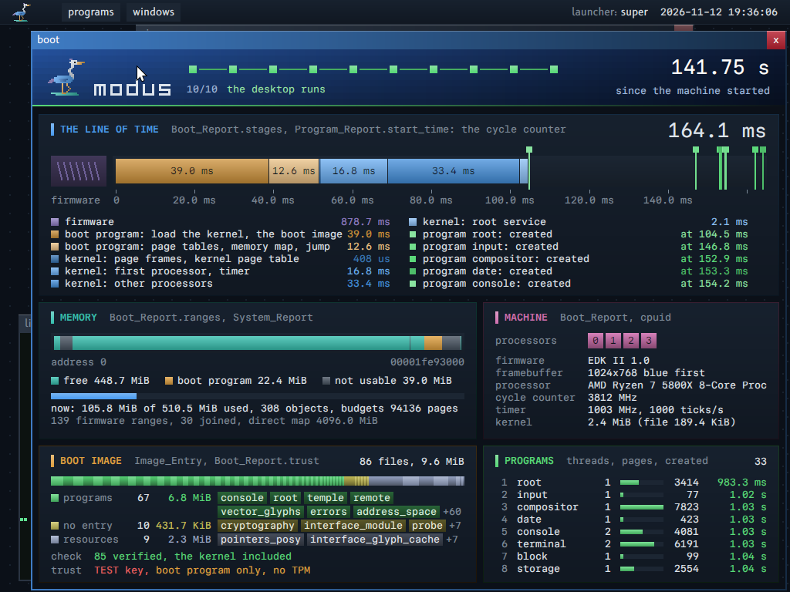

# The design rules

These rules say how a program of this system looks. They are taken from the boot display (`support/bootscreen/`). The boot display is the model.

A new graphical program follows these rules. The programs of the desktop that came before do not follow all of them yet: see "State" at the end.

**Why rules.** One look across the system lets a reader trust what a screen says: a value always has the font of the cells and the color of its kind, a concept always has its color, and each number on a screen names the record that it comes from. The rules live as one table of constants (`support/graphics/rules.odin`), so a change of a color changes every program and the site at once.

**For whom.** A reader who writes a graphical program, and a reader who changes the desktop or the site.

**Read before.** Nothing. `INTERFACE.md` gives the package that draws the elements; `FONTS.md` the fonts.

**The map of this guide.** Sections 1 to 8: what is on the screen, forms, surfaces, color, text, the grid, cost, decoration. Section 9: the desktop. Section 10: the elements. Section 11: the mark. Section 12: the card of the boot image. "State": which programs follow the rules.

The rules live as one table of constants in `support/graphics/rules.odin`: the grid, the surfaces, the colors of the concepts and the colors of the desktop, with `mix`, `shade`, `block` and `gradient`. The boot display, the compositor and the programs read this table. A program does not repeat a color of the rules as its own constant.

## 1. What is on the screen

- Each thing on the screen is a fact of a record. A display invents nothing.
- Each card has a caption that names its record, for example `Boot_Report.stages`. A reader can find the source of each number.
- A record that is all zero is valid. Its card says "not known yet", in the dim color. A card never shows a zero as if it was a measure.
- A size on the screen carries a fact when it can: the width of a stage is its duration, the width of a part of a size strip is the size of its file. A form has a least width, so that it stays visible.
- A name is whole or absent: a form that is too narrow for its name shows no name, and the name is said elsewhere when a reader needs it. A name is never cut.
- A step is an interface, not a printed line: a list of steps shows each step with its state ("done", "now", "failed").

## 2. Forms

Forms are rectangles by preference, because a rectangle can carry a measure (its width or its height) and aligns on the grid. Other forms are allowed where they say more.

- Rectangular forms are the preference of the design, not an absolute rule. A form is a rectangle unless another form says more. Any geometry can be drawn, sparingly; a round form can be right in some cases. The look to avoid: everything is a rounded blob.
- A point or a mark is a square.
- A line is a rectangle that is 1 or 2 pixels thick.
- Lines at an angle are allowed. The boot display keeps its own use of them: a part that has no measure on this scale (the firmware before the line of time).
- There is no shadow and no transparency.

## 3. Surfaces

A surface is a level of depth: the background, a card on it, and a track inside a card. The only sign of depth is a gradient from lighter at the top to darker at the bottom: no shadow.

There are three levels. Each is a constant of the package.

| Level | Color | Use |
|---|---|---|
| Background | `0x0B1018` | Under all cards. A grid of points of 2 pixels, each 24 pixels, lies on it |
| Card | `0x17212E` at the top to `0x111822` at the bottom | The frame of one subject |
| Track | `0x1C2633` | The empty part of a bar, a band or a tube |

- A surface has a color that goes from lighter at the top to darker at the bottom. This is the one sign of depth.
- A card has a border of 1 pixel in its accent, at 28 % at the top and 14 % at the bottom.
- A full part of a bar goes from 120 to 130 % of its color at the top to 78 % at the bottom.

## 4. Color

Color carries meaning, so each color names one concept of the system: the kernel is always blue, a program always green, a failure always coral. The table is in `support/graphics/rules.odin`, and every program reads it.

One color is one concept, as one term is one concept.

| Concept | Color |
|---|---|
| Firmware | `0x8E7CC3` |
| Boot program | `0xE0A040` |
| Kernel | `0x4A9CF0` |
| Program | `0x58D878` |
| Memory | `0x38C0B0` |
| Machine | `0xD070B0` |
| A module with no entry export | `0xC8C058` |
| A resource of the boot image | `0x9AA8C8` |
| Failed | `0xF06060` |
| Stop a program | `0xB82232`: a rich red, the color of the close button of a window |
| Not usable | `0x4A5563` |
| Text | `0xDCE4EC` |
| Dim text | `0x7C8A99` |

- The state of a thing has three colors: the color of the boot program while it starts, the color of a program when it runs, the color "failed" when it failed.
- Two neighbours of one concept take two shades of its color, so that their limit is visible.
- If a thing has an identity (a hash), its color can come from the hash. A thing that changes takes a new color.
- A color never stands alone for a fact: a text or a place says the same fact.

### The colors of code

Code has one set of colors wherever it is shown: on the site, and in the console of the system. The table is `support/graphics/code_colors.odin` (`Code_Class`, `code_class_colors`); the site (`tools/kerneltool/site_code.odin`) and the terminal (`support/terminal/code_runs.odin`) read it. Each class is an accent of the concepts, moved toward white on a dark surface and toward black on the light page of the site.

| Class | What | Accent | Dark: shade, color | Light: shade |
|---|---|---|---|---|
| Keyword | A word of the language | Kernel | 115 %, `0x64AAF2` | 55 % |
| Type | A type, or a name in the place of a type | Firmware | 115 %, `0x9E8FCB` | 60 % |
| Literal | A number, a text, a constant, a member | Memory | 100 %, `0x38C0B0` | 50 % |
| Name | The name of a function or of a declaration | Program | 100 %, `0x58D878` | 45 % |
| Directive | A directive or an attribute | Machine | 115 %, `0xD785BB` | 55 % |
| Comment | A comment, or words that are not code: quiet | Dim | 125 %, `0x9CA6B2` | 60 % |
| Punctuation | An operator or punctuation: quiet | Dim | 140 %, `0xB0B8C1` | 50 % |

- A part with no class has the color of the text around it.
- Each class has at least 4.5 to 1 on each surface that shows code: the block of code of the site in both forms, and the background and the card in the terminal. Host tests compute each contrast.
- On a chosen row (`COLOR_CHOSEN`, section 10), no class keeps that contrast: the row is white.

### The colors of values

A technical value has one color wherever it is shown: on the site, and in the programs of the system that show values of mixed kinds, as the log does. The kinds are the value kinds (`GLOSSARY.md`, `contract/value_kinds`), one enumeration for the site and the system. The colors are one table, `support/graphics/value_colors.odin` (`value_kind_colors`); the site (`tools/kerneltool/site_values.odin`) and the program `log` read it. The site keeps only what is its own: the title and the meaning of each kind (`docs/SITE.md`, "The kinds of values"). The icon of each kind is one table too ("The icons of the kinds"). No kind and no color is new: the log uses the kinds of the site, so no new decoration exists.

The kinds that the log writes, on a dark surface (contrast on the background `0x0B1018`, the top of a card `0x17212E`, the band of a row of the log `0x131B26`):

| Kind | Accent | Color | Contrast |
|---|---|---|---|
| Number | Memory | `0x38C0B0` | 8.47 / 7.22 / 7.70 |
| Size | Memory | `0x38C0B0` | 8.47 / 7.22 / 7.70 |
| Time | Boot program | `0xE0A040` | 8.42 / 7.17 / 7.65 |
| Module | Program | `0x58D878` | 10.45 / 8.90 / 9.49 |
| Version | Boot program | `0xE0A040` | 8.42 / 7.17 / 7.65 |
| Status | Failed | `0xF06060` | 5.94 / 5.06 / 5.40 |

- A part with no kind has the color of the text around it.
- Each kind has at least 4.5 to 1 on the background, on both colors of a card and on the band of a row of the log (`support/graphics/value_colors_test.odin`), and on both surfaces of a table of the site in both forms (`tools/kerneltool/site_values_test.odin`).
- A color is never the only sign: the text of the value and its unit say the same fact.

### The icons of the kinds

A kind has one icon wherever it is shown: on the site, and in a list of the desktop whose rows are of several kinds. The kind icons (`GLOSSARY.md`) are one table of cells, `support/kind_icons`, as the heron of the mark is one table of cells (section 11). The site draws the cells as the rectangles of an SVG picture (`docs/SITE.md`, "The kinds of values"); the system draws them as rectangles of whole pixels (`interface.draw_kind_icon`). No second set of icons exists.

- **The grid** is 12 by 12 square cells (`kind_icons.ICON_SIZE`). A cell is one pixel in a row of a list: the icon is 12 pixels, in the middle of the 24 pixels of the row. A larger icon has cells of 2 or 3 pixels: 24 or 36 pixels. No icon is scaled by a filter, so each edge is on a whole pixel.
- **The form** is cells only: rectangles, and lines at an angle as steps of cells. An icon has no curve, no shade and no second color.
- **The color** is given by the display that draws the icon: the color of the value kind, or the color of one fact of the thing (the palette, section 9). The table of the icons holds no color.
- **The contrast** of an icon on its surface is at least 3 to 1, the bound of a graphic that carries a fact. On a chosen row an icon is white, as the text is.
- **An icon never stands alone**: the row says the kind in words too. A reader who sees an icon for the first time reads the word.
- **The cost**: an icon is at most 20 rectangles (`kind_icons.RECTANGLE_LIMIT`): a run of cells of a row is one rectangle, and a run that the rows under it repeat exactly is one rectangle with them. The icons of the palette take 3 to 16.

The icon of each value kind:

| Kind | Icon |
|---|---|
| Number | A hash sign |
| Size | Three stacked bars, each wider than the one above |
| Time | A square with two hands |
| Handle | A square ring on a stem |
| Value | One small square |
| Grant | A check mark in steps |
| Status | A flag on its pole |
| Type | Two angle brackets, `< >` |
| Operation | A line into a box |
| Command | The prompt of a console, `>_` |
| Module | A block with a notch in its top |
| File | A page with a corner of steps |
| Guide | A page with three lines of text |
| Term | The capital letter T |
| Version | A tag with a hole |
| Yes | A filled square |
| No | An empty square |
| Procedure | Two parentheses |
| Constant | A lock |
| Variable | A cross of two diagonals |

The desktop lists four kinds of things that are not values (`kind_icons.Desktop_Kind`):

| Kind | Icon |
|---|---|
| Window | A frame under a title bar of three rows |
| Setting | Two sliders: a line with a knob at the left, a line with a knob at the right |
| Export | An arrow out of a box: the reverse of the icon of an operation |
| Stop: an act that destroys | A full block with a cross cut out of it, as the close button of a window |

- **Where the icons show**: the site; the rows of the palette and the candidates of a field of its form (section 9).
- **Where they do not show**: a list whose rows are all of one kind and of one state (a menu of the bar), a heading of a group, a text grid of cells (the console and the completion list of the terminal: an icon is not a character of the font).
- A host test draws each icon as text in its log, and checks that each icon is 12 by 12 cells, has at least 12 cells, differs from each other icon, and that its rectangles cover each of its cells once (`support/kind_icons/kind_icons_test.odin`).

## 5. Text

- **Two fonts** (`docs/FONTS.md`, section 12.6):
  - **The interface font, B612** (proportional): each text that names or explains: the title and the caption of a card, a label, the name of a button, a line of a list or a menu, the title of a column, a sentence of help.
  - **The font of the cells, Paper Mono** (monospace): each value, and each text that a reader compares character by character or copies: a number in a column, a hash, an address, a text that is typed, code, the console, the terminal, a text grid.
  - Both draw in the line of 16 pixels of the grid, at the scales 1, 2 and 3. The places of the elements stay on the grid of 8; the letters of the interface font do not.
  - A text is measured in the font that draws it, and an element cuts a text to its box: no text passes its element in either font.
  - With no interface font (absent, refused, or the setting `font` is Spleen 8x16), each text is in the font of the cells, with the same layout rules.
  - The compositor follows the same rule: the buttons of the bar, the lines of its menus, the titles of the windows, the names, the sentences and the hints of the palette are in the interface font; the clock, the date, the text that is typed in the palette and the counts of the menus and of the palette are in the font of the cells. The mark and its name in square cells do not change. The places of the buttons and of the lines come from the widths of their texts in the font that draws them (the bar layout).
  - **The boot display, by design, in two steps**: the boot program holds no glyph cache, so the first screen of the machine is in Spleen 8x16, the one font of its binary, as a text grid is. The root service then draws the same display again with the caches of the boot image: the titles of its cards and the names of its facts in the interface font, its values in the font of the cells.
- The font of the cells: the vector font by default, drawn with a coverage for each subpixel band; Spleen 8x16 as the fallback and as the other value of the setting `font` (`docs/FONTS.md`).
- Three sizes: lines of 1, 2 and 3 times 16 pixels; cells of 1, 2 and 3 times 8 x 16 for the font of the cells. No other size.
- The font of the cells is monospace: its advance is the width of a cell, so a layout in cells holds with the vector font and with Spleen. A glyph of the font of the cells stays inside its cell.
- An enlarged picture of the screen shows colored edges on each letter: the subpixel bands, not a fault. The setting `subpixel_order` `none` gives gray edges.
- The title of a card is in capital letters, in the bold weight of the interface font, in the accent of the card, after a bar of 4 x 16 pixels in the same accent.
- The system has no italic face. Where a text has italics (the documentation of a module in `manual`), the words have a line of 1 pixel under them, in the dim color, and keep their color. A link in such a text is a name in the color of a link; a link that a click opens also has a line of 1 pixel under it, in its color.
- A name is in the dim color. A value is in the text color. A measure of a concept is in the color of that concept. Where values of mixed kinds follow one another, as in a line of the log or a table of the site, each value is in the color of its value kind (section 4, "The colors of values").
- A card has at most one number in the large size: the number that the card is about.
- Numbers of one column are aligned on the right, each with its unit.
- A sentence follows the language rules of the project: short, exact, one term for one concept.

## 6. Grid

Every place and size sits on a grid of 8 pixels, so that the elements of different programs line up and a reader's eye can follow a column.

- The unit is 8 pixels. A position and a size are multiples of 8, or of 4 inside a form.
- A line of text is 16 pixels.
- The space between two cards is 8 pixels. The margin inside a card is 16 pixels. The title of a card takes 40 pixels.

## 7. Cost

Drawing must stay cheap and the same on every machine: integers, rectangles, and no image file to decode.

- Drawing is `fill` of rectangles with integer arithmetic. No floating point and no image file. The one drawn data is the glyph cache of the vector font: the kernel tool makes it at build time from the outlines, in integers, and a text draw blends its words (`docs/FONTS.md`).
- A display does not wait so that a reader can see it. A display that fails stays.
- Each display has a measured draw time.

## 8. Decoration

Three things carry no fact: the grid of points on the background, the blue of the head of the boot display, which goes darker toward the right, and the same blue on the title bar of the window in front (section 9). No other decoration exists.

## 9. The desktop

This section applies the rules of sections 1 to 8 to the screen that a principal sees first: its sizes, colors and behaviour, element by element.

The desktop is the screen of the compositor: the background, the bar, the windows, the two menus of the bar and the palette. It follows sections 1 to 8.

### The gradient and the palette

- **The gradient** of a title bar goes from the blue of the title bar, `0x3F7CC4`, at its left to a darker blue at its right. The background of the desktop is not that blue: it is the background of the rules.
- **The palette** is not the menu of the programs. The menu is a list that the pointer opens from the bar. The palette is a panel in the upper third of the screen that a key opens: the input types a part of a name, and the list narrows at each key. It is the way of the keyboard to each operation: it starts a program and reaches a window. The desktop keeps the menus.

### Background and bar

- The background is `COLOR_BACKGROUND` with the grid of points of section 3. The compositor computes it once, at its start.
- The bar is 32 pixels high, at the top of the screen. It has the surface of a card (`COLOR_CARD_TOP` to `COLOR_CARD_BOTTOM`) and a line of 1 pixel in `COLOR_TRACK` at its bottom.
- The bar holds, from the left: the mark of the system (the heron with cells of 1 pixel, 24 by 24, at (16, 4): section 11); the button `programs`; the button `windows`; at the right, the key of the palette ("palette: super") and the clock: the date and the time of day in UTC (`contract/date`), or the time since the start of the machine while the system has no date.
- A button is 24 pixels high, in `COLOR_TRACK`. The button of an open menu is in `COLOR_TITLE`, with its label in white.

### Menus

- A menu of the bar is a card under its button: a border of 1 pixel in the color of the kernel, a title in capital letters, the caption of its source and the count of its lines.
- The menu of the programs has two columns of lines. Its caption is `bar.names`, the table of the names in `support/bar`.
- The menu of the windows has one line for each window, in the order of the client table. The window that has the focus has a square of 8 pixels before its title, and its title is white.
- A line is 24 pixels high. The line under the pointer is a chosen row: `COLOR_CHOSEN`, with its text in white (section 10).

### Windows

- A window is a title bar of 24 pixels over the surface of its program, with a border of 2 pixels at the left, the right and the bottom. There is no shadow.
- The title bar of the window that has the focus goes from `COLOR_TITLE` (`0x3F7CC4`) at its left column to `COLOR_TITLE_END` (`0x162C45`, the same blue at 36 %) at its right column. Its top line is 125 % of these colors: the sign of depth of section 3. The bottom border has the colors of the title bar; the left border is the start color, the right border the end color.
- The title bar of another window is quiet: it goes from `COLOR_TITLE_QUIET` (`0x2A3442`) to `COLOR_TITLE_QUIET_END` (`0x161D27`), and its title is in the dim color. So the gradient also says which window has the keyboard. Its title also says it: a title in white has the focus.
- The close button is a square of 24 x 24 pixels at the right end of the title bar, with the character `x` of the font in white. Its color is the concept "stop a program": a deep red `COLOR_STOP_PROGRAM` (`0xB82232`), not the coral of "failed", because to close a window is not a failure. It has the sign of depth of the rules: a block from 118 % of the red at the top to 82 % at the bottom, and a top line at 150 %. When the pointer is over it, the red is brighter (`0xE0343F`). On a window that is not in front, the red is quiet (`0x4E2229`) and the `x` is a dim pink (`0xC09098`). The button shows the character `x`, not a cross of squares of 2 pixels: the two lines of such a cross do not meet on one square at the centre, and the cross does not match the title.
- The compositor places a new window at (64, 56), and each next one 40 pixels to the right and 32 pixels lower, for 8 windows (`PLACE_X`, `PLACE_Y`, `PLACE_STEP_X`, `PLACE_STEP_Y` in `programs/compositor/main.odin`). Each of these places is on the grid. `bar.new_window_place` then moves a window that does not fit up and left, on the grid (`docs/INTERFACE.md`, section 2.6).
- Cost: the compositor computes the colors of one line of a title bar once, for the columns that the frame shows, with a fixed-point step for each channel (no division for each pixel), then copies them to the 24 lines. At its start it measures three forms of a title bar of 1024 pixels, 64 times each, and writes them on the log. On 10 machines of one check: one color takes 1.6 to 2.7 us, a mix for each pixel 65 to 87 us, one row of colors then copies 5.7 to 6.8 us. The gradient costs about 4 us for each window that a frame draws.
- At 8 bits for each channel, the gradient has 41 levels of red, 80 of green and 126 of blue over the width of a window. The picture shows no band, so there is no dithering.

### Pointer

- The pointer is an arrow of squares of 2 pixels, 8 squares wide and 11 high: black at the edge, white inside. Its point is the top left square. This arrow is the shape `arrow` of the pointer theme of the system (`resources/pointers/system.manifest`). Each other pointer shape of that theme has the same style: squares of 2 pixels, black and white.
- **Not a rectangle.** The theme "Posy's Cursor" (`docs/POINTERS.md`) is a build input. When the build has it, it is the default pointer theme. Its pointer pictures have smooth edges, curves and transparency: they are not rectangles. The pointer picture is the one picture resource of the desktop that does not follow sections 2 and 7. It is drawn with a blend of premultiplied alpha. The windows, the bar, the menus, the palette and each program keep rectangular forms and no transparency.

### Palette

- **One panel, one key.** The key super (the left key with the logo, `display.KEY_SUPER`) opens and closes the palette. No program uses this key: the compositor keeps it, and the program that has the focus never receives it. While the palette is open, it takes each key and the pointer: no window and no menu receives them.
- **The panel holds no right.** It is a part of the compositor, which already owns each key and each pixel. An entry of the compositor itself does what the desktop already does: a program starts through the root service as the menu of the programs starts it (`Start` with the name), a window comes to the front as a press brings it, a close stops the program as the close button does (`Stop`). A provider entry runs in the program that gave it: the compositor sends the index of the entry, never a text of a line, and makes no call.
- **The place.** The panel is 640 pixels wide and 400 high. Its top is at y = 96, fixed, in the upper third of the screen, so the input band never moves when the list changes. It is in the middle of the width of the screen, on the grid: x = 192 on a screen of 1024 (`palette.panel_place`). It opens with no animation, in the next frame, and its height never changes: a short list leaves empty rows.
- **The parts, from the top**:

| Part | Height | Content |
|---|---|---|
| Input band | 48 | The typed part at scale 2 (cells of 16 x 32), 16 pixels from the left edge. Its last 2 pixels are a line in `COLOR_TITLE` |
| List | 12 rows of 24 = 288 | The entries |
| Gap | 8 | |
| Detail line | 24 | One sentence in the dim color: what the choice of the chosen entry does |
| Footer | 24 | At the left, in the search only: the count of the entries that match, of all the entries, with the word for what is counted ("13 of 58 entries"; "entries, no commands" when the console gives none). At the right: the keys of the state, with what Enter does on the chosen entry ("enter: to the front   esc: close"); while nothing is typed, the prefixes ("> commands  @ windows  : settings  ? manual"). On a result and while a command runs, the footer has the keys only |
| Margin | 8 | |

- **The input band is flush.** It is the top of the panel. Its fill (`COLOR_TRACK`) touches the top, the left and the right edge of the panel. Nothing is around it: no title over it, no margin, no border on those three sides. A reader tells it from the list by four signs: the step of surface (the track over the surface of a card); the line of 2 pixels in `COLOR_TITLE` under the band, from edge to edge; the caret of 4 x 32 pixels in `COLOR_TITLE`; the size of the typed part, at scale 2 where each row is at scale 1.
- **The edge of the rest.** The list, the detail line and the footer have the surface of a card and a border of 1 pixel in the color of the kernel (28 % to 14 %) at the left, the right and the bottom, as a menu of the bar has. They have no border at the top: the line of the band is the edge there. The palette is not a card: it has no title and no caption. Each row says what it is in words, and the footer counts the entries in a plain word: a name of the code is not a word for a reader of the panel.
- **The typed part.** It is white, in the font of the cells. Left, Right, Home, End, Delete and Backspace edit it at the caret (`support/line_editor`). It holds at most 64 characters. When it is empty, the band says "type a part of a name" in the dim color, at scale 2.
- **Two kinds of entries** come from the compositor itself and need no other program: the programs (the table `bar.names`, what the menu of the programs lists) and the windows (the client table, what the menu of the windows lists). Each window also gives the entry of its close, named "close" and its title. The palette provider, the console, adds one entry for each of its commands (`CONSOLE.md`, "8. The palette provider").
- **A row** is 24 pixels: 16 pixels, the icon of 12 pixels, 8 pixels, the name, then at the right the kind in words, 16 pixels from the edge.
  - **The icon** is the kind icon of the entry (section 4, "The icons of the kinds"), with cells of 1 pixel. Its form says what the entry is, so a reader who does not tell two colors apart still tells a window from a program and a command from a setting. Its color says one fact of the entry: the color of the kind when the thing is there or in use, the dim color when it is not. An entry that destroys has the icon of that act, whatever its kind:

| Entry | Icon | Color |
|---|---|---|
| A program that has a window now | Module | The color of a module, `COLOR_PROGRAM` |
| A program that has no window now | Module | The dim color |
| The window that has the focus | Window | `COLOR_TITLE` |
| Another window | Window | The dim color |
| A command with no parameter | Command | The color of a command, `COLOR_PROGRAM` |
| A command with parameters | Command | The dim color, as the whole row |
| An export | Export | The color of a module; the dim color with parameters |
| The value of a setting that the machine uses now | Setting | The text color |
| Another value of a setting | Setting | The dim color |
| An entry that destroys: the close of a window, a command such as `shutdown` | Stop | The red of the close button under the pointer, `COLOR_STOP_PROGRAM_POINTER_OVER` |
| A candidate of a field of a form: a program or a module | Module | The color of a module |
| A candidate of a field of a form: a grant | Grant | The color of a grant |

  - **The colors of the icons**: each one has at least 3 to 1 on both colors of a card (3.66 for the red, 3.78 for the blue of the title bar, 4.60 for the dim color). The deep red `COLOR_STOP_PROGRAM` has 2.56 there: it is the fill of the row that asks for a second Enter, not the color of an icon. `COLOR_NOT_USABLE` has 2.14: a program with no window has the dim color. On the chosen row and on the row that asks, each icon is white: no color of a kind keeps 3 to 1 on `COLOR_CHOSEN`. The fact that the color said is then in the words at the right and in the detail line. A host test computes each pair (`support/graphics/palette_colors_test.odin`).
  - **The kind** is said in words at the right, in the dim color: `window`, `program`, `close a window`, `command`, `export`; `setting`, and `setting, in use` for the value that the machine uses now; a command with parameters says `command, needs arguments`. A color never stands alone for a fact (section 4).
  - **The name** of a program or of a window is in the interface font. A command is code: its name is in the font of the cells, in the color of a name of the colors of code, and its parameters and its result follow it in the dim color. A signature longer than its room is cut at the end of a parameter, with `, ...)`, or shows `(...)`: it is never cut inside a parameter, and it never reaches the words at the right. A command with parameters is dim as a whole.
  - **The matched characters**: a line of 2 pixels in the color of the kernel is under each matched character of a name.
- **The chosen row** is a chosen row of section 10: `COLOR_CHOSEN`, its name and its kind in white, the line under each matched character in white. The kind stays on the chosen row: "plasma" the window and "plasma" the program are then two things in words, on each row. What Enter does on the chosen entry is in the footer: "enter: to the front", "enter: start", "enter: close", "enter: run", "enter: arguments", "enter: set". The icon of the chosen row is white.
- **The detail line** says what the choice does, with the facts of now. A window: "The window of the program console. It has the focus.", or "Brings the window of the program life to the front and gives it the focus." A program: "Starts the program plasma. It has no window now.", or "Starts the program plasma one more time. It has 1 window now." A close: "Stops the program plasma: its window closes. Asks for a second Enter." A command: its help sentence.
- **With a typed part: one list, ranked**, with no group: the best match is the first row. The match is the fuzzy match of the console (`support/line_editor`): the characters of the typed part appear in the name in their order, not always side by side, without the case of the letters ("closepla" matches "close plasma"). Among entries of one score, the order is: the entries chosen lately, the newest first; then the kind (a window, a program, a command, an export, the close of a window); then the order of the table. A better match always comes before a recent choice.
- **With no typed part: groups**, each under a dim line of text: "recent" (at most 5 entries, the newest first), "windows" (each window, the front one first), "programs" (the order of `bar.names`). A group with no entry is absent. To reach a window is the most frequent act, so the windows show before any letter. The entries that destroy and the commands show only for a typed part, or as a recent choice.
- **The recent choices**: the panel remembers the last 16 chosen entries, by kind and name, in the memory of the compositor. A restart of the machine loses them.
- **More than 12 rows**: a bar of 2 pixels at the right says which part of the list the panel shows.
- **No match**: one dim line, `nothing has "xyz" in its name`, and Enter runs nothing.
- **An entry that destroys asks for a second Enter**: the close of a window, and the commands `shutdown`, `lock` and `history_clear`. Enter on it changes the chosen row: its fill is `COLOR_STOP_PROGRAM` and its text says the act in full ("stop plasma: its window closes", "shutdown(): stop the machine"); the footer says "enter: confirm   another key: back". A second Enter runs it. Each other key goes back to the search, with the typed part kept, and does nothing else. The compositor draws this question: a provider cannot skip it.
- **A command with no parameter runs from the panel.** Enter sends the choice to the console, and the panel waits: the list makes room for the call, in the color of a name, and "runs in the console". The panel still takes its keys: Escape closes it, and the line goes on in the console. The panel sets no bound on a line: the console has none.
- **A result** shows in the place of the list, under the call: an Integer as the one large number of the panel (scale 3), a Text of one line, the lines of a Record, "done" for a command with no value, an error in `COLOR_FAILED`. Each part has the color of what it is, as in the console. A Table, and each result of more than 12 lines or 76 cells, is not drawn in the panel: the panel closes and the window of the console comes to the front, with the line and its result. Escape closes the panel; each other key goes back to the search.
- **A command with parameters has a form.** Enter turns the input band into the call, as code, at the scale of the typed part: the name of the command in the color of a name, then one field for each parameter, with its name: `revoke(name: plasma, grant: |)`. The caret is in one field; the name of that parameter is in the text color, the others are quiet. A call wider than the band shows the part that holds the caret.
  - **A field has the kind of its parameter.** An Integer field takes digits, and one `-` at its start. A Text field takes each character but a quote, 48 characters at most. A refused key changes nothing, and the detail line says why, in the color of a failure: "an Integer takes digits, and one - at its start".
  - **The list is the candidates of the field** that has the caret, when the console can give them: the modules of the boot image for `start`, `load`, `isolate` and `replace`; the programs that run for `stop`, `grants`, `connect`, `debug` and the first field of `revoke`; the grants for its second field. The text of the field narrows them by the fuzzy match. The panel asks for them once when the caret enters the field, and no key waits for them.
  - **The keys**: Tab takes the chosen candidate, or goes to the next field; Shift with Tab goes to the field before; up and down move in the candidates; Enter goes to the next field, and runs from the last one; Control with Enter runs from any field; Escape, and Backspace in the first field when it is empty, go back to the search with the typed part kept.
  - **Before it runs**, each field must hold a value of its kind: the caret goes to the first field that does not, and the detail line says why ("grant: empty"). An entry that destroys then asks for its second Enter, on a row that says the call with its values; another key goes back to the form, with its fields.
  - **What goes to the console** is one typed value for each field, an Integer as a number and a Text as its bytes, then the choice. The console builds the line. The panel sends no text of a line.
  - **A parameter that no field can give** (a Table, a Record, a Handle, Bytes, a value of any kind): the entry has no form. Enter closes the panel; the console writes the call in its edit line, with the caret between the parentheses, and its window comes to the front. Control with Enter does the same for each command.
- **The settings are entries**: one for each value of each setting of the machine, "set font to spleen". The value in use has its icon in the text color and says "setting, in use". Enter sets it through the console, the desktop shows the change behind the panel, and the panel shows its list again, so the next value is one key away. The compositor gets no right for it: it knows the value in use from the settings page that it reads as each program does.
- **A prefix restricts the kinds.** The first character of the typed part: `>` the commands and the exports; `@` the windows and their closes; `:` the settings; `?` the programs, and Enter then asks the console for the page of the manual of the chosen program (the program `manual` must run; its window comes to the front). The names match the part after the prefix. A prefix alone lists each entry of its kinds. The word of the prefix shows at the right of the input band, in the dim color, and each row keeps its kind in words.
- **With no provider** (the console does not run, or its grant `palette` ended), the palette lists the programs and the windows, and the footer says "entries, no commands". A table of the console that fails a check gives the same list, and "entries, commands refused". The footer then keeps the hint of Enter in the place of the prefixes, so the words have their room.
- **The keys**:

The keys of a form are in its bullet above.

| Key | In the search | In the question of an entry that destroys | While a command runs | On a result |
|---|---|---|---|---|
| Super | Closes the panel | Closes the panel | Closes the panel | Closes the panel |
| Escape | Closes the panel | Back to the search | Closes the panel; the line goes on | Closes the panel |
| A character | Goes in at the caret; the list follows | Back to the search | Nothing | Back to the search |
| Left, Right, Home, End, Delete, Backspace | Edit the typed part | Back to the search | Nothing | Back to the search |
| Up, Down | Move the choice, from the last entry to the first and back | Back to the search | Nothing | Back to the search |
| Page Up, Page Down | Move the choice by 11 rows, with no wrap | Back to the search | Nothing | Back to the search |
| Enter | Runs the chosen entry: starts the program, brings the window to the front, sends the command, opens it in the console, or asks the question | Runs the entry | Nothing | Back to the search |
| Tab | Nothing | Back to the search | Nothing | Back to the search |
| Control with Enter | Opens the chosen command in the edit line of the console | Back to the search | Nothing | Back to the search |

- **The pointer**: a move of the pointer over an entry chooses it (only a move: a list that changes under a still pointer keeps its choice). A press and a release on one row run it, as Enter does. A press outside the panel closes it. A press inside the panel that is on no row does nothing. The pointer shape is `text` over the input band and `pointing_hand` over an entry.
- **After a choice** that starts a program or brings a window to the front, the panel closes at once: what it started shows on the desktop.
- **The states** of the panel are one enumeration (`palette.State`): closed, the search, the question, running, the result, the arguments. Two pure procedures hold each transition of a key (`palette.key_action`, `palette.state_after`), a third one the answer of the provider (`palette.result_set`), and host tests run each state with each key.
- **The palette runs the row that is drawn.** The lists come from another thread and the entries from other programs, so a list can come at any moment behind an open panel: a window appears, the console gets new commands, a choice becomes a recent one. No such arrival changes what a key that follows will do, unless the screen showed it first:
  - **The choice is an entry, not a row.** When a list comes for the typed part that the list before answered, the chosen entry stays chosen, at whatever row it has now, and the rows shown follow it. An entry is the same entry when it has the same kind and the same name.
  - **An entry that leaves.** Only when the chosen entry is no longer in the list does the choice go to the first entry. That is a change that the input did not make: Enter, and each other action that runs an entry, then does nothing until a frame showed the new choice. A question for a second Enter ends with its entry.
  - **A key that changes the typed part ends that wait.** The choice that no frame showed was of the list before; the typed part asks for a new list, and Enter waits for that list. The list that answers keys of the input chooses its first entry, also when the keys left the same text (a character, then Backspace, in one batch): Enter then runs the best match of what was typed. The rule is in `support/palette` (`typed_edit`, `panel_adopt_after`), so each owner of a panel has it.
  - **A list for a new typed part** chooses its first entry. It is the answer to the keys of the input: Enter that was typed before that list was made waits for it, and runs its best match; an entry that destroys still asks for its second Enter, on a row that is drawn.
  - **A list that shows what the list before showed** changes nothing: no new choice, no frame, no line of the log.
  - **A form** holds its own copy of its entry, so a new table of the console does not change the form; the console still refuses a choice whose entry is not the one that the panel named.
  - **Tab and the candidates.** Tab that comes before the candidates of its field waits for them, then takes the chosen one or goes to the next field: it never goes to the next field while a candidate is on its way. Another key ends the wait. When the text of a field narrows the candidates, the chosen candidate stays chosen while it is shown.
  - **A window that left.** A choice of a window or of its close acts only on the window that has the title of the row: another window that took its place in the client table is not touched.
  - The compositor writes at each close how many lists it adopted while the panel was open, and how many of them were the same.
- **The cost.** The loop of the compositor never makes a list. A second thread of the compositor collects the entries, copies and checks the table of the provider, and ranks; the loop gives it the typed part, the windows and the recent choices, and adopts the list that it publishes: one address changes. Two lists take turns, and the thread writes only the one that the loop does not read. The key super only sets the state and builds the draw records of the 12 rows shown: the list of an empty typed part is made at each close, and when a window appears, leaves or comes to the front. A typed key shows at once in the input band; its list comes a moment later. Enter that comes before the list of the typed part waits for that list, so it never runs an entry of the list before. The compositor writes on the log at each key the count and the first rows, "compositor: the palette lists 3 of 61 for "mon": monitor (window), monitor (program), close monitor (close a window)", and at each close the frames, the mean time of a frame and the longest making of a list by the ranking thread.
- The code: the state, the entries, the ranking, the keys and the draw records are `support/palette`; the keys, the pointer, the acts, the ranking thread and the side of the provider are `programs/compositor/palette.odin`; the table and the ring are `contract/palette_table`; the provider is `programs/console/palette_provider.odin`.

## 10. Elements

The interface package (`support/interface`, `docs/INTERFACE.md`) draws these elements. A program that uses them follows the rules of this file with no number of its own.

| Element | The rule |
|---|---|
| Background | `COLOR_BACKGROUND` and the grid of points of section 3, at 12 + 24 n of the surface |
| Card | A border of 1 pixel in its accent (28 % to 14 %), the surface of a card, a bar of 4 x 16 pixels and the title in the accent, the caption of its record in the dim color, a count at the right in the text color. Its content starts 40 pixels under its top and 16 pixels inside its sides |
| Line of a label and a value | The label in the dim color; the value in the text color (or in the color of its concept), at the right of its area for a number |
| Table | The titles of the columns in the dim color; lines of 24 pixels; every second line, from the first, on a band of `COLOR_CARD_TOP`; numbers at the right of their column |
| Bar | The track in `COLOR_TRACK`; the full part from 125 % of its color at the top to 78 % at the bottom; 2 pixels at least for a value above 0 |
| Button | A rectangle of the track with its label in the text color; blue (`COLOR_TITLE`) at 60 % when it has the focus or the pointer is over it, full blue with a white label when it is open or both |
| List with a choice | Lines of 24 pixels; the chosen line in `COLOR_CHOSEN` with its name and its hint in white; a line of 2 pixels under a searched part of each name; a bar of 2 pixels at the right when the lines do not fit |
| List of rows | Rows of 24 pixels: the kind icon of the row, 12 pixels, in a color that says one fact (white on the chosen row), the name (in the font of the cells with a quiet detail after it when it is code), and at the right what the row is, in words, in the dim color; a line of 2 pixels under each matched character of a name; the chosen row filled, with its text in white, and at its right its hint or the same words as the other rows; a dim line of text as the heading of a group; a bar of 2 pixels at the right when the rows do not fit |
| Text input | A field of the track with a line of 2 pixels at its bottom (`COLOR_TITLE` with the focus, `COLOR_NOT_USABLE` without); the text in white, at scale 1 or 2; a caret of 2 x 16 pixels in `COLOR_TITLE` with the focus (4 x 32 at scale 2), at any place of the text; the placeholder in the dim color |
| Panel with a flush input | The input is the top band of the panel, from edge to edge, with no border on its three outer sides: its fill and the line of 2 pixels under it are its edge. The rest of the panel has a border of 1 pixel at the left, the right and the bottom |
| Large number | The font at 3 times its size, drawn from its outline at 24 x 48: the one number of a card (section 5) |

### The chosen row

A chosen row is the chosen line of a list, of a menu of the bar, of the palette, and of the completion list of the terminal.

- Its color is `COLOR_CHOSEN`, `0x3C76BB`: the blue of the title bar at 96 % (`shade(COLOR_TITLE, 96)`). It is not the title blue itself: white has 4.29 to 1 on `0x3F7CC4`, under the 4.5 that a text needs.
- Its text is white: 4.67 to 1. No other color of the rules keeps 4.5 on it: the text color has 3.63, the accent of a match under 3.3.
- A matched character of a chosen row in a grid of cells is the reverse: the chosen blue on a white cell, 4.67 to 1. In a list of the interface font, the line of 2 pixels under the searched part, or under each matched character, is white.
- A title bar is not a chosen row: it keeps its gradient from `COLOR_TITLE`. An open button draws its white label on `COLOR_CHOSEN` too (4.67).
- The row of the palette that asks for a second Enter is not in `COLOR_CHOSEN`: its fill is `COLOR_STOP_PROGRAM`, the concept of what it does, and its text is white: 6.3 to 1.
- A host test computes the contrast of the text and of a matched character on the chosen row (`support/terminal/code_runs_test.odin`). A second host test computes the pairs of the palette: white on the chosen row, white on `COLOR_STOP_PROGRAM`, white and each color of code on the track of the input band, the dim color on the surface of a card, the dim placeholder of the input band as a large text, at 3 to 1, and each color of an icon of a row on the surface of a card, at 3 to 1 (`support/graphics/palette_colors_test.odin`).

- An element that takes input can take the focus, and the keyboard reaches it: Tab, Enter, Space, the arrows (`docs/INTERFACE.md`, section 4).

## 11. The mark

The mark is drawn from data, not from a file: one table of cells in `support/mark` gives the icons of the repository, the head of the boot display and the mark in the bar.

The mark is the picture that stands for the system: a heron in pixel cells, and the name "modus".

- The form: a heron on a grid of 24 by 24 square cells. It stands on one leg in water. Its parts: the crest and the tail (one part, in the color of the firmware), the head and the neck (the text color), the eye, the beak and the legs (two parts, in the color of the boot program), the body (the kernel), the wing (`0x2F6FC0`), the water (memory). No line goes around it.
- The data: `support/mark` holds the rows of the cells, the table of the parts with their colors and their boxes, and the letters of the name of the mark. Its procedures are pure: `mark_pixel(cell_size, x, y, on_light)` gives the color of one pixel of the heron, `name_pixel` one pixel of the name, `heron_size` and `name_size` their sizes. `mark_draw(canvas, x, y, cell_size, on_light)` and `name_draw` draw into a canvas of `support/graphics`: the covered pixels only, cut to the canvas.
- The cell size: 1 to `CELL_SIZE_LIMIT` (65 536). Another cell size draws nothing and has a size of 0. A pixel outside the heron or the name is not covered.
- The gradient: each part is filled with one linear gradient, from the top left corner of the box of the part (the color moved 30 % toward white) to its bottom right corner (the color moved 30 % toward black). A pixel takes the gradient at its centre. The eye is one flat color. The arithmetic is in integers, rounded to the nearest value, so that every machine gives the same pixels.
- The two backgrounds: the background of the system `0x0B1018`, and the light background `0xF4F6F8` of a page of another program. On the light background the neck is darker (`0x9FB2C8`), and the name is in `0x0B1018` instead of the text color.
- The name of the mark: "modus" in letters of 5 by 7 cells, 2 empty columns between two letters, one flat color. The same letters are a font file, for a page that writes the name as text: see "The font of the name".
- A picture holds the name only where one file must carry the heron and the name. Elsewhere the picture is the heron alone, and the name is drawn or written beside it.
- The files: `kerneltool logo` writes them, and `kerneltool check` fails with "run kerneltool logo" when a picture does not have the pixels of the data, or when the font does not have the bytes that the data gives.

| File | Size | What it shows |
|---|---|---|
| `resources/logo/modus.png` | 1024 x 1024 | The heron (cells of 24) and the name under it (cells of 20), on the dark background |
| `resources/logo/modus_light.png` | 1024 x 1024 | The same on the light background |
| `resources/logo/modus_transparent.png` | 1024 x 1024 | The heron and the name in the colors of the dark background, on a transparent background |
| `resources/logo/modus_light_transparent.png` | 1024 x 1024 | The heron and the name in the colors of the light background (the darker neck, the dark name), on a transparent background |
| `resources/logo/heron_768.png` | 768 x 768 | The heron alone, cells of 32, on a transparent background |
| `resources/logo/heron_24.png`, `heron_48.png`, `heron_96.png`, `heron_192.png` | 24 to 192 | The heron alone with cells of 1, 2, 4 and 8 pixels, on a transparent background |
| `.project/image.png` | 512 x 512 | The heron alone, cells of 16, centred on the dark background |
| `resources/logo/modus_mark.ttf` | A font file | The font of the name of the mark: the letters of the name as glyphs |

- A transparent file keeps the colors of the dark background: its pale neck shows little on a white page. Use `modus_light.png` there.
- The PNG writer of these files is the one of the Odin standard library: it compresses, and it writes an alpha channel. The writer of the pictures of the screen has neither.
- Where the system draws the mark, always with the colors of the dark background:

| Where | Who draws | What | When the gradients are computed |
|---|---|---|---|
| The bar of the desktop | the compositor | the heron, cells of 1 pixel, at (16, 4) | once, at the start, into a picture of 24 x 24 pixels over the pixels of the bar; each frame copies that picture (a Picture record that never changes) |
| The head of the boot display | `support/bootscreen`: the boot program, the root service, the program `boot` | the heron, cells of 2 pixels (48 x 48) at (20, 12), and the name of the mark, cells of 3 pixels, at its right | at each draw of the display: one call for each of the 2 304 pixels of the box of the heron and the 2 079 pixels of the box of the name, a few integer divisions each |

- No file of the mark is in the boot image: each place draws from the data.

### The font of the name

The font of the name of the mark (`GLOSSARY.md`) is the letters of `mark.name_letters` as a TrueType file. A page that writes "modus" in it shows the letters of the files of the mark, and the text stays text.

- The file: `resources/logo/modus_mark.ttf`, written by `kerneltool logo` (`tools/kerneltool/mark_font.odin`). The tool writes each table itself: `OS/2`, `cmap`, `glyf`, `head`, `hhea`, `hmtx`, `loca`, `maxp`, `name` and `post`. The file holds no date: the same letters and the same license give the same bytes. `kerneltool check` compares the bytes of the file with the bytes that the data gives.
- The glyphs, 7: the glyph of a character that the font does not have (no contour), the space, and `m`, `o`, `d`, `u`, `s`. The capitals `M`, `O`, `D`, `U`, `S` have the glyphs of the small letters: the name of the mark has small letters only, so a text "Modus" still shows the mark. No other character has a glyph: a browser takes it from the next font.
- The outline of a glyph is the union of its cells: it goes around the whole letter, with a second contour for the hole of the `o` and of the `d`. It is not one square for each cell: two squares that share a side can show a thin line between them when a browser smooths the edges. Each point is a corner of a cell. An outer contour turns clockwise and a hole the other way. The font has no curve and no instruction.
- The units: a cell is 128 units and the em is 1024 units, 8 cells. The 7 rows of the name are above the baseline (the ascent, 896 units) and one empty row is under it (the descent, 128 units): the letters stand on the baseline of a text beside them. The letters with no stem are 5 rows high (640 units).
- The advance of each glyph is 896 units: the 5 columns of a letter and the gap of 2 columns. So "modus" in the font has the proportions of `name_draw`: 33 columns from the left of the `m` to the right of the `s`, and the gap after the `s` is empty.
- The sizes: a font size of 8 pixels gives cells of one pixel. A font size that is a multiple of 8 pixels draws whole cells; another size blurs the squares. A text in this font starts on a whole pixel.
- The names in the file: the family "modus mark", the style "Regular", the line of the copyright and the text of the license of the repository (`LICENSE`).
- The test (`tools/kerneltool/mark_font_test.odin`): the reader of fonts of the system (`support/vector_font`), which did not write the file, opens it. For each letter, the outline sampled at the centre of each cell, with the rule of the winding that is not zero, is the cells of `mark.name_letters`, and the area of the outline is the area of those cells. The test also checks the checksum of each table and of the file, the glyph of each character, the advances, and that two builds give the same bytes.
- Where it is used: the site (`SITE.md`, "The name of the mark"). The system draws the name from the cells with `name_draw`, with no font.

### The animations

The mark has idle animations. Several animations play in turn. They play only on the large mark of the home of the site and on the icon of its tab, and they respect the choice of the visitor about motion.

- An animation of the mark moves a few cells of the still heron. It does not draw the bird again. The data is in `support/mark/animation.odin`, beside the table of the still heron, in the same cells and letters. A cell that moves takes the gradient of its part over the box of that part in the still heron.

| Animation | Frames (duration, cells changed from the still heron) | Time | Weight |
|---|---|---|---|
| blink | the eye closes (150 ms, 1) | 150 ms | 6 |
| look | the head and the beak one cell forward (800 ms, 11); still (250 ms, 0); one cell back (800 ms, 12) | 1850 ms | 3 |
| leg | the knee of the raised leg half in (200 ms, 2); in (500 ms, 6); half in (200 ms, 2) | 900 ms | 2 |
| ripple | one cell of water above the line at each side of the legs, two columns farther at each frame (4 frames of 180 ms, 2 each) | 720 ms | 3 |
| dip | the head one row lower (300 ms, 23); the eye closed (250 ms, 22); open (350 ms, 23); a swallow down the front of the neck (3 frames of 220 ms, 1 each) | 1560 ms | 1 |
| preen | the head three rows lower, the neck curved (250 ms, 43); the head turned back, the beak above the body (250 ms, 43); the head folded on the back, the tip of the beak on the body (300 ms, 47); two strokes: the tip leaves the body and a feather lifts (180 ms, 47), back in the feathers (180 ms, 47); then the same poses up (250 ms each) | 2090 ms | 1 |
| scratch | the knee in, the pose of the leg animation (200 ms, 6); three strokes on the ground: the foot forward on the row of the ground (220 or 200 ms, 8), pulled back one column with one cell of water lifted behind it (220 ms, 9); the knee in again (200 ms, 6) | 1680 ms | 1 |

- The order of play, which repeats (about 80 seconds: 64.1 s still and 15.7 s of animations): 3 s blink, 4.8 s ripple, 2.2 s blink, 4 s look, 5.2 s blink, 3.4 s preen, 2.6 s ripple, 4.4 s blink, 5.5 s dip, 3 s look, 3.7 s blink, 5 s scratch, 2.4 s leg, 4.2 s blink, 3.3 s ripple, 2.8 s leg, 4.6 s look. Each time is the still time before the animation. No animation follows itself. No random number is used.
- The rhythm of the site: the order of play above is the rhythm of the system, for a mark in a bar that a principal works under. On the home of the site the heron is what the page shows, so each still time there is 40 % of the still time of the table (`SITE_MARK_STILL_PERCENT`): 0.88 to 2.2 s, 25.6 s still and 15.7 s of animations in a turn of about 41 seconds. An animation starts each 2.4 s on average, in place of each 4.7 s; an animation other than the blink each 3.8 s, in place of each 7.3 s. The order, the animations and their frames are the same.
- The preen and the scratch: in the preen the bird bends and scratches its body; in the scratch it scrapes the ground with its front foot. In the scratch the body does not dip: the body, the wing and the tail one row lower change 46 cells (counted on the table), five times the cells of a stroke of the leg, and the leg reads alone.
- The bounds, which the host tests hold: each animation has its limit of changed cells in the data (`animation_change_limits`): a frame differs from the still heron and from the frame before it by at most 24 cells, or 48 for the preen, which moves the whole head onto the back; a frame lasts 150 to 1000 ms, so the picture changes at most about 6 times each second; an animation lasts at most 3 s; a still time is 2 to 6 s in the table, and 0.8 to 2.4 s on the site.
- The sprite sheets of the site hold 22 sprites: the still heron and 21 distinct frames. A sheet of the home is 4224 x 192 pixels (the heron alone, 192 for each sprite), in one row: under the 8192 pixels that a browser decodes. The sheet of the icon is 704 x 32.
- Where it plays: the large heron of the head of the home of the site, and the icon of the tab of the home. Not the small mark of the bar of the site: a page of the documentation is read, and a picture that moves each two seconds at the top of a text takes the eye from it. Not the desktop of the system yet.
- Reduced motion: when the browser says that the visitor asks for reduced motion, nothing moves, and the still picture stays. A change of that choice while the page is open stops or starts the play.
- A hidden tab: the play stops, no timer runs, and the icon is the still icon again.
- `kerneltool logo` writes `build/mark_animations.png`: each animation as a row of its frames at cells of 8 pixels, with the durations and the order of play, for a reader to look at.
- The desktop of the system does not play the animations. The data is ready for it: `animation_frame_cells` gives the cells of a frame, and `cells_draw` draws them. To play them, the compositor needs one picture of 24 x 24 pixels for each distinct frame, drawn at the start as the still heron is. It also needs one timer that changes the generation of the Picture record of the bar at the times of the order of play.

## 12. The card of the boot image

The card "BOOT IMAGE" of the boot display says which files the boot image holds, by kind, and what the check of their hashes found. It has 536 x 130 pixels of content, whatever the count of files. Package `support/bootscreen/image_card` computes its places; the boot program, the root service and the program `boot` draw them. It uses integers only and allocates nothing.

- **The kinds**: "programs" are the modules with an entry export; "no entry" are the modules with no entry export, which other modules import; "resources" are the files of the resource table. The kernel is not in the boot image: the card of the machine gives its size, and the line of the check counts it.
- **The size strip**, 12 pixels high, at the top: one size strip for all the files, by kind, then from the largest file to the smallest. A part is at least 2 pixels wide, 4 for the failed file. The parts fill the width exactly. If the files need more than the width at their least, the smallest files have no part; the failed file always has one. Two parts that touch take two shades of the color of their kind. The strip has no names.
- **The rows of names**, 4 rows of 18 pixels under the strip. Each kind has one row at least: the color of the kind, its name, its count and its bytes. Then the tiles: the names of its largest files, from the largest. A tile is as wide as its whole name. The first name that does not fit ends the kind, so a smaller file never takes the place of a larger one. The count of the files with no tile ("+55") follows the last tile, in the dim color. The rows that are left go, one at a time, to the kind with the most files with no tile.
- **The line of the check**: the count of the files that have the hash of the system description, the kernel included ("85 verified, the kernel included"); or, after a failure, "failed: " and the whole name of the file, in the color of a failure; or "no file verified" when the check failed before the files (a wrong signature). The part and the tile of the failed file are in the color of a failure.
- **The line of the trust** is the last line (`docs/TRUSTED_BOOT.md`, section 4).

With the boot image of the last build (77 modules and 9 resources), the card names 12 files: 7 programs in two rows (`console`, `root`, `temple`, `remote`, `vector_glyphs`, `errors`, `address_space`), 3 modules with no entry and 2 resources. A host test holds this count.

## State

- The boot display follows all rules.
- The desktop (the compositor: background, bar, menus, windows, pointer, palette) follows all rules. The pointer pictures of the theme "Posy's Cursor" are the one exception of their own (section 9, "Pointer"). New windows and windows that the pointer drags are on the grid of 8.
- `clock`, the window of `remote`, the palette of the compositor, `interface_elements`, `vector_glyphs` and `settings` are built with the interface package (section 10). `errors`, `locks` and `net` take all their colors from `support/graphics`. `log` and `pages` take the background, the text and the dim color from it.
- Each other program takes from `support/graphics` the colors that have a role of the rules: the background, the card (a panel or a band), the text, the dim color, the track (the empty part of a bar), an expected answer (`COLOR_PROGRAM`) and a failure (`COLOR_FAILED`), where its own color had that role. The colors that mean something of one program stay in it: a refusal that the program expects, an answer that is not the expected one (`0xE0B040` in eight programs), the measures of `flow`, `crowd`, `disk` and `clock`, the bars of `budget` and `processors`, the states of `rings`, `threads` and `terminal`, the headings of `manual`, the count of `tally`, the marble of `temple`, the paper of `paint`, the levels of `log`, the kinds of pages of `pages`. Some of them have the value of a rule color with another meaning (`0xE0A040` for kernel entries): a color of the rules for them is a change of meaning, which is not done.
- The windows below the level of the boot display, `remote` and `scheduler`, from the farthest: `temple` (marble and ink, no rule color), `paint` (a light paper), `manual` (its own colors for headings, no cards), `monitor` (one list, no cards), the tables of `budget`, `rights`, `origin`, `limits`, `frames`, `imports`, `processors` (one size of text, bands but no cards and no captions), the measures of `clock`, `crowd`, `flow`, `disk`, then `rings`, `threads`, `workers`, `tally`, `notes`, `life`, and the text of `console` and `terminal`.
