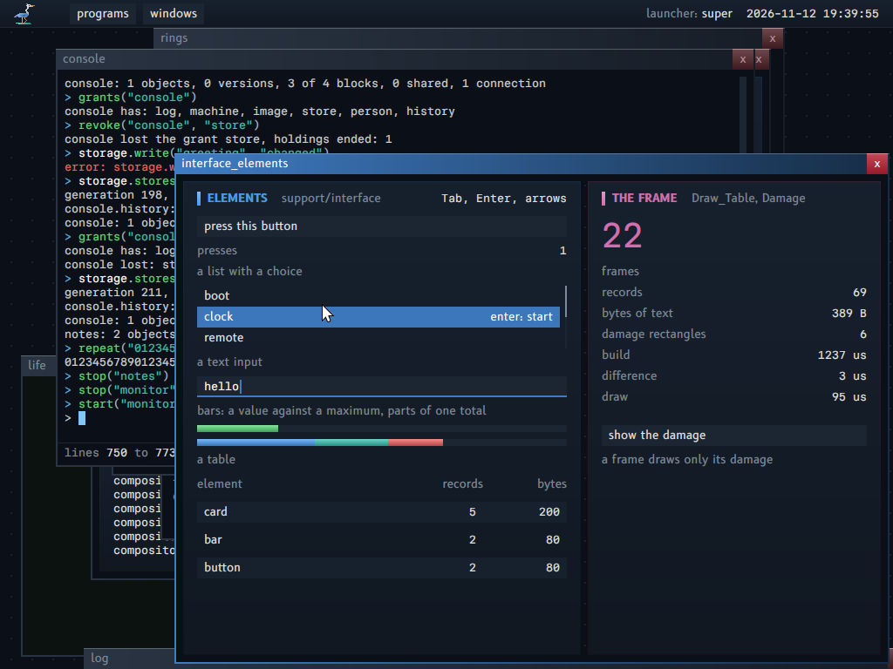

# The interface of the programs

The interface package (`support/interface`) is the shared logic of the interface of the programs: the draw records, the damage, the layout, the input and focus, and the text. The system draws in software, and this logic is still a foundation of its own. The package takes ideas from `gui_toolkit` and none of its code (section 11).

The terms of this document are in `GLOSSARY.md`, section "Desktop": interface package, draw record, draw table, element, element identity, damage by difference, interface state.

**The idea in plain words.** A program describes its window again at each frame, as a table of draw records of one size. The package compares that table with the table of the frame before, record by record, and draws only the rectangles that changed. So a program keeps no tree of widgets, and a tool can read, compare or record the table of any frame.

**For whom.** A reader who writes a window, and a reader who changes `support/interface` or the compositor.

**Read before.** `DESIGN.md` for the look; `FONTS.md` for the text.

**The map of this document.** Section 1: what the programs drew before. Section 2: the model, the draw records and the damage. Sections 3 to 6: layout, input and focus, text, the output. Sections 7 and 8: where the package lives, and property 20 in the compositor. Section 9: the vector font. Sections 10 to 12: decisions, what came from `gui_toolkit`, and the state of the conversions.

## 1. What the programs drew before the package

Before the package, each program drew its window by hand with `support/graphics`, and repeated the same cards, bars and tables. This section counts that repetition: it is the reason for the package. The counts are those of the day before the package; section 12 gives the state after the conversions.

Counted on 2026-11-11 (`master` `cbe3c0e`) with `grep` over `programs/*/` and `support/`:

| Fact | Count |
|---|---|
| Programs that draw with `support/graphics` | 34, with 13 995 lines in all |
| Lines that call a drawing function (`fill`, `text`, `block`, `unsigned`, `character`, ...) | 591 |
| Programs that draw a card or a band of a card by hand | 21 |
| Private copies of the procedure `card` (frame, accent bar, title, caption) | 5: the boot display, the compositor, `remote`, `scheduler`, `server` |
| Private copies of large text (each pixel of the font as a square) | 5: `large` in `remote`, `scheduler`, `terminal`; `write_large` in the boot display and `server` |
| Programs that draw a bar on a track | 15 |
| Programs that draw a table (a header, columns, bands) | 8 |
| Lists with a choice | 3: the menus and the palette of the compositor, `manual`, `errors` |
| Text inputs with a caret | 2: the palette, `terminal` (`console` draws through the terminal) |
| Programs that react to the pointer | 7; to the keys: 9. Each one tests rectangles by hand |
| Programs that track damage | 1: the compositor. Each other program draws its whole surface for each change, and `Present` damages the whole surface |

The developer tool `inspect` is not in this count. It drew a list with a filter and a choice, a band, tables and a hex view, all by hand (section 12 has its conversion).

Without the package, each card, bar, table and list is drawn again in each program, with its own numbers of pixels. A change of the rules (for example the close button, or the colors of the rules) then touches each program.

## 2. The model: an immediate pass over flat tables

**Choice: immediate mode.** Each frame, the program describes its whole window again, in code: `card`, `label_value_line`, `bar`, `button`. Each call appends fixed-size draw records to a draw table that the program owns, and gives back what the input did to that element ("pressed", "has the focus", "the text changed"). There is no tree of objects that lives between frames, no callback, no allocation.

Why, against a retained tree of widgets:

- The state of a window is the state of the program. A retained tree is a second copy of it that must be kept in step, which is the source of most interface faults. In immediate mode, a window cannot show a value that the program does not have.
- The output is data: a table of records of one size, in the memory of the caller (P14). A table can be compared, measured, sent to another rasterizer, or written to a file to test it.
- A retained tree gives damage for free: a node that changed knows its rectangle. Immediate mode loses that. Section 2.2 gives it back without a tree.

### 2.1 Draw record (format version 7)

A draw record is 40 bytes. The fields are little-endian, in this order:

| Offset | Field | Type | Meaning |
|---|---|---|---|
| 0 | `kind` | u8 | `None` 0, `Rectangle` 1, `Vertical_Gradient` 2, `Horizontal_Gradient` 3, `Text` 4, `Clip` 5, `Point_Grid` 6, `Folded_Gap` 7 (version 2), `Picture` 8 (version 2), `Text_Grid` 9 (version 3), `Line` 10 (version 4), `Interface_Text` 11 (version 7) |
| 1 | `text_scale` | u8 | Text, Interface_Text: 1, 2 or 3 (`DESIGN.md`, section 5) |
| 2 | `text_origin_thirds` | u8 | Interface_Text: the origin of the text after `x` + the ink margin, in thirds of a pixel: 0, 1 or 2 (version 7; it was `text_subpixel_x`, which no reader used). 0 for the other kinds |
| 3 | `kind_detail` | u8 | Line: the thickness in pixels, 1 to 32 (version 4; it was `reserved`). Text, Interface_Text: the weight, 0 regular, 1 bold (version 6: the titles of the cards; bold draws at scale 1 only). 0 for the other kinds |
| 4 | `x`, `y`, `width`, `height` | 4 x i32 | The rectangle of the record, in pixels of the surface. For text, the rectangle that the run covers. For an Interface_Text, the box of its measure grown by its ink margin on each side: every pixel of its ink is in it. For a line, the first end, and the second end minus the first: `width` and `height` can be negative |
| 20 | `first_color` | u32 | `0x00RRGGBB`: the color of a rectangle or a text; the top or the left color of a gradient |
| 24 | `second_color` | u32 | The bottom or the right color of a gradient. Interface_Text: the ink margin in pixels, at most `INK_MARGIN_LIMIT` (16) |
| 28 | `text_start`, `text_count` | 2 x u32 | Text, Interface_Text: the bytes of the run in the text table of the draw table. Picture: the index of the picture in `Draw_Table.pictures` and its generation. Text grid: the index of the grid in `Draw_Table.grids` |
| 36 | `element` | u32 | The low 32 bits of the element identity that wrote the record, 0 for none: a tool can say which element changed |

- `Clip` sets the rectangle that the next records are cut to, until the next `Clip`; a `Clip` of width 0 ends the cut.
- **No stack of clips**: a `Clip` replaces the cut, and a `Clip` of width 0 removes each cut. An element that clips inside an area that is already clipped removes the outer clip. A caller that nests clips writes the intersection itself, and ends with the outer clip again.
- **Places and sizes**: each edge of a record is cut to 2^30 pixels from the corner of the surface (`COORDINATE_LIMIT`), then the size is the difference of the two edges. A rectangle that covers the surface with places past the `i32` still covers it.
- **`full` and `refused`**: `full` says that a record or a text did not fit in the table. The table is not the frame, so the next frame of that picture is drawn whole. `refused` says that a record could not be made: a picture or a grid that the table does not have, or a grid whose cells are fewer than its rows. That record is missing, and each other record is in the table, so the difference stays exact.
- **Grids with large numbers**: `grid_valid` divides in place of a product, so a count of rows or a stride near the largest `int` cannot wrap and pass the check.
- A version number (`DRAW_RECORD_VERSION`, 7) is beside the format, as for the contracts. A new kind or a new field is a new version: 5 added the fill of a grid cell, 6 the weight of a text, 7 the kind `Interface_Text` and its byte `text_origin_thirds`.
- **An `Interface_Text` record of a hostile caller** draws nothing when its range is outside the text table, its third is 3 or more, its ink margin passes `INK_MARGIN_LIMIT`, its scale is not 1 to 3, or it has more than `INTERFACE_TEXT_LIMIT` (256) bytes. The checks are on the one copy of the record that the execution reads; the sums are in 64 bits, so no margin or range wraps. A program with no interface font draws such a record in the font of the cells at its origin, cut to its rectangle.
- The text of a run is in the text table of the draw table, not in the record: a record stays 40 bytes, and two runs with the same bytes compare equal.
- A `Picture` record shows the pixels of a picture of the caller. The program raises its generation when its pixels change; with the same generation the record compares equal and damages nothing. `life`, `paint`, `plasma`, `temple` and the surfaces of the windows in the compositor are pictures.
- A `Text_Grid` record shows a grid of text cells of the caller (`Text_Grid_Cell`: a character, reverse, a color; or filled: a character in its color on a cell of a fill color, for a list drawn over text, 12 bytes for each cell). Its 40 bytes do not change when its cells change: the difference compares the cells (section 2.4).

### 2.2 Damage by difference

The program keeps the draw table of the last frame that it drew (a second table, its own memory). After it builds the table of this frame, `damage_by_difference` compares the two tables, record by record, at the same index:

- Two records at one index are equal if their 40 bytes are equal and the bytes of their texts are equal. Nothing is damaged.
- If they differ, the rectangle of the old record and the rectangle of the new one are damaged: the old one must be painted over, the new one painted.
- The records after the end of the shorter table are damaged.
- The rectangles merge as in the compositor: rectangles that touch become one; with no room left (`DAMAGE_CAPACITY` 8), a new rectangle joins the first one.

Then `execute_in_rectangles` draws again, in each damage rectangle, each record of the new table that touches it, cut to the rectangle. The program never tracks damage by hand.

- **The limit of the index rule**: a record added in the middle of the table moves all the records after it, and they all compare as different: the damage is too large, never too small. It is right, and it costs only time. An element identity in each record (offset 36) allows a later rule that matches records by identity; the package does not use it.
- **Two pictures**: a surface with two pictures needs the table that was drawn in the picture that the program draws now, which is the table of two frames before. The caller keeps one table for each picture. The program draws the difference with its own picture, but it presents also the difference with the picture that the screen shows (`damage_of_two_pictures`): a frame equal to its own picture can differ from the screen. Without that rule, the terminal shows rows of two different frames (host test `two_pictures_screen_is_each_frame`).
- **The table of the shown picture is not known** (its copy failed, or it is full): the screen can show records of an older frame where the frame now draws nothing. The present is then the whole surface (host test `two_pictures_unknown_shown_table_presents_all`).
- **A new font**: on `Settings_Changed`, each record stays the same and each pixel of text changes. `window_events` calls `draw_whole_window_next`, which makes the next frame of each picture whole. The terminal and the manual read their events by themselves and call it.
- **A present that is lost**: `display.present_rectangle` gives false when the command ring is full. The picture then counts as not drawn, and its next frame is whole: with one picture, the next difference would see no change, and the screen would keep the old pixels.
- **Present with a rectangle**: `display.present_rectangle` gives the compositor the union of the damage: the compositor draws again only that part of the window. A full rectangle stays the default of `display.present`.
- **The cost**, measured by the program `interface_elements` on its window of 68 records, the mean of 100 rounds: nothing changed, 0 rectangles in 0.8 us; one number changed, 3 rectangles in 0.8 us; everything moved, 1 rectangle in 1.8 us: about 13 ns for each record. The whole frame is drawn in 366 to 411 us, a frame in its damage in 89 to 120 us. `clock` draws one picture in 11.6 us against 109.2 us by hand.

### 2.3 Memory of the caller, errors as values

- The caller gives the draw table (`records: []Draw_Record`, `text: []u8`) and the interface state. The package never allocates. Its core files make no kernel call; `window_drawing.odin` reads the events of a window and presents its surface.
- On the surface of a program, each damage rectangle is painted with the background before the records draw again (`draw_damage_on_surface`), and a whole frame starts from the background: a record that a frame no longer has leaves no pixel, with no rule for the caller. The compositor draws its panels over other windows, so it draws the records only.
- A table that is full stops taking records and keeps the flag `full`: the frame is drawn without the records that did not fit, the program can test the flag and write it on its log. No element fails in silence.
- An element gives its result as a value (`Element_Result`): pressed, has the focus, changed. Nothing is hidden in a context.

### 2.4 Text grid

A text grid is the element of the terminal: up to 104 x 32 cells, which a program changes many times in one second.

- The table of the frame now names the cells of the caller; each table before keeps its own copy of the cells that its picture shows (`draw_table_copy` copies them, about 26 KiB for each table of the terminal).
- The difference damages, in each row, the span from the first changed cell to the last one; the rectangles merge as in section 2.2. A grid that changes its size is damaged whole.
- The execution draws the cells of one color that follow each other as one text, so the text goes through `graphics.text_scaled` (and the glyph cache of the vector font) once for each run.
- The console draws no pixels: it writes records into its terminal, so the text grid of the terminal is the drawing of the console too.

### 2.5 Line

A `Line` record draws a straight line between two points, with a thickness, in one color: `draw_line(table, from_x, from_y, to_x, to_y, thickness, color)`.

- **The pixels**: the path of `graphics.line` (the line of Bresenham, integers only), with a square of the thickness at each point of the path. An even thickness starts one pixel before the point. The pixels are the same at each build and on each part of the surface: the execution in a damage rectangle walks the same path and cuts the squares.
- **One order**: `draw_line` writes the left end first, or the top end when the two ends have one x. A line and its reverse are one record, so they draw the same pixels and compare equal.
- **The damage**: the rectangle that holds each square of the path (`line_rectangle`). Pieces of the path would be tighter on a diagonal, but the damage list joins rectangles that touch (section 2.2), and the pieces of one line touch: the list would make them one rectangle again. A diagonal across a window damages its whole bounding rectangle.
- **Hostile values**:
  - A thickness of 0 or less gives no record. A thickness past 32 (`LINE_THICKNESS_LIMIT`) is cut to 32.
  - An end past 32 768 pixels from the corner (`LINE_COORDINATE_LIMIT`) gives no record. A cut end would change the slope, so the record would be another line. The bound exists because the execution walks each point of the path.
  - A record written by hand with a thickness of 0, a thickness past 32, or an end past the bound covers nothing: no pixel, no damage.
  - A line of length 0 is one square of its thickness. A line fully outside the area is cut away like each record.
- **The cost bound**: one execution walks at most 65 537 points and fills at most 32 x 32 pixels for each point inside the area.
- **Limits**: no rounded ends, no antialiasing, no dashes. Lines at an angle are allowed, sparingly (`DESIGN.md`, section 2).
- `draw_outline` appends the border of a rectangle as four rectangles, the same pixels as `graphics.outline`.

### 2.6 Window places

The compositor puts each window on the grid of 8 pixels (`support/bar/window_place.odin`, procedures with no state and their host test).

- A window that the pointer drags goes to the nearest point of the grid, then stays where 8 pixels of its title are on the screen, under the bar. At the left, the end of the title is at 8 or more, so the close button is on the screen too. Without that bound, a window dragged past an edge could not come back: the menu of the windows only brings a window to the front.
- A new window that fits stays at the place that the compositor chose, moved up and left until it fits. A window wider than the screen puts its close button at the right of the screen; a drag shows its left part. A window higher than the screen starts under the bar.

## 3. Layout

Layout places the elements of a window. The package has no solver: a program takes rows from a column and splits a row into columns, in one pass, with sizes that it states before it draws. The windows of the system have fixed sizes, so this one pass covers them.

- The unit is the grid of 8 pixels (`DESIGN.md`, section 6). An `Area` is a rectangle of the surface.
- **A column** gives areas from the top of its area to the bottom: `column_take(&column, height)`. The height of a line of text is 16, a line of a table 24.
- **A row** splits an area into columns in one pass: the caller gives the sizes of all the columns before it draws in them, so the row knows each width at once. A size is `Pixels` (a fixed width), `Characters` (a count of characters of the font: the width that the text measure gives) or `Share` (a part of what the fixed sizes leave, in proportion to its value). A gap is between two columns.
- **Alignment**: text is at the left, or at the right of its area (numbers: `DESIGN.md`, section 5), and in the middle of the height of a line.
- **One pass.** There is no tree and no constraint solver: what is not known before the row (the width of a text that the program has not made yet) is measured by the caller with `text_width` first. `gui_toolkit` solves sizes in five passes over a tree of boxes (standalone, upward, downward, violations, positions): the windows of this system have fixed sizes, and one pass with sizes declared before content covers each window of section 1.

## 4. Input and focus

The package gives each element its input with no callback: the program passes the events of the frame, and each element returns what happened to it. Only the focus, the element under the pointer and the pressed element live from frame to frame, by the identity of the element.

An example from `interface_elements`: `identity("list")` names its list in each frame, so the list keeps the focus while its rows change.

- The program gives each frame an `Input` record, filled from the `display.Event` records of the frame: the place of the pointer, a press and a release of the left button, and the keys pressed in this frame (at most 16).
- **Element identity**: an element that takes input has an identity, a u64 that the caller makes from a text with `identity("list")` (the 64-bit FNV-1a hash of the text). The identity must stay the same from one frame to the next for one element. Two elements with one text have one identity: `identity_with(base, row)` and `identity_in(parent, name)` make them two, and `Frame.identity_collisions` counts the elements of a frame that repeat an identity (a host test).
- The order of Tab holds 64 elements (`FOCUS_ORDER_CAPACITY`); an element after them takes a press but not Tab, and `Frame.focus_overflow` counts them.
- **The interface state** (`Interface_State`, memory of the caller, 544 bytes: three identities, the order of 64 identities and its count) keeps between frames: the element that has the focus, the element under the pointer, the element pressed and not yet released, and the order of the elements that can take the focus in the last frame.
- **The keyboard is a first path**: Tab and Shift+Tab move the focus in the order of the elements of the last frame; Enter and Space press the button that has the focus; up and down move the choice of a list that has the focus; a text input that has the focus takes the characters and Backspace. The palette of the compositor is the model: each thing that the pointer does, a key does.
- **Elements that take no input**: `list_of_rows` and `text_input_line` only draw. Their caller owns the choice, the typed text and the caret, and decides what each key does in a pure procedure of its own (`support/palette`, `key_action`): a host test then runs each state with each key, with no frame. `list_of_rows` gets only the rows that its area shows, with the place of the first one in the whole list, so its work is the rows on the screen. A row can have a mark that is the outline of a square, a name in the font of the cells with its own color, and a quiet detail after the name. `text_input_line` draws a line that `support/line_editor` edits: a caret at any place, at a scale of 1 to 3, and a field with no border, whose fill reaches each edge of its area.
- **The pointer**: an element under the pointer is "under the pointer" (the close button of a window is brighter); a press and a release on one element press it. A press on an element gives it the focus.

## 5. Text

A program asks for a font and a scale, measures a text, and writes a text record; the package and `support/graphics` draw it. Two fonts exist: the font of the cells (monospace, 8 x 16) for values, and the interface font (proportional) for the words that name and explain (`docs/FONTS.md`).

- **The interface of the text** is two functions and one record: `Font` (`kind`, `scale`), `text_width(font, text) -> pixels` and the records `Text` and `Interface_Text` of section 2.1, with `text_scale` (1, 2 or 3) and, for an `Interface_Text`, `text_origin_thirds`.
- **The font of the system** (`docs/FONTS.md`): the vector font by default, from the glyph cache that the root service maps, with a coverage for each subpixel band; Spleen 8x16 as the fallback and as the other value of the setting `font`. Both are monospace on cells of 8 x 16, so `text_width` and the layout do not change with the setting, and a `Text` record of the cells stays on whole pixels. `execute` draws a text record with `graphics.text_scaled`: the package does not know which font draws.
- **A change of the setting** comes as the display event `Settings_Changed`: `window_events` marks the window as not drawn, and the next frame draws it whole (each draw record is the same, each pixel of text is not).
- **The interface font** (`docs/FONTS.md`, section 12): the second `kind`, `Interface`, beside `Cells_8x16`. A `Draw_Table` names the interface font of its program (`interface_font`: the caches that `display` validated at `open`; `nil`: none); `window_frame_begin` sets it, so a program that draws its window with the package takes it with no change of its code. A table that a program builds itself (the compositor, the measures) has none unless the program names it.
- **A text is measured in the font that draws it**: `font_in_use` gives the font of a text of a table: the interface font only when the table has it, the setting is the vector font, and the text has at most 256 bytes; else the font of the cells. `text_measured_width`, `texts_measure` (many texts in one call: the lines of a list), `measured_size` (a column of a row, rounded up to the grid of 8) and `text_fit` (the longest start of a text that fits a room) all go through it.
- **Which element takes which font** (the rule of `DESIGN.md`, section 5): a text that names or explains takes the interface font: the title (bold) and the caption of a card, the label of `label_value_line`, the name of a button, the lines, the hint and the empty text of a list, the titles of a table, the placeholder of a text input. A value keeps the font of the cells: the count of a card, the value of `label_value_line`, `cell_text` unless the caller names a font, the typed text of a text input, `large_number`, the text grid. Each element cuts each text to its box with `text_fit`, in either font.
- **The damage of an interface text**: its record rectangle is its measured box grown by its ink margin, so the difference damages every pixel that it drew, and the execution of a damage rectangle draws again each record that touches it, in order, so an overlap of two neighbours is drawn as in the whole frame. The host test `damage_of_interface_text_equals_the_whole_frame` compares 200 pairs of frames, byte for byte.

## 6. The output and its execution

The draw table is the whole output of a frame. Execution turns it into pixels in the canvas of the program, either whole or only in the damage rectangles; both give the same pixels.

- `execute(table, canvas)` draws each record into a canvas of the program (its surface), in order: `Rectangle` is a `fill`, `Vertical_Gradient` is the `block` of the rules, `Horizontal_Gradient` is the `gradient` row of the title bar, `Text` is the font of the system.
- `execute_in_rectangles(table, canvas, rectangles)` draws, for each rectangle, the records that touch it, cut to it.
- **A later back end** (property 18, WebGPU): the same table is the input of a GPU pass: one instance for each record, the gradients in the vertex colors, the text from an atlas or from outlines (section 9). The format has no pointer and no field that only the processor can read.

## 7. Where it lives: the elements in each program, the drawing in a module

Shared code in this system is a module, loaded once and named by its hash. The interface package is cut in two parts. The part that a window calls two times for each frame, the difference and the draw, is the drawing module, which the programs import. The part that a window calls 30 to 200 times for each frame, the elements, the layout and the input, stays compiled into each program. This section weighs the two forms, gives the reason of the cut, and states the border of the drawing module.

Two forms were weighed:

| | A module with exports (P10) | A package of `support` |
|---|---|---|
| Code pages | One copy, shared by hash by each program that imports it (P11) | One copy in each program; the hash of each program changes with the package |
| The cost of a call | 3.9 ns through an import slot (measured by the program `imports`); about 200 element calls for one frame: under 1 us | 0: a direct call, often inlined |
| What the call passes | Must be described by the module contract (section 5 of `MODULE_CONTRACT.md`) | Any Odin type |
| A replacement of the module | Each program takes a new version with no new build (Replacement of an import) | Each program is built again |

The module is the right form: the interface is shared code, as P10 and P11 say. The calls of the interface pass tables of the caller (the draw table, the rows of a list, the columns of a row), so the description of an export must describe a table as a parameter (`MODULE_CONTRACT.md`, "Tables and bytes as parameters"). Passing an address as an Integer works in a direct call and means nothing in an isolated call: it breaks the contract.

**The choice**: a cut, not "one package, one module". `support/interface` is written as a module would be: each function takes the tables of the caller and fixed-size records, no global state, no callback. The cut follows the count of the calls and the size of the code:

| Part | Calls for one frame | Where it is | Why |
|---|---|---|---|
| The difference of two draw tables, the execution of a draw table, the text of the cells and of the interface font, the blends | 2 (3 on a surface with two pictures) | The drawing module, `modules/drawing` | Three procedures hold most of the bytes (the execution with the blends and the glyphs inlined in it, the draw of a glyph, the difference): about 20 KiB in each program. A border crossed two times for a frame costs nothing that a frame can show |
| The elements, the layout, the input, the measure of a text, the draw table | 30 to 200 | Each program, compiled in | They take a `^Frame` (three addresses) and slices, which a description cannot carry, and they are small and often inlined. One element call through an adapter costs about 100 ns more (below) |

**The drawing module** (`GLOSSARY.md`, "Drawing module"; `MODULE_CONTRACT.md`, "A library as a module"). Two exports, each with an error record:

| Export | Parameters | Result |
|---|---|---|
| `damage_of_draw_table_7` | `before: Table(Draw_Record, Read)`, `before_text: Bytes(Read)`, `now: Table(Draw_Record, Read)`, `now_text: Bytes(Read)` | `Table(Damage_Rectangle)`: at most 8 rectangles |
| `execute_draw_table_7` | `now: Table(Draw_Record, Read)`, `now_text: Bytes(Read)`, `rectangles: Table(Damage_Rectangle, Read)`, `pixels: Bytes(Change)`, `shape: Canvas_Shape` | Integer: the count of rectangles |

- **No copy.** In a direct call each parameter is one register with an address of memory of the program. The two draw tables and their texts are table places over the memory that the program gave to its `Window_Drawing`. The rectangles of the damage are written by the module into the `Damage` of the program: a `Rectangle` of the package and a `Damage_Rectangle` of the module have one layout, four integers of 64 bits. The pixels are `Bytes(Change)` over the surface memory of the window, which the compositor maps too: the module writes them in place. `Canvas_Shape` is a record of five integers: the width, the height, the stride, whether each rectangle is painted with a background first, and the color of that background.
- **Why bytes and not a handle for the surface.** A lent handle makes the callee map the memory object at each call. The program has the surface mapped already, and a direct call runs in its address space: the address is enough. An isolated caller still has a form: `Bytes(Change)` in a lent memory object (`MODULE_CONTRACT.md`, "Tables and bytes as parameters", form (iii)).
- **The frame before** is the table `before` of the window, which the window layer keeps and copies after each present. The module keeps nothing from one call to the next.
- **The version in the names.** The 7 is `DRAW_RECORD_VERSION`. The check of a replacement compares descriptions, and two versions of the draw record can have the same fields with another meaning of a value. With the version in the name of each export, a module for another version has no export with the name that the importer binds, and the load fails. A constant check in the module and in the package stops the build when the version changes and the names do not.
- **The errors.** An export fails with -1 and its error record: `Too_Long` of a table over 2^40 records or bytes, `Bad_Value` of a shape with a width or a height below 1 or a stride below the width, `Too_Small` of pixels that do not hold the shape, `Bad_Address` of pixels at an address that is not a multiple of 4. A record that is wrong draws nothing and makes no fault, as in the package. The window layer draws the next frame whole after a refused call, and keeps the record in `Window_Drawing.module_error`.
- **Memory (property 14).** The module allocates nothing and keeps no address of the caller after a call. Its own data is a cache of a fixed size, 29 KiB, one copy for each program (the loader gives each program its own copy of the writable data of a module): the choice of the font, the glyph caches of the program as validated records, the interface font, the table of square roots and the blend tables. The glyph caches themselves are resources of the boot image that the starter maps read-only: the module holds their validated headers, not their bytes.
- **The settings.** The module loads the text settings at its first draw, from the context of the program, with the code of `support/display` (`text_settings_load`), and writes no line on the log: the program validated the same caches when it opened its window. It reads the choice of the settings page again at each draw, so a change of the font or of the order of the stripes reaches the next frame with no message. The program still draws that frame whole (`Settings_Changed`).
- **What it does not draw.** A Picture record and a Text_Grid record name pixels and cells by an address in `Draw_Table.pictures` and `Draw_Table.grids`; a description carries values only. The module draws nothing for them. A program with such a record keeps the package compiled in, and the window layer refuses a frame with a picture or a grid in a program that draws through the module.

**The window layer** (`support/interface/window_drawing.odin`). `window_frame_end` has one path. It calls `frame_difference`, then `frame_draw`, which are the package or the two exports: the build setting `DRAWING_THROUGH_MODULE` chooses, and the module table of the kernel tool sets it for each program that imports the module. A whole frame and a frame with damage draw the same way: each rectangle is painted with the background, then the records that touch it are drawn. `Window_Drawing.module_calls` counts the calls of an export: 2 for a frame with damage, 1 for a whole frame or a frame with no change, 3 on a surface with two pictures.

**Which programs import it.** 23 programs: `budget`, `clock`, `crowd`, `cryptography_vectors`, `disk`, `extended_state`, `flow`, `frames`, `inspect`, `limits`, `locks`, `manual`, `monitor`, `net`, `notes`, `origin`, `quic_echo`, `randomness`, `remote`, `rights`, `rings`, `scheduler` and `unlock`. The programs that keep the package compiled in, and why:

| Programs | Why |
|---|---|
| `compositor`, `life`, `paint`, `plasma`, `processors`, `temple`, `threads`, `workers`, `terminal` | A Picture record or a Text_Grid record |
| `interface_elements`, `pointers` | They call the execution of the package themselves |
| `interface_font`, `settings`, `vector_glyphs` | They draw text with `support/graphics` themselves: they keep the text code and its state |
| `address_space`, `errors`, `fault_ring`, `kernel_events`, `return_fault` | Each starts a child of its own file with no load source: the loader of the child would not find the import |
| `imports`, `tally` | `imports` is the test of the loader and counts its own imports; other programs load `tally` as a library |
| `root`, the boot program, `host` | They import nothing: the kernel starts the root service with no loader for imports, the boot program is not a module, and the call host loads the module of a call |

**The proof of the same pixels.** A picture of the whole screen cannot prove it: the hash of each converted program changes, and the screen shows hashes and times. The proof compares the bytes of a canvas:

- The host test `the_exports_draw_the_same_bytes_as_the_package` (`modules/drawing`) builds 24 pairs of frames with a record of each kind that the module draws, in 7 font states (Spleen, the vector font and the interface font, each order of the stripes). It draws each frame with the package as a window drew it before the module (the clear and the execution of the whole frame, then the difference and the draw of the damage) and through the two exports with the argument forms of a caller. The damage rectangles are equal, and the two canvases are the same bytes after the whole frame and after the damage. In a host test the two ways share one text state: the test proves the border, the fill and the rectangles.
- The program `interface_through_module` draws one frame two times in the machine: with the package compiled in, which draws with the text state that the program loaded, and through the drawing module, which draws with the text state that the module loaded. It compares the bytes and writes "the same bytes: as it must". This proves that the two copies of the code chose the same fonts from the same context.

**The elements as a module: the test of the claim** (`MODULE_CONTRACT.md`, "Tables and bytes as parameters"): the module `interface_module` has six exports that call the element functions of the package with no change to the package: the draw table is a `Table(Draw_Record, Append)`, the text table `Bytes(Append)`, an area a Record, the area of the content of a card a `Table(Area, Change)` of one row. The program `interface_through_module` imports it, builds one frame through it and the same frame with the package compiled in: the two draw tables are equal, record for record. Where the claim does not hold exactly: (1) the calls are not the same calls: a function of the package takes a `^Frame` (three addresses: the table, the state, the input), which a description cannot carry; an export takes the two tables and the records of its element, and makes a frame over them for one call. (2) The record `Draw_Record` has fields of 1 and 4 bytes: the description has Integer fields of 1, 2 and 4 bytes for them. (3) The elements that take input (a button, a list, a text input) keep the interface state of the program between frames: as exports they need the state as a `Table(Interface_State, Change)` of one row; this is not done. Measured (the program `interface_through_module`, QEMU with KVM, one run, the least of 200 builds): one frame of 31 draw records in 25 element calls took 6 556 ns through the module and 4 055 ns with the package compiled in: about 100 ns more for each element call. A call through an import slot costs 2.4 ns (the program `imports`): the rest is the adapter, which builds each element into a frame of its own and appends it to the tables of the caller. This cost is the reason why the elements stay in the program.

**Measures of the cut.** Two programs, `clock` and `monitor`, built two times, with the package and with the two calls through a module (QEMU with KVM, one run each, other work on the host):

| | Package compiled in | Through the module |
|---|---|---|
| The file of `clock` | 92 112 bytes | 72 864 bytes (-21 %) |
| The file of `monitor` | 114 688 bytes | 94 208 bytes (-18 %) |
| `clock`, one picture, the mean of 10 | 29.1 us | 34.1 us |
| `clock`, the draw of 34 records in 1 damage rectangle | 16.3 us | 17.7 us |

Two runs of the same code differed by 30 % on the draw time (12.6 and 16.3 us): the difference between the two columns is inside that spread. The sizes of this build are a line of the kernel tool at each build ("the library module drawing has ... bytes"), and the window of `clock` prints its build, difference and draw times: both are measures, and no test asserts them.

## 8. Property 20 and the compositor

- The package draws only into the canvas that the caller gives: a program draws only into its own surface. The package has no handle and makes no kernel call (P20: no ambient access).
- The compositor is a user of the same package: its palette is built as a draw table, executed into its frame, and damaged by difference as each program's window is.

## 9. Text: a vector font, research note and prototype

This section is the research behind the vector font. The system draws a vector font by default, with subpixel bands, and Spleen 8x16 as the fallback. The built design is in `docs/FONTS.md`: a rasterizer in fixed point and a glyph cache made at build time. The prototype below (floating point, no cache) is replaced.

### What Slug does

Slug (Eric Lengyel, JCGT 6(2), 2017, <https://jcgt.org/published/0006/02/02/>) draws a glyph from its quadratic Bézier curves in the pixel shader, with no bitmap. For each pixel, it casts a horizontal and a vertical ray, finds where each ray crosses each curve of the glyph (the roots of a quadratic, with a robust classification of the end points so that no pixel drops or sparkles), and takes the coverage of the pixel from the signed distances of the crossings: an antialiased edge that is exact at any scale and under any transform. To keep the work small, the glyph is cut into horizontal and vertical bands, and each band lists only the curves that touch it, sorted so that the shader stops early. Since 2019, "dynamic dilation" grows the box of each glyph by half a pixel on the screen in the vertex shader.

### Its state today (verified on 2026-11-11)

- **Patent**: US 10,373,352 (granted 2019, to 2038). On 2026-03-17 its author filed USPTO form SB/43 and paid the fee to disclaim the rest of its term, "permanently and irrevocably dedicating the Slug patent to the public domain" (<https://terathon.com/blog/decade-slug.html>, "Patent Announcement"; also <https://blog.adafruit.com/2026/03/22/slugs-out-the-algorithm-that-made-text-look-perfect-is-now-free-or-how-to-give-away-a-patent/>). Google Patents still shows the patent as "Active": that site does not show the disclaimer of 2026; this is the state of an aggregator, not a contrary fact. The USPTO record itself was not read.
- **Reference code**: <https://github.com/EricLengyel/Slug>, shaders "freely used by anyone for any purpose"; a distributed program must give credit. One reader names the license MIT or Apache-2.0 (<https://luv.swa.sh/slug-bezier.html>); GitHub shows "Other". The system copies no code: the ideas are free to use.
- `gui_toolkit` has a Slug path on the GPU (`docs/text.md`, "Slug"), with stem darkening, hinting for small sizes and coverage per color stripe; its note `slug-small-text.md` says that Slug text at 11 to 16 pixels looks softer than hinted bitmaps, and that closer to the reference is not the same as sharper.

### What it means for this system

- This system draws with the processor (the first stage of property 18). Slug is a GPU method: the bands and the root solvers save work for thousands of pixels in parallel. On the processor, the same exact coverage comes cheaper from a scanline rasterizer: each line segment of the outline adds its signed area to an accumulation row, and one prefix sum gives the coverage of each pixel (the method of font-rs and of stb_truetype 2). The quadratic curves are cut into line segments within a tolerance.
- **The prototype** (`support/vector_font`, the program `vector_glyphs`): a parser of a subset of TrueType (`head`, `hhea`, `maxp`, `cmap` format 4, `hmtx`, `loca`, `glyf` with simple glyphs) that checks each offset and each count against the length of the file (a font is hostile input); a rasterizer with exact area coverage, a horizontal position in 1/64 of a pixel, and an option of coverage per color stripe (three samples per pixel, then the 5-tap filter 8, 77, 86, 77, 8 / 256 against color fringes).
- **The measures**: one glyph of Spleen 8x16, 32 ns; one glyph of 13 pixels from its outline, 2939 ns in grayscale, 2396 ns on a whole pixel, 5502 ns with color stripes: about 90 times more, with no cache of the coverage of a glyph. The picture `vector_glyphs` shows the same text in the two fonts, and one glyph enlarged 8 times in grayscale and with color stripes.
- **What the picture shows**: at 13 pixels the outline font has the shapes of its design and even spaces (an advance of 7.8 pixels), and its stems are softer than the stems of Spleen, which sit on whole pixels; the color stripes give sharper sides with faint colors at the edges. Spleen is sharper at its one size.
- **The font**: a font needs a license that allows embedding in a program of the system. Candidates: DejaVu Sans Mono (Bitstream Vera license, DejaVu changes in the public domain; TrueType outlines), Noto Sans and Noto Sans Mono, Inter, IBM Plex, JetBrains Mono, Source Code Pro (SIL Open Font License 1.1: embedding allowed, no sale of the font alone). The prototype uses DejaVu Sans Mono, a monospace font like Spleen, with its license beside it.
- **The rules**: a vector font keeps the grid: one size for the text of the interface (a cap height that is a whole number of pixels, as the reference of Slug advises), a large size for the one number of a card; the line height stays 16 or 24.

## 10. The decisions of this design

1. The model: immediate mode over draw tables, damage by difference (sections 2 and 2.2).
2. The form: a `support` package, and a module when the contract describes a table as a parameter (section 7).
3. The font: a vector font by default, subpixel bands, Spleen as the fallback. The open decisions (the font file, the grid fit) are in `docs/FONTS.md`, section 11.

## 11. What was taken from `gui_toolkit`, and what was not

`gui_toolkit` (MIT license, 2026) was read for ideas. No code was copied.

Taken as ideas:

- **Immediate mode with a state kept by identity** (its `Box` with a `Key`, from the RAD Debugger): elements are described again at each frame, and only the focus, the element under the pointer and the pressed element live between frames, by identity.
- **Signals as a value** (its `Signal`: pressed, clicked, focused, ...): here `Element_Result`.
- **Damage is never negotiable for correctness** (its `damage.odin`: "a partial frame must be byte-for-byte identical to the full frame", with a verify mode that draws both): here the host tests compare a frame drawn in its damage rectangles with the same frame drawn whole.
- **A bounded list of damage rectangles that merge** (its `MAX_DAMAGE_RECTS` 16): here 8, as the compositor.
- **The keyboard is a first path** (Enter and Space press, as its `clicked`).
- **Text measured by the font, drawn from runs** (its `draw.glyph_run`): here the text record with a subpixel position, ready for a vector font.

Refused:

- **The damage given by the application** (its `damage_add` that the program calls): here the package computes it by difference, so a program cannot forget a rectangle.
- **The layout solver of five passes over a tree** (sizes by text, percent, sum of children, violations): one pass with sizes declared before content (section 3).
- **Floating point, transforms, round corners, shadows, themes** (its `draw` layer): the rules of this system are integer rectangles on a grid.
- **Allocation by the toolkit** (its frame allocator and maps): the caller gives each table.
- **A font stack of a host system** (DirectWrite, Fontations, HarfRust): the system has its own font.

## 12. State of the conversions

Most programs now draw their window with the package. This section lists the invariants that the host tests hold, each converted program with its counts before and after, what the pictures showed, and the programs that are not converted.

### Invariants and what holds them

| Invariant | Where | What holds it |
|---|---|---|
| `line_add` of the vector font writes no cell past its row, also for a vertical segment on the last column and a coverage of width 1 | `support/vector_font/raster.odin:34`: `if start_y == end_y \|\| target.width < 2 { return }`; line 60: `if left_index < 0 \|\| left_index + 1 >= target.width \|\| right_index >= target.width` before the clamp | Host test `segments_at_the_edges_stay_in_their_rows` |
| A `Present` for the whole surface with a place of its own damages nothing past the window | `programs/compositor/main.odin:317-318`: `changed_width, changed_height := client.surface.width - left, client.surface.height - top` | The compositor does not run on the host: no host test. The rectangle stays inside the surface in each case by its two lines; the machine test draws each window |
| A text input takes Enter in the order of its keys, not before the characters of the same frame, and stops there | `element_interact` takes no Enter for a text input | Host test `text_input_keys_in_their_order` (keys `l s Enter x` give "ls", activated, `x` not taken) |
| A key past 16 in one frame is not dropped | `window_events` stops when the input has 16 keys; the other events wait in the ring | Host test `a_full_input_says_so` (the reading itself needs a ring: no host test of it) |
| A frame drawn in its damage rectangles equals the same frame drawn whole, for each kind | The partial-frame test covers a clip that changes, horizontal gradients, text at the scales 1 to 3, records outside the surface, records of one line, more than 8 rectangles (the merge), a full table, pictures | Host tests `damage_is_never_too_small_for_each_kind`, `picture_and_folded_gap` |
| A number with more than 20 digits indexes no place before `digits` | `min(minimum_digits, 20)` | Host test `number_with_many_digits` |
| A negative height of a column does not make `used` smaller | `top + max(height, 0)` | Host test `column_negative_height` |
| `row_split` checks its sizes | Negative sizes are 0, fixed sizes are cut, each column stays in the row, no overflow | Host test `row_split_checks_its_sizes` |
| A press under the last line or on the bar of a list chooses no line; a cut choice is reported | The list | Host test `list_press_and_cut_choice` |
| Tab in the palette does not move the focus | `palette.key_action` gives no action for Tab | Host test `each_key_in_each_state` of `support/palette` |
| Two elements with one text get two identities; elements past 64 are counted | `identity_in` and `identity_with`; `Frame.identity_collisions` and `Frame.focus_overflow` count them; section 4 says the limit | Host test `identity_collision` |
| `draw_text_right` keeps the element; an `int` is not cut to `i32` with no check | The element passes; each place and size is clamped to `i32` | Host test `coordinates_are_cut_to_i32` |
| The core files make no kernel call | `draw_table.odin` and the other core files; `window_drawing.odin` reads events and presents (section 2.3) | Read |
| A table that does not cover its surface leaves no stale pixel | Each damage rectangle of a surface is painted with the background first (`draw_damage_on_surface`), a whole frame starts from the background, with no rule for the caller | Host test `a_gone_record_leaves_no_pixel` |
| Names are complete words | `raster.odin`: `start_x`, `signed_height`, `width_inverse`, `first_x`, ...; `parse.odin`: `start_read`, `end_read`, `glyph_bytes`; `vector_glyphs`: `pixel_x`, `pixel_y`; `bar`: `full_width`; the palette: `first_row`, `matched_count`. The TrueType tags stay | Read |

The package has 49 host tests (45 in `support/interface/interface_test.odin`, 4 in `interface_font_test.odin`), and `support/vector_font` has 22.

### The converted windows

"Calls" are the direct drawing calls of `support/graphics` (`fill`, `text`, `block`, `unsigned`, `character`, `clear`, `line`, `outline`) in the program before the conversion (`859f078`) and after. "Module" is the size of the module file, in bytes, on `master` `c909390` and after the conversions: the package is compiled in each program.

| Program | Calls before | Calls after | Module before | Module after |
|---|---|---|---|---|
| inspect | 58 | 0 | 81 920 | 90 112 |
| scheduler | 50 | 0 | 61 440 | 73 728 |
| monitor | 29 | 0 | 49 152 | 61 440 |
| locks | 20 | 0 | 86 016 | 98 304 |
| disk | 19 | 0 | 35 284 | 45 124 |
| limits | 17 | 0 | 28 129 | 42 225 |
| crowd | 15 | 0 | 28 672 | 45 056 |
| tally | 15 | 0 | 36 864 | 49 152 |
| flow | 13 | 0 | 28 672 | 40 960 |
| budget | 12 | 0 | 28 672 | 40 960 |
| notes | 12 | 0 | 53 248 | 65 536 |
| errors | 11 | 0 | 134 113 | 144 609 |
| rights | 11 | 0 | 24 576 | 40 960 |
| frames | 11 | 0 | 73 728 | 90 112 |
| imports | 11 | 0 | 81 920 | 94 208 |
| net | 10 | 0 | 50 179 | 64 515 |
| origin | 10 | 0 | 24 576 | 40 960 |
| manual | 10 | 0 | 114 688 | 126 976 |
| life | 2 | 2 (its own board picture, by design: the Picture record) | 32 768 | 51 148 |
| clock, remote, the palette | 32, 31, 48 lines | 0 | | |
| Sum of the 19 programs above | 346 | 2 | | |

- Each converted module grows by 8 to 16 KiB (2 to 4 pages): the package is in each one. `processors`, which is not converted, grows by 4 KiB from the measure of pictures of `display`. This is the measured argument for the package as one shared module (section 7): about 230 KiB in all for these programs, today paid once for each.
- The boot image: 3 284 753 bytes on `master` `c909390`, 3 566 097 bytes with the conversions (+281 344).
- Lines: in the 19 programs, 865 lines added and 494 removed (+371), against 1 242 lines of the package (and 537 of its host tests). A conversion replaces each drawing call by one record and adds the tables of the program and the frame: it does not make the programs shorter. It removes the five private copies of `card` and of large text in the converted programs, it gives each window the damage by difference and the keyboard, and one change of the rules now changes every converted window.
- The times of the pictures are not published: the host had a load of 17 to 62 during each run of the conversions, and a measure above a load of 8 is not valid. `kerneltool measure windows` (in the form of `kerneltool measure scheduler N`) starts each converted window alone in a measure build and prints one table of the time of the first picture and of the mean of 3 and of 10, with the load of the host. It needs a quiet host. To measure "before", run the same command on the commit "display measures the time of a picture" (the programs before the conversion with the marks of the measure).

### What the pictures of the conversions show

- `inspect`: a card cuts its caption to the room between its title and its count (host test `card_caption_stays_inside`), so the caption "Program_Report" of the narrow SLOTS card does not touch its right border. The columns "weight" and "req us" of the threads have room, so they do not read as one.
- `scheduler`, `locks`, `manual`, `life`: no fault seen.
- `limits`, `crowd`, `origin`, `rights`, `disk`, `notes`: no clipped text and no column out of place. `crowd`: its header "kernel entries, one million records" ends 8 pixels from the right edge of the window. `notes`: an empty band between its status line and its keys.

### The layers of the conversion

Each layer is a commit that passed the main scenario; the last one passed the full check (789 checks).

| Layer | Direct drawing calls before / after | Module before / after (bytes) | What holds it |
|---|---|---|---|
| The compositor: its windows (frame records and the surface as a Picture record), its bar and its two menus (cards) in one draw table for each frame | 42 / 7 (the pointer, the points of the background, the copy to the screen) | 125 723 / 121 979 | The main scenario (menus, moves, close buttons); one measure run: the frame of a window of 800 x 600 by hand 8.5 us, as 9 records 8.9 us (load 39 to 63: an indication only) |
| The boot display: its five cards are the card of the package | the card by hand / `interface.card` | `boot` 69 632 / 77 824, `root` 172 032 / 180 224 | The pictures `boot`, `boot_fails`; the UEFI loader builds with the package (no kernel call in the core files) |
| `paint`, `plasma`, `temple`: Picture records (`interface.show_picture` for one picture) | paint 13 / 5, plasma 0 / 0, temple 18 / 18: the remaining calls draw into the picture of the program, by design | paint 45 056 / 61 440, plasma 24 576 / 45 056, temple 212 992 / 229 376 | The pictures `desktop_moved`, `temple` |
| The text grid (section 2.4) and `terminal` | terminal 29 / 0 | 49 152 / 65 536 | Host tests `text_grid_damage_for_each_cell`, `text_grid_draws_its_cells`, `two_pictures_present_what_the_screen_shows`, `two_pictures_screen_is_each_frame`; the pictures `terminal`, `terminal_held`, `terminal_keys`, `terminal_stopped` |
| Window places on the grid of 8 | | | The compositor places each new window and each moved window with its corner on the grid; the scenarios move windows with steps `Move`; the tool reads places from `compositor.windows()` once it has the grant acts_for_principal; the full check |

- Sizes are on `master` `b97fb08` against the layers; the boot image is 5 338 592 bytes against 5 531 104 (+192 512).
- With these layers, the package grew by 401 lines (with 3 host tests and 1 simulation); the 16 changed files gained 844 lines and lost 273.
- `flood`, lines in one second, as the terminal logs them: 3 492 315 before the text grid (load about 50), 4 651 133, 3 567 351 and 2 429 679 after (loads 15 to 23). Each is above a load of 8, so none is a valid measure; the text grid did not make the console slower in these runs. A frame of the terminal now draws only the rows that changed.
- With two pictures, a frame presents its difference with its own picture and its difference with the picture that the screen shows. The screen shows the other picture: with the first difference alone, rows of two frames mix on the screen (in `terminal.png`, a row half of one line and half of another). The rule and a simulation of the screen are in section 2.2.
- The pictures of these layers: `desktop_moved` (plasma, paint, life, monitor on the grid), `temple`, `boot`, `rings`, `terminal`, `terminal_held`, `terminal_stopped`, `menu`, `windows`. A fact of the boot display, such as the processor name, is cut after its last whole word, not in the middle of a word. The keys hint of the terminal is left out when the text at its left takes its room, so it does not run over "older than the lines kept". The pictures show no other clipped text and no misaligned column.

### Lines and shared pictures

- `rings` draws its rings with `Line` records and its nodes with `draw_outline`: 0 direct drawing calls (19 before).
- `threads`, `workers` and `processors` keep the pixels that their threads compute in a picture of the program, in the memory that the threads share. The window shows it with a `Picture` record. For `threads`, the generation of a square is the frame count of its thread. For `workers` and `processors`, the generation is the number of the picture times 1024, plus its complete tiles or rows. Direct drawing calls after the change:
  - `threads`: 1 (9 before), the clear of each square picture to the background at the start.
  - `workers`: 1 (21 before), the clear of its picture at the start.
  - `processors`: 2 (22 before), the clear of its picture at the start and at each new picture.
  - Each of these calls draws into a picture of the program, not into the surface. The threads write the pixels of the picture directly: that is the subject of these programs.
- A frame of these windows copies the picture only when its generation changed. A picture can be copied while a thread writes it, as before when the threads wrote into the surface. The next generation copies it again.
- `crowd`: the window ends 12 pixels after its widest header, the same margin as at the left, and the header stays in its column.
- `notes`: the line of the keys follows the status line, with no empty band. When the grant of the store ends, the line that says so takes the place of the keys. The window is 30 pixels shorter (208).

### Not converted, and why

- `server`, `fetch`.
- `console`: it draws no pixels; its terminal draws it (section 2.4).
- `log`, `pages`: colors of their own meaning and a layout of their own. `twin` and `fault` have no window.
- The pointer of the compositor.
