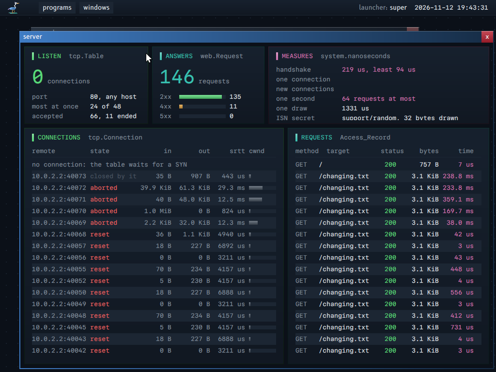

# The network: TCP as a library in the program

The first layer of the network is the base: the frame service, the network service, endpoints of datagrams. `GLOSSARY.md` defines the terms.

**The idea in plain words.** No program opens a connection because it runs. The root service gives a program a grant that names what it can reach: one remote (a client grant) or one port on which it answers whoever comes (a listen grant). The network service checks each datagram and segment against that grant; the protocol itself, TCP or QUIC, is a library inside the program, so a fault in it harms only that program.

**For whom.** A reader who writes a program that uses the network, and a reader who changes the network service or the TCP library.

**Read before.** `PROPERTIES.md`, "5. Kernel off the data path" and "20. No ambient access: the other holes to close" (line 3). `ARCHITECTURE.md`, "U7. Network steering service". After this guide, `QUIC.md`.

**The map of this guide.** "The principles" and "The parts" give the model and the programs. "The path of a datagram and of a segment" says which program touches the bytes, hop by hop, and who checks what. "The segment endpoint" is the grant of TCP and its checks. "The TCP library" is the protocol in the program. "The tests" and "The HTTP server" show it at work. "The listen grant of UDP" and "QUIC: what it reuses, and what it needs" lead to `QUIC.md`.

## The principles

The kernel carries no network data and holds no network protocol. A program that talks over the network runs the protocol itself, as a library, and one service of user space only checks each datagram or segment against the grant of the program. Three rules follow:

- The network stack is a library in the program that uses the network (property 5). A fault in TCP or QUIC harms only the program that runs it.
- The network service is on the control path of each datagram and each segment: it reads the headers and checks them against the grant. It is on the data path for one copy in each direction, and for nothing else: it computes no checksum of the bytes and writes no header of UDP or TCP. The reason is the device of the first machine, which has one pair of queues (section "The path of a datagram and of a segment").
- The network has UDP, TCP and QUIC, and a server as a scenario: `server` speaks HTTP over TCP, and `quic_echo` and `remote` speak QUIC over UDP.

## The parts

Each part of the network is a program or a library of user space. The table names each one, where its code is, and what it does.

| Part | Where | What it does |
|---|---|---|
| TCP library | `support/tcp` | The state machine, the windows, the timers, the reassembly, the congestion control. Pure code over memory of the caller: no kernel operation, no allocation. The kernel tool uses the same package on the host |
| Network service | `programs/network` | Gives each program with the grant one endpoint. It checks the header of each datagram and each segment against the grant, writes and checks the IPv4 header, and copies the datagram or the segment one time. It computes no checksum of UDP or TCP and keeps no state of a connection |
| Protocol library | `support/network` | For the network service: Ethernet, ARP, IPv4, ICMP echo, and the checks of the header of UDP and TCP (`parse`). For a program with a datagram endpoint: the UDP header and its checksum (`udp_header_write`, `udp_data_read`) |
| Server | `programs/server` | A program with a listen grant on the TCP port 80. One thread serves all its connections from one connection table. It speaks a small HTTP/1.1 |
| Client | `programs/fetch` | A program with a segment grant of one remote. It fetches pages and measures |
| QUIC server | `programs/quic_echo` | A program with a listen grant of UDP on the port 4433: QUIC in the program (`docs/QUIC.md`, section 6) |
| Remote service | `programs/remote` | The calls of the host: a QUIC server with a listen grant of UDP on the port 7100 that admits the address of the host (10.0.2.2) only. Each call is one QUIC stream (`docs/QUIC.md`, section 7) |
| Peer | `tools/kerneltool/peer.odin` | The gateway of the test machine. It is also a TCP client that the tool drives, with loss, reorder and duplicates that the tool chooses, and the QUIC client of the remote service |

The kernel has no network code.

## The path of a datagram and of a segment

A datagram or a segment passes through several programs between the device and the program that uses it. This section names each hop, the bytes that the hop reads or writes, and the party that checks each field. Two terms sort the hops (`GLOSSARY.md`): the data path is the code that reads or writes the bytes of the data; the control path of a packet is the code that reads the headers and decides where the bytes go.

The payload of a frame is what follows the IPv4 header: a whole datagram with its UDP header, or a whole segment with its TCP header. UDP and TCP take the same path through the network service: the program writes and reads the whole payload, and the network service treats the two alike.

### A datagram or a segment that arrives

| Hop | What runs | Bytes of the payload that it touches |
|---|---|---|
| The device | It writes the frame into a receive place of the frame region | Written one time by the device |
| The frame service | It reads the used ring and gives the length of the frame to the network service | None: it reads no frame |
| The network service | `network.parse` checks the headers of Ethernet and IPv4 (with the IPv4 checksum, 20 bytes), then the lengths of the header of UDP or TCP | The header only: the two ports, the length field of UDP, the data offset and the flags of TCP |
| The network service | It finds the endpoint by the local port, checks the remote against the grant, and admits a remote of a listen grant | None |
| The network service | `deliver` copies the payload into the place that the program gave | **One pass: the copy** |
| The program | TCP: `tcp.step` checks the TCP checksum, then reads the header and copies the data into the receive buffer of the connection. UDP: `network.udp_data_read` checks the UDP checksum, when the program asks for it | The passes of the program itself |

### A datagram or a segment that leaves

| Hop | What runs | Bytes of the payload that it touches |
|---|---|---|
| The program | It writes the payload in a place of its datagram region: the header of UDP or TCP, the data, and the checksum over both (`tcp.header_write`, `network.udp_header_write`) | The passes of the program itself |
| The network service | It copies the payload from the region to a send place of the frame region | **One pass: the copy** |
| The network service | `header_granted` reads the two ports, and the length field of UDP, in its own copy, and checks them against the endpoint and the grant | The header only, in the copy |
| The network service | `network.ipv4_frame` writes the headers of IPv4 and Ethernet | None |
| The frame service | It gives the frame to the device | None |
| The device | It reads the frame region | Read one time by the device |

### The passes of the network service

A pass is one read or one write of each byte of a payload by one program. The table gives the passes of the network service for each byte, in this form and in the form with the checksums of the transport in the network service.

| Direction | Protocol | With the checksums in the network service | This form |
|---|---|---|---|
| Arrives | TCP | 2: the TCP checksum, then the copy | 1: the copy |
| Arrives | UDP | 2: the UDP checksum, then the copy | 1: the copy |
| Leaves | TCP | 1: the copy | 1: the copy |
| Leaves | UDP | 2: the copy, then the UDP checksum | 1: the copy |

The network service counts its passes. For each endpoint and each direction it counts the datagrams or the segments, their bytes, and the bytes of each pass (`data_pass` in `programs/network`, called at each place that reads the bytes). When an endpoint ends, the log has two lines: a measure, "network: a measure: the endpoint of server, TCP: the passes of this service over the data for each payload byte: 1.00 on receive (...), 1.00 on send (...)", and the structural fact, "network: the endpoint of server, TCP: this service read each payload byte one time on receive and one time on send, for the copy, and computed no checksum of it: as it must". The machine tests of `net`, `server` and `quic_echo` wait for the second line. It is a count of passes, not a speed.

The one copy on receive cannot leave with this device. The device chooses the place of a frame before any program knows whose frame it is, so one program that is not the receiver must read the headers, and the bytes must then move to the receiver. The copy on send can leave: the device can read the data from the datagram region of the program, when the network service gives it a private copy of the headers. That form is not built. A device that gives each endpoint its own receive queue, and steers frames by the destination port, removes the copy on receive too; the device of the test machine has no such queues.

### Who checks what

| Field | Who checks it | Where |
|---|---|---|
| The headers of Ethernet and IPv4 of a frame that arrives, with the IPv4 checksum | The network service | `network.parse` |
| The lengths of the header of UDP or TCP of a payload that arrives | The network service | `network.parse` |
| The local port and the remote of a payload that arrives, against the endpoints and their grants | The network service | `arrived` in `programs/network` |
| The checksum of a segment that arrives | The program | `tcp.step`: a wrong one adds to `Table.bad_checksums`, changes no connection and gets no answer |
| The checksum of a datagram that arrives | The program | `network.udp_data_read` with the rule `Verify`. A QUIC program gives the rule `Do_Not_Verify`: QUIC authenticates each packet, so the checksum adds nothing (`docs/QUIC.md`, "One private copy of each datagram") |
| The source port of a payload that leaves: a local port of the endpoint | The network service, in its copy | `header_granted` |
| The remote of a payload that leaves: the address of the command and the destination port of the header, against the grant or the admitted remotes | The network service, in its copy | `header_granted` |
| The length field of a datagram that leaves | The network service, in its copy | `header_granted` |
| The source address of a payload that leaves | Nobody: the network service writes it | `network.ipv4_frame` |
| The checksum of a payload that leaves | Nobody on this machine: the remote does | — |

Three rules follow from the table.

- **A program cannot send as another program.** The network service writes the source address. It reads the source port in its own copy of the header, after the copy, and never reads the region of the program a second time: the program cannot change what was checked. A program controls the data and the checksum of its own datagrams and segments, and nothing else.
- **A wrong checksum harms its writer only.** A program that sends a wrong checksum loses its own datagram or segment: the remote drops it. A program that does not check the checksum of what it receives takes damaged bytes as data: the harm stays in that program. The TCP library always checks. A program with a datagram endpoint chooses the rule in its call of `network.udp_data_read`.
- **The checksum comes after the choice of the endpoint.** The network service chooses the endpoint by a port that it did not check with the checksum. A frame whose port the wire damaged, and that the check of Ethernet let pass, can reach the endpoint of another port. The program of that endpoint then refuses it by its checksum, after it saw the bytes. The grant, not the checksum, is the guard against a hostile sender: a hostile sender writes a correct checksum.

`net` shows the two sides in the machine test: the peer sends one datagram with a wrong UDP checksum to the port of `net` ("net: UDP from 10.0.2.2 port 7 with a wrong checksum: dropped by this program: 1 datagram; ..."), and `net` writes one datagram with another source port, which the network service refuses ("net: UDP from the source port 1234: refused: ..."). `net` also writes a datagram whose length field says one byte more than its Send gives ("net: UDP with a wrong length field: refused: ...") and sends 7 bytes, fewer than a UDP header ("net: UDP of 7 bytes: refused: ..."): the network service refuses both. On receive, `network.udp_data_read` refuses a datagram under 8 bytes and a datagram whose length field is not its count, with each rule.

## The segment endpoint

A program reaches the network through an endpoint: a ring of commands and a region of memory that it shares with the network service. A segment endpoint is the form for TCP: the program writes whole TCP segments, and the network service checks them and sends them. The grant of the endpoint says which remotes the program can reach.

A segment endpoint is an endpoint (`contract/datagram`) whose grant has the protocol TCP. The ring, the region, the commands and the error records are the ones of a datagram endpoint. Two things differ:

1. A Send names a whole segment in the region: the TCP header, its options and its data, where a datagram endpoint names a whole datagram: the UDP header and its data. In both, the program writes the header and its checksum, and a Receive gives the whole segment or datagram.
2. The grant names TCP ports, not UDP ports, and a client grant has a block of local ports.

The library writes the segments directly in the places of the datagram region, so a segment is copied one time on its path: by the network service, between the region and the frame.

### The grant of a segment endpoint

The root service names the grant by the name of the program, as for UDP (`endpoint_of`). The principal reads it with `grants` and revokes it with `revoke`. The grant is one record, `datagram.Grant`: a remote address, a port, and the flags `tcp`, `listen` and `inspect`. So an endpoint has one of four forms, two for TCP and two for UDP:

| Form | Local ports | Remotes | Use |
|---|---|---|---|
| TCP client grant | A block of 64 TCP ports (`datagram.PORT_BLOCK`) that the network service chooses | One remote address and one remote TCP port | A program that connects to one server: `fetch` |
| TCP listen grant | One TCP port that the root service names | Each remote that sent a SYN to that port | A server: `server`, on the port 80 |
| UDP client grant | One UDP port that the network service gives (`Info`); the program writes it as the source port of each datagram | One remote address and one remote UDP port | A program that talks to one remote over datagrams |
| UDP listen grant | One UDP port that the root service names | Each remote that sent a first datagram of 1200 bytes at least, and with a named address, that address only | A QUIC server: `quic_echo` on the port 4433, `remote` on the port 7100 (section "The listen grant of UDP") |

The form and the local ports of an endpoint come from its creation, and stay until the endpoint is removed. A revocation sets the grant to none and keeps them:

- A listen port has one holder. The port of an endpoint whose grant was revoked is still taken: no second endpoint gets it (`network.listen_port_taken`, one rule for UDP and TCP).
- A new grant on an endpoint must have the form of its creation: the same protocol, listen or client, and for a listen grant the same port. An endpoint that was made for a listen port never gets a client grant, which would send from that port.
- A Send that waits for a hardware address (the answer of ARP) was checked against the grant of its time. A change of the grant ends each such Send of the endpoint with the refusal `Not_Granted`: no frame leaves after a revocation.

A client grant of TCP has 64 local ports, because a closed connection stays in TIME-WAIT (below) and one local port serves one connection at a time to one remote. The program chooses a port of its block for each connection.

A listen grant is narrow in another way: the program answers, but it does not reach. The network service keeps one table of admitted remotes for each listen grant: an address and a TCP port that sent a SYN (no ACK, no RST) to the listen port, when a Receive of the endpoint waited for it, from an address that can answer (not 0, a broadcast or multicast address, or the local address). A segment of a remote that is not admitted does not reach the program. A segment to send goes out only to an admitted remote. So a program with a listen grant cannot open a connection to a machine that did not come to it, and cannot send a segment to it. The table has 64 places, each with the time of its last segment in or out. The program releases a remote (command `Release`) when its connection ended, after its last segment. When the table is full, the oldest place with no segment for more than 120 s serves again (twice the longest gap between two probes of a zero window in `support/tcp`, so that a live remote keeps its place); with none, a SYN from a new remote is dropped and counted in the problems of the endpoint (kind `Full`). A program that forgets a `Release` loses only places with no traffic.

This table is the one state of TCP in the network service: addresses and ports, with no sequence number and no window. It is the port table of the network service, with the remotes of a server.

### What the network service does for each segment

| Direction | Work | Why |
|---|---|---|
| Arrives | Checks the Ethernet and IPv4 headers, and the length and the data offset of the TCP header (`network.parse`). It does not check the TCP checksum | The service reads the ports to choose the endpoint; it reads no byte of the data. A segment with a wrong checksum reaches the endpoint of its port, and the TCP library drops it |
| Arrives | Finds the endpoint by the local port, checks the remote against the grant, admits a remote of a listen grant | Property 20, line 3 |
| Arrives | Copies the segment from the frame to the region | The device writes the frame region of the service, not the region of the program |
| Sent | Copies the segment from the region to the frame, then reads its ports from the copy | A port is checked in bytes that the program cannot change after the check |
| Sent | Checks the local port against the block or the listen port, and the remote against the grant or the table of admitted remotes | Property 20, lines 3 and 11 |
| Sent | Writes the IPv4 and Ethernet headers | It must check them anyway |
| Sent | Does not check the TCP checksum | A wrong checksum harms only the program that wrote it: the remote drops the segment |

The work for a datagram is the same, with the UDP header in the place of the TCP header (section "The path of a datagram and of a segment").

The library computes the TCP checksum of each segment that it sends, and checks the checksum of each segment that arrives, in `tcp.step`, before any other read of the segment. The checksum covers the pseudo-header: the remote address that the network service gives with the segment, and the local address of the table. A segment with a wrong checksum adds one to `Table.bad_checksums`; it changes no connection and gets no answer, because its ports and its sequence numbers are not to be trusted. A SYN with a wrong checksum takes a place of the admitted remotes until the program releases it: `server` releases the remote of each segment that has no connection.

A program decides nothing from the bytes of a segment that the library dropped, with one exception that is safe for any bytes: the release of a remote that no connection has. `tcp.connection_of_segment` answers "does a connection have the remote of this segment" from the remote address and the two ports at their fixed place, bytes 0 to 3, and reads nothing else. `server` releases the remote of a segment only when the answer is no. So a segment from the remote of a live connection, damaged by the wire or with a malformed option, makes the network service forget nothing: the connection goes on. A release for a segment of no connection frees at most a place that a SYN took; it harms no connection, whatever the segment holds.

### Property 5 as it is built

Property 5 says that the kernel is off the data path, and that the network stack is a library in the program. Its cost line names what one device with one pair of queues needs: a multiplexer in user space. The network service is that multiplexer. This section says what it does, and what it does not do.

- The kernel carries no data and has no network code. No kernel entry carries a datagram or a segment: an entry is a wait or a wake, and one entry serves a batch.
- The transport is in the program: the whole of TCP (`support/tcp`), the whole of QUIC (`support/quic`), and the header and the checksum of UDP (`support/network`, `udp_header_write` and `udp_data_read`). The program can read and change each field of its connections.
- The network service is on the control path of each datagram and each segment, in both directions: it reads the headers and checks them against the grant.
- The network service is on the data path for one copy in each direction. It computes no checksum of the data and writes no header of the transport.
- IPv4, ARP and ICMP echo stay in the network service: they are the shared identity of the machine.
- The network service keeps only the ports and, for a listen grant, the remotes that came to it: no sequence number, no window and no key.

Two changes take the network service further off the data path. The first needs no other device: the device reads the data of a frame to send from the datagram region of the program, and the network service checks a private copy of the headers; then no byte of data that leaves passes through the service. The second needs a device with a receive queue for each endpoint and an exact filter by destination port that only the frame service programs; then the copy on receive leaves too. Neither is built.

## The TCP library

`support/tcp` is the whole protocol of TCP as pure code: it reads segments and the time from memory of the caller, and writes segments and events back. It makes no kernel operation, so the same package runs in a program of the system and in the tool on the host. A program calls it in a loop: wait on the rings, call `tcp.step`, send what it wrote, read the events.

### The form of the interface

The interface follows the rule of the system on data-oriented interfaces: many records in one call, in memory of the caller, never a list of pointers.

- A connection is one record of fixed size (`tcp.Connection`, 424 bytes). The caller gives the table of records and one block of memory for the buffers (property 14): each connection has a send buffer and a receive buffer at a place that its index gives. The library allocates nothing.
- One call does the work of a batch: `tcp.step` takes all the segments that arrived, the time, a table of places for the segments to send, and a table of events. It reads all the segments, runs the timers, and writes all the segments to send.
- An event is a record of fixed size: the index of a connection and a set of kinds (Opened, Accepted, Readable, Writable, Peer_Closed, Closed, Reset, Timed_Out, Refused). One record for each connection that has news, so a table with one place for each connection is enough.
- `tcp.step` gives the deadline of the next timer. The program waits on its rings with that deadline. No call blocks and no call has a callback.
- A call that fails gives an error record (`errors.Error_Record`, `MODULE_CONTRACT.md` section 8): a full table, a local port out of the block, a write on a connection that is not open.
- `connect`, `write`, `read`, `close` and `abort` change the record of one connection. The segments that follow come at the next `step`.

The program owns each field. It reads the state, the windows, the round trip estimate and the counts of each connection in its own memory, with no call; `server` draws them.

### What the library does

| Subject | Rule | Source |
|---|---|---|
| Open | Active and passive open; a simultaneous open | RFC 9293 3.5 |
| Sequence numbers | Modulo 2^32: `a` is before `b` when `i32(a - b) < 0` | RFC 9293 3.4 |
| Initial sequence number | `M + F(addresses, ports, secret)`: M counts 4 microseconds, F is the first 4 bytes of BLAKE3 of the secret and the four values | RFC 6528 |
| MSS option | Sent with each SYN (1460); a SYN with no option gives 536 | RFC 9293 3.7.1 |
| Receive window | The free room of the receive buffer, 65 535 at most. The right edge never moves left. It grows only by one MSS or half the buffer (avoidance of the silly window) | RFC 9293 3.8.6 |
| Send window | The segment that carries the newest window updates it (`SND.WL1`, `SND.WL2`) | RFC 9293 3.10.7.4 |
| Out of order | A segment after a hole goes to its place in the receive buffer; 8 ranges remember what arrived. An ACK goes at once | RFC 9293 3.10.7.4, RFC 5681 4.2 |
| Delayed ACK | One ACK for each second full segment, or after 40 ms | RFC 9293 3.8.6.3, RFC 5681 4.2 |
| Retransmission timer | SRTT and RTTVAR from the round trips, in microseconds; one segment timed at a time; no sample from a segment sent two times (Karn); the timer doubles after each timeout | RFC 6298 |
| Least RTO | 200 ms, not the 1 s of RFC 6298 2.4 | A choice of this library: the test link has round trips under 1 ms |
| Retries | 8 timeouts in a row end the connection (event Timed_Out, a RST) | RFC 9293 3.8.3 |
| Congestion control | Slow start, congestion avoidance, fast retransmit after 3 duplicate ACKs, fast recovery: Reno, with the partial ACK of NewReno. The congestion window stops at the largest window of the remote | RFC 5681, RFC 6582 |
| Limited Transmit | The first two duplicate ACKs each send one new segment | RFC 3042 |
| Duplicate ACKs | One ACK at once for each segment after a hole, also when a batch has several | RFC 5681 4.2 |
| Initial window | 3 segments of 1460 bytes | RFC 5681 3.1 |
| Zero window | A persist timer sends a probe (one byte before `SND.UNA`, with no data) until the window opens; it doubles as the retransmission timer does | RFC 9293 3.8.6.1 |
| Close | FIN in both directions: FIN-WAIT-1, FIN-WAIT-2, CLOSING, TIME-WAIT, CLOSE-WAIT, LAST-ACK. A FIN is taken only before the FIN of the remote. FIN-WAIT-2 ends after 20 s with a RST | RFC 9293 3.6 |
| Limits against a remote that does not answer | A passive open ends after 3 timeouts (15 s); 8 probes of a zero window with no answer end a connection; the ACKs that answer segments out of the window, and the challenge ACKs, are 10 in one second for each connection | RFC 5961 7, CVE-2016-5696 |
| TIME-WAIT | 10 s: 2 MSL with an MSL of 5 s | A choice of this library, see below |
| RST | Sent for a segment of no connection, for a SYN when the table is full, and by `abort`. A RST received ends the connection only if its sequence is exactly `RCV.NXT` | RFC 9293 3.10.7.1, RFC 5961 3 |
| Challenge ACK | A RST in the window but not at `RCV.NXT`, a SYN in a synchronized state, and an ACK after `SND.NXT` get an ACK and change nothing | RFC 5961 3, 4, 5 |

The MSL of RFC 9293 is 2 minutes. The library takes 5 s, as an MSL for one link: the TIME-WAIT of 10 s keeps a connection record for 10 s, not for 4 minutes. A program that serves many short connections needs records for them. The initial sequence numbers of RFC 6528 protect a new connection on the same ports.

### What it does not do

- Window scaling (RFC 7323): a window is 65 535 bytes at most. On a link with a round trip of 1 ms, that is 65 MB/s at most for one connection.
- Selective acknowledgments (SACK, RFC 2018), timestamps (RFC 7323), TCP Fast Open (RFC 7413), ECN (RFC 3168), urgent data (the field is read and ignored).
- The Nagle rule (RFC 9293 3.7.4): the library sends a small segment at once.
- Keepalive (RFC 9293 3.8.4).
- SYN cookies: a SYN takes a connection record. A table that is full ends its oldest record in TIME-WAIT and drops the SYN (the remote sends it again), else refuses the SYN with a RST. `Table.remote_limit` limits the open connections of one remote address.
- Path MTU discovery: the MSS is 1460 at most, for one frame of Ethernet.
- IPv6.
- A RST from the network service for a segment to a port with no endpoint: the service drops it and counts it.

### Randomness

RFC 6528 needs a secret that an attacker cannot guess: with it, a remote cannot predict the first sequence number of a new connection and inject a segment into it. `server` and `fetch` take the secret from their random generator (`random.generator_from_context`): each program has one, seeded by its starter (`docs/RANDOMNESS.md`). A program with no seed in its context stops: `server` writes "server: no random seed in the context" and ends with the code 1.

## The tests

TCP is tested at three levels: the library alone on the host, the system against a TCP stack that this project did not write, and the system against a peer that damages the traffic on purpose. `kerneltool test tcp` runs the two machines (`docs/TOOLS.md`, "The parts of the machine test").

### The library on the host

`odin test support/tcp` (in `kerneltool check`): two connection tables on one link that the test controls, with loss, reorder and duplicates; the sequence numbers at the wrap of 2^32; the round trip estimate and the timer of RFC 6298, with its doubling; a zero window that opens; a RST in the window and out of it; a SYN in a synchronized state. The checksum has its own cases: a segment with one changed bit, in its data or in its header, changes no field of the connection and adds one to the count; a segment whose checksum is right for another pair of addresses is dropped; a segment from the remote of a live connection with a malformed option, with and without a right checksum, still names its connection for the program (`connection_of_segment`), and data on the connection is taken after it.

`odin test support/network` checks the other half: `parse` gives a datagram or a segment with a wrong checksum to its port, and `udp_data_read` refuses the datagram with the rule `Verify` and takes it with the rule `Do_Not_Verify`. A datagram with an odd count of bytes has its own case: the test sums the words by hand, and one changed bit of the last byte is refused. The rule of a taken listen port has its case too: the port of an endpoint with no grant stays taken until the endpoint is removed.

### Against an independent implementation

The peer uses `support/tcp` too: it tests the library against itself. So the test also runs the system's TCP against a stack that this project did not write:

- A second network machine (`scenario_tcp_real`) has QEMU user networking (`-netdev user`). Its TCP is the one of libslirp, which comes from the TCP of 4.4BSD.
- `hostfwd` gives a port of the host loopback to the port 80 of the machine: the tool connects with `core:net` (the TCP of the host kernel to libslirp, then libslirp to the machine) and fetches the pages of `server`.
- `guestfwd` gives the address 10.0.2.100 port 80 of the network of the machine to a port that the tool listens on with `core:net`: `fetch` connects to it.

### With the controlled peer

A third network machine (`scenario_tcp`) has the peer of the tool on `-netdev dgram`, as `scenario_network`. The tool tells the peer to run one case at a time. The peer is a TCP client of `server`, and it changes the frames between its library and the machine with a generator of numbers that the case seeds, so each run makes the same changes: 5 % loss, a reorder, duplicates, a zero window of its receive buffer.

The case "damaged" sends two segments by hand on a live connection, after a first answer: an ACK with an option of length 0 and one bit of its checksum changed, then the same ACK with the checksum of its bytes. The library of `server` drops both; the log has "server: 1 segments dropped for a wrong checksum". The client then sends two more requests on the same connection, and the case passes when both are answered: "closed, the remote first: 3 requests". The second request is the one that shows the rule: the server can answer the first one before its network service acts on a release.

### What the tests found

- With batches of segments, a receiver must still send one duplicate ACK for each segment after a hole; with one ACK for a batch, no fast retransmit starts. The record counts the ACKs that it owes.
- `recover` of NewReno starts at the initial sequence number, not at 0: with 0 and an initial number above 2^31, no fast retransmit can start.
- Avoidance of the silly window can stop a sender with a small window and nothing in flight: the persist timer ends that case too.
- The congestion window stops at the largest window that the remote gave: without that limit, it grows with no end when the window of the remote limits the sender.
- 1 MiB with 5 % loss in each direction, on the host link of the tests: 5 to 10 s with Reno and NewReno, 1.5 to 2.7 s with Limited Transmit. The timeouts that remain come mostly from a retransmission that the link dropped too: SACK would remove more of them.
- libslirp acknowledges the FIN of a connection of `guestfwd` and does not send its own: the connection of `fetch` stays in FIN-WAIT-2.
- The measures (the machine test, QEMU with KVM, 4 processors, while other machine tests ran on the host; one run unless said):
  - Between the peer and `server`: 1 MiB from the server in 52.9 ms (19.8 MB/s), 1 MiB to the server at 20.2 MB/s.
  - With 5 % loss in each direction: 0.8 and 0.7 MB/s (48 segments sent again; 2.2 and 0.8 MB/s in another run). With 10 % reordered: 16.6 and 15.3 MB/s. With 10 % repeated: 16.1 and 14.9 MB/s. A zero window of 1.5 s: 4 probes.
  - The handshake seen by `server` (SYN to the ACK of its SYN, ACK): 61 to 135 us at least. `GET /` answered and acknowledged in 157 to 224 us.
  - With libslirp: the host fetched 1 MiB at 58.6 to 64.9 MB/s and sent 1 MiB at 57.6 to 61.0 MB/s (the clock of the host). `server` measured 92.9 to 98.4 MB/s out and 81.9 to 90.4 MB/s in.
  - `fetch` measured the handshake in 261 to 266 us, 1 MiB in at 105.3 to 140.7 MB/s, 1 MiB out at 11.4 to 11.9 MB/s, and `GET /hello` in 42.6 to 43.5 ms. The cause of that time is not known: the tool answers at once, so the time is in QEMU, libslirp or the wait of `fetch`.
  - With 16 connections, the answers were acknowledged 0.2 to 30 ms after their request, in the order of the connections: the peer runs one step for each frame.
  - The window of a connection is 32 KiB (the receive buffer), so one connection cannot exceed 32 KiB for each round trip. The test asserts no speed.

## The HTTP server

`server` shows the TCP library at work: it serves web pages over HTTP to each client that comes to its port 80. It reads hostile input with fixed bounds, and its pages come from its own private store, which the principal fills from the console.

`server` is a simple HTTP/1.1 server (RFC 9110, RFC 9112), in the program as its TCP is: one thread, one table of 48 connections (`CAPACITY`, with the ones in TIME-WAIT), one session of fixed size for each (its input of 8192 bytes, `web.REQUEST_HEAD_LIMIT`, and its answer), and no allocation. Each connection has a send buffer of 64 KiB and a receive buffer of 32 KiB.

- **The reading of a head** is `request_read` of `support/web`, for hostile input: a bound for each part, and a problem with its status (400, 405, 408, 413, 414, 431, 501, 505) for each rule that a head breaks.
- **Connections** stay open after an answer; "Connection: close" or HTTP/1.0 ends them. The bytes after a head stay in the input: they are the body, or the next request (pipelining). The answers go in the order of the requests.
- **What it serves** comes from its grants (property 20): its own counts (`/`, `/counts.json`), and the pages of its private store (property 9). The principal changes the pages from the console through its exports (property 19): `server.put`, `server.remove`, `server.pages`, `server.served`. PUT and DELETE over HTTP stay off: without TLS the network is not authenticated.
- **Limits** against a client that makes no progress (without them, one host could keep each record): 10 s with no request, 408 for a head after 10 s (also a head that starts after an answer), no byte of a body in 10 s, a body and the bytes to send under 4096 bytes in one second over a period of 10 s (also after this server closed), 24 connections for each remote address.
- **The pages and their origin**: an answer of a page keeps the generation of its place, and a page that changes during it ends the connection with a RST. `put` and `remove` change the store first. The pages, `/` and `/counts.json` share one origin, and a page of the store runs script on it by design: the origin holds no secret, no cookie and no authority. Each answer says `X-Content-Type-Options: nosniff`.
- **The Date field**: an answer has a field `Date` when the date page of the program (`contract/date`) knows the date. With no date known, the answer has no `Date`: RFC 9110 6.6.1 asks a server with no clock to send none.
- **No TLS** over TCP: the TLS 1.3 of the system is the one of QUIC (`docs/QUIC.md`).

## The listen grant of UDP

A QUIC server must answer clients that it does not know in advance, over UDP. The listen grant of UDP lets it answer each client that came to its port, and never reach a machine that did not come. It is the listen grant of TCP, with one rule changed for datagrams.

Written for QUIC (`docs/QUIC.md`, section 6); `kerneltool test quic` and `kerneltool test quic-real` run it. A datagram endpoint can have a listen grant: one local UDP port that the root service names, and the remotes that came to it. Its rules are the ones of the listen grant of TCP above, with one change: a new remote is admitted on a datagram of 1200 bytes at least (`datagram.LISTEN_FIRST_LEAST`), where TCP admits it on a SYN. 1200 bytes is the least first datagram of a QUIC client (RFC 9000, section 14.1), so a stray small datagram of an unknown remote takes no place.

- The table of admitted remotes is the one of TCP (`network.Admitted`): 64 places, the oldest place with no traffic for 120 s serves again, `Release` forgets a remote.
- A UDP listen grant can name one remote address (`datagram.Grant.address`): then a datagram of another address is never admitted, whatever its size, and the endpoint counts it (`Not_Granted`). The port of the remote is not named: a QUIC client takes a new port for each connection. The grant of `remote` names the address of the host, 10.0.2.2: that address is the rule of who may call (`docs/QUIC.md`, section 7). A TCP listen grant names no address.
- With QEMU user networking, each datagram that a `hostfwd` of UDP gives to the machine comes from 10.0.2.2. A forward of a UDP port of the host to the port 7100 would then let each sender that reaches that port call `remote` as the principal. The tool refuses a machine with such a forward (`network_device_problem` in `tools/kerneltool/main.odin`).
- A UDP listen port is not a port PORT_FIRST + n of a client grant, and no other UDP listen grant has it.
- A Send goes only to an admitted remote. To a remote that the program did not validate, the network service sends at most 3 times the bytes that came from it (status `Amplification`, error kind `Over_Limit`); the command `Validate` lifts that limit for a remote that proved its address to the program (`docs/QUIC.md`, section 6, says what a program that validates every remote gains). A send does not keep a place alive: only a datagram of the remote does.
- `Resolve` and `Echo` are refused, as for each listen grant: the program answers, but it does not reach.
- The program releases a remote whose datagram it refused (a forged Initial, a datagram of no connection), so that a flood of many addresses does not hold the table.

The kernel has no code for it. The network service does for a datagram of a listen grant what it does for each datagram: it checks the headers, finds the endpoint by the local port, checks the remote, and copies the datagram one time. The 1200 bytes of a first datagram and the 3 times of the limit count the data, with no UDP header.

## QUIC: what it reuses, and what it needs

The design of QUIC is in `docs/QUIC.md`. QUIC runs over UDP (RFC 9000), so it is a library in the program over a datagram endpoint (`support/quic`). This section says what QUIC took from the work on TCP, and what it needed in addition.

It reuses from TCP:

- The endpoint and its grant: a client grant of one remote, and the listen grant with its admitted remotes, for UDP in place of TCP. The table of admitted remotes is the one of the datagram endpoint, unchanged (the section above).
- The form of the interface: a table of connection records and buffers of the caller, one `step` for a batch of datagrams, a table of events, the deadline of the next timer.
- The ideas of loss and congestion: RFC 9002 takes the round trip estimate of RFC 6298, and its congestion control is NewReno. The code is not shared: `support/quic/recovery.odin` has its own estimate and congestion window, and `support/quic` imports nothing of `support/tcp`.
- The tests: the peer with loss, reorder and duplicates (`tools/kerneltool/peer_quic.odin`). The test against a stack that this project did not write uses the QUIC client of OpenSSL through the UDP relay of the peer, not libslirp: with `restrict=on`, libslirp drops each UDP datagram that the machine sends.

It needs more than TCP gives:

- TLS 1.3 (RFC 8446, RFC 9001): the key exchange (X25519), AEAD (AES-GCM or ChaCha20-Poly1305), HKDF. `docs/CRYPTOGRAPHY.md` has the primitives.
- Randomness: keys need a secret that an attacker cannot guess. Each program takes it from its random generator, seeded by its starter (`docs/RANDOMNESS.md`).
- A check of the peer. A certificate needs a time of the day that an attacker cannot set: the date page has the date of the real-time clock, read one time, and the clock of the machine is not such a time. So QUIC uses raw public keys in place of certificates and a date (`docs/QUIC.md`, section 4).
