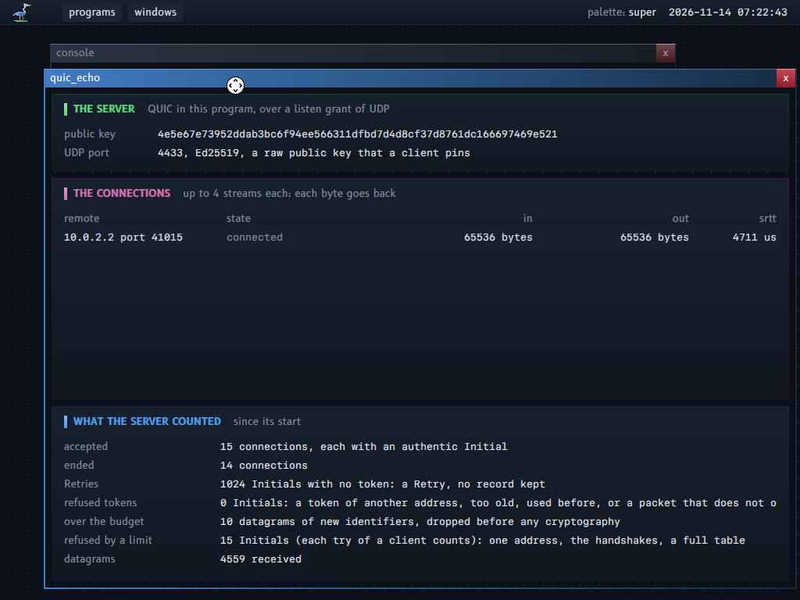

# QUIC

This document is the design of QUIC version 1 in this system, its first three layers (packet protection, TLS 1.3, the transport of one connection), and the fourth (a server of several connections over a listen grant of UDP, `quic_echo`). The terms are in `GLOSSARY.md`, section "QUIC".

**For whom.** A reader who uses `support/quic` in a program, a reader who calls the machine from the host (`kerneltool call`), and a reader who must know what the network can do to a server of the system.

**Read before.** `NETWORK.md` (the grants and the network service) and `CRYPTOGRAPHY.md` (the primitives).

**The map of this document.** Section 1: where QUIC runs. Section 2: the form of the library. Sections 3 to 6: the four built layers, from packet protection to a server of several connections with Retry and budgets of work. Section 7: `remote`, the calls of the host, and who may call. Sections 8 and 9: what is designed and what is not built.



QUIC (RFC 9000) carries the streams of a connection over UDP, and protects each packet with keys that a TLS 1.3 handshake gives (RFC 9001). The purpose here: the service `remote` gets an authentication of the machine to the host, and a protection of each call on the path (section 7), and `server` gets a second transport.

## 1. Where QUIC runs

QUIC needs no new part of the kernel. The network service carries UDP datagrams, as for any program, and the whole protocol, with its keys, runs inside the program that holds the connection. The table says where each part is, and why.

| Part | Where | Why |
|---|---|---|
| The datagrams | An endpoint of the network service, as for UDP today. A server needs datagrams from any remote on one port: a listen grant of UDP, with admitted remotes, as for TCP (section 6) | The service multiplexes the one pair of queues of the device (the note of property 5 in `PROPERTIES.md`) |
| QUIC: packets, keys, streams, loss, congestion | `support/quic`, a library in the program that holds the connection | QUIC is a library in the program; its state is memory of the program |
| TLS 1.3 | `support/quic` too: QUIC carries the handshake in CRYPTO frames, with no record layer | One library for one connection |
| The primitives | The module `cryptography`, loaded in the program through its import slots | Proven code, one module, named by its hash (`docs/CRYPTOGRAPHY.md`) |
| The keys | The memory of the program that holds the connection, and nowhere else | A key never crosses a ring: the module runs in the program |

**No kernel change is needed.** QUIC uses the operations that UDP uses today (rings, memory, waits). The changes are in the network service and its contract (a listen grant of UDP, section 6), not in the kernel.

## 2. The form of the library

`support/quic` is written as `support/tcp` is: the caller owns every byte of state, and the library only reads and writes it. So the same code runs in a program of the system and in the tool on the host, and a test can drive it with a fake clock.

The same form as `support/tcp`:
- pure code over memory of the caller, with no allocation and no kernel call;
- an error is an `errors.Error_Record`;
- the kernel tool runs the same code on the host.

**The seam to the module.** `quic.Cryptography` is a record of the procedures of the module `cryptography` that QUIC calls. A program fills it from its import slots: each call is a direct call of an export. The host tests fill it with the procedures of the module package. When the module contract describes a table as a parameter (`work/tables`), a batch export (seal or open a table of packets in one call) takes the place of a procedure here, and nowhere else.

**One private copy of each datagram.** A datagram comes into the region of the endpoint, which the network service writes. `quic.datagram_take` copies it once into private memory of the program. Each later step works on that copy only:
- the reading of the header;
- the removal of header protection;
- the open, in place.

So no byte is checked in one place and used from another, and the result of each export of the module is private memory, as section 6 of `docs/CRYPTOGRAPHY.md` asks.

## 3. Packet protection (the first layer, built)

Each QUIC packet is encrypted and authenticated, and even its header is masked. This layer reads a packet of the network as hostile input, removes the protection, and opens it; and it does the reverse for a packet to send. It knows nothing of connections.

`support/quic`, files `integers.odin`, `keys.odin`, `packets.odin`:

- **Variable-length integers** (RFC 9000, section 16): `variable_length_integer_read`, `_write`, `_size`. A read never goes past the bytes.
- **Packet numbers** (RFC 9000, section 17.1 and appendix A): `packet_number_encoded_size`, `packet_number_decode`.
- **Keys** (RFC 9001, section 5):
  - `hkdf_label_write` and `hkdf_expand_label`: TLS 1.3 HKDF-Expand-Label with SHA-256 and an empty context.
  - `initial_secrets` and `initial_keys`: from the Destination Connection ID of the first Initial packet of the client, with the salt of version 1.
  - `packet_keys_from_secret`: the labels "quic key", "quic iv", "quic hp".
- **Cipher suites**:
  - AES-128-GCM protects each Initial packet, as the RFC asks.
  - ChaCha20-Poly1305 is the suite that this system prefers after the handshake: its portable code is 4.6 times faster than the portable AES here.
- **Header protection** (RFC 9001, section 5.4): the AES mask and the ChaCha20 mask are two new exports of the module (`header_protection_mask_with_aes_128`, `header_protection_mask_with_chacha20`). The library applies the mask to the first byte (4 bits of a long header, 5 of a short one) and to the packet number.
- **The reading of a header as hostile input** (`header_read`). Each length is checked before a byte is read. These give false and an error record, with the offset of the field:
  - a header that does not fit;
  - a connection identifier over 20 bytes;
  - a token or a Length past the end of the datagram;
  - a fixed bit of 0;
  - a packet too short for the sample of header protection.

  - a Retry with an empty token (RFC 9000, section 17.2.5.2: a client discards it).

  A long header of another version is read up to its connection identifiers (`Unknown_Version`), for a later Version Negotiation answer. A connection identifier over 20 bytes is refused for every version, though RFC 8999 allows 255 bytes outside version 1: this library does not answer such a header. The `end` of a packet is where the next packet of the datagram starts (coalesced packets).
- **Seal and open**:
  - the nonce is the iv with the packet number in its last 8 bytes;
  - the additional data is the header without protection;
  - the open is in place, in the private copy.

  The open has two steps, so that the caller chooses the keys from the key phase:
  1. `header_protection_remove` uses the header protection key only (it does not change at a key update, RFC 9001 section 6.1). It gives the first byte, the packet number and the key phase (`Unprotected_Header`).
  2. `packet_payload_open` opens the frames with the keys that the caller chose.

  `packet_open` makes the two steps with one set of keys: for a long header, which has no key phase.

  `packet_seal` writes the packet number itself, truncated to the length in the first byte. For a long header, it reads the header as the peer will, and refuses a Length that does not end the packet after the tag (`Bad_Value`): the peer could not open such a packet, and the loss would be silent.

  Failures:
  - A tag that does not verify gives `Not_Authentic`. The frames are erased (the module erases what it wrote), so the packet cannot be opened again from this copy, with any key.
  - Reserved bits that are not 0 after the open give `Bad_Value`: a PROTOCOL_VIOLATION in RFC 9000, section 17.2. They are checked after the open only, so a packet that is not authentic cannot close a connection. The open says which failure it is in `Opened_Packet.authentic_with_reserved_bits`, true only when the tag verified: the kind `Bad_Value` also comes before the open (keys with no suite, offsets that do not fit), so the transport closes on that field, never on the kind.
- **Retry** (RFC 9001, section 5.8): `retry_integrity_tag` and `retry_integrity_check`, with the fixed key and nonce of version 1. The Retry Pseudo-Packet is the additional data of AES-128-GCM; the module takes 2048 bytes of additional data, so a Retry of 2043 bytes (with an original Destination Connection ID of 20 bytes), and an Initial packet with the longest token that a datagram holds, are taken.
- **The duties of the caller** (RFC 9000, sections 7.2, 14.1 and 17.2.2). The transport (section 5) does them; a program that uses this layer alone must do them too:
  - a server drops a client Initial in a datagram of less than 1200 bytes;
  - a server drops a client Initial whose Destination Connection ID has less than 8 bytes;
  - a client drops a server Initial that holds a token.
- **Limits**:
  - A datagram has 2048 bytes at most: a place of the region of an endpoint.
  - The header of a packet, with its token, has 2048 bytes at most: the additional data of the module, and a datagram.

**Tests** (`support/quic/packet_protection_test.odin`, host):
- RFC 9001 appendix A:
  - A.1: the labels, the initial secret, the secrets and keys of both sides.
  - A.2: the client Initial, sealed byte for byte and opened.
  - A.3: the server Initial, the same.
  - A.4: the Retry integrity tag, and each changed byte refused.
  - A.5: the ChaCha20-Poly1305 keys, nonce and short header packet.
  - The three masks.
- RFC 9000 appendix A: the variable-length integers, and the size and the decoding of packet numbers.
- Hostile datagrams:
  - each packet of the RFC cut at each length (none opens);
  - a Length, a token length and a connection identifier length that lie;
  - a fixed bit of 0;
  - a packet too short for the sample;
  - two bits of each byte of each packet changed (none opens);
  - 50 000 random datagrams for the AES Initial keys and 50 000 for ChaCha20 keys, a third with a long header of version 1, a third with a short header, one in five with a sample that starts with `ff ff ff ff` (none traps, none opens);
  - the ChaCha20 mask at the counter `ff ff ff ff` (the last block of the stream, which the sender chooses), against a value of an independent implementation;
  - two packets in one datagram (an Initial and a Handshake packet), and a second packet whose Length lies;
  - authentic packets with reserved bits set (`Bad_Value` after the open, and the field that says so); a failure with `Bad_Value` before the open, and a packet that is not authentic, which do not set that field;
  - the seal that writes the packet number, and refuses a Length that is one byte short or long;
  - the removal of header protection, then an open with the keys of another phase (the frames are erased);
  - a Retry with an empty token, version 0, an unknown version, a connection identifier of 21 bytes for each;
  - packet numbers near 2^62;
  - an Initial packet of 2048 bytes with a token of 2008 bytes.

The values of appendix A were copied from the text of the RFC by a script that is not in the repository; none was typed by hand.

## 4. TLS 1.3 for QUIC (the second layer, built)

TLS 1.3 gives the two sides of a connection their keys, and proves to the client that it speaks to the server whose key it expects. This layer is a small TLS: one group, one signature, two cipher suites, and a raw public key in place of a certificate.

`support/quic/tls_key_schedule.odin` and `tls_handshake.odin`: both sides of the handshake as one state machine over bytes in memory of the caller, with no allocation. QUIC carries the messages in CRYPTO frames at their encryption level; there is no record layer (RFC 9001, section 4).

**What it does, and nothing more:**
- the group X25519 only, the signature Ed25519 only;
- TLS_CHACHA20_POLY1305_SHA256 first, TLS_AES_128_GCM_SHA256 also (the client offers both, the server takes ChaCha20-Poly1305 when it is offered);
- one application protocol (ALPN, which RFC 9001 section 8.1 makes required);
- the `quic_transport_parameters` extension of each side, carried as bytes, checked for its form (each parameter an identifier, a length and its bytes), kept for the transport;
- no session resumption, no 0-RTT, no HelloRetryRequest (the client sends its one key share; a HelloRetryRequest gives handshake_failure), no client certificate, no KeyUpdate (QUIC forbids it).

**How a peer is known: a raw public key, pinned by the caller** (RFC 7250).
- The client offers `server_certificate_type` with the one type RawPublicKey. The server answers with that type in EncryptedExtensions; its Certificate holds one entry, the SubjectPublicKeyInfo of its Ed25519 key: 12 fixed bytes (RFC 8410) and the 32 bytes of the key. No other DER is read, and no X.509 certificate is read.
- The client compares the key with `Tls_Configuration.server_public_key`, the key that its caller pinned. Another key gives bad_certificate. Then CertificateVerify proves that the server holds the private key of that key, over the transcript (RFC 8446, section 4.4.3).
- So there is no certificate authority, no name and no date: a client trusts one key, given by its caller. For `remote`, the root service gives the key as a grant (the next layers).

**Who holds the private key.** The server program holds its Ed25519 private key in `Tls_Configuration.server_private_key`, in its own memory; the module `cryptography` runs in the same program, so the key never crosses a ring. The handshake erases its copy, its X25519 private key and its secrets when the transport ends the connection, and at once on most failures (`tls_handshake_erase_secrets`; three failures that keep the error record of the generator leave the erase to the end of the connection); the X25519 private key is erased as soon as the shared secret is made.

**Randomness.** The client random, the server random and each X25519 private key come from the generator of the program through `random.fill_for_a_key`, with the least seed strength of the configuration: QUIC asks for `processor` at least (`docs/RANDOMNESS.md`). `tls_start` refuses a configuration whose least strength is under `processor` (a field left at its zero value would accept a weak seed), and a client whose pinned key is 32 zero bytes (no key was pinned).

**Hostile input.** Each message of the peer:
- has each length checked before a byte is read (`Reader`);
- may come in parts (the side waits for the rest), but over 4096 bytes is refused;
- goes into the transcript, which holds 8192 bytes: a ClientHello whose body has up to 4092 bytes, 4096 with its header (a peer with large key shares and padding) and the flight of the server. A handshake costs about 33 KiB;
- must come at the level of the keys in use: bytes of a level left when the next keys take its place, or bytes of an earlier level that come later, fail the handshake, and QUIC closes with PROTOCOL_VIOLATION (RFC 9001, section 4.1.3);
- must have the type that the state waits for, at its level: else unexpected_message;
- may hold an extension that the side does not know: it is skipped in a ClientHello, and refused with unsupported_extension where the side did not offer it (ServerHello, EncryptedExtensions);
- may hold, in EncryptedExtensions, only an answer to an extension that the client offered and that RFC 8446, section 4.2, allows there: ALPN, `server_certificate_type`, `quic_transport_parameters` and `supported_groups`. The last one names the groups that the server prefers (RFC 8446, section 4.2.7): the client takes it and does not read it. `server_name`, `client_certificate_type` and `early_data` can be in EncryptedExtensions too, but only as answers, and this client offers none of them: they are refused with unsupported_extension;
- may not ask for the compatibility mode of TLS: a ClientHello with a session identifier fails the handshake, and QUIC closes with PROTOCOL_VIOLATION, not with the code of an alert (RFC 9001, section 8.4);
- may not hold one extension type two times (illegal_parameter);
- gives, at a failure, the alert of TLS in `Tls_Handshake.alert` (QUIC sends it as the error code 0x100 + alert) and an error record whose `found` field is the alert. The record names the argument at fault as the caller of `tls_start` or `tls_receive` gave it: 3, the bytes, for a message of the peer; 2 for the configuration of `tls_start` and for the level of `tls_receive`; 0 for a failure of this side that no argument caused (a refusal of the module, a full buffer).

**Keys for QUIC.** `tls_packet_keys(handshake, level, sending, keys, error)` gives the packet keys of the Handshake or the Application level, from the traffic secrets, through `packet_keys_from_secret`. It gives keys only while the secrets exist: once they are erased (`tls_handshake_erase_secrets`, and each failure of the handshake), `handshake_keys_ready` and `application_keys_ready` are false again, and the call fails with `State`. It never gives keys made from a secret of zeros.

**Tests** (`support/quic/tls_handshake_test.odin`, host):
- The key schedule against the trace "Simple 1-RTT Handshake" of RFC 8448, section 3:
  - the X25519 exchange;
  - the hashes of the transcript after the two Hello messages and after the Finished of the server (from the messages of the trace: its Certificate is RSA, which this handshake does not read, but its bytes go into the hash);
  - the early, handshake and master secrets, the two derived secrets, the four traffic secrets;
  - an HkdfLabel with a context;
  - the two finished keys and the two Finished values.
- A whole handshake of a client against a server in memory: both connected with ChaCha20-Poly1305, the same keys in each direction, the transport parameters of the other side, the X25519 private keys erased.
- The refusals: a server key that is not the pinned key (bad_certificate), a protocol that the server does not speak (no_application_protocol), a weak seed (Seed_Too_Weak, nothing sent).
- No packet keys after the secrets are erased, and after a handshake that failed (`State`).
- EncryptedExtensions with `supported_groups` is taken; with `server_name`, or with an extension that is not known, it is refused.
- A ClientHello with a session identifier fails as a PROTOCOL_VIOLATION.
- Hostile messages:
  - each message cut at each length, with its length field set to the cut (the side fails) and left as it was (the side waits);
  - one bit of each byte of each message changed (the two sides never both connect);
  - each server message in the place of another, a message at a level where it does not go (unexpected_message);
  - 20 000 random messages (none traps, none connects a side).

The values of RFC 8448, RFC 8446 (the Random of a HelloRetryRequest) and RFC 8410 (the prefix of an Ed25519 SubjectPublicKeyInfo) were copied from the text of the RFCs by a script that is not in the repository, with the size of each one checked. The two byte arrays in `tls_handshake.odin` were written from that output, and a test compares them with it.

## 5. The transport of one connection (the third layer, built)

`support/quic`, files `connection.odin`, `connection_receive.odin`, `connection_send.odin`, `recovery.odin`, `frames.odin`, `transport_parameters.odin`, `ranges.odin`. One `Connection` record in memory of the caller holds all of the state of the connection: no allocation, no kernel call. It has about 88 KiB. The streams are apart, in a table of `quic.Stream` records that the caller gives (below): each stream record holds two buffers of 64 KiB and has about 129 KiB. The log line of `quic_echo` prints the real sizes: "a table of 16 connections of 88 KiB, each with 4 streams of 129 KiB".

This layer is the protocol of one QUIC connection: the handshake, the acknowledgements, the losses, the streams and the timers. A program feeds it datagrams and the time, and takes from it datagrams to send and the bytes of its streams. The sections below give the calls, then what the layer does, the frames, what it does not do, and its tests.

**Where a `Connection` record lives.** Never on a stack: the main thread of a program has 256 KiB of stack, and a record there leaves too little room for the frames of the module `cryptography` and the 16 KiB that it erases below them. A record goes in the global memory of the program or in a mapping that the program owns. No check enforces this: on the host the heap and the stacks of threads are both mappings, so an address test would refuse good records, and a program of the system has no call that gives the bounds of its stack.

### The calls of a connection

**The calls of the caller:**
- `connection_start_client`, `connection_start_server`: a server starts its handshake at the first Initial packet of the client. Each one takes a table of stream records in memory of the caller (below).
- `connection_datagram_receive(connection, datagram, now, error)`: each datagram of the peer. A packet that cannot be read or opened is dropped, with an error record, and changes nothing.
- `connection_datagram_send(connection, buffer, now)`: the next datagram, or 0.
- `connection_deadline(connection)` and `connection_time_passes(connection, now)`: the timers. Time is a count of microseconds that the caller gives; the tests give a fake clock.
- `stream_open` (a client), `stream_write`, `stream_read`, `stream_reset`, `stream_stop_sending`: the streams, each named by its identifier. `stream_of` gives the record of an open stream; a caller walks `connection.streams` to find the streams that the peer opened.
- `connection_close(connection, code, now)`: a close of the application.

### What the transport does

**What it does:**
- **The three packet number spaces**, each with its keys, its packet numbers, its ACK ranges and its packets in flight. The Initial keys go when the client sends its first Handshake packet and when the server opens one; the Handshake keys go when the handshake is confirmed (RFC 9001, section 4.9).
- **The handshake**: the bytes of TLS go in CRYPTO frames at their level, 4096 bytes at most for each level and direction. The keys of each level are installed when TLS gives them; the secrets of TLS are erased once TLS is connected (a server has its 1-RTT keys before that). A failure of TLS closes the connection with the code 0x100 + alert. The 4096 bytes of the 1-RTT level hold every NewSessionTicket of the life of a connection: a server that sends more gives CRYPTO_BUFFER_EXCEEDED. The servers of this system send none.
- **A server takes a client only with an authentic Initial**: the keys of the first Initial come from its Destination Connection ID into local records, and the record of the connection takes that identifier and those keys only when the packet opens. Anyone can make an authentic Initial (its keys come from a public value), so a handshake that does not complete within 10 s (`HANDSHAKE_TIME_LIMIT`) ends the record, whatever the idle timeout; a client has the same limit. A listening program keeps one record for each Destination Connection ID of a client, with a limit on the count of records (the server of several connections, section 6).
- **Transport parameters**: each side sends its limits and its connection identifiers. The values of the peer are checked (RFC 9000, section 18.2): a repeated parameter, a value out of its range, a parameter that only a server sends, or an identifier that is not the one that the packets carried, gives TRANSPORT_PARAMETER_ERROR.
  - `max_udp_payload_size` must be 1200 at least. The RFC gives it no largest value, so a value over the 65527 bytes that UDP carries is taken as it is: this side sends 1200 bytes at most, whatever the value.
  - `preferred_address` is not used (no migration), and its form is checked: two addresses with their ports, a connection identifier of 1 to 20 bytes with its length, and a stateless reset token of 16 bytes, with nothing after. An empty identifier there, or a `preferred_address` from a server whose own identifier is empty, is refused.
- **Acknowledgements**: an ACK frame of up to 16 ranges. In the Initial and Handshake spaces it goes at once; in the 1-RTT space after 2 ack-eliciting packets or 25 ms.
- **Loss detection** (RFC 9002, section 6):
  - a packet is lost when a packet 3 numbers later is acknowledged, or when it is older than 9/8 of the round-trip time;
  - the probe timeout sends one or two probes, with the data of the oldest packets in flight or a PING, and doubles at each timeout;
  - a client with nothing in flight probes before the server validated its address, so that a server bound by its limit can send again.
- **The data of a lost packet goes again**: the CRYPTO and STREAM ranges, HANDSHAKE_DONE, MAX_DATA, MAX_STREAMS, STREAMS_BLOCKED, and the MAX_STREAM_DATA, RESET_STREAM and STOP_SENDING of its stream (with their values of now). A packet carries one STREAM frame and the control frames of one stream at most, so its record names one stream for each. A PATH_RESPONSE does not go again. Data or a frame of a stream that ended since the packet went is not sent again.
- **A fixed congestion window** of 12 000 bytes (the initial window of RFC 9002, section 7.2). Probes go past it.
- **Streams** (`support/quic/streams.odin`): bidirectional streams, which only the client opens. Unidirectional streams are not allowed (a limit of 0 each way).
  - **The table of stream records.** The caller gives a table of `quic.Stream` records with the connection, in memory of the caller (a record has 2 × 64 KiB of buffers and under 2 KiB of state: about 130 KiB). Its count is the most streams that are open at one time.
  - **The limit of streams.** A server gives the client a limit equal to its records (MAX_STREAMS in the transport parameters), and one more each time a stream of the client ended, with a MAX_STREAMS frame: the limit never promises a stream that has no record. A server opens no stream: it would take a record that the limit promised. A client that reaches the limit sends STREAMS_BLOCKED.
  - **The implicit open.** A frame that names a stream of the client that is not open yet opens it, and each lower stream of the client (RFC 9000, section 3.2). The limit bounds that count, so a stream number far ahead within the limit takes records that exist, and one past the limit is STREAM_LIMIT_ERROR before any record is taken.
  - **The end of a stream.** A stream ends when both directions ended: this side's last byte (all bytes and the end acknowledged) or its RESET_STREAM acknowledged; and the end of the peer read by the application (its last byte, or its reset). Its record is then free, the part of its rings that it used is written with zeros, and its identifier never names a stream again: a later frame for it is dropped. When the connection ends (the state `Closed`), each stream that is still open ends the same way: its rings are written with zeros and its record is free, so no byte of a peer stays in memory after its connection. A `stream_read` after that gives nothing: a program reads what it wants of a stream before the connection is `Closed`, and it still can in the closing and draining states. A program must read each stream to its end: a stream that it never reads keeps its record for the life of the connection, and a server then gives the client no stream in its place.
  - **Resets.** `stream_reset` sends RESET_STREAM and no more data. Its final size is the largest offset sent (RFC 9000, section 4.5): the bytes that flow control held back are dropped at the reset, because the peer never counted them. After the reset, `stream_write` takes no byte, and no end of the stream (FIN) goes. `stream_stop_sending` sends STOP_SENDING; a peer that gets it answers with RESET_STREAM and the same code (this side does so too). A RESET_STREAM of the peer ends the bytes for the application, and the bytes that it never read give their room back to the window of the connection.
  - **The order of sending.** Each packet carries one STREAM frame: of the next stream, from the record after the one that sent last, that has bytes or its end to send. Each stream gets its turn.
- **Flow control**, for each stream and for the connection:
  - each stream: 64 KiB, moved forward when the application read half of it (MAX_STREAM_DATA);
  - the connection: the buffers of every stream record (4 records: 256 KiB), moved forward when half of it was read (MAX_DATA). The bytes of a stream count at their largest offset, and a reset counts its final size;
  - data past the limit of the stream or of the connection is FLOW_CONTROL_ERROR; a final size that changes, or that is under the data that came, is FINAL_SIZE_ERROR;
  - this side sends new bytes within the MAX_STREAM_DATA of each stream and the MAX_DATA of the peer.
- **The idle timeout**: the smaller of the two values, 3 probe timeouts at least. The connection ends with no packet.
  - **The rule.** RFC 9000, section 10.1, asks for an idle timeout of at least three times the "current" probe timeout. Here the probe timeout of that bound is the one of the round-trip time, with no backoff (`probe_timeout_base`). A connection that receives nothing ends at most `max(idle timeout, 3 × base probe timeout)` after its last activity, whatever the count of its probes. The closing and draining states last 3 base probe timeouts too.
  - **The activity** that moves the bound: a packet received, processed and recorded, and the first ack-eliciting packet sent after it. A probe after that first packet does not move it (`connection_send.odin`, `ack_eliciting_sent_since_receive`). A packet whose data had no place in a range set is processed but not recorded (and not acknowledged, so the peer sends its data again): it does not move the bound, because a packet that is not recorded is not refused as a duplicate, and whoever saw it on the path could replay it to keep a silent connection alive. A datagram that does not authenticate, and a replay of a recorded packet, are refused before their open, and move nothing.
  - **A server always has an idle timeout.** `server_init` refuses a configuration with an idle timeout of 0: `Empty`, unit milliseconds, argument 5 ("argument 5 is empty; it must have 1 to 4611686018427387903 milliseconds"). With no idle timeout on either side, the bound would be none, and a client that vanished with data of the server in flight would keep its record for ever, probed about every 18 hours once the backoff stops. A client may still give 0: the idle timeout is the smaller of the two that are not 0, so against a server of this library its connection has the server's. Against a server of another stack that also gives 0, a client with 0 keeps its one connection until its application closes it: that is its own choice, and it holds one record.
  - **Why the bound has no backoff.** The probe timeout doubles at each probe that nothing answers. With that backoff in the bound, a side whose peer went silent while one of its own packets was in flight probes, and each probe doubles the bound. Once 3 probe timeouts pass the idle timeout (after about 9 probes, about 19 s, with a round trip of a few milliseconds and a max_ack_delay of 25 ms), the bound moves past each next probe. The connection then ends only when the backoff stops at 2^16: after about 2 hours. A server keeps the record of a client that vanished for that long, and a record in the closing state after many probes can last as long.
  - **The case that shows it.** The one CONNECTION_CLOSE of a client is lost. The server must then reach its idle timeout of 30 s, while its last packet (the end of its stream, never acknowledged by a client that only sends its close) keeps it probing. Without the rule above, the server does not log the end of the connection within 45 s.
  - **What a side sends to a peer that went silent.** No limit of the RFC applies once the address is validated, so the arithmetic is the bound. A probe timeout k (from 1) comes at base × (2^k − 1) after the last ack-eliciting packet, and sends 2 datagrams (`PROBE_PACKETS`). In 30 s that is floor(log2(30 s / base + 1)) timeouts:
    - with a round trip of a few milliseconds the base is about 28 to 45 ms (the round trip, 4 times its variation and at least 1 ms, and the max_ack_delay of 25 ms of the peer): 9 or 10 timeouts, 18 to 20 datagrams;
    - with no sample of the round trip yet the base is about 1 s: 4 timeouts, 8 datagrams;
    - each datagram has 1200 bytes at most, since a probe carries the data of the oldest packets in flight: 24 KB at most in the 30 s, to one address. The count grows with the logarithm of the idle timeout, not with it.
- **The anti-amplification limit**: before a Handshake packet of the client came, a server sends at most 3 times the bytes that it received, and its timer stops when it cannot send. A server counts only the datagrams that it processed: stricter than RFC 9000 section 8.1, and safe; such a server can wait for one more datagram before it sends.
- **A range set with no place.** The sets of received bytes, of bytes to send again and of acknowledged bytes have 32 ranges each. A packet of the peer whose data has no place is not recorded and not acknowledged, so the peer declares it lost and sends the data again (its other frames have the same effect when they come again). A sent packet whose data has no place stays in flight, and loss detection tries again.
- **Packet numbers that were forgotten**: the set of received packet numbers keeps 32 ranges. When it drops its lowest range, the numbers below the end of that range are refused from then on, before the open, so that no packet is processed two times (RFC 9000, section 12.3).
- **Times that cannot wrap**: the sums and products of times saturate at the largest value, the ack delay of the peer is at most its max_ack_delay in each state, and the round-trip sample is adjusted with a subtraction that cannot wrap. A peer cannot move a deadline into the past.
- **Datagrams of 1200 bytes**: a datagram with an Initial packet of the client, or an ack-eliciting Initial packet of the server, is padded to 1200 bytes. A server drops a client Initial in a smaller datagram, or with a Destination Connection ID under 8 bytes; a client drops a server Initial with a token.
- **The close**: a side that closes sends CONNECTION_CLOSE and answers the 1st, 2nd, 4th, 8th... later datagram with it, for 3 probe timeouts (closing). A side that receives it sends nothing for 3 probe timeouts (draining). An application close before the 1-RTT keys goes as APPLICATION_ERROR, with no code of the application.

### The frames

**The frames, each read as hostile input:** each field is read with its length checked first. A frame that is cut, a length past the packet, an end past 2^62 - 1, a count of streams over 2^60 or a type that does not exist is FRAME_ENCODING_ERROR. A type that is not in its shortest form, or a frame at a level where it may not go (RFC 9000, section 12.4), is PROTOCOL_VIOLATION.

| Frame | What this layer does |
|---|---|
| PADDING, PING | Read |
| ACK, ACK with ECN counts | Acted on; a number that this side never sent is PROTOCOL_VIOLATION; the ECN counts are read and not used; 64 ranges at most are acted on |
| CRYPTO | Acted on |
| STREAM | Acted on for each stream; it opens a stream of the client (and each lower one) within the limit; past the limit STREAM_LIMIT_ERROR; a stream of this side that it did not open STREAM_STATE_ERROR; a stream that ended dropped; a final size that changes FINAL_SIZE_ERROR |
| MAX_DATA, MAX_STREAM_DATA, MAX_STREAMS | Acted on: a client opens streams up to the MAX_STREAMS of the server |
| CONNECTION_CLOSE | Acted on: the draining state |
| HANDSHAKE_DONE | Acted on by a client; to a server, PROTOCOL_VIOLATION |
| RESET_STREAM | Acted on: the stream gives no more data to the application, with the code; its final size is checked, and the bytes not read give their room back to the connection |
| STOP_SENDING | Acted on: this side answers with RESET_STREAM and the same code, and sends no more data on the stream |
| NEW_CONNECTION_ID | Minimal: read for its form and not used (no migration). A Retire Prior To above 0 closes the connection with PROTOCOL_VIOLATION: this layer has no other identifier of the peer. A real peer seldom sends it, but it may; this is a known gap |
| RETIRE_CONNECTION_ID | Minimal: this side gave no identifier past the one of the handshake: a number above 0 is PROTOCOL_VIOLATION |
| PATH_CHALLENGE | Answered with PATH_RESPONSE. The record keeps the data of one challenge: when a second one comes before the answer went, the answer echoes the newest only (below) |
| PATH_RESPONSE, DATA_BLOCKED, STREAM_DATA_BLOCKED, STREAMS_BLOCKED | Read and not used (STREAM_DATA_BLOCKED checks its stream as STREAM does) |
| NEW_TOKEN | A client reads it and keeps no token; to a server, PROTOCOL_VIOLATION |

**One PATH_CHALLENGE at a time.** RFC 9000, section 8.2.2, asks for a PATH_RESPONSE that echoes the data of each PATH_CHALLENGE. This side keeps the 8 bytes of one challenge, and sends its answer in the next 1-RTT packet. A second challenge that comes before that packet went replaces the first, which gets no answer. For the peer, that is the loss of one PATH_RESPONSE, which it must bear in any case: a PATH_RESPONSE never goes again when its packet is lost (RFC 9000, section 13.3), and the peer validates a path with any one answer to a challenge that it sent on it (section 8.2.3). This side has one path, because it does not migrate, so the newest challenge is the one whose answer the peer still waits for. A queue of challenges would need a bound too, and would add a state for a case that a peer does not make on one path.

### What the transport does not do yet

**What this layer does not do yet:**
- NewReno: the congestion window does not grow and does not shrink after a loss; there is no persistent congestion.
- Pacing, ECN, and a path MTU larger than 1200 bytes.
- Unidirectional streams, and streams that a server opens.
- DATA_BLOCKED and STREAM_DATA_BLOCKED: this side never says that a limit of the peer blocks it. RFC 9000 says SHOULD.
- Version Negotiation and the stateless reset: a connection drops a datagram of these kinds (the server of section 6 answers another version, and a client takes one Retry: section 6).
- A key update: a 1-RTT packet with the next key phase is dropped.
- A packet number shorter than 4 bytes on the wire.
- Packets of a level whose keys are not ready are dropped, not kept: the peer sends them again.
- A STREAM frame of the peer may write over bytes that came and were not read yet, with other bytes: RFC 9000 allows PROTOCOL_VIOLATION there, and this layer takes the new bytes. Only the authenticated peer can do it, and it can send any bytes at a new offset anyway.

### The tests of the transport

**Tests** (`support/quic/transport_test.odin`, host): two connections in memory, joined by a channel that the test controls (loss, reorder by delay, duplicates, a delay of 10 ms one way), with a fake clock and fixed seeds:
- a handshake: both connected with ChaCha20-Poly1305, the client confirmed, the Initial and Handshake keys dropped, the parameters applied;
- an echo of 5000 bytes with no loss;
- **1 MiB each way** (the server writes back each byte that it reads) with 5 % of the datagrams lost, 5 % delayed out of order and 1 % duplicated;
- a handshake whose first datagram of each side is lost;
- the anti-amplification limit: a server that never hears the client again sends at most 3 times what it received, then its timer stops;
- the idle timeout of both sides, and a close of the application with its code;
- **hostile frames**:
  - each frame type whole, and cut at each length (FRAME_ENCODING_ERROR);
  - lengths near 2^62, an ACK of a packet never sent, STREAM data one byte past the window, streams that may not be, final sizes that change, a frame at the wrong level, each with its error code;
  - **the idle timeout when the peer goes silent** (`support/quic/idle_test.odin`, the channel of the test cut both ways):
    - `a_silent_peer_ends_the_connection_at_the_idle_timeout_whatever_the_probes`: a server with data in flight probes more than 5 times and ends at its idle bound; the count of its probe datagrams is the count of the arithmetic above (a range of 1 ms for each send of the endpoints). Before the correction it would have run out of its hour of clock;
    - the same with nothing in flight: no datagram, the end at the idle bound;
    - a packet of the client 29 s into the silence moves the bound by 29 s, and the ACK that answers it does not move it again;
    - the closing state lasts 3 base probe timeouts after 16 probe timeouts, and the draining state ends by the clock 3 base probe timeouts after the close of the peer;
    - during a silence, a datagram with the identifier of the server that does not authenticate, a replay of a recorded packet, a packet whose data has no place, and a replay of that one: none moves the last activity, and the record ends at the bound of the last recorded packet;
    - a server with an idle timeout of 0 is refused (`Empty`, argument 5);
  - **50 000 random packets that pass the AEAD** (sealed with the 1-RTT keys of the client of the test) and carry random frames, to a connected server that answers each one: none may trap;
- **several streams** (`support/quic/streams_test.odin`):
  - 4 streams at once, 100 KiB each way on each, with 2 % lost and 5 % out of order: each byte comes back on its own stream (each stream has its own pattern);
  - 12 streams through a server that gives 4 at a time: the client is blocked, then opens the next ones as each MAX_STREAMS comes; every record of both sides is free at the end, and the limit is 16;
  - a reset after flow control held bytes back (64 KiB sent, 32 KiB more written), by `stream_reset` and by a STOP_SENDING of the peer: the final size is the 64 KiB sent, the two sides count the same bytes for the connection, and the client then fills two new streams up to the limit of the connection exactly, with no FLOW_CONTROL_ERROR. Before the correction the final size was the 96 KiB written, and the server closed;
  - the rings of a stream record are zero after its stream ended; the rings of a stream that is still open, with bytes not read and bytes not acknowledged, are zero after its connection ended, and its record is free;
  - a stream that the client resets and stops: the server reads the reset, answers with RESET_STREAM and the code of the STOP_SENDING, both records end, and the 3000 bytes that the server never read count as read for the window of the connection;
  - hostile frames: a stream far ahead within the limit opens each lower one; one past the limit, and a number near 2^62, are STREAM_LIMIT_ERROR with no record taken; data within the limit of each stream and past the limit of the connection is FLOW_CONTROL_ERROR; a reset under the data, or that changes the end, is FINAL_SIZE_ERROR; STOP_SENDING ends the sending part; a server opens no stream;
- the corrections found by a review, each with a test that failed before it:
  - STREAM data in 40 islands: the 8 past the 32nd are not acknowledged, and once the holes and those 8 come, the 8000 bytes are read once, in order; the same for CRYPTO data;
  - a sent packet whose data has no place stays in flight;
  - a random datagram shaped as an Initial does not take the server, and the real client connects after it;
  - an authentic Initial alone ends at the handshake deadline, with no idle timeout;
  - a replayed packet whose number was forgotten is refused;
  - the round-trip time, the probe timeout and the idle deadline with values near 2^64;
  - a least seed strength left at zero, and a client with no pinned key, are refused;
  - each error record names the argument at fault as its caller gave it, with the value that it had: the configuration (argument 3 of the two starts, argument 5 of `server_init`), the facts of a Retry token, each identifier and the token of a Retry packet, the label, the context and the output of HKDF-Expand-Label, the configuration, the level and the bytes of TLS;
  - the transport parameter `preferred_address`: whole, cut, one byte short and long, with an empty identifier, with an identifier of 21 bytes, from a client, and from a server with an empty identifier; a `max_udp_payload_size` of 65528 is taken;
  - a ClientHello of 3900 bytes is taken; bytes left at the Initial level after the ServerHello fail the handshake.

## 6. QUIC on the network (the fourth layer, built, with Retry and the budgets of work)

This layer puts the library on the network: one program serves many QUIC clients on one UDP port. Most of it is defence: a server on a network gets datagrams from addresses that anyone can forge, so it must spend no memory and little work on a client until the client proves its address.

**Where it runs.** QUIC runs in the program, as TCP does in `server` and `fetch`: `support/quic` over a datagram endpoint of the network service. The network service sees UDP datagrams; it reads no QUIC header and keeps no QUIC state.

### The listen grant of UDP

**The listen grant of UDP in the datagram contract.** A QUIC server needs datagrams from any client on one port. A UDP endpoint with a client grant names one remote, and the network service drops each datagram of another remote. So the listen grant has a UDP form (`contract/datagram`, `programs/network`), with the rules of the TCP form:

| Rule | TCP listen grant | UDP listen grant |
|---|---|---|
| The port | One local TCP port that the root service names | One local UDP port that the root service names |
| A new remote is admitted on | A SYN (no ACK, no RST) | A datagram of 1200 bytes at least (`LISTEN_FIRST_LEAST`): the size of the first datagram of a QUIC client (RFC 9000, section 14.1) |
| And only | From an address that can answer, when a Receive waits | The same |
| The table | 64 admitted remotes, each with the time of its last segment in or out | The same table, the same code (`network.Admitted`) |
| When it is full | The oldest place with no traffic for 120 s serves again; else the new remote is dropped and counted (`Full`) | The same |
| A Send | Only to an admitted remote | Only to an admitted remote, and at most 3 times the bytes that came from it until the program validates it (`Validate`) |
| The time of a place | The last segment in or out | The last datagram that came from the remote: a send keeps no place |
| The program forgets a remote | `Release`, after the last segment | `Release`, after the last datagram, and at once for a datagram that the program refused |

**The limit of 3 times, in the network service.** The anti-amplification limit of QUIC (RFC 9000, section 8.1) is held by `support/quic`, in the program. The network service holds it too, without knowing QUIC: it counts the bytes that came from each admitted remote of a UDP listen grant and the bytes that went to it, and refuses a Send that would pass 3 times the bytes that came (status `Amplification`), until the program says with the command `Validate` that the remote proved its address. `quic_echo` validates a remote when its client came back with the token of a Retry. What a program gains by validating every remote: it lifts that limit for each address that sent it a datagram. It still reaches no address that sent it nothing, and a remote with no datagram for 120 s loses its place. So a program that validates every remote can send any volume, for 120 s after its last datagram, to an address whose name came in one forged datagram. The principal revokes the grant of such a program. The listen grant of TCP has no such limit: a remote is admitted on a SYN, and the program answers a SYN with one segment.

The root service names the grant by the name of the program: `quic_echo` has the UDP port 4433 (`programs/root/network.odin`). The principal reads it with `grants` and revokes it with `revoke`, as for the other endpoints.

**What the kernel does: nothing new.** No kernel code changed. The endpoint uses the rings, the memory objects and the waits that UDP uses today.

### The server of several connections

**The records.** A server has a table of `quic.Connection` records (connection records) in memory of the program: one mapping, never a stack (section 5). `quic_echo` has 16 records of about 88 KiB, 4 stream records of about 129 KiB for each record, and an echo buffer of 16 KiB for each stream: about 2670 pages (10.4 MiB) in one mapping (`TABLE_PAGES` in `programs/quic_echo/main.odin`), within its budget of 4096 pages (`programs/root/main.odin`). These sizes are computed from the declarations: the log line "listening on the UDP port 4433" prints the real sizes of a record and of a stream record. `quic.server_init` takes the stream records of all records in one table, 4 for each record in its order.

**The server of several connections** (`support/quic/server.odin`, `quic.Server`). The caller gives each datagram with its remote address and port; the server chooses the record:

0. The server copies the datagram once into its own memory, and takes each decision on that copy; the record opens the same bytes.
1. A packet whose Destination Connection ID is the identifier of a record goes to that record. In an Initial, the identifier that gave the Initial keys of a record also names it. The same identifier from another remote is dropped: the server sends `disable_active_migration`, and a client does not move.
2. **Retry** (`support/quic/retry.odin`; RFC 9000, sections 8.1.2 and 17.2.5; RFC 9001, section 5.8). An Initial with an unknown identifier and no token gets a Retry packet, and the server keeps nothing: no record, no key, no open of the Initial. The Retry gives a token. Only a client that receives datagrams at its address can send its Initial again with that token, so a forged source address takes nothing.
3. An Initial with a token takes a free record only when:
   - its token opens for its remote and names the identifier that the Initial uses;
   - the token did not take a record before (each token takes a record once, below);
   - the limits allow it: connections and handshakes of its remote address, handshakes at once, a free record, then the budget of Initial checks of its address. These need no cryptography, so they come before the open;
   - the Initial itself opens on a second copy.

   The record is then validated: the client proved its address.
4. A datagram over a limit gets no answer.
5. A long header of another version, in 1200 bytes at least, gets one Version Negotiation packet that lists version 1.
6. Each datagram that the server keeps nothing of (a Retry, refused, not authentic, of no record) has its remote released at once, so that a flood does not fill the admitted remotes of the network service.
7. The work of datagrams of unknown identifiers has budgets (below). A datagram over a budget is dropped before any cryptography. The datagrams of known records have no budget. `quic_echo` decides the order of each batch once (`server_batch_order`, which reads the header of each datagram one time): the datagrams of known records first, then the others, each one given once. A second datagram of a new client in the same batch then goes to the record that the first one took. Before, the order was decided again in each of two passes, and that second datagram was in neither pass.
8. A record whose address is validated asks the caller to validate its remote (`validate_remote`) at each datagram, until the caller gives a result of 1 for its `Validate` (`server_validation_confirmed`; one bit in the record). The case: the program releases a remote after its Retry, the client comes back before the network service handled the Release, and the `Validate` of the new record comes after the Release and gives 0. The next datagram of the client of 1200 bytes admits the remote again, and the next `Validate` works. Before, nothing validated it again, and the connection stayed under the limit of 3 times for its life. The tag of each `Validate` carries the place and the low 27 bits of the generation of the record: a result that comes after its record ended and the place was taken again confirms nothing.

### The token of a Retry

**The token of a Retry.** An AEAD value: ChaCha20-Poly1305 of the module `cryptography`, under a key of 32 bytes that the server makes at its start from its generator (`fill_for_a_key`, the least strength of the server). The nonce is a counter of the server, never used two times with one key. It seals:
- the original Destination Connection ID of the client, which the server sends back in the transport parameter `original_destination_connection_id`;
- the Source Connection ID of the Retry, which the client must use as its next Destination Connection ID, and which the server sends in `retry_source_connection_id`;
- the time of the Retry.

The additional data is the remote address and port. The token has 62 bytes. It does not open for another address or port, with a changed byte, after another start of the server (another key), or more than 10 s after the Retry (`RETRY_TOKEN_LIFETIME`: a client sends its Initial again one round trip after the Retry, and 10 s covers its probe timeouts).

**What a replay of a token gives.** Whoever sees a token on the path can send it again, but only from the address and port of that client, to the identifier that the Retry named, within 10 s. While the record of the client lives, the replay goes to that record. After the record ends, the token takes no record again: the server keeps the counter of each token that took a record (`server_budgets.odin`).
- The table has 64 places. A place is free again when its token expired (10 s).
- When the table is full of tokens that did not expire, the token issued first is forgotten (`used_tokens_forgotten` counts it). That one token can take a record again, from its address and port, until it expires.
- 64 tokens that take a record in 10 s is far over what the table of 16 records takes; the limits of one address bound the rest.
- An attacker on the path can do worse (drop the datagrams of the client). An attacker off the path gets nothing.

Why a table of used counters, and not a window of bits over the counter (the anti-replay window of IPsec): the counter grows with each Retry, not with each record. A window must cover every Retry of 10 s: 200 000 counters at 20 000 Retries a second, 25 KiB, and a flood of Retries beyond it would push the token of a real client out of the window, and refuse it. The table keeps 64 × 24 bytes, only for tokens that took a record, and a flood of Retries does not touch it.

### The budgets of work

**The budget of Initial checks of one address.** A host with one real address takes one Retry, so it has a valid token for 10 s, and can send Initials with it that pass the token check but do not open. If each of them spent one check of the shared budget, 500 in a second would stop every new client. So each address whose token opened has its own budget: 4 Initial checks at once, then 1 in each second. A client needs one, and one more for each Initial that the network loses. Only an address whose token opened gets a place: a forged source never does.

The table of these budgets has 1024 places of 32 bytes (32 KiB in the `quic.Server`). A new address takes a place only when the place holds no information: it is free, or its bucket refilled to its depth (4 s after its last check at the latest). When no place can be taken, the new address gets no check (`address_table_full` counts it). A full bucket is the state that a new address gets, so a place that moves to another address never gives more than one bucket gives. The table is then 1024 buckets, whatever the addresses that rotate through it:
- at once, at most 1024 × 4 = 4096 checks, once: the shared budget has a depth of 200, so this burst spends it for about 2 s;
- after that, at most 1024 × 1 = 1024 checks in each second, half of the shared budget of 2000. The other half stays for the clients that the table does not hold.

Before, a new address took the place used the longest time ago, with a full bucket: 33 real addresses in turn (the size of the table, plus one) each got a full bucket at each Initial, spent the shared budget at about 2.4 MB/s, and stopped every new client. The document said 500 addresses: that was wrong.

What remains: a host with 1024 real addresses, each with a valid token, can hold the table: exactly 1024 are enough, one for each place. Each address must send an Initial with its token a little more than once a second, and take one Retry every 10 s to renew its token: about 1.2 MB/s in all (1024 × 1200 bytes in each second), from 1024 addresses that the attacker really has, since a token comes back only to its address.
- An address keeps its place while it asks faster than its bucket refills: its bucket never comes back to its depth. After one check, that means at least one Initial in each second.
- A place frees when its address asks less often: 1 s after a client that needed one check, 4 s at most. The first new address to ask takes it.
- The addresses of the attack that the table refused ask again at the pace of the attack (about 1200 times a second in the host test). A new client therefore gets a place only if it asks before them. The design gives it no bound while the attack lasts: it may wait, or end at its handshake deadline.
- When the attack stops, every place refills within 4 s, and new clients get places.
- The shared budget of Initial checks is not spent (1024 a second at most), and connections that completed go on.
- The budget for each source prefix (below, designed) is the next defence: one /24 holds at most a share of the table.

**The client side of Retry.** A client takes one Retry, before any Initial of the server: its Retry Integrity Tag must verify over the identifier that the client chose, its Source Connection ID must not be that identifier, its token must not be empty. A second Retry, or one with a bad tag, changes nothing. After a Retry, the client derives its Initial keys from the Source Connection ID of the Retry, sends its ClientHello again from its first byte in Initial packets that carry the token, and keeps counting its packet numbers. It checks that the server names its first identifier in `original_destination_connection_id` and the identifier of the Retry in `retry_source_connection_id`; a server that names a Retry when there was none, or none when there was one, fails the handshake.

| Limit | Value | Why |
|---|---|---|
| Records | 16 | 16 records of 88 KiB, their 64 stream records of 129 KiB and their echo buffers fit the budget of 4096 pages of the program |
| Connections of one remote address | 8 | Half the table: one host cannot take all of it |
| Connections in the handshake of one remote address | 2 | A host with authentic Initials of its own holds 2 records for 10 s at most |
| Connections in the handshake at once | 8 | Half the table stays for connections that completed |
| Handshake deadline | 10 s | Anyone can make an authentic Initial; the record is free again after this time |
| Version Negotiation packets | 16 in one second | Each one has 51 bytes at most for a datagram of 1200 bytes: far under the anti-amplification limit; the count bounds the work |
| Retries | 20 000 in one second, 2000 at once | Each costs 2 exports of the module (the seal of the token, the tag of the Retry), about 10 us: 20 % of one processor at most; a Retry has 113 bytes at most, for 1200 received |
| Checks of a token | 30 000 in one second, 3000 at once | Each costs 1 export (the open of 37 bytes), about 3 us: 9 % of one processor at most |
| Checks of an Initial with a valid token | 2000 in one second, 200 at once | Each costs 11 exports (9 for the Initial keys, the mask, the open of about 1160 bytes), about 30 us: 6 % of one processor at most; a client reaches this only after a Retry at its own address |
| Checks of an Initial of one address | 1 in one second, 4 at once, in a table of 1024 addresses | A client needs one; addresses that take turns get at most 1024 checks in one second, half of the shared budget |
| Tokens that took a record, kept | 64, for 10 s | Each token takes a record once |
| Lifetime of a token | 10 s | The round trip of a Retry and the probe timeouts of a client |
| Idle timeout | 30 s | The value of `quic_echo` |
| The first datagram of a remote | 1200 bytes | The network service admits no remote with less |
| Admitted remotes | 64 | The table of the network service (unchanged) |

**The work that one forged datagram costs now** (the speeds of `docs/CRYPTOGRAPHY.md`, section 6, with the erasure of 16 KiB of stack after each export):
- Every datagram: one copy into the memory of the server, and the reading of its header two times: once in place for the order of the batch, once on the copy for the decision.
- An Initial with no token, within the budget: 8 random bytes from the generator of the program, and 2 exports (the token, about 1 us of ChaCha20-Poly1305; the Retry Integrity Tag, AES-128-GCM over about 100 bytes), then one Send of 113 bytes and one Release. About 10 us, computed from the speeds of the module. A speed test exists (`the_cost_of_the_work_of_new_connections`); the numbers of a quiet host are not yet in this document.
- An Initial with a token, within the budget: 1 export, the open of the token. A token that does not open stops there.
- An Initial whose token opens: the 11 exports of the open of the Initial. Only a client that received a Retry at its address reaches this.
- Over a budget: the copy and the header, then nothing.

Before the budgets, each forged Initial cost the 11 exports (about 30 us), with no budget.

**The budgets are token buckets.** Each budget holds at most its depth of units of work (a tenth of a second of its rate), and gains its rate in each second, continuously; each Retry, token check or Initial check takes one unit. A burst takes the depth at once, then the rate: no window has a boundary where a burst gets the budget of two seconds in one millisecond, as the fixed window of one second did. The rates are a share of one processor, by the costs above: when a flood spends every budget, the work of new identifiers takes about 350 ms of each second of one processor (200 for Retries, 90 for token checks, 60 for Initial checks). The costs are computed from the speeds of the module, not measured on these calls: the host test `the_cost_of_the_work_of_new_connections` (`support/quic/server_speed_test.odin`) measures them, and the rates follow the measure.

### What a flood can do

**What a flood can do after this round, and what it cannot.**
- It cannot take a record from a forged address: a record needs a token that came back to the address. It cannot make the server open an Initial without a valid token, or spend more than the budgets on cryptography.
- **A flood above a shared budget stops new clients for its duration.** To spend the budget of Retries, it brings more than 20 000 Initials with no token in each second (24 MB/s, from any forged sources); to spend the budget of token checks, more than 30 000 Initials with a token (36 MB/s). For as long as it lasts, a new client meets an empty budget at most of its tries, and ends at its handshake deadline. The connections that completed go on: their datagrams have no budget and come first. No server without a defence based on addresses avoids this: a forged Initial and the first Initial of a real client look the same until the Retry comes back.
- Real addresses that rotate through the table of address budgets get at most 1024 Initial checks in each second after a burst of 4096: the shared budget is not spent in a lasting way. 1024 real addresses that keep asking (about 1.2 MB/s) hold the table: a new client then gets a place only if it asks first when one frees, with no bound on its wait while that lasts.
- **What a deployment adds (designed, not built): a budget for each source prefix.** The shared budgets of Retries and token checks are divided among source prefixes (/24 for IPv4): a table of the prefixes seen recently, each with a bucket of a share of the rate (for example a hundredth), and the shared bucket over them. A flood from forged sources spread over all addresses still spends the shared budget; a flood from few prefixes (one network, or one path that does not filter forged sources) spends only its own share, and new clients of other prefixes go on. The table holds state for forged sources too, so it is bounded (a few thousand prefixes, the oldest forgotten), and a forged source can only push the prefix of a real client out of the table, where it gets a fresh share. A network in front of the machine that drops forged sources (BCP 38) removes the cause.
- It cannot make the server, or the network service, send more than 3 times what came from a remote that did not prove its address. A Retry (113 bytes at most) answers a datagram of 1200 bytes: a reflection to a forged address carries less than a tenth of what the attacker sent.
- It can fill the 96 places that `quic_echo` posts for datagrams, and the 64 admitted remotes of the network service, faster than the program empties them. Then the network service drops datagrams with no place, those of real connections too: the order of known datagrams first works only on the datagrams that reached the program. A flood that outruns one pass of the program is a limit of the device and of the network service (one pair of queues), not of QUIC.
- A host with a real address can take records within the limits of one address (2 in the handshake, 8 in all) for the handshake deadline or the idle timeout, from each address that it really has.
- An attacker on the path can replay a token (above), or drop datagrams.

### Other rules of the server

**A NAT that changes the address or the port of a client ends its connection.** The server finds a record by its identifier and its remote, and sends `disable_active_migration`: a datagram with the identifier of a record from another address or port is dropped. RFC 9000, section 9, allows this. A client behind a NAT that gives it another port after a silence (often 30 s or more) loses its connection until the idle timeout. Later: validate the new path with PATH_CHALLENGE for a datagram that opens.

**What the closing state answers.** In the closing state a record answers the 1st, 2nd, 4th, 8th... datagram with its identifier, not each one (RFC 9000, section 10.2.1). These datagrams are not opened, so a third party that knows the identifier and forges the address of the client makes at most a few CONNECTION_CLOSE packets of about 50 bytes.

**A record that ended, and its remote.** `server_sweep` frees each record whose connection ended, and gives the remote of each one that no other record has, so that the caller releases it. The caller gives the places for those remotes. A record whose remote has no place left is not freed in that call: it stays in use, and the next call frees it and gives its remote. So no remote is lost, and a caller with one place for each record frees every ended record in one call.

**A record and its generation.** Each time a record is taken it gets a new generation number; `quic_echo` ties its echo state to it, so a new client of a place never takes the echo state of the client before.

**What a client over a limit gets: nothing.** A CONNECTION_CLOSE would need an Initial packet built outside a record, for a client whose identity no one checked; an attacker that fills the table would learn when it is full. A real client tries again at its probe timeout, and ends at its own handshake deadline.

**Version negotiation: one packet, within a count.** RFC 9000, section 6.1, says a server SHOULD answer a version that it does not speak. The answer is small (51 bytes at most for 1200 received), and 16 in one second bound the work. A Version Negotiation packet of this server has no authentication; a client of this system speaks only version 1 and never needs one.

**The stateless reset: not done.** A server that restarts forgets its connections; their clients end at their idle timeout.


### The key of the server and the programs

**The key of a server.** `quic_echo` makes an Ed25519 key at its start from its own generator (`random.fill_for_a_key`, the strength "processor" at least). The private key stays in the memory of the program: in the configuration of its `quic.Server`, which copies it into each handshake, and each handshake erases its copy. The public key goes on the log ("quic_echo: the public key of this server: " and 64 hexadecimal digits) and in the window; a client pins it. A new start makes a new key, which the client must pin again: a key that lasts needs a store of the program and a grant, which is not built.

**A weak seed.** A seed weaker than "processor" makes no key (`Seed_Too_Weak`): `quic_echo` writes "the random seed of this program is weak: it makes no key of a server, and listens on nothing" on the log and in its window, and opens no endpoint. This is the rule of `docs/RANDOMNESS.md`: the program chooses what it accepts.

**The programs.**
- `programs/quic_echo`: the server. A client opens up to 4 streams at one time; on each one each byte goes back, then the end of the stream after the end of the client, or a reset with the code of the client after its reset. The bytes in and out of a connection on the log and in the window are the sums of its streams. Its window shows its public key, its connections (remote, state, bytes in and out, smoothed round-trip time) and its counts (accepted, ended, not authentic, refused by a limit). It writes each new connection and each end on the log (50 lines in one second at most), and its counts once in a second when they change.
- The client: the peer of the tool on the host (`tools/kerneltool/peer_quic.odin`). It links `support/quic` and the module `cryptography` compiled for the host, and pins the key that the machine printed. It sends its datagrams as the gateway 10.0.2.2, through the network device of the machine, so the network service of the machine is on the path. A client inside the machine would need a second program with a client grant of UDP to the local address; the network service sends no datagram to its own address (no loopback), so this is not possible today.

### The tests of the server

**The tests.**
- On the host (`support/quic/server_test.odin`, `retry_test.odin`):
  - 8 clients at once from 8 addresses, each with an echo of 64 KiB; 8 clients of one address, which wait their turn; a client that vanishes after it came back with its token; a Version Negotiation packet, byte for byte, and its count in one second; a known identifier from another remote;
  - a flood of 1000 forged Initials from 1000 addresses and 15 authentic Initials from 3 addresses: 1015 Retries, no record, no open of an Initial; the real client connects in under 1 s;
  - 8 authentic Initials from 4 forged addresses every 10 s, and a real client that starts in the middle of it: no record is taken, and the real client connects in under 1 s;
  - one address with a valid token that sends 500 Initials a second that do not open, for 2 s: its budget of 4 checks a second stops them before any open, the shared budget is not spent, and a real client connects during it and ends its echo;
  - a token takes a record once: after its record ended, the same Initial takes none;
  - three records that end at once, with one place for a remote in each sweep: each sweep frees one record and gives its remote; two records of one remote need one place;
  - a batch with a datagram of a known record and two datagrams of a new client: the known one first, then both new ones, and the second one goes to the record that the first one took;
  - a record asks for the validation of its remote until a result of 1 for its generation;
  - 33 real addresses with valid tokens that send 2000 Initials a second in turn, for 2 s: at most 33 × 6 Initial checks, the shared budget is not spent, and a client that starts with the attack and another that starts 1 s into it both connect during it;
  - 2000 such addresses at 2400 Initials a second for 2 s: at most 1024 × 4 + 1024 × 2 Initial checks, and 4 for each real client (one run counted 2852); the client that starts with the attack takes a place before the table is full, and connects; the client that starts 1.5 s into it finds no place that can move (the one place that freed, the place of the first client 1 s after its check, went to a refused address of the attack within a millisecond), gets no check until the attack stops, and connects after it. A client that starts at 1 s asks at the moment the place of the first client frees, and wins that race by about a millisecond: the test starts it at 1.5 s;
  - the cost of a Retry, a token check and an Initial check, printed (`server_speed_test.odin`), not checked;
  - the Retry packet of RFC 9001, appendix A.4, written byte for byte; a client through a Retry, with both identifiers checked in the transport parameters;
  - tokens: another address, another port, each byte changed, too old, a time to come, another key, too short; at the server, a token from another remote, to another identifier, too old, and the right one;
  - a client refuses a Retry with a bad tag, a Retry whose Source Connection ID is its own identifier, and a second Retry;
  - the budgets: 3000 Initials with no token at once get the depth of 2000 Retries; 1 ms later the bucket has 20 more, not a new budget; 100 ms later it is full again; 4000 with tokens that do not open cost the depth of 3000 checks;
  - the closing state answers 4 of 15 datagrams;
  - on the network service (`support/network/tables_test.odin`): the limit of 3 times for a remote that is not validated, the end of the limit when it is validated, and a place that a send does not keep.
- On the machine (`kerneltool test quic`, `tools/kerneltool/quic_scenario.odin`): 1 MiB each way; one client with 4 streams at once, 256 KiB each way on each; the same 1 MiB on one stream with 5 % lost, 10 % reordered and 10 % repeated; 8 clients at once; a client that pins another key (it refuses the server: bad_certificate); a flood of 1000 forged Initials from addresses of 198.18.0.0/15 and 8 authentic Initials from 4 forged addresses, at the pace of their answers. What must hold: no answer to a forged address is anything but a Retry (so no record answered one), at most one Retry to each forged address and port (each one sent one Initial), never more than 3 times the 1200 bytes that one address sent, and the real client gets its echo; the count of Retries is reported, not required, because the network service may drop a datagram of a flood. Before this pace, the peer read one frame of the machine for 5 that it sent, and its own socket on the host dropped the Retries (445 of 1008 counted); a datagram of another version (one Version Negotiation packet), and a real client at the same time; a client that takes its Retry, sends its Initial with the token, and vanishes (the server ends its record at the handshake deadline); a client that goes silent after an echo of 64 KiB, with no close, while the server has a packet in flight (the server ends the record at its idle timeout, and `quic_echo` checks the time that it took, in time of the machine, against its bound).
  - **The close of a client at the end of a case** goes 3 times, outside the loss and the reorder of the case (`PEER_QUIC_CLOSE_COPIES`). One close through them can be dropped, or held for a reorder with no later datagram to let it go: the server then ends the record only at its idle timeout. The step of the case "loss" waits for "closed by the client" in the normal time of a step.
  - **The step "silent" checks the bound in time of the machine.** At an end by the idle timeout, `quic_echo` logs a second line: the time from the last activity of the connection to its end (`Connection.ended_at`, set when the library ends it), its idle timeout, its bound (`quic.connection_idle_bound`), its verdict, and how many milliseconds after the bound the end came: "the idle end held its bound" when the time is at least the idle timeout, else "did NOT hold its bound". The program sees the deadline when its wait ends, and how late a busy or slow machine wakes it depends on the host: that side is printed, not checked. An end that never comes is a hang, which the bound of the step ends. The step waits for the verdict, so it means the same under KVM and under emulation, and is never skipped.
  - The wait in time of the host is only the limit of a test that hangs: 120 s for the end of the record. QEMU gives the machine the clock of the host (the tool does not use `-icount`), so 30 s of the machine are about 30 s of the host under emulation too. The tool gives QEMU `-accel kvm -accel tcg` and cannot tell which one QEMU took (QEMU prints no line that the tool reads), so the bound does not depend on it.
  - Whether the sandbox of the flake has `/dev/kvm` is not settled by reading. The derivation `kernel-boot-test` does not ask for the system feature `kvm`. The run that failed shows the speed of KVM (378 KB hashed in 311 µs, a round trip of 0.4 ms): that run had it. The step no longer depends on it.
  The machine of the weak seed starts `quic_echo` too (`random_scenario.odin`).

### A stack that this project did not write

**A stack that this project did not write** (`kerneltool test quic-real`, `tools/kerneltool/quic_real.odin`). OpenSSL has a QUIC client since 3.2, with raw public keys of a server (`openssl s_client -quic`, `-enable_server_rpk`); the nixpkgs of the flake has OpenSSL 3.6.5, now in the development shell. What the manual and the source of `apps/s_client.c` (tag openssl-3.6.0) say:
- `-quic` needs `-alpn`.
- `-enable_server_rpk` offers the server certificate types {raw public key, X.509}; this server accepts a list that has the raw public key.
- After the handshake, `s_client` prints "Server-to-client raw public key negotiated", then "Server raw public key" and the key (`EVP_PKEY_print_public`).
- `s_client` goes on after any check of the key (it is a test tool): the test compares the printed key with the key on the log of the machine. That is the pinning.
- With `-adv`, the line `{fin}` ends the stream.

The network device of the machine of `test quic-real` goes to the peer of the tool (`-netdev dgram`), as in `test quic`. `s_client` reaches `quic_echo` through the UDP relay of the peer (`tools/kerneltool/peer_relay.odin`):
- the relay has one UDP socket on the loopback of the host, at a port that the system chooses;
- a datagram of a client of the host becomes a frame from 10.0.2.2 to 10.0.2.15 port 4433, from a port that the relay gives that client (42000 + its place in a table of 16; a new client takes a free place, or the place whose last datagram is the oldest);
- a datagram of the machine to 10.0.2.2 at one of those ports goes back to its client from the socket of the relay;
- a datagram over 1472 bytes (the UDP data of a frame of 1500 bytes), from either side, is dropped and counted; the relay prints its counts when the peer stops.

The thread of the peer runs the relay. `peer_run` reads each frame of the machine that waits, and runs the ticks of the cases and of the relay when no frame waits, or after 1 ms of frames: the answers of the machine never wait in the socket of the peer behind the next sends. The socket of the relay does not block; each tick takes 64 datagrams at most. The test needs no network of the host but its loopback.

The machine starts `quic_echo`; the step Quic_Key reads its key; the step Openssl_Quic runs:
```
(printf '%s\n{fin}\n' 'an echo through QUIC, from the OpenSSL of the host'; sleep 3) | timeout 20 openssl s_client -quic -alpn kernel-remote -enable_server_rpk -groups X25519 -sigalgs ed25519 -ciphersuites TLS_CHACHA20_POLY1305_SHA256 -adv -connect 127.0.0.1:<port of the relay> 2>&1
```
The output must have "Server-to-client raw public key negotiated", the key of the log in the 64 hexadecimal digits after "pub:", and the line back. On a failure, the step prints:
- all that OpenSSL printed, with its error queue;
- the first 60 datagrams that the relay carried: the direction, the port, the length, and the first 160 bytes;
- the last counts of `quic_echo` (with the Sends that the network service refused, and the status of the last one);
- the last end of a connection that `quic_echo` logged: its cause, the error code and the frame type of the close, and the first 48 bytes of the reason phrase of the client (each byte that is not printable ASCII as "?");
- the output of a second attempt with `-msg -debug -state`.

**OpenSSL and a Retry with an empty identifier.** What the source of OpenSSL 3.6.0 says:
- its client of one connection uses a connection identifier of 0 bytes (`quic_impl.c`: the port of a client has `is_multi_conn` 0, so `rx_short_dcid_len` is 0 in `quic_port.c`). The Retry of `quic_echo` then has an empty Destination Connection ID. The client of this system always has 8 bytes, so a host test checks that Retry, byte for byte, with the tag computed by the rule of RFC 9001, section 5.8, for an original identifier of 8 and of 20 bytes;
- its port finds the connection by that empty identifier; its decoder takes a Retry with a zero-length Destination Connection ID; it checks the tag over its first identifier by the same rule (`quic_wire_pkt.c`), and takes one Retry before any encrypted packet (`quic_channel.c`).

So nothing in the source refuses the Retry of `quic_echo`.

**QEMU user networking and UDP.** A capture has the Initial of OpenSSL (Source Connection ID of 0 bytes) and the Retry of `quic_echo` (93 bytes, its tag right by a computation outside this code, its UDP and IP checksums right); `quic_echo` refuses no Send; OpenSSL with `-debug` receives no datagram. libslirp drops each UDP datagram that the machine sends when the user network has `restrict=on` (`src/udp.c`, `udp_input`), before it looks for a forward; TCP answers pass, so the HTTP tests through `hostfwd` work. `restrict=on` stays: the machine must not reach the network of the host for one test. So the step goes through the UDP relay of the peer, with no `hostfwd=udp`. The text `{fin}` is an argument of the command, not a part of the format of `fmt`, where a brace starts a field.

**A client with an empty identifier, after the Retry** (read of the server path, then a host test). Every packet that the server sends to that client has a Destination Connection ID of 0 bytes:
- a long header has 1 + 4 + 1 + 0 + 1 + 8 bytes before its token and Length, and a short header 1 + 0 bytes before its packet number. Both writers take the length of the identifier of the peer, so no size is fixed to 8;
- the sample of header protection is 4 bytes after the start of the packet number, whatever the identifier: a packet number of 4 bytes and a tag of 16 bytes always cover it;
- the client sends to the identifier of the record (8 bytes), and the server finds the record by that identifier and the remote; the empty Source Connection ID of each later long header must stay empty, and does;
- the transport parameters of the client name an empty `initial_source_connection_id`, which equals the empty Source Connection ID of its packets.

The host test `a_handshake_with_a_client_with_an_empty_identifier` (`support/quic/server_test.odin`) builds a real ClientHello with an empty `initial_source_connection_id`, sends it after the Retry in an Initial with an empty Source Connection ID and the token, and checks:
- the record stays in the handshake;
- the first datagram of the server has 1200 bytes, an Initial and a Handshake packet, each with an empty Destination Connection ID and the identifier of the record as its source;
- the Initial opens with the keys of the identifier of the Retry.

What the server sends to OpenSSL, against what its client requires (`quic_channel.c`, `ssl/statem`):
- the transport parameters: `original_destination_connection_id` (the first identifier of the client, before the Retry), `retry_source_connection_id`, and `initial_source_connection_id` (the identifier of the record, which is the Source Connection ID of the Initial of the server);
- EncryptedExtensions: ALPN, `server_certificate_type` with the one value 2, which a server sends only when the client offered it (this server requires that offer), and the transport parameters;
- Certificate: one entry, the 44 bytes of the SubjectPublicKeyInfo of the Ed25519 key; CertificateVerify with ed25519;
- HANDSHAKE_DONE in the first 1-RTT packet after the Finished of the client;
- an empty legacy session ID is required of the ClientHello: OpenSSL clears its middlebox compatibility mode for QUIC (`quic_tls.c`), so its ClientHello has one.

Where this code is stricter than RFC 9000 and RFC 9001, and why none of them refuses OpenSSL in this test:
- **A key update of the peer is not followed.** A 1-RTT packet with the next key phase is dropped (no close). RFC 9001, section 6 requires an endpoint to follow one. OpenSSL starts one by itself at half the limit of its AEAD: for ChaCha20-Poly1305 that is about 2^61 packets.
- **A server sends no HelloRetryRequest.** A ClientHello without a key share of X25519 fails with handshake_failure; RFC 8446 asks for a HelloRetryRequest. `-groups X25519` makes OpenSSL send that key share.
- **A NEW_CONNECTION_ID with Retire Prior To above 0 closes the connection** (PROTOCOL_VIOLATION): this side has no other identifier of the peer to move to. A client with an empty identifier sends no NEW_CONNECTION_ID (RFC 9000, section 19.15).
- **The server requires `server_certificate_type` with the raw public key, ed25519, X25519 and ALPN `kernel-remote`.** These are choices of this protocol, not of QUIC.
What is not stricter, read in the code: a ClientHello with GREASE values or extensions that this side does not know (skipped); PING and PADDING at each level; ACK and ACK_ECN with ranges and the delay exponent of the peer; NEW_TOKEN at a client (dropped); a coalesced datagram of Initial, Handshake and 1-RTT packets (each packet in order, with the keys that the packet before made ready); zero bytes after the last packet of a datagram (the rest is dropped); a packet with keys that this side does not have yet, or a 1-RTT packet before the server completed its handshake (dropped, the peer sends it again; never a close).

The runs settled the two points that the design left open:
1. `s_client` ends at the end of its input, before it prints what the server sent back. The step keeps the input open for 3 s after the line.
2. The printed key: "pub:", then the bytes in hexadecimal with colons, on indented lines. The step reads the first 64 hexadecimal digits after "pub:".

The run passes: OpenSSL takes the Retry, completes the handshake with the raw public key that the machine logged, sends a line and reads it back. The part is in the whole test; it needs only the loopback of the host, and OpenSSL is a build tool of the flake.

## 7. `remote` over QUIC (built)

`remote` is the door of the host into the machine: `kerneltool call` sends one call of the language of the console, and `remote` makes it as an isolated call and sends the answer back. QUIC protects each call on the path and proves to the host which machine answers.

**What it is.** The service `remote` is a QUIC server, as `quic_echo`, and its own transport of datagrams is gone. The host calls an export of a service through it (`docs/MODULE_CONTRACT.md`, "A call from the host"); each call is one call stream.

**The transport.**
- `remote` has a UDP listen grant on the port `remote.LISTEN_PORT` (7100) that names one remote address: `remote.HOST_ADDRESS`, the host at the gateway (10.0.2.2). The network service drops a datagram of another address before it admits it, whatever its size (a problem row `Not_Granted` of the endpoint). The other rules are the rules of a UDP listen grant (section 6). `remote` refuses to start with a grant that admits each address.
- It makes an Ed25519 key at its start from its own generator, with the strength "processor" at least, as `quic_echo`. The public key goes on the log ("remote: the public key of this service: " and 64 hexadecimal digits) and in its window. A seed weaker than "processor" makes no key: `remote` says so, and listens on nothing.
- Its application protocol (ALPN) is `remote.APPLICATION_PROTOCOL`, "modus-remote-call". A client that offers another one fails the handshake.
- It has the Retry and the budgets of work of section 6, with the limits of `quic_echo` for a table of 2 records: one address may hold both records, in the handshake too.

### One call, one stream

**One call, one stream.**
1. The host opens a bidirectional stream, and writes the call request: the `remote.Request` header of 104 bytes, then the bytes of the call region (its `arguments` field), then the end of the stream.
2. `remote` reads the stream into the buffer of its stream as it arrives. The buffer holds `remote.REQUEST_LIMIT` bytes: the header and a whole call region (65 640 bytes).
3. When the end of the stream came, `remote` checks the request (`remote.request_check`, against the bytes of the stream), then makes the isolated call. A request that does not check gets an answer with the status Refused and its error record, as each refusal of `remote`. A stream that ends before its header is such a request ("the call has 20 bytes; it must have at least 104 bytes").
4. `remote` writes on the same stream the call answer: one `remote.Answer` header of 112 bytes, whose `total` counts the bytes of the result, then those bytes, then the end of the stream. The host checks that the bytes are exactly a header and its total (`remote.answer_check`).
5. The stream ends when both ends were read and acknowledged: its stream record is free, and the server gives the host one more stream (MAX_STREAMS).

The stream names the call: the headers have no request number, and the answers in parts are gone. A lost datagram is sent again by QUIC, so a call is never sent again by the host: a call whose answer did not come may have run, and the tool says so.

### Several calls at once

**Several calls at once.** `remote` has 2 connection records of 8 stream records each (`remote.CONNECTION_CAPACITY`, `remote.CALLS_AT_ONCE`): 8 calls at once on one connection. A host that opens a 9th stream is not refused: its client sends STREAMS_BLOCKED and waits for MAX_STREAMS, which comes when one of the 8 ends. `remote` makes one isolated call at a time, in the order in which the requests became whole: its connection to a service has one call region. While an isolated call runs (5 s at most), `remote` runs no QUIC; the client sends again what it does not see acknowledged. After an isolated call of 100 ms or more (`SLOW_CALL_MILLISECONDS`), the next call waits 50 ms (`EXCHANGE_AFTER_SLOW_CALL_MILLISECONDS`), in which `remote` only moves datagrams: the handshake of a second connection, or the next flight of a stream, goes as far as the round trips of that time allow. A call of 5 s then waits 1 % more at most; a fast call adds no wait. The limit: a handshake needs about three round trips, and the deadline of a handshake is 10 s of the machine, which counts the time of the isolated calls. A client whose round trip is more than about 15 ms needs more than one window, and during a row of calls of 5 s each its handshake can pass its deadline. On the test network a round trip is under 1 ms. The answers come back in any order; the host matches each one to its call by its stream. The memory: 2 records of about 88 KiB, 16 stream records of about 129 KiB, and a buffer of about 64 KiB for each stream (the request, then the answer), about 3.2 MiB in one mapping of the program.

### Errors and ends of a call

**Errors and ends of a call.** An error of one call ends its stream with RESET_STREAM and a stream error code (`remote.Stream_Error`), never a close of the connection: the other calls go on. The tool prints the code by its name.

| Case | What `remote` does | Code |
|---|---|---|
| A request that does not check | It answers with the status Refused and its error record, then the end of the stream | none |
| A request of more than `REQUEST_LIMIT` bytes | STOP_SENDING and RESET_STREAM as soon as the byte after the limit comes, before any call | Too_Large (1) |
| A request that is not whole 10 s after its stream came (`REQUEST_TIME_LIMIT`) | STOP_SENDING and RESET_STREAM, no call | Timeout (2) |
| An answer that the host did not take (each byte and the end acknowledged) 10 s after the call (`ANSWER_TIME_LIMIT`) | RESET_STREAM | Timeout (2) |
| The host resets its stream, or sends STOP_SENDING, before the call | No call; `remote` ends its own direction | Cancelled (3) |
| The host sends STOP_SENDING during the answer | The library resets the answer with the code of the host at once; `remote` stops the bound of the answer and drops what still comes | the code of the host |
| The host resets its stream after the call started | The call runs to its end (an isolated call cannot be stopped); its answer is not taken. The principal sees its effects | none |
| A stream that `remote` reset and that the host did not end 10 s later (`RELEASE_TIME_LIMIT`) | CONNECTION_CLOSE of the application: a stream record that the host never ends would hold one call of the 8 | Timeout (2) |

A host that vanishes while `remote` holds a stream of it (an answer whose end it did not acknowledge) is ended by the bounds of the stream before its idle timeout: the reset of the answer 10 s after the call, then CONNECTION_CLOSE 10 s later, each with its log line; a host that vanishes with no stream open is ended at the idle bound. Each bound is in milliseconds of the machine, from the start of its phase, and the wait of `remote` ends at the nearest one. A bound counts only the time in which the stream could move: after each isolated call, `remote` moves the start of the bound of each stream that is reading, answering or discarding later by the time of that call (`call_bounds_pause`). Each reset and each close by a bound writes a line on the log with the time that it took and its verdict: "held" when the time is at least the bound, else "did NOT hold". How late after the bound it came depends on the load of the host: the line gives the time, and the verdict does not check it. A connection that ends at its idle timeout writes the line of `quic_echo` ("the idle end held its bound").

### Who may call

**Who may call.** The rule that holds is the rule of the datagrams before: the address of the host.
- The listen grant admits the address 10.0.2.2 only. The network service drops a datagram of another address. The root service names the grant; the principal reads it with `grants` and ends it with `revoke`.
- What QUIC adds: the host knows that it speaks to the machine whose key it pinned, and no one on the path reads a call or an answer, changes one, or plays one again. A Retry validates the address: a datagram with the address of the host that comes from elsewhere takes no record, because its sender does not receive the Retry. Before, one forged datagram with the address and the port of the host made a call.
- What it does not protect: `remote` does not know who the client is. Whoever sends and receives the datagrams of 10.0.2.2 (the gateway of the network of the machine) can make a connection and call as the principal. QUIC adds nothing there.
  - On the test network the gateway is the peer of the tool. The peer takes the calls of the tool on a Unix socket in a folder of the user with the mode 0700. So each program of the same user on the host can call as the principal; a program of another user cannot.
  - With QEMU user networking, a forward of a UDP port of the host to the port 7100 (`hostfwd=udp:...-:7100`) would give each forwarded datagram the address 10.0.2.2. Then each sender that reaches the port of the host could call as the principal. The tool forwards no such port, and it refuses to start a machine whose network device has one (`network_device_problem`). Whoever adds such a forward by hand opens `remote` to whoever reaches that port.
- What a client can do through the service `debugger`: `remote` can connect to `debugger`, so whoever calls as `remote` debugs each program that the rule of the root service lets `remote` debug (`docs/TOOLS.md`, "Who can debug which program"): the programs with no grant, in the session of `remote`. For such a program the client reads each byte of its memory and each register, writes its registers, and so chooses what the program runs. With the handles of that program it draws in its window and reads the keys and the pointer events that the compositor sends to it. No other service gives a client that power. Each client is the one caller `remote`: two clients share one debugging, and one can steer or detach the debugging of the other. `revoke("remote", "acts_for_principal")` ends each debugging of `remote` at once, and a machine that must not be debugged from the host does not start `remote`.
- What would protect it: the host proves a key of its own (a raw public key of a client in TLS), and the root service gives that key to `remote` as a grant that the principal reads and revokes. Principals exist (`docs/PRINCIPALS.md`): `remote` acts for the principal of its session through the grant `acts_for_principal`. But no principal has a key that a client proves over QUIC, so `remote` cannot tell one client from another: a principal on another machine is layer 5 of `docs/PRINCIPALS.md`, "9. Not built".

### The client of the tool

**The tool.** The peer of the tool is the QUIC client (`tools/kerneltool/peer_remote.odin`).
- It pins the key that `remote` logged (the step Remote_Key of the machine test), or the key that `kerneltool call <key> "..."` names, read in the window of `remote`. A new key closes the connection; the next call makes a new one.
- A pin belongs to one start of `remote`: each start makes a new key. The test tool forgets the pin after each step that starts or closes `remote`, and refuses to run a scenario that has a step that calls `remote` with no step Remote_Key since the last start of `remote` (`remote_key_problem`). The peer of a machine test takes the key of the log only: a call that names another key fails, and does not change the pin. The peer of `kerneltool run` takes the key that each call names.
- When `remote` presents another key than the pinned one, the handshake fails with bad_certificate, and the call fails at once with both keys in hexadecimal ("the pin does not match: the pinned key of remote is ..., and remote presented ..."). Each next call fails the same way, with no connection, until a new pin. A connection that ends before the end of its handshake fails the calls that wait for it: the peer never makes connections in a loop. The library keeps the key that a client refused (`Tls_Handshake.refused_server_public_key`) for that text.
- The header of a call on the call socket has a fixed mark and the count of the bytes of the request. A header that is not at the start of the bytes, or a request that is cut, fails the call with what the peer read; it never becomes a call with another key or another request.
- The tool gives each call to the peer on its call socket: a header with the key, the bytes of the request, the end of the sending; the peer writes the outcome, the bytes of the answer, and the end. The call socket is a Unix socket in `$XDG_RUNTIME_DIR/kerneltool`, or in `/tmp/kerneltool-<user number>` when that variable is not set. The tool makes that folder with the mode 0700, and uses it only when it is a folder of this user (not a link) with no right for the group and the others. A folder under the repository is not used: a repository can be readable by its group. `kerneltool run` takes the socket `calls-run.socket` and prints its path; `kerneltool call` finds it by the same rule. A machine test takes a socket with the number of its process and of its peer, and the step Call uses the same code.
- One connection carries the calls of a session. At a call, a connection whose last packet came more than 20 s ago is closed, and a new one is made: under the idle timeout of `remote` (30 s), so that no call goes on a connection that `remote` may have ended. A connection that ended (its idle timeout, a close of `remote`, a new start of `remote` with a new key) fails the calls that were open on it, with the reason; the next call makes a new connection.

### The tests of `remote`

**The tests.**
- On the host (`contract/remote/remote_test.odin`): the request and the answer written and read again, from no result to a whole call region; each refusal of `request_check`; the answer that `answer_check` refuses (shorter than its total, longer, a total over a call region); the framing of a stream (`stream_progress`: a request of `REQUEST_LIMIT` bytes is whole, one byte more is Too_Large before the end of the stream, an empty stream is a request that `request_check` refuses); the name of each stream error code; random requests.
- On the machine: each step Call of the scenarios goes over QUIC, and the step "a lost datagram" drops one datagram of `remote` to the host (QUIC sends it again, and `monitor.served()` shows that the call ran one time). The cases of the peer: six malformed requests, each on its own stream, refused with their error records; two calls on two streams at one time, each answer on its own stream; a request of `REQUEST_LIMIT` + 1 bytes, reset with Too_Large; 50 bytes of a request and no end, reset with Timeout at the bound of a request, which `remote` checks in time of the machine; an Initial from 198.51.100.7, which the grant does not admit, that gets nothing (a call of the host after it gets its answer, and the network service and `remote` take datagrams in order); the peer silent, both ways, from a moment when the connection is quiet (no call, no stream of the client, no acknowledgement owed): `remote` ends the connection at its idle bound in time of the machine, and the next call of the tool opens a new connection.

## 8. The next layers (designed, not built)

1. **The transport, second part**:
   - NewReno congestion control, from the ideas and the tests of the Reno of `support/tcp`;
   - connection identifiers, the validation of a new path (NAT rebinding), the stateless reset, DATA_BLOCKED and STREAM_DATA_BLOCKED.
2. **The authentication of the client of `remote`** (section 7, "Who may call"): a key of the client that the root service gives to `remote` as a grant of the principal.

## 9. What is not built, and will not be in version 1 of this library

- Connection migration.
- 0-RTT.
- Key update (the key phase bit is read before the open, `Unprotected_Header.key_phase`, so that it can come).
- ECN.
- The datagram extension (RFC 9221).
- HTTP/3.
- X.509 certificates, session resumption, HelloRetryRequest, the groups and signatures other than X25519 and Ed25519.
- AES-256-GCM and AES-128-CCM: the suites of TLS 1.3 that this library does not offer.
