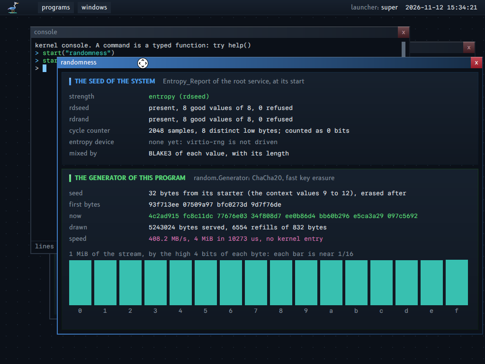

# Randomness

This guide says where a program gets random bytes, how the generator works, where the seed of the system comes from, and how strong the system claims it is.

The terms are in `GLOSSARY.md`, section "Randomness": random seed, random generator, entropy report, seed strength.

**The idea in plain words.** A program asks no service and no kernel for random bytes: its starter gives it a seed of 32 bytes in its context, and it draws from its own generator in its own memory. The root service gathers the seed of the system from the processor at boot, and the system says how strong that seed is, so a program that makes a key can refuse a weak one.

**For whom.** A reader who needs random bytes in a program, and a reader who must know how far to trust them.

**Read before.** `MODULE_CONTRACT.md`, "6. The context" (the values of the seed).

**The map of this guide.** Section 1: where a program gets random bytes. Section 2: the generator. Section 3: the seed of the system, and what is claimed. Section 4: the tests. Section 5: what is not built.

## 1. Where a program gets random bytes

A program draws random bytes from its own random generator, a record of fixed size in its own memory (property 14). A draw makes no kernel entry and no call. The generator starts from the random seed of the program: 32 bytes that its starter writes in the context values 9 to 12 (`op.CONTEXT_VALUE_SEED`).

- **The root service** has no starter. At its start, before it starts any program, it gathers its own seed from the sources of the processor (section 3).
- **Each starter** (root, `console`, `errors`, `imports`, `frames`, `locks`, `rings`) gives each child 32 bytes of its own stream (`random.values_with_seed`). `system.program_start` refuses a start whose seed is 32 zero bytes: a starter cannot forget it.
- **The program** reads its seed once (`random.generator_from_context`), which erases it in the context.

The forms that the system can take, weighed against the properties:

| Option | Against the properties | Chosen |
|---|---|---|
| A kernel operation that gives random bytes | Property 1: the kernel has 27 counted operations; this one needs no kernel: a program runs `rdrand` with no handle, and the root service can give a seed. A kernel entry for each draw is also a cost on a hot path (QUIC draws a connection ID and a nonce for each handshake) | No |
| A service `random` that answers each request | Property 5: a call for each draw. The pool of a service is one shared state for all programs | No |
| A seed for each program at its start, and a generator in the program | Property 14 (the state is memory of the program), property 20 (no ambient access: the seed is a value of the context, which only the starter writes), property 5 (no call and no kernel entry for a draw) | Yes |

**What a starter knows.** The starter of a program knows its seed. A child has no secret from its starter, which already chooses its code and its grants. Two programs that one starter starts do not know the streams of each other.

**The fault program reads value 14.** `fault` reads its "zero" address from the value 14 of its context, which no starter writes: the seed is in the values 9 to 12.

## 2. The generator

`support/random/generator.odin`: ChaCha20 with fast key erasure (D. J. Bernstein, "Fast-key-erasure random-number generators", 2017).

- Each refill runs ChaCha20 with the key of the generator and the nonce 0 for 13 blocks (832 bytes). The first 32 bytes are the next key; the next 800 bytes are served in order.
- The key that made a refill is overwritten at once. Each byte is erased (`erase_secret_bytes`) when it is served. So a copy of the state after a draw does not give the bytes before it.
- `reseed` mixes new bytes into the key: the next key is BLAKE3 of a domain text, the old key and the new bytes.
- A zero generator is not seeded: a draw from it stops the program, so that no program draws from a known key.
- **One generator belongs to one thread.** Two threads that draw from one generator at once would get the same bytes (two equal nonces, two equal child seeds). A second thread gets its own generator, seeded with `seed_for_a_child` of the first. A draw or a reseed sets a flag of the generator with an atomic exchange; a second draw that finds it set stops the program with the sentence "random: two threads drew from one generator at once ...", instead of a bounds check later. The check costs one atomic exchange for each draw. It finds two draws that overlap, not a generator that two threads use one after the other (which gives no equal bytes).
- **The stack is erased after a refill and after a hash of a key.** The frames of ChaCha20 under `refill` hold the words of the key that made the refill, and the frames of BLAKE3 under `key_derive` hold the old key and the chaining values. `fill` calls `erase_stack_below_the_caller` after each refill, and `reseed` and `entropy_gather` after `key_derive` (the same 16 KiB as in `docs/CRYPTOGRAPHY.md`, section 6). So "the key that made a refill is overwritten at once" holds for the record of the generator and for the stack below the draw.
- The ChaCha20 is the code of Odin's `core:crypto` that the system took (`docs/CRYPTOGRAPHY.md`), checked against RFC 8439.

**Speed**: 4 MiB in 12.4 to 38.7 ms in the program `randomness` (108 to 339 MB/s, host load 19 to 22). A draw of 32 bytes for a TCP secret costs about 0.1 to 0.3 us.

## 3. The seed of the system, and what is claimed

The root service hashes, with BLAKE3, each value of each source, each with its length (`random.entropy_gather`, `key_derive`):

| Source | How it is read | Its checks | What it can claim |
|---|---|---|---|
| `rdseed` | 8 values of 64 bits, when CPUID 7 says the processor has it | A value with the carry clear (empty), all ones (a known fault of some processors of AMD), or equal to a value before it, is refused and read again, 32 times for each value at most | The entropy source of the processor, by its specification: strength `entropy` |
| `rdrand` | 8 values, when CPUID 1 says the processor has it | The same | The generator of the processor, which the processor reseeds: strength `processor` |
| The cycle counter | 2048 deltas of `rdtsc` around a short loop | None: its count of distinct low bytes is shown, as a sign of life only | 0 bits: this system does not measure its entropy. A seed from it alone has strength `weak` |

The strength of the seed is the strongest source that gave all its values. The root service writes it on the log: "root: the random seed of the system, strength ...". It gives the facts of the gathering, never the seed, to the program `randomness` (its context values 0 to 7).

**The reads are not merged.** The reads of `rdrand` and `rdseed` through a procedure value (`processor_values` in `support/random`) carry `#side_effects`: without it, LLVM keeps one value for all the reads (a machine test then shows "rdrand present, 1 good, 255 refused").

**No claim beyond the sources.** The system does not test the output of `rdseed` or `rdrand` for quality. A processor whose generator is wrong or hostile gives a wrong seed, with no sign; the jitter of the cycle counter is mixed in so that such a processor alone does not fix the seed, but this system claims no bits from it.

**A machine with no `rdrand` and no `rdseed`.** The seed comes from the cycle counter only. Each program still starts and draws. The log and the window say "weak (the cycle counter only)" in the color of a failure. `kerneltool test random` runs such a machine (`-cpu max,-rdrand,-rdseed`).

**Each program knows the strength of its seed.** The starter writes the strength of the seed of the system in the context value 16 (`op.CONTEXT_VALUE_SEED_STRENGTH`) with the seed: 1 weak, 2 processor, 3 entropy. A child's seed comes from its starter's stream, so it has the same strength. `random.seed_strength(generator)` gives it.

**Each program chooses the least strength that it accepts.** The functions let the program state what it tolerates; a seed below that is an error of the call, not a stop.
- `random.fill_for_a_key(generator, output, least_strength, error)` gives bytes for a key, a nonce or another secret only when the seed of the program has `least_strength` at least.
- If the seed is weaker, the call gives the error kind `Seed_Too_Weak` (value: the strength of the seed; limit: the strength asked), with the sentence "the random seed of this program has the strength weak (the cycle counter only), and the call asks for processor (rdrand) at least: it made nothing". It writes no byte.
- The system does not refuse for the program, and a plain draw with no requirement (`random.fill`) stays as it is.
- QUIC and TLS ask for `processor` at least (`Tls_Configuration.least_seed_strength`): on a machine with no `rdrand` and no `rdseed`, a handshake does not start, and the caller gets the error.
- The exports of the module `cryptography` take each key as an argument and draw no random byte, so they have no such parameter.

**The boot-time problem: who seeds root.** No program runs before the root service, so it cannot get a seed from a device program. It takes one from the processor at its start; a device program can add bytes later with `reseed` (section 5).

## 4. The tests

- Host tests (`odin test support/random`):
  - the generator gives the ChaCha20 stream of its key after its first 32 bytes, then the stream of the next key;
  - each served byte is erased;
  - two seeds give two streams, a zero seed is refused, and a child seed is not part of the later stream of its starter;
  - a statistical smoke test on 1 MiB: the count of one bits within 6 standard deviations, and a chi-square of the 256 byte values between 150 and 400. **It finds a gross fault, and proves nothing about the quality**;
  - each fallback with sources of the test: none, `rdrand` of all ones, `rdrand` that repeats one value, `rdrand` alone, and `rdseed`.
- `kerneltool test random`, three machines:
  - two with the processor of the host (strength `entropy`), with two programs `randomness` in the first;
  - one with no `rdrand` and no `rdseed` (strength `weak`).
  - The first 16 bytes of the stream of the 4 programs all differ: two programs give different streams, and a restart gives different streams.
- `server` and `fetch` take the secret of the initial sequence numbers of TCP from their generator (`kerneltool test tcp`).

## 5. What is not built

- **An entropy device.** QEMU has `virtio-rng-pci`. A device program of property 7 that reads it and gives its bytes to the root service (`reseed`) is not built. The window says "none yet".
- **A reseed of a running program.** A program reseeds its own generator only from bytes that it has (`random.reseed`). No service gives fresh bytes to a running program.
- **The TPM** (property 17) as a source.
- **A measure of the jitter of the cycle counter** (as `jitterentropy` does). Without it, the claim stays 0 bits.
