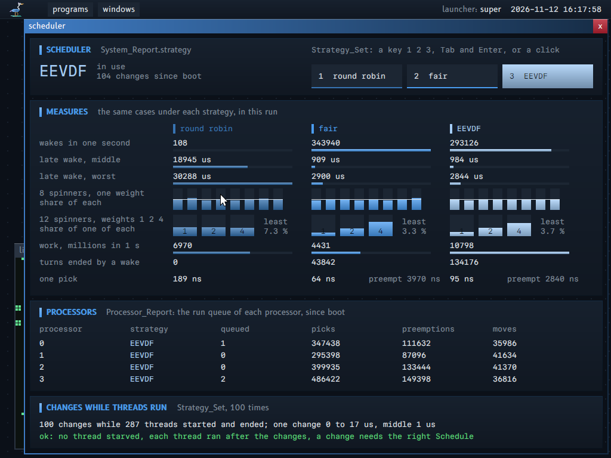

# Scheduling strategies

Status: research note and design. The system takes ideas from CFS, EEVDF and `sched_ext`, and it can change from one strategy to another while it runs.

**The idea in plain words.** A scheduling strategy decides which ready thread runs next on a processor. This system has three behind one table of six functions (round robin, fair, EEVDF), and a program with the right **Schedule** on the machine changes the strategy of the whole machine while it runs, with no stop.

**For whom.** A reader who wants to know how the system shares the processors, and a reader who changes `kernel/strategy.odin`.

**Read before.** `ARCHITECTURE.md`, "K3. Scheduler" and, for the locks, "Rules that keep each path correct". After this guide, the picture of the program `scheduler`.

**The map of this note.** "1. What Linux does" describes CFS, EEVDF and `sched_ext`. "2. What this system takes" gives the table of six functions. "3. Design details" gives the virtual time, the queue clock and the lag. "4. Measured" and "5. What this system refuses, and why" close.

This note says what the three Linux designs do, which ideas this system takes, which it refuses, and why. The terms are in `GLOSSARY.md`: strategy, weight, virtual time, lag, eligible, virtual deadline, request, wake preemption.

Sources. The EEVDF and `sched_ext` paragraphs were checked against the kernel documentation (`docs.kernel.org/scheduler/sched-eevdf.html` and `sched-ext.html`, read on 2026-11-11). The constants of CFS and the details of the Linux code (the names of fields, the clamp of the lag) are from memory of the Linux sources: they are not checked against a source.

## 1. What Linux does

### CFS: virtual run time and weights

CFS ("Completely Fair Scheduler", Linux 2.6.23 to 6.5) gives each runnable task a share of a processor in proportion to its weight. The weight comes from the nice value: 1024 at nice 0, about 1.25 times more or less for each step of nice.

Each task has a virtual run time. When a task runs for a time `t`, its virtual run time grows by `t * 1024 / weight`. A heavy task ages slowly; a light task ages fast. The run queue of a processor keeps its tasks in a red-black tree ordered by virtual run time, and the processor runs the task with the least virtual run time. So over time the virtual run times stay close, and the real run times follow the weights.

The queue keeps `min_vruntime`, a clock that never goes back: the least virtual run time of the queue and of the task that runs. A task that wakes after a sleep gets at least `min_vruntime - latency/2`: a sleeper gets a small credit, not the whole time that it slept. A task that moves to another processor keeps its distance to `min_vruntime`, not its absolute value.

The length of a turn is not fixed: the target latency (6 ms) is divided among the runnable tasks by weight, with a least turn (0.75 ms). A woken task preempts the task that runs if its virtual run time is less by more than a wake granularity (1 ms, scaled by weight).

The known weakness: CFS has one number per task. A task that needs a short delay (audio, input) and a task that needs a large share have the same knob, the nice value. The rules for a woken task are heuristics.

### EEVDF: eligible time, virtual deadline, lag

EEVDF ("Earliest Eligible Virtual Deadline First", Stoica and Abdel-Wahab, 1995) replaced CFS in Linux 6.6 (2023, Peter Zijlstra). It keeps the virtual run time and the weights of CFS, and adds three concepts.

- **Lag.** The queue has an average virtual time `V`: the average of the virtual run times of its tasks, weighted by their weights, with the task that runs. The lag of a task is `V - v` (scaled by the weight): what the task is owed. A positive lag means the task received less than its share; a negative lag means it received more.
- **Eligible.** A task is eligible when its lag is zero or more (`v <= V`). Only an eligible task can run.
- **Virtual deadline.** A task asks for a request: a run of `r` of processor time (Linux: the base slice, 0.75 ms by default, and a value that a task sets with `sched_setattr()` since 6.12). Its virtual deadline is `v + r * 1024 / weight`. Among the eligible tasks, the processor runs the one with the earliest virtual deadline. When a task used its request, it gets a new deadline.

The request size is the latency knob. It does not change the share of a task: the weight sets the share. A short request gives an early deadline, so the task runs soon after it becomes eligible, in short turns. A long request gives fewer switches. CFS had no such separate knob.

A woken task preempts the task that runs when the woken task is eligible and has an earlier deadline. This rule replaces the heuristics of CFS.

The lag of a task is kept when it sleeps, within a bound (Linux clamps it to about two requests), and the task is placed at `V - lag` when it wakes, with a correction for the change of `V` that its own weight makes. So a task cannot gain by a short sleep: a negative lag stays. Linux also keeps a sleeping task in the queue for a time ("deferred dequeue") so that a negative lag decays and a long sleeper starts at zero.

Linux keeps the tree ordered by virtual run time, with the least deadline of each subtree in the node: a pick is `O(log n)`.

### `sched_ext`: a strategy as a replaceable program

`sched_ext` (Linux 6.12, 2024) is a scheduler class whose behavior is a set of BPF programs: a `struct sched_ext_ops` with callbacks. The main ones: `select_cpu` (where a waking task goes), `enqueue` (a task becomes runnable), `dequeue`, `dispatch` (a processor has nothing in its local queue), `runnable`, `running`, `tick`, `stopping`, `quiescent` (the task waits), `set_weight`, `init_task`, `exit_task`, `init`, `exit`. All callbacks are optional.

The tasks wait in dispatch queues (DSQs): one global FIFO, one local queue for each processor, and queues that the BPF scheduler makes. A queue is a FIFO or ordered by a virtual time. A processor always runs from its local queue; it moves a task from the global queue, or calls `dispatch`, when its local queue is empty.

The BPF verifier proves that each callback is memory safe and ends. The kernel keeps the integrity of the system whatever the BPF scheduler does: if a runnable task is not scheduled for a time (a watchdog, 30 s by default), if the scheduler reports an error, or at the key SysRq-S, the kernel aborts the BPF scheduler and gives all its tasks back to the fair class. During the load, the unload and the recovery, a bypass mode schedules all tasks with a plain FIFO and a slice of 5 ms.

## 2. What this system takes

### A strategy is a table of six functions over the data of a run queue

From `sched_ext`: a strategy is a small set of callbacks. Here it is a record of six function addresses in the kernel (`kernel/strategy.odin`):

| Callback | When | It decides |
|---|---|---|
| `ready` | a thread becomes runnable: new, woken, or back after its turn | its virtual time and deadline |
| `pick` | a processor needs a thread | the next thread of a queue, among the threads that a budget lets run |
| `tick` | the tick, on the processor that runs a thread | the charge of the time; if the turn ends |
| `stopping` | a thread leaves its processor | the charge of the last time; the lag of a thread that waits |
| `wake_preempts` | a thread woke and each processor is busy | if the woken thread preempts the thread that runs on its home |
| `move` | a processor takes a thread from the queue of another processor | the virtual time of the thread in the new queue |

The data stays in the kernel tables, in fixed fields (property 13, property 14: no allocation). A strategy owns no memory: its state is the fields of the thread record and of the run queue that the table of `ARCHITECTURE.md` names. All strategies share one list per queue; only `pick` decides the order.

The run queue, the run lock, the balance between processors and the budgets stay as they are: a strategy chooses among the threads that a budget lets run (`budget_spent`). The limit of a budget is not a strategy: it holds under each strategy.

### Three strategies

1. **Round robin**: the reference strategy: a queue in order, a time slice of 10 ms, no wake preemption.
2. **Fair**: the idea of CFS. Virtual time and weights; the least virtual time runs; a target latency of 6 ms divided by weight with a least turn of 0.75 ms; a sleeper credit of 3 ms; wake preemption with a granularity of 1 ms; a move keeps the distance to the queue clock. A new thread, and each thread that a change of strategy places again, starts one least turn (weighted) after the queue clock, not at it: a program that creates threads all the time does not get a turn before each other thread.
3. **EEVDF**: average virtual time, eligible, virtual deadline from a request, the earliest eligible deadline runs, lag kept across a sleep within two requests (at least one tick), wake preemption by deadline, a move keeps the lag. A new thread has the lag 0: it starts at the average `V`, not at the least virtual time, and its deadline is one whole request after it; so it is owed nothing, and runs before another thread only if that thread is owed less. A program that creates threads all the time gets no turn that its threads did not have before.

### Weights and requests: a field at thread creation

`Thread_Create` has two more values: the weight (1 to 1024; 0 is 1024, the full weight) and the request in microseconds (1 to 100 000; 0 is 3000). Zero is the default, so a program that gives neither value gets the full weight and the default request (property 13).

Property 20: a program can lower or split its own share, never raise it. The weight of a thread is at most the full weight, which is the default. So a program can give one thread less than another, and cannot take more than a thread with no weight. The processor limit of the budget stays above any weight: a strategy only orders the time that the budget gives. The request does not change the share: it moves the deadline. A short request can cost more switches; the cost is in the time of the thread itself, which its budget pays.

A weight is for a thread, not for a program or a budget: a program with many threads still has more share than a program with one thread, as with round robin. A share for each budget (the groups of Linux) is not built: see section 5.

### The change of strategy is a kernel operation with a right

`Strategy_Set` (operation 27) takes the machine handle with the right `Schedule`, and a strategy. The root service gives the machine with this right only to the program `scheduler`, as it gives Inspect to the programs that read reports (property 20: no ambient access; the strategy of the machine is a fact of all programs). The operation gives the strategy that was in use. `System_Report` gives the strategy in use and the count of changes; `Processor_Report` gives, for each processor, the strategy of its queue, the threads in the queue, and the counts of picks, preemptions and moves, and the cycles spent in picks.

The change does not stop the machine and loses no thread: each run queue changes under its run lock, one queue at a time; see section 3.

## 3. Design details

### The hot data

The fields that a pick and a wake read are in the first 64 bytes of the thread record: state, home, the links of the queue, processor, budget, weight, request, virtual time, virtual deadline, lag, queued, placed. `Thread` is aligned on 64 bytes, so the line is one cache line. The run queue is one line too: the lock, the head, the tail, the counts, the strategy of the queue, the sum of the weights, the queue clock.

A pick touches: the line of the queue, and one line for each thread of the queue (round robin: the first thread whose budget has time), plus the lines of the budgets of these threads (`budget_spent` walks the chain of budgets). A pick of EEVDF reads each thread of the queue three times: one pass keeps each thread within its bound, one computes `V`, one finds the deadline. The second and the third pass read lines that the first pass brought into the cache.

### A scan, not a tree

The thread table has 256 places, and a queue holds the ready threads of one processor: in the machine test, 0 to 12. A scan of 12 records of 64 bytes reads 768 bytes in order. A tree needs a node per thread, pointers, and a rebalance at each insert; for these sizes it reads more lines than the scan. The program `scheduler` measures the cycles of each pick for each strategy (`Processor_Report.pick_cycles`), with up to 12 threads in a queue: section 4 gives the numbers.

### Integer arithmetic and the overflow argument

The kernel counts time in cycles of the cycle counter (about 3e9 in one second here). A virtual time is in weighted cycles: a run of `c` cycles adds `c * 1024 / w`, with `1 <= w <= 1024`. One charge is the time since the last charge: one tick, or the time between two passes of the kernel. The kernel clamps it to 2^32 cycles (about 1 s at 4 GHz), so one charge adds at most 2^42.

A virtual time is a `u64` that can wrap. Two virtual times are compared by the sign of their difference as an `i64` (as Linux does): this is right while the two are less than 2^63 apart.

Each queue has a queue clock (`Run_Queue.virtual`), which never goes back. The kernel keeps each queued thread within a bound under the clock: a pick that sees a thread more than the bound behind sets it to the bound. So a thread whose budget had no time for a while stays at a bounded distance. The bound is the sleeper credit (3 ms of weighted cycles) for the fair strategy, and the lag bound of the thread for EEVDF: two requests, at least one tick. A request is at most 100 ms, about 2^29 cycles at 5 GHz; at the least weight it is 2^39 weighted cycles, so the lag bound is at most 2^40. A thread ahead of the clock ran at most one turn ahead of it. A thread that waits is in no list, and the clock can move by any amount during its wait, so it keeps no absolute virtual time: under the fair strategy it keeps its distance to the queue clock (`lag`, clamped to the credit below and 2^44 above) and wakes at the clock plus that distance; under EEVDF it keeps its lag, clamped to its bound, and wakes at `V` minus the lag. A thread does not move while it waits: a move takes a thread from a list. A thread that goes back to the list after its turn is kept within the bound by the next pick. This correction is by argument: the case that it closes needs about 35 days of one thread of weight 1 alone in a queue, and the kernel code does not run on the host, so no test reaches it.

The average of EEVDF is `V = clock + sum(w * key) / sum(w)`, with `key = v - clock`. The kernel clamps each key to `±2^44` before the product. The clamp changes nothing unless a thread of weight 1 ran about 5 s with no tick that ended its turn. Then one product is at most `2^10 * 2^44 = 2^54`, and the sum of the 256 threads of the table at most `2^62`: it fits in an `i64`. The weights sum to at most `2^18`. The placement of a woken thread scales its lag by `(W + w) / W`, as Linux does, so that `V` does not move when the thread joins: the lag is at most `2^40` and `W + w` at most `2^18 + 2^10`, so the product is below `2^59`.

### The change at run time

`Strategy_Set` writes the new strategy in one word, then visits the run queue of each processor, one at a time, under its run lock. For each queue it reads the word again, and if the queue has another strategy it rebuilds it: each thread whose home is this queue, and that is in the queue, on the processor, or waiting, gets the zero values of the strategy fields; then the strategy of the queue changes; then each queued thread is placed by `ready`. The order of the list stays.

Why the zero values are fair enough: the state of a strategy is a history of shares inside one queue. Under a new rule, the old history has no meaning (a round robin queue has no virtual time; the virtual time of the fair strategy is not a lag of EEVDF). The zero values place each thread at the clock of its queue with a lag of zero: each thread starts equal, which is the definition of fair at one moment. The cost: a thread that was owed time loses at most one bound (3 ms for the fair strategy, two requests for EEVDF); a thread that was ahead gains at most as much. A thread that waits starts at zero when it wakes.

The interleavings are in `ARCHITECTURE.md`, "Locks of the kernel", "The change of strategy".

### The time slice is the longest turn

Each strategy ends a turn after the time slice of 10 ticks at most, as round robin does. At the end of a turn the processor passes through the balance (`schedule_pick`), where it takes a thread from a queue with more load. Without this rule, a thread alone in its queue under EEVDF keeps its processor while threads wait in another queue (the check "processors" then sees at most 3 of 4 processors run the program at the same time).

### Wake preemption, also on another processor

A woken thread goes to the queue of its home. If the processor of the home is idle, the waker sends it an interrupt; else, if another processor is idle, the waker sends one to it, and that processor takes the thread. If no processor is idle, the waker asks the strategy of the home queue, under its run lock, if the woken thread preempts the thread that runs there. If yes, the waker sets `preempt` in the processor record of the home and sends an interrupt; when the home processor receives it from a program, it ends the turn of its thread. If the home is the processor of the waker, the waker ends the turn itself, with no interrupt. The tick of the first processor wakes threads at their deadlines through the same path.

The round robin has no wake preemption. The fair strategy and EEVDF have it.

Two rules limit wake preemption:

- **A hint for the idle processor.** When the home of the woken thread is busy and the waker wakes another idle processor, it stores the home queue in that processor record (`look_first`) before the interrupt; the processor takes from that queue first. Without the hint it takes from the busiest queue, which can be another one, and the woken thread waits up to 10 ms.
- **At most one wake preemption of a processor in each millisecond by a thread of another program** (property 20). The interrupt and the pass through `schedule` cost time to the thread that runs there, and its budget pays: a program with a request of 1 us and threads that wake each other could make the threads of other programs pay. A thread of the same program preempts with no limit: its own program pays. A woken thread that the limit stops waits at most for the next tick, where its strategy ends the turn when it says so. Measured in the kernel part of one preemption by an interrupt, from its handler to the next thread: 1 883 ns (fair) and 1 964 ns (EEVDF), with no count of the entry and the exit of the interrupt.

`Strategy_Set` measured with its kernel entry, over 100 changes: 1 335 ns at least, 2 122 ns in the middle, 16 360 ns at worst. The conversion scans the 255 slots of the thread table under each run lock, with interrupts off.

## 4. Measured

The program `scheduler` runs the same cases under each strategy in the machine test (QEMU with KVM, 4 processors, a host loaded by other tests). Three runs: two threads that wake each other while a spinner runs on each processor make 80 to 84 wakes in one second under round robin, 461 732 to 498 800 under the fair strategy and 313 601 to 332 954 under EEVDF. A thread that sleeps 2 ms among 8 spinners runs 18.5 to 19.3 ms late in the middle under round robin, 0.3 to 0.9 ms under the two others. With the weights 1, 2 and 4, one spinner of each weight gets about 4, 7.5 and 13.5 % under the fair strategy and EEVDF, and about 8 % each under round robin. One pick takes 43 ns (fair), 81 to 86 ns (EEVDF) and 77 to 117 ns (round robin, with more picks from another queue). The spinners did 10 to 20 % less work under the fair strategy than under the two others in each of these three runs. One run with the limit of preemptions, the hint, and the placement of new threads under the fair strategy: two threads that wake each other made 65 (round robin), 458 431 (fair) and 114 643 (EEVDF) wakes in one second; the sleeper was late by 202 us (fair) and 1 005 us (EEVDF) in the middle, 3 031 and 7 275 us at worst. The fall of EEVDF from about 320 000 is between two runs of the full machine test on two trees of the source: with only the desktop (`kerneltool measure scheduler N`), EEVDF made 127 559 to 178 706 wakes in one second in 5 runs with these three rules, and 147 666 to 173 462 in 3 runs without them, so the rules are not its cause. EEVDF stays below the fair strategy in each run: its wake path and its pick read the queue three times each.

## 5. What this system refuses, and why

- **A tree for the queue** (CFS, EEVDF): refused for now. A scan of a small queue in one table is fewer lines (property 13); a measure decides when a queue becomes large.
- **The nice value**: refused. A weight is a number from 1 to 1024 that a program can only lower (property 20), not a level that a privileged program raises.
- **A program of the principal as the strategy** (`sched_ext`): not built. The kernel must stay off the hot path (property 5) and must not run code that it did not verify; a program that answers each pick through a ring puts a round trip between programs on each switch. What it needs: (1) a form of strategy code that the kernel can check before it runs it: a small language of callbacks over the fixed fields (a verifier, as BPF), or a module that the kernel runs only after a proof of bounded time and of the fields that it reads and writes; (2) the six callbacks, which are already the whole interface; (3) a watchdog: a thread that is ready and does not run for a time ends the strategy, as the kernel of Linux does; (4) the fallback: `Strategy_Set` to round robin, which already works without a stop; (5) a right: the same right `Schedule` on the machine. What exists for it: the six callbacks, the state in fixed fields that a strategy owns and that a change resets to zero, the change at run time without a stop, and the counts that a watchdog reads.
- **Groups** (the CFS groups, the cgroups of Linux): not built. A share for each budget needs a virtual time for each budget in each queue: a strategy can add it with the same six callbacks.
- **The deferred dequeue of Linux** (a sleeping thread stays in the queue so that its lag decays): refused. It keeps a thread that waits in a structure of threads that are ready; here the lag is clamped at the sleep and the change of strategy resets it.
- **Per-thread affinity**: not built. A move keeps the virtual time or the lag; the balance stays the one of the lock split.
