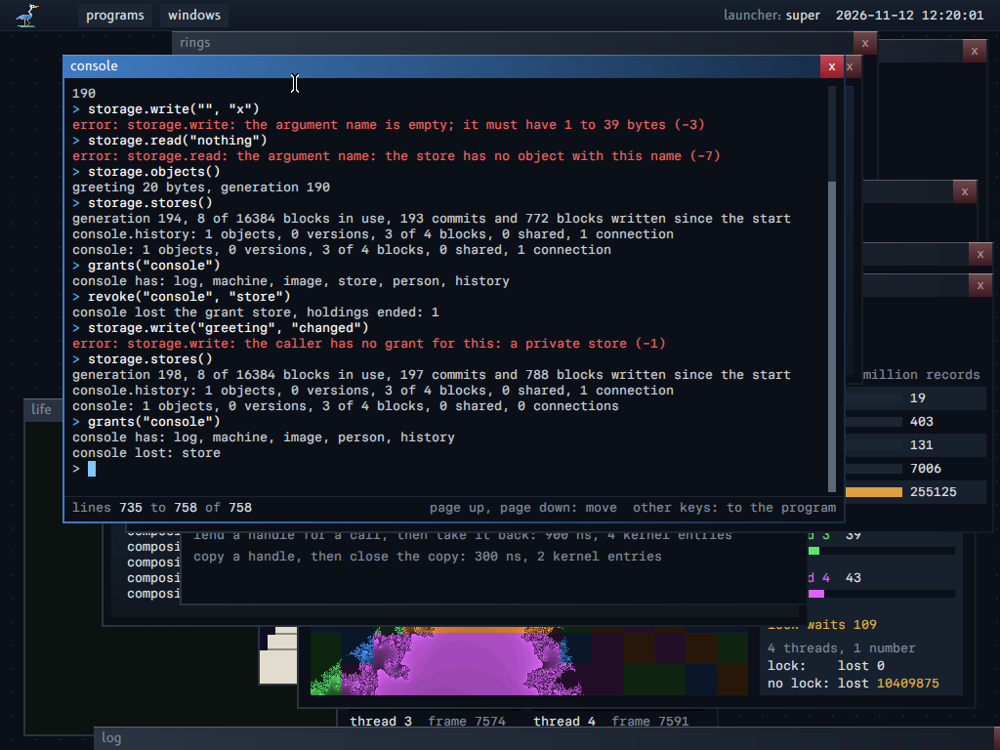
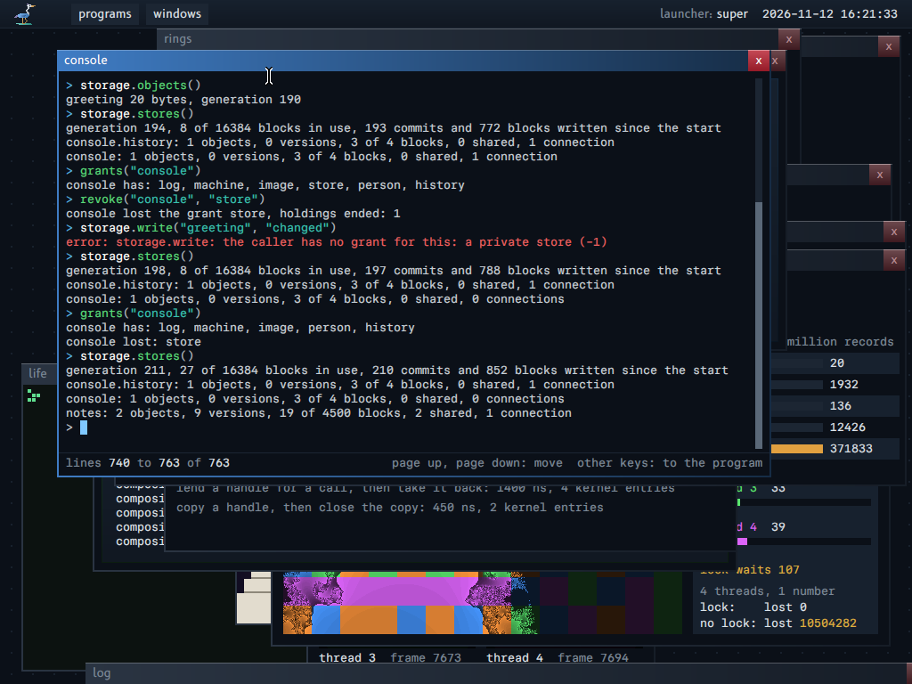

# Storage

This guide gives the model of the stored data of the system: what a program, a package and a principal keep, and how a program reaches only what it was granted. It also gives the format on the disk, the interface of the storage service, the limits, and the order of construction. Each part says if it is **built** or **not built**.

The terms are in `GLOSSARY.md`, section Storage. The versions and the date are in `ARCHITECTURE.md`, "Versions" and "The date".

## About this guide

**The idea in plain words.** A program never sees a disk, a path or a folder that other programs share. It holds a connection to its own store, granted by the root service with a limit of blocks. In it, it keeps objects (bytes) and trees (named entries that hold objects and other trees). Each change is a commit that a loss of power cannot cut in half, and each commit keeps the state before it as a version, so no program needs a save action or an undo file. To give a part of its data to another program, a program shares one tree, read-only or not, and can revoke the share.

**For whom.** A reader who writes a program that keeps data, a reader who wants to know what another program can reach of it, and a reader who changes the storage service.

**Read before.** `PROPERTIES.md`, "8. No global, mutable, shared file system" and "9. A storage engine with one private store per program". `PRINCIPALS.md`, "6. The store of a principal", for the names of the stores.

**The map of this guide.**

| Section | What it says |
|---|---|
| "1. The model" | Objects, trees and stores; installation and packages; the hard points; where the model changed |
| "2. What exists, and how it maps on the model" | What the system had first, and where each part stands in the model |
| "3. The format on the disk" | The blocks, an entry, the commit and the open, and the limits |
| "4. The interface of the service" | Places, the confinement, read-only shares and revocation, the removal of a tree, budgets, large objects |
| "5. Not built: the next steps" | The order of the next capabilities |
| "6. The tests" | What the host tests and the machine tests check |

**An example.** The console holds its line history in the store `console.history`, with a limit of 4 blocks: `storage.usage()` gives the counts of a store, and from a program that acts for the principal, `place = storage.open_store("console.history")` then `storage.versions(place, "line_history")` lists the earlier states of the object. The picture shows the private store of the console, its limit of blocks, the stores that the principal sees, and a grant that the principal revokes.





## 1. The model

The model has three things, and two concepts that the system has already.

| Thing | What it is | Does it change? |
|---|---|---|
| Object | Bytes, named by their hash (BLAKE3, 32 bytes). A module, a font, a picture, the text of a note: the same thing | Never. A new content is a new object |
| Tree | An object that names other objects and trees: each entry is a name and a hash. A tree holds trees, so the hash of a tree fixes each byte under it | Never |
| Store | A cell that names one tree now. A commit moves it to another tree in one atomic step. The versions of a store are its history | Yes: it is the only thing that changes |

| Concept that exists | Its part |
|---|---|
| Principal | A key pair. It signs trees (a package is a signed tree), and its key encrypts its data (not built) |
| Grant, handle | Access: a handle on a tree or on a store reaches what is under it and nothing above it, with or without the right to change, and its grant can be revoked |

The four needs, in the model:

| Need | Answer |
|---|---|
| Reproducibility | A system is the hash of one tree. Two machines with the same hash run the same bytes |
| Providers of packages | A package is a tree that the key of a principal signs. A provider is a principal: no other concept |
| Data of an application | A store held for a principal, attached to the identity of the package: the key of its signer and its name. Not its hash: an update would lose the data. Not its name alone: any signer could take it |
| Delegated access | A handle on a tree or on a store: what is under it, nothing above; read only or not; revocable |

What the model removes as a concept:

- **The system description is a package.** The system is the tree that holds the trees of its parts.
- **To install is to grant.** A principal adds the tree of a provider to its own tree, and grants it.
- **A folder is a tree.** The system has no other kind of folder, and no path that a program can name from nothing.
- **The boot image is a transport, not a concept.** It carries the objects that the machine needs before the storage service runs, one after the other. An image for a machine with no disk is the same transport with every object. An object can come by any channel: its hash proves it.
- **A package has no format of its own.** It is a signed tree with six facts beside its entries:
  1. its stable identity: the key of its signer and a name;
  2. the module that starts it, and the name that the desktop shows;
  3. the grants that it asks for;
  4. a version number that never goes back: an old signed tree cannot replace a newer one;
  5. where it comes from: the hash of its sources and of the recipe of its build, so that a third party can build it again and compare;
  6. its license.

### 1.1 Installation

Not built. These are rules of the model.

- **An installation runs no code of the package.** It has no script, no hook, and no step that changes the machine. It gets the objects that the tree of the package names and that the machine does not have, verifies each one by its hash, and keeps them. Nothing else changes until a principal adds the tree to what it holds: a grant, one atomic move of a store.
- **So an installation can be prepared before, cached, mirrored, shared between machines, stopped and continued, and undone** by a move of the store back to the tree before it.
- **A third party can build the same package.** The hash of a tree fixes each byte under it, and the build of a module gives the same bytes from the same source (`REPRODUCIBLE_BUILD.md`). A party that builds the package from its sources and its recipe gets the same hash: an object built before and an object built on the machine are the same object.
- **A cache of objects needs no trust.** The hash verifies each object. The signature of the tree says who vouches for the whole set.
- **What an application needs at its first start happens when it runs, inside its own grants:** it makes its data, or converts the data of an older version. Never at installation.

What these rules forbid, so that nobody adds it later:

- A package writes nothing outside its own data.
- A package does not register itself in a table of the machine by code that runs. What the system shows of a package (the module that starts it, the name that the desktop shows, the grants that it asks for) comes from the facts of its tree, read as data.
- A package does not depend on the order of the installations.

### 1.2 The hard points

**A large object that changes.** Built: section 4.6. An object is a tree of blocks. A commit of range writes makes new blocks for the changed blocks, and new object nodes on the paths from them to the root: copy on write, as the store does. The value of a block (its BLAKE3 chaining value at its place) is its check, and the hash of the object comes from the values: a commit hashes the changed blocks, the nodes above them and the path of the last block, never the whole object. One change of the model: a hole has the value zero, so the hash of an object with a hole is not the BLAKE3 hash of its bytes (section 4.6, "The hash of an object").

**Removal.** Two trees can name one object. A remove takes a name out of a tree: it does not erase the bytes while another tree, or a version, names them. What a remove guarantees: the name is gone from the tree at the commit, and the blocks that nothing else names are free after the removal finishes (section 4.4). To erase bytes for certain needs the end of each version that names them, and then a write of zero bytes over their blocks: not built.

**Collection.** An object that no store reaches, through any tree or any version, can go. The disk counts the names of each block, so most blocks become free at the commit that drops their last name: no walk. The walk is needed only for what the counts cannot see: a shared object that a later step names by its hash from several stores. Its cost is one read of each node of each tree that a store reaches; it runs at the start of the service, which walks every block already to check it (section 3.3). Not built as a separate step.

**Secrecy.** The data of a principal are encrypted under a key of that principal. Then two principals with the same bytes have two different objects: the store does not share them across principals. This is intended: a shared object tells one principal what another one has. Not built.

### 1.3 Where the model does not hold as it was first stated

- **The hash of a tree is not fixed by its entries alone.** A tree on the disk is a B+ tree of nodes, and the form of a B+ tree depends on the order of the changes. Two trees with the same entries can have two different forms. Rule: the hash of a tree is defined on its entries in the order of their names, not on its nodes; a tree that a build writes whole (a system, a package) is written in that one form. A tree in a store that changes has no hash until it is sealed. Not built: no tree has a hash today.
- **A writable handle on a part of a store is a place, not a hash.** A tree never changes, so a handle on a tree is read only by nature. To let another program change a part of a store, the handle names the store and the names of the path from the root of the store to that part. Such a handle reaches what is under that path. If a program with a wider handle renames a tree above the path, the handle names what is at the path now: the handle follows the names, not the bytes.
- **The versions are still kept for each named object, not for the store.** In the model, the versions of a named object are found in the history of its store. The first step keeps the versions of each object of a tree, as the store keeps them now; the history of a store is a later step (section 5).

## 2. What exists, and how it maps on the model

The model of section 1 is the direction; the service of today builds a part of it. The table gives each thing that exists, the concept of the model that it becomes, and how far it is built.

| What the system had first | In the model | State |
|---|---|---|
| A private store as one table of 39 named objects (the first format; not read any more) | A store of one program: it names one tree, with trees inside it | Built: section 3 |
| The name of an object (1 to 39 bytes, the first format) | A name of an entry of a tree (1 to 64 bytes) | Built |
| An object of a store, as a list of blocks | An entry of a tree that names an object: its hash and the root of its block tree | Built: the hash is kept; the blocks are still found through the entry, not by the hash |
| The versions of an object, their thinning | The history of a store | Kept for each object; the history of a store is not built |
| The system description (a signed list of hashes) | The tree of the system, signed by the principal that signs the system | Not built |
| The boot image | The transport of the first objects | Not built: the image is still the one source of modules |
| The resources of the boot image (pointer themes, glyph caches) that the root service gives | Objects of the tree of the system, granted by handle | Not built |
| The hash of a module (P11) | The name of an object | The same BLAKE3 hash; modules are not in the store yet |
| A grant of the root service: the store of a connection and its limit | A handle on the store of a program, with its budget of blocks | Built: the connection is the handle |

## 3. The format on the disk

Built. The disk is blocks of 4096 bytes. A root block names each store; a store names one tree; a tree is a B+ tree of entries; an entry names an object, whose bytes are a tree of blocks. Nothing on the disk is written in place: a commit writes new blocks, then switches the root block, so a loss of power leaves the state before or after the commit, never a mix.

The format is the contract `contract/store`, `STORAGE4`. A disk of `STORAGE3` is not read: an object there is a list of blocks.

### 3.1 The blocks

- **Root block**: the generation, and one store entry for each store: its name, its limit of blocks, the blocks that it uses, and the pointer of its store block. The disk has two places for the root block.
- **Store block**: one for each store: the root node of its tree, the root node of its removal queue, and its counts (objects, trees, the blocks of the current objects, the nodes of its trees, the trees that the removal queue holds).
- **Node**: a node of the B+ tree of one tree. A leaf holds up to 24 entries; a branch up to 50 children. Each tree of a store is its own B+ tree: a tree inside a tree is an entry whose pointer names the root node of the inner tree.
- **Object node**: a node of the block tree of one state of an object: 64 children, each an object node of the level below, a block of data, or a hole (section 4.6).
- **Data**: 4096 bytes of an object, at one place of it.
- **Version index, version leaf**: the versions of an object, as before; a version names the root of the block tree of its state.

A pointer is a block number and a check. The check of a block of data is the first 8 bytes of its value (section 4.6); the check of each other block is the first 8 bytes of the BLAKE3 hash of its 4096 bytes.

### 3.2 An entry

| Field | An object | A tree |
|---|---|---|
| Name | 1 to 64 bytes, then zero bytes. No zero byte, no byte `/`, not `.` or `..` | the same |
| Kind | object | tree |
| Size | its bytes | its entries |
| Generation, time, date | of its last change | of its last change |
| Hash | the hash of the object (section 4.6) | zero (not built) |
| Pointer | the root of its block tree: an object node, or its one block of data when it has one block; none when each of its bytes is zero | its root node; none when it is empty |
| Versions | its version index | none |

A name is one step: it has no separator, and it never names the tree above. So a name that a program looks up under a place never reaches a node outside it.

In a branch, the name of the record 0 is a bound that the search never reads. It can be larger than the name of the record 1: a smaller name that goes into the child 0 splits it, and the new separator goes to the record 1. So the order of a branch is checked from its record 1.

### 3.3 The commit and the open

A commit is one change of one store. It changes the entries of the trees on one or two paths from the root of the store. Each changed node of each tree is written to a free block, then the node above it, up to the root node of the store, then the store block, then the root block: copy on write, as before. A loss of power leaves the disk with the last commit or the one in flight, never a mix: the tool checks each image that a loss can leave (section 6).

The open of the disk at the start walks each node of each tree once, checks each block, and counts the names of each block. A block of data is checked by its value at its place; an object node by its check, by the rules of its format, and by the counts and the values of its children. A block that an earlier state named is not read again. A node that breaks a rule (its count, its level, the order of its keys) is damage, as a wrong check. A wrong node damages its store: the service gives nothing of that store and changes nothing in it. A wrong object node or a wrong block of data damages the state of the object that names it only: a read of it gives Damaged, and a write or a remove replaces it.

### 3.4 The limits

| Limit | Value | Reason |
|---|---|---|
| A name | 1 to 64 bytes | A key of 64 bytes gives 24 entries in a leaf with their hash: a store of a million objects has its entries in about 60000 blocks, inside the 262144 blocks of a disk |
| The levels of one B+ tree | 8 | With nodes a third full, 8 levels hold more entries than a disk can name. The open takes a deeper tree for damage |
| The trees on a path | 32 | A place holds the names of its path; a commit rewrites one tree on each level. 32 bounds both |
| The entries that one call adds | 256 | One commit writes at most 4096 blocks |
| An object | 4 TiB: five levels of object nodes of 64 children, 64^5 blocks | A commit copies one node of each level for each changed block, and the open takes a deeper tree for damage. 4 TiB is more than the disk, and a sixth level costs one more node on each path |
| A write of a whole object | The call region: 64 KiB | The data comes in the call region. A larger object is written by ranges |
| The pending changes | 1024 blocks (4 MiB) and 16 objects, for all the connections | The blocks of data that one commit writes. A range write past it is refused (Full, unit Pending): the caller commits first |
| The blocks that one commit releases | 262144: each block of the disk | The remove of an object as large as the disk is one commit |
| The disk | 262144 blocks (1 GiB) | Unchanged |
| The entries of a tree | No limit but the disk | |

## 4. The interface of the service

Built. A program reaches its data only through the exports of the storage service, over the connection that the root service gave it. Each export names an entry by a place and a name, never by a path: a program can reach what is under its connection and nothing above it. Each change is one commit, so it is on the disk when the call returns, and the state before it is kept as a version.

An example, in the console of the machine test, whose store has a limit of 3 blocks:

```
> connect("storage")
> storage.write(0, "greeting", "kept on the disk")
G
> storage.read(0, "greeting")
kept on the disk
> storage.write(0, "second", "one block more")
error: storage.write: the call needs 4 blocks in all, with no earlier version kept; the limit is 3 blocks (-2)
> storage.write(0, "", "x")
error: storage.write: the argument name is empty; it must have 1 to 64 bytes (-3)
> storage.stores()
console: 1 objects, 0 trees, 0 versions, 3 of 3 blocks, 0 shared, 1 connection
```

The place 0 is the root of the store of the connection. `write` gives the generation `G` of its commit. The refused write changed nothing: a change that does not fit even with every earlier version thinned is refused before any thinning (the paragraph on thinning in `ARCHITECTURE.md`, section U5). After a stop of the machine, `storage.read(0, "greeting")` gives the same bytes.

### 4.1 Places

A connection to the storage service is a handle on a store or on a part of it. A **place** is a number that a connection holds: the names of a path from the root of the connection, and the right to change or read only. The place 0 is the root of the connection: no call is needed to have it. Every export that names an entry takes a place and a name. A place is valid on its connection only; a call refuses a place of another connection (Absent, unit Places).

| Export | What it does |
|---|---|
| `open(place, name)` | The place of the tree `name` under `place` |
| `close(place)` | Frees the place |
| `add(place, rows, names)` | Adds up to 256 entries in one commit: each one an empty object or an empty tree. All or none |
| `write(place, name, data)` | Makes the object `name` the bytes of data, in one commit: the same mechanism as a commit of ranges (a cut or an extension to the size of data, and a change of each of its blocks). The state before is a version |
| `read(place, name, result)`, `size(place, name)` | The bytes (the range from 0 to the end), the size; with the pending changes of the connection |
| `read_range(place, name, offset, result)` | The bytes from `offset` up to the end, with the pending changes of the connection; a hole reads as zero bytes |
| `write_range(place, name, offset, data)`, `set_size(place, name, size)` | A pending change of the connection: no commit, no hash (section 4.6, "Ranges") |
| `commit(place, name)` | Puts the pending changes of the connection on the object in one commit, and gives a row: the generation and the measure of the commit |
| `list(place, after, rows, names)` | A page of the entries after the name `after`, in the order of the names: a table of rows (the place of the name in `names`, its count of bytes, the kind, the size, the generation) and the bytes of the names. A tree of a million entries is never given whole |
| `rename(place, name, to_place, to_name)` | Moves an entry, in one commit, inside one store. Refused when `to_name` exists, or when a tree moves into itself |
| `remove(place, name)` | Removes an object, or a tree and all under it (section 4.4) |
| `share(place, read_only)` | A new connection whose root is the tree of the place: two handles (its call ring and its call region) for the caller, to give to another program |
| `unshare(share)` | Ends a connection that `share` made |
| `usage()` | The counts of the store of the connection |
| `stores()` | One line for each store that the caller is allowed to name (section 4.2): its objects, its trees, its versions, its blocks (a shared block counted one time), the blocks that two names share, its limit, the count of connections that hold its grant now, and its damage. A caller that does not act for a principal gets the refusal "no grant to see the stores" |
| `open_store(store)` | A place on the root of another store, for a caller that may name that store (section 4.2). Such a place reads, restores and clones; `write`, `add`, `remove`, `rename` and `share` refuse it |
| `versions`, `version`, `restore`, `clone`, `compare` | As before, on an object `name` under a place; no argument names a store |

### 4.2 No way up

- A name is one step (section 3.2): `..`, `.`, a name with `/`, and a name that starts with `/` are refused with the byte that breaks the rule.
- The store of a connection comes from the grant of the root service, or from the share that made the connection. One procedure of the service (`may_name_store`) decides if a caller may name another store, for `open_store` and for the lines of `stores`: a caller that acts for principal N names the stores of principal N only (the principal of a store is in its name: `principals.store_name_principal`); principal 0 names no store of a named principal; a caller that does not act for a principal, and a share, name their own store only.
- A place of another connection is refused.

### 4.3 Read only, and revocation

- A connection that `share` made with `read_only` refuses each change (No_Grant, unit Changes).
- `unshare` revokes the two handles of the connection: the kernel ends each holding that came from them, in each program (`Handle_Revoke`), and the service frees the connection and its places. A call on it gives Gone.
- When the grant of the store of a connection ends (the root service revokes it, or the connection closes), each connection that it shared ends too, at its next call.

### 4.4 The removal of a tree

A remove of a tree is one commit: its entry leaves its tree, and the tree goes into the removal queue of the store. The name is gone at that commit. The blocks under it stay counted in the store until the service frees them, in steps: each step is one commit that removes up to 64 entries of the first tree of the queue (an inner tree goes into the queue in its turn). The service runs a step when no call waits. So the cost of the call is one commit, whatever the size of the tree; the work after it is bounded for each commit, and a loss of power loses no step: the queue is on the disk. `usage` gives the trees in the queue.

### 4.5 Budgets

The limit of blocks of a store holds as before: it counts the nodes of its trees, its object nodes, its blocks of data and its versions. A hole costs nothing: an object of 8 GiB with three blocks of data counts 13 blocks. A limit for a part of a store is not built.

### 4.6 Large objects

Built. An object can be far larger than one call: its bytes are a tree of blocks, and a program changes a few blocks of it and commits, with no copy of the rest. A part of zero bytes costs no block. The cost of a commit follows the blocks that it changed, never the size of the object.

#### The block tree

An object is a tree of blocks. The block n of an object holds its bytes from n × 4096. A block whose bytes are all zero is a hole: nothing names it, it costs no block, and it reads as zero bytes. The service never writes a block of zero bytes: a write that leaves one makes a hole, so the blocks of a state come from its bytes alone. The open takes a block of data of zero bytes for damage.

The object nodes are above the blocks. A node has 64 children: 64 is a power of two, so a node covers a whole subtree of the BLAKE3 tree of the bytes. A child holds its block number, its check, the count of blocks under it (itself included), and its value. The level of the root comes from the size: level 0 when the object has at most one block (the root is that block), else the least level whose node covers each block. A child whose blocks start at or past the size is a hole. A node with no child is a hole too.

The value of a part of an object is the BLAKE3 chaining value of its bytes as a subtree of the BLAKE3 tree of the object, with zero bytes past the size. The value of a block is the chaining value of its 4 chunks of 1 KiB at its place: it is the check of the block. The value of a node is the parent of the values of its children, two by two; a whole part with no block (a hole) has the value zero, and two halves of value zero give zero.

#### The hash of an object

The hash of an object of at most 4096 bytes is the BLAKE3 hash of its bytes. For a larger object, it is the root of the BLAKE3 tree of its chunks, where each whole part before the last block takes its value from the block tree, and the parts of the last block come from its bytes, up to the size.

- When no block before the last one is a hole, the hash is the BLAKE3 hash of the bytes. The host test computes the official vectors of BLAKE3 through the block tree.
- When a block before the last one is a hole, the hash counts the value zero for that whole part, in place of the chaining value of its zero bytes. So the hash differs from the BLAKE3 hash of the bytes.

The reason: BLAKE3 puts the place of each chunk in its compression, so zero bytes at two places have two chaining values. The BLAKE3 hash of an object of 8 GiB with three blocks costs the hash of 8 GiB of zero bytes, and the hash of a write in a hole costs the hash of the hole around it. With the value zero, a hole costs nothing.

The hash is still a function of the bytes only: a block of zero bytes is always a hole, so two objects with the same bytes have the same hash. The size is in the hash: the last chunk carries its length and its place.

The hash of a module (P11) is the BLAKE3 hash of its file. A module with an aligned block of 4096 zero bytes before its last block has another hash as an object. The work on objects by their hash (section 5) must name the module by one of the two: it is not decided here.

#### Ranges

A connection changes an object by ranges in two steps:

1. `write_range` and `set_size` are pending changes of the connection. The service keeps a copy of each changed block, as the connection sees it: the block of the last commit, read and checked at the first change of a part of it (a whole block that a write covers is not read), with the change on it. Nothing is written and nothing is hashed. A read of the connection sees its pending changes; another connection sees the last commit.
2. `commit` makes the pending changes one commit, on the disk at its return. The state before becomes a version.

A pending change starts from the state of the object at the first pending change. Another change of the object before the commit (a write, a restore, a remove, a rename, or a commit of another connection) comes first: the commit is refused (Absent, unit Pending, found 1), and the pending changes are dropped. A loss of power before the commit loses the pending changes and nothing else: the disk has the last commit. The end of a connection drops its pending changes.

This is the grouping of property 9: a program sends each change when it happens, and says which changes are one step. A whole write is the same mechanism: one call that cuts or extends the object to the size of its data, changes each of its blocks, and commits. A block that keeps its bytes keeps its block: its value is the value of the old block.

#### The cost of a commit

A commit of K changed blocks in an object of N blocks, with L levels of object nodes (L is the least level with 64^L at least N, at most 5):

| Work | Count |
|---|---|
| Blocks of data hashed | K, and the last block of the object: K + 1 at most; one more when an object of one block grows past it (its block becomes a child, with its value). Each one is 64 compressions of its chunks and 3 of their parents |
| Object nodes hashed | The nodes on the paths of the K blocks: at most K × L, and at most N / 64^l at the level l. Each one is 63 parent compressions for its value and one BLAKE3 hash of its block for its check |
| The hash of the object | The nodes on the path of the last block: at most 64 × L parent compressions from their values, and the bytes of the last block |
| Blocks read | A block that a range changes in part: at most K, each one read once; a hole and a whole block are not read. The nodes on the paths, through the cache |
| Blocks written | K blocks of data and the object nodes hashed; then the nodes of the trees of the store on the path of the entry, the version leaf and index, the store block and the root |

No count depends on N but through L. A write of a range computes nothing: a copy of the bytes in the service. The service writes one line for each commit of ranges: the blocks changed, the blocks and the object nodes hashed, the blocks written, and the time, as a measure. The export `commit` gives the same counts to the caller.

The test of section 6 makes 1000 writes of 16 bytes at scrambled places of an object of 8 GiB (2097152 blocks), each one in its own object node of level 1, then one commit. The commit hashes 1000 blocks and the last block, and about 1018 object nodes (1000 of level 1, 16 of level 2, one of level 3 and the root): it checks that the counts are bounded by the blocks changed (at most K + 1 blocks, at most 4K nodes), and prints the time as a measure.

#### Versions, thinning and the limit

A version names the root of the block tree of its state. A commit copies the nodes on the paths that it changes; the new state names each other node and block of the state before. Each block counts its names: the nodes that name it, and the entries and the versions that name a root. A release of a state takes one name of its root; a node with no name left gives one name less to each of its children. So the thinning of a version frees only the blocks that no kept state reaches: after the 1000 writes, the version before them holds 4 blocks of its own (the root and the path of the first block), and its other blocks are shared. `versions` gives the blocks of its own of each state.

The count of a store counts the blocks that its objects hold: each node and each block of data of the current state, and each block of the versions once. A hole counts nothing.

#### A loss of power

A commit of ranges is a commit as any other: its new blocks first, then a Flush, then the root. The tool checks each image that a loss of power can leave during a loop of commits of range writes (`kerneltool test power`): each image gives the durable commit or the commit of range writes in flight, never a mix; each object byte for byte when it has at most 1 MiB, else block for block by the values of its blocks, and the hash of each entry against its block tree.

## 5. Not built: the next steps

Each step is one tested capability on a system that works.

1. **Large objects and ranges.** Built (section 4.6), but the disk past 1 GiB: an object can hold 4 TiB, and the disk has 262144 blocks.
2. **The history of a store.** A version is a tree that a store named; the versions of an object are found in it. The thinning applies to the history of the store. The versions of each object go.
3. **Objects by their hash.** An index of the store from a hash to the blocks of an object: an object that two entries name is kept one time. The hash of a tree on its entries (section 1.3).
4. **The first objects from storage.** The boot image carries only what the storage service needs; the root service loads the other modules, the fonts and the pointer themes from the tree of the system, by hash.
5. **Packages.** A signed tree with its six facts; the store of the data of an application, attached to the identity of the package.
6. **Encryption for a principal.**
7. **The network as a channel.** An object comes from a peer; its hash proves it.

## 6. The tests

- Host tests of the B+ tree (`support/storage_tree`): inserts in a random order that split leaves and branches, a branch whose record 0 keeps a stale name, removes that merge and rebalance, the order of the keys, the pages of a listing, copy on write (the tree before a commit is still whole), the sizes of the format, the names that are refused.
- Host tests of the block tree (`support/storage_object`): the official vectors of BLAKE3 through the block tree, past one and two levels of nodes; a sparse object of 8 GiB with its hash computed again from its definition, its holes and a read across a block edge; a change across a block edge and across a level edge, with the state before whole; a cut to 10 bytes that lowers the levels to 0, an extension, a block of zero bytes that becomes a hole; a whole write that keeps the blocks whose bytes did not change.
- Host tests of the open (`support/storage_mount`): damage of a node, of an object node and of a block of data, a block tree that two states share, the recount of a store.
- The machine test of `hierarchy`: 100000 entries in trees inside trees, the listing in pages, a rename, the removal of a tree, 6000 names added to one tree in a fixed scrambled order (leaves and branches split in their middle) and half of them removed in another order (merges), then a second machine that opens the same disk and checks the counts and the contents. Each refusal of the confinement (`..`, `/`, a place of another connection, a change through a read-only share, a call after `unshare`). The time of the commits is printed as a measure.
- The machine test of `ranges` (`kerneltool test ranges`): an object of 8 GiB from three range writes holds 13 blocks and reads them back, with its holes and a read across a block edge; 1000 writes at scrambled places and one commit, bounded by the blocks changed; the version before them and the blocks of its own; a version of a small object reads its old bytes after a range write, and `compare` gives the one range written; a cut of 70 blocks to 6000 bytes, then an extension to 1 GiB; a read at the end and past it; a place of another store, a place of no connection, a commit with no pending change, and a commit after another change are refused; a loop of 200 commits of range writes. A second machine reads each of them back after the open of the disk.
- The losses of power (`kerneltool test power`): each image that a loss can leave opens, and gives the commit before or the commit in flight, each entry and each version byte for byte, or block for block for a large one. The third loss comes in the loop of range commits of `ranges`: the commit in flight is a commit of range writes.
