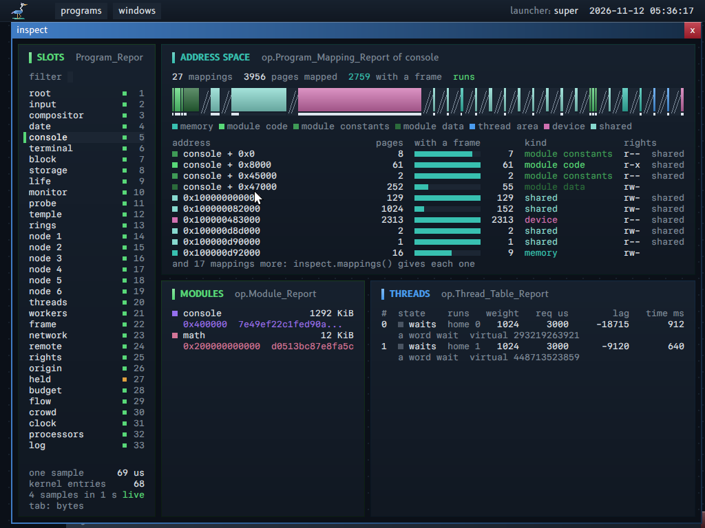

# Developer tools

The developer tools show memory and execution.

A developer tool (`GLOSSARY.md`) shows how the system runs. It reads reports of the kernel with a grant, and it changes nothing. Property 20 sets the limit: a tool inspects a program only with a handle that has the right to inspect.

## About this guide

**The idea in plain words.** In current systems a debugger or a task manager sees every program of the same user because it runs. Here a tool sees only what a grant lets it read: the kernel gives reports (counts, mappings, threads, modules) to a holder of the machine handle with the right **Inspect**, and gives no byte of the memory of another program. So each tool is a normal program, and its access is visible and revocable like any other.

**For whom.** A reader who wants to see how the system runs, and a reader who writes a tool, a source comment or a test of the system.

**Read before.** `PROPERTIES.md`, "20. No ambient access: the other holes to close" (line 2: debug access is a handle to one program). The terms developer tool, sample, folded gap, near export and confirmed place are in `GLOSSARY.md`, group Network.

**The map of this guide.**

| Section | What it says |
|---|---|
| "What each tool reads" | Each tool, its grant, and the reports that it reads |
| "The log" | The log of the kernel: its records, its channels and levels, and who reads it |
| "The program `inspect`" | The window that shows one program live |
| "Names and lines", "The debugger: the design" | How an address becomes a procedure and a source line, and the debugger that is designed |
| "What `inspect` does not read: the bytes of another program", "The cost" | The limit of the grant, and the price of a sample |
| "The comments of the sources", "The form of a documented comment" | The rules that the tool checks on every comment, and the form of a comment that the site and the console show |
| "The commands of the tool" | The commands of `kerneltool`, the parts of the machine test that `kerneltool test` runs alone, the times of a test, the incremental build, and how the tool sends input and waits |
| "The bounds of the tests" | How a test waits, and why no test asserts a speed |



## What each tool reads

Each developer tool is a program of the boot image. The root service gives it its grants when it starts, and the kernel answers its operation `Inspect` with one report at a time. The table names, for each tool, the handle and the rights that it holds, and the reports that it reads.

A tool with no grant to inspect the machine reads nothing. It says so in its window and in the log: the monitor writes "no grant to inspect the machine".

| Tool | Grant | Reports |
|---|---|---|
| `monitor` | machine, Inspect | `System_Report`, `Program_Report` of each slot. It serves `programs()`, `counts()`, `count()`, `counts_named()` and `served()` |
| `pages` | machine, Inspect | `Mapping_Report` of its own page table and of the kernel half |
| `processors` | machine, Inspect | `Processor_Report` of each processor |
| `locks` | machine, Inspect | `System_Report.locks` |
| `scheduler` | machine, Inspect and Schedule | `Processor_Report`, `System_Report.strategy`, `Thread_Table_Report` (the machine number of its own threads) |
| `manual` | machine, Inspect; boot image; replacement table | the flat tables of the modules, `Module_Report` of each slot |
| `log` | the log records, Read | `op.Log_Record`. It serves `records(after)` and `value_runs(after)` |
| `inspect` | machine, Inspect; boot image; debug image | `Program_Report`, `Module_Report`, and the four reports below, of the program that the principal chooses. It serves `mappings()`, `threads()` and `modules()` |

## The log

The log is the list of the lines that the kernel and the programs write as they run. The kernel keeps the newest records in memory and prints each one on the serial port. A record knows which of its bytes are values, so a window can color a size or a time without guessing from the text.

A log record (`GLOSSARY.md`) keeps its text and the value runs of the text: which bytes are a number, a size, a time, a module, a version or a status. The text is the text that the serial port prints, byte for byte: the machine tests wait for texts of the serial port, and a reader that ignores the runs reads the same record.

On the serial port, each line starts with the program and the channel in brackets. Two lines of the console, from the machine test:

```
[console] error: the instruction is at peek + 0x4 in probe (modules/probe/probe.odin:18)
[console] error: frame 0: peek + 0x4 in probe (modules/probe/probe.odin:18), the instruction
```

### The writer states the kind

A line of the log is made of parts (`system.log`, `system.log_in`, and `log` in the kernel). A text is plain. Each other part is a value with a value kind (`contract/value_kinds`):

| Part | Writes | Value kind |
|---|---|---|
| `u64`, `i64`, `Hex` | the number, in decimal or in 16 hexadecimal digits | Number |
| `Size{value, unit}` | the number, a space and the unit: `bytes`, `KiB`, `MiB`, `pages`, `blocks` | Size |
| `Duration{value, unit}` | the number, a space and the unit: `ns`, `us`, `ms`, `s` | Time |
| `Hash{bytes}` | two hexadecimal digits for each byte: the head of a hash is its first 8 bytes | Version |
| `Module_Name{name}` | the name of a program or of a module | Module |
| a status of the kernel (`system.Status`) | its number | Status |

No text is classified by its look. A value that a writer gives as a text stays plain. The reason: a guess from the look is wrong for a name that holds digits, and only the writer knows that `4096` is a size and not a count.

### The record and its value runs

A log record has 152 bytes of text and at most 8 value runs (`op.LOG_RUN_CAPACITY`): 3 bytes each, a start, a length and the kind. The operation `Log` takes the runs of its text in its seventh value, a count of at most 32 (`op.LOG_CALL_RUN_LIMIT`); the runs (6 bytes each, `Value_Run_In_Call`) follow the text at its address. The kernel copies them once and checks them in its copy: each run inside the text, after the run before it, with at least one byte and a kind. One run that fails: the record has no runs, and its text is whole. The kernel cuts the runs at the bounds of the records: a run across two records is one run in each. A text with more values than runs keeps the runs of its first values; the rest of its text is plain.

A run that fails its check costs the record its colors, never its text: the text is the fact, and the runs only describe it.

### The cost of the value runs

On the path of `log` in the kernel: one store of 6 bytes for each value, and at most 12 runs on the stack (72 bytes, `KERNEL_LOG_RUN_LIMIT` in `kernel/serial.odin`). In `log_record`, under the log lock: one pass over the runs for each record, at most 32 steps. No allocation. The serial port gets the same bytes as a record with no runs.

### The window of the log

The program `log` shows the last 30 records: the time, the mark of the level, the program, the channel, and the text in the font of the cells. Each value run is in the color of its value kind (`docs/DESIGN.md`, "The colors of values"); the rest of the text is in the text color, or in the color "failed" for a record of the level error. The head of the column of the text is the legend: the six kinds that the logs write, each in its color. A text that starts with the name of its program and ": ", then its channel and ": ", shows without that start: the columns at its left say it. The record keeps its text whole.

### The tables of the log service

`log.records(after)` gives one row for each record: its fields, the count of its value runs (`runs`), and its text. `log.value_runs(after)` gives the value runs: the number of the record, the start and the length in bytes of its text, and the name of the kind (`size`, `time`...). Join them on `number`. The first row of `records` also says in `lost` how many records after `after` the kernel wrote over before the call read them: a reader that is slow knows what it missed.

### The console and the terminal

A log record reaches the console only as the rows of these two tables. The console draws them as a table when a line asks for them. It also reads them itself for the programs that a line calls, and shows those records under the line, with each value run in the color of its value kind (`docs/CONSOLE.md`, "The log records of a line"). A program writes to its terminal apart from the log; a Text record of the terminal already carries a color for each run (`Style.color`), so a console that writes a record as runs of text, one run for each value run, needs no new form of the terminal.

## The program `inspect`

`inspect` is a window that shows one running program: its memory, its modules, its threads, and the stack trace when it stopped on a fault. It reads the same reports as any holder of the machine with **Inspect**, so it never sees the bytes of the program. The picture at the top of this guide shows it on the console.

One window for one program that the principal chooses in a list. It shows:

1. **The address space** (`Inspect_Kind.Program_Mappings`, `op.Program_Mapping_Report`): each mapping of the program, with its address, its pages, the first page of its memory object, the pages that have a frame (a count that each mapping keeps where an entry becomes present, under the program lock: the report reads one count for each mapping, not one entry for each page), the size and the serial of the memory object, and flags (`op.Program_Mapping_Flag`): Write, Execute, Uncached, Device, Contiguous, Shared (another mapping or handle names the object), Thread_Area, Uncommitted (an object made with Uncommitted: the field `committed` says which part its budget pays), Large (pages of 2 MiB), Protected (`Memory_Protect` changed pages of the mapping) and No_Access (its protection is No_Access now). The window draws one band scaled by address. A gap between two mappings is folded: it has a fixed width and lines at an angle (`DESIGN.md`, section 2: lines at an angle are a part with no measure on the scale). The kind of a mapping comes from these facts and from the module records: module code, module constants, module data, thread area, device, shared memory, memory of the program. The kernel does not know a stack: it is memory of the program.
2. **The modules** (`Module_Report`): name (from the boot image), hash, base and size. Each address in the window is `module + offset` when a module record holds it, as the stack trace of a fault names a frame (`MODULE_CONTRACT.md`, section 8).
3. **The threads** (`Inspect_Kind.Threads`, `op.Thread_Table_Report`): the machine number, the thread area, the state, the processor that runs it and its home queue, the weight and the request, the virtual time, the virtual deadline and the lag of the strategy, the processor time, the words of a word wait and its deadline. The kernel reads the fields of the scheduler with no run lock: each field is whole, two fields can come from two instants.
4. **The stop report** of a program that stopped on a fault (`Inspect_Kind.Stop`): the vector, the address, and each frame with the name of its procedure and its source line, `fault::three + 0x8 in fault (programs/fault/main.odin:15)`, from the debug image (section "Names and lines"). With no debug image, or a frame that no procedure of the debug object holds, the frame is `module + offset, near export`. The names are made when the stop report changes, not at each picture. The kernel filters the report (see below). The machine test waits for the log line `inspect: fault stopped: page fault at 0x0; stack: fault::three + 0x...`.
5. **Live**: a sample each 250 ms. A value that changed since the sample before is drawn in the color of the boot program for one sample. Space freezes the sample. The window shows the time of one sample and its kernel entries.
6. **A hex view** of the memory of `inspect` itself (the code of its export `entry`, and four pages of a memory object of which two were written): 16 bytes in each row, the address as `module + offset`, the ASCII at the right, the boundary of each page marked. A page with no frame is shown as such, and the tool does not read it: it asks `Inspect_Kind.Pages` (`op.Page_Report`) which pages have a frame, so its read gives no frame to a page. `Pages` answers for the program that asks only: about another program it is a side channel (a holder of Inspect watches which pages of a program get a frame, page by page, as the program runs), finer than each other report.
7. **One program, by its slot and its serial.** Each report has the serial of the program of the slot. A sample whose reports have two serials (a program ended, and a new one took its slot between two reports) is dropped, and the window keeps the sample before. The tool chooses a program by its slot and its serial, not by its name: two programs can have one name.

## Names and lines

A stop report gives addresses, and a reader wants the name of a procedure and a line of a source file. The names come from the debug object of each module, which the kernel never reads: a few programs with a grant read the debug image and translate. With no debug image, a frame keeps the form `module + offset`.

The kernel gives an address of a stop report as an address in a module record. The module names its exports only. The names of its other procedures and its source lines are in its debug object (`GLOSSARY.md`; `MODULE_CONTRACT.md`, "Debug information").

The debug object also holds what a debugger shows: the types, the global variables, and the parameters and the local variables of each procedure with their variable locations (`MODULE_CONTRACT.md`, "The types and the variables"). The names and the lines come from the symbol table and from the line program of the linked file; the types and the variables come from the entries of its DWARF. A program reads all of them through `contract/debug_object`, with no parser of DWARF.

- **One module, one debug object**: the debug object holds the BLAKE3 hash of its module file. A reader uses it only for a loaded module with that hash (`debug_object.describes_module`).
- **The source of a line**: the debug object holds, for each source file, its path from the root of the repository and the BLAKE3 hash of its content at the build. `debug_object.source_line_of` gives the path, the hash and the line of an instruction. A reader shows the text of the line only from a file with that hash, and says so when the hash differs.

- **Who names**: a program with the grant `Debug_Image` of the root service: `console`, `inspect` and `errors`. The root service maps the debug image read-only into each of them (the fixed range `Debug_Image`). The kernel reads no debug object: its line of the log stays "in module <hash> at offset X".
- **The form of a frame**: `procedure + offset in module (file:line)`. Frame 0 is the instruction. Each next frame is a return address: the procedure and the line are those of the call, the byte before the return address. The offset is the distance of the address from the start of the procedure.
- **The console**: a call host that stops on a fault prints "error: the instruction is at " and the name of its instruction, then one line "error: frame N: ..." for each frame (`fault_print`). A frame that no procedure of the debug object holds stays `module + offset`.
- **The program `errors`**: the case of the program `fault` writes its stack trace with the names: "fault::three + 0x8 in fault (programs/fault/main.odin:15), fault::two + 0x... in fault (programs/fault/main.odin:20), ...".
- **The machine test** (`Trace`): the tool takes the names that the system wrote, or names a frame `module + offset` from the debug object of the module in `build/modules`, with the same reader.
- **With no debug image** (a volume with no file `DEBUG/OBJECTS.IMG`): each frame is `module + offset`.

Lines of the machine test, after the console called the module `probe`, which tests the sandbox of an isolated call and reads an address that it must not read. Frame 1 is in a part of `host` that no procedure of its debug object holds:

```
[console] error: frame 0: peek + 0x4 in probe (modules/probe/probe.odin:18), the instruction
[console] error: frame 1: host + 0x2e14
[console] error: frame 2: entry + 0x224d in host (support/system/service.odin:337)
```

## The debugger: the design

A debugger stops a program where its author asks, shows its threads, registers and stack, and runs it one instruction at a time. The system has the parts that read and change one thread, but not yet the grant, the breakpoints and the read of the memory of another program. This section is the design of what is missing; no command below exists yet.

Not built. The console reads a stop report with names, and `Thread_Control` stops, reads and writes a thread (`Stop`, `Resume`, `Read_Registers`, `Write_Registers`, `Read_Extended_State`, `Write_Extended_State`). A debugger needs four more things of the kernel. This section gives each one with its reason; the console commands use them, and a window can come later over the same commands.

### The commands of the console

| Command | What it does | What it needs |
|---|---|---|
| `debug("life")` | Attaches to the program: the root service gives the console the program handle with the right `Debug` | The grant below |
| `threads()` | A table of the threads of the program: number, state, the procedure and the line of the instruction | `Inspect_Kind.Threads`, then `Read_Registers` of each held thread |
| `stop(thread)`, `resume(thread)` | Holds a thread, lets it run | `Thread_Control` `Stop`, `Resume`: built |
| `registers(thread)` | A table of the 16 general registers, `rip` with its name, `rflags` | `Read_Registers`: built |
| `stack(thread)` | The frames from `rbp`, each with its procedure and its line | `Read_Memory` (below) for the words of the stack; the debug image |
| `locals(thread, frame)` | A table of the parameters and the local variables that live at the instruction of the frame: name, type, value or "not readable" | The variable table and the type table of the debug object; `Read_Registers`; `Read_Memory` |
| `value(thread, frame, "pair.next")` | One variable or one global, with its fields, the elements of its array, the name of its enumeration value | The same, and the global table |
| `source(thread, frame)` | The source lines around the instruction of the frame | The file table of the debug object with the hash of each file; the source files, where the debugger has them |
| `break("fault::three")`, `break("programs/fault/main.odin:15")` | A breakpoint at the first offset of the procedure, or at the first row of the line table with that file and line | The debug object (a search by name, a search by line); the breakpoints (below) |
| `step(thread)` | One instruction: the trap flag in `rflags`, then `Resume` | `Write_Registers`: built (the trap flag is allowed); the delivery of the trap (below) |
| `continue()` | Resumes each held thread | `Resume`: built |
| `memory(address, count)` | The bytes, in the form of the hex view of `inspect` | `Read_Memory` (below) |
| `detach()` | Removes each breakpoint, clears the trap flag, resumes each thread, closes the handle | The end of the debug handler (below) |

The console already has a command `stop`, which stops a whole program by its name. The command that holds one thread needs a name of its own when it is built.

### The variables and the types

The data is built: the debug object of each module holds its types, its global variables and the variables of each procedure (`MODULE_CONTRACT.md`, "The types and the variables"). The commands that show them are not built.

- **The object of a module.** The debugger takes the hash of each module of the program from the module report, and uses only the debug object with that hash. With no such object it shows addresses, and says that the module has no debug object.
- **A variable of the innermost frame.** The debugger takes the variables of the procedure that holds `rip` (`debug_object.variable_range_of_offset`), keeps those that are visible at `rip` (`debug_object.variable_at`), and reads each value by its variable location: a register of the register image, or memory at a register plus an offset. A variable whose range there is of the kind `Not_Readable` is shown as "not readable". A variable of a procedure that the compiler put inside its caller is shown only where it has a value. The debugger computes no location that the table does not give.
- **A variable of a frame of a caller.** The instruction is the byte before the return address. Only the frame pointer of that frame is known, so only a variable location from the frame pointer is read; each other one is shown as "not readable in this frame".
- **A value by its type.** The debugger reads the bytes of the size of the type and shows them by the kind: an integer, a boolean, a float, the address of a pointer, the fields of a record (`debug_object.field_of_type`), the elements of an array, the name of an enumeration value, the bytes of a string (a second read of memory, with a bound). It follows a pointer only when asked, and bounds the depth of a type that names itself.
- **A global.** Its address is the address where the module is mapped plus the address of the global table (`debug_object.global_by_name`).
- **The stack.** Each procedure that the compiler wrote keeps the frame pointer: the word at `rbp` is the frame pointer of the caller and the word at `rbp` + 8 is the return address. The walk needs no table. It ends at a frame pointer of 0, at an address that the program does not map, at a frame pointer that is not above the one before it, or after a fixed count of frames. A procedure of an assembler file can keep no frame pointer: the walk skips its caller or ends there.
- **The source lines.** The debugger shows a line only from a source file whose BLAKE3 hash is the hash of the file table (`debug_object.source_line_of`). With another hash it shows the path and the line number, and says that the source changed since the build. The debug object holds no source text.

### Debugging from another machine

Debugging from another machine needs no mechanism of its own.

- **The commands are exports.** The commands of the debugger are exports of a debugger service. The console calls them, and a window can call the same exports.
- **The service `remote` carries them.** `remote` already carries a call of an export over QUIC from another machine to a program that holds the grant (`QUIC.md`, section 7). A debugger on another machine calls the exports of the debugger service through it. The grant of the debugger service decides who debugs what, as for a local caller; the connection adds no right.
- **Where the debug objects are.** They stay on the machine of the developer, or in the debug image of the debugged machine. The debugger service reads a debug object by the hash of the module. A caller on another machine can also ask for raw values (registers, bytes of memory, the hash of each module) and name them with its own debug objects, by the same hash.
- **The serial port is not used.** The serial port is the log of the kernel. A second protocol on it would be a second way into the machine, with no grant and no connection that proves who calls.

### What the kernel lacks, and the least addition for each

1. **Who may debug whom.** Property 20, line 2: "Debug access is a handle to one program. The principal grants it". So the grant is a new right of a program handle, `Debug`, and a new command of the root ring, `Debug` (a name). The root service gives the handle of the program with `Debug` only to a caller that acts for the principal whose session runs that program (`PRINCIPALS.md`): never a program of another principal, and principal 0 does not debug the programs of a named principal. The grant is a record of the root service, visible in `grants()` and revocable. A thread of the program is named by its number and this handle: today only a thread handle names a thread of another program, and the root service holds no handle of a thread that a program made.
2. **The faults of the debugged program go to the debugger.** Today a program names one of its own threads as its fault handler (`ARCHITECTURE.md`, "The fault ring"). The addition: a fourth argument of `Fault_Handler_Set`, a program handle with `Debug`. Then the handler thread of the caller receives the faults of the kinds `Debug` and `Breakpoint` of that program, before the handler of the program itself, and `Fault_Answer` takes the same handle. The ring stays in the thread record of the handler: the debugger pays for it. When the debug handler ends (the debugger stops, or `detach`), the kernel clears the breakpoints and the trap flag of each thread that waits on it and resumes them: a debugger that ends never stops the debugged program. The debugger injects no thread and no code into the program.
3. **Breakpoints, with no write to the code.** The code of a module is shared: each program of the module maps the same pages without Write (`MODULE_CONTRACT.md`, "Shared code"). A byte `CC` in those pages would stop each program of the module. `Memory_Protect` only takes rights away, and refuses an object that another program names (`Object_Shared`). A private copy of one page for one program needs a page of a mapping that differs from its memory object: the kernel keeps the state of a page in the slots of the object, not in the mapping, so this is a new structure of the kernel. The least addition is the debug registers of the processor: two commands of `Thread_Control`, `Read_Breakpoints` and `Write_Breakpoints` (Inspect, and Inspect with Write), with four addresses of instructions for each thread. The kernel checks that each address is below `USER_END`, writes only the local enable bits of `DR7`, and loads `DR0` to `DR3` and `DR7` at the switch to a thread that has them (one flag of the thread: the others pay nothing). An instruction breakpoint is a `Debug` fault before the instruction; the record gives `DR6` in its error code, so the debugger knows which address; `Resume` sets the resume flag, so the instruction runs once. A breakpoint is of one thread: it never appears in another program. The limit: four breakpoints for each thread, and a thread that the program makes later has none until the debugger sets them.
4. **The bytes of the debugged program.** No operation reads the memory of another program (section "What `inspect` does not read"). The addition: a command of `Thread_Control`, `Read_Memory` (Inspect and Write: a thread handle with Inspect only sees the thread, it does not read secrets), at most 4096 bytes of the program of the thread, from the pages that have a frame only (no read gives a frame to a page).

Each addition is a command or an argument of an existing operation: the count of operations does not change. Additions 2 and 3 change the delivery of a fault and the switch of threads: kernel code with an independent review.

## What `inspect` does not read: the bytes of another program

The right **Inspect** on the machine shows how every program runs, but it must not show what a program holds: its keys, its documents, its passwords. So the kernel removes from a report each value that can come from the memory of the program. The rule and its reason follow.

The reports give counts, places, states and the stack trace. The stack trace comes from the stack of the program: with a chain of frame pointers that the program broke, a frame holds a word of its memory, and the address of a page fault can be a value that the program computed. The holder of the program handle with Read reads the whole stop report. For a holder of the machine with Inspect, the kernel gives a frame only when a module record of the program holds its address (else the frame is zero, and the tool shows "not code"), and the address of the fault only when it is in the first page or in a module record (else 0); the report counts the values that it took out (`hidden_value_count`). So no report through Inspect gives a byte of the memory of a program. To read the bytes of another program is a stronger right than Inspect: a tool with it reads the secrets of each program (property 20, line 2: "Debug access is a handle to one program. The principal grants it"). The system does not have that right: the hex view shows the memory of `inspect` itself. The right, if it is built, is a right of the program handle (one program, not the machine), that the root service gives to a tool on the request of the principal, visible in `grants()` and revocable.

## The cost

A tool that watches the system must not slow it in proportion to what it watches. Each report is built from counts that the kernel keeps anyway, so a sample costs the same for a small program and for a large one.

A sample makes one kernel entry for each report: the program reports of the list (one for each slot), and the mappings, the modules, the threads and the stop report of the chosen program. Each report costs one read for each mapping, thread or module: the pages with a frame are a count of each mapping, not a walk of the page table, so a program that maps 1 GiB 128 times costs the same as one that maps 128 pages. The test build checks the count against the page table at each unmap, in the walk that the unmap makes anyway. The window and the log give the measured time and entries of one sample.

## The comments of the sources

A comment must stay true for a reader who has only the source file. A number of a working record (the number of a property, the label of a review finding) means nothing to that reader, and it goes stale when the record changes. So a check refuses those numbers, and a comment gives its reason in words.

### What the check refuses

`kerneltool check` reads each comment of the sources and refuses a comment that names a thing of the working records by its number, its label or its date. A comment gives the reason itself, in plain words. When the reason is long, a pointer names a document and its heading, as `(docs/MODULE_CONTRACT.md, "Did not fit, across calls")`, or a numbered section, as `(docs/CONSOLE.md, section 3)`.

The check reads the `.odin`, `.asm` and `.nix` files of `kernel`, `boot`, `runtime`, `contract`, `support`, `modules`, `programs` and `tools`, with their tests, and `flake.nix`. It reads a comment with the scanner of the site (`tools/kerneltool/site_source_readers.odin`): the lines of comment that follow each other are one text. A form that a line break cuts is found, at the line where it starts. A string of the code is not a comment.

| Form | Example | Message |
|---|---|---|
| A property by its number | `(property 14)`, `(properties 2 and 20)` | a property by its number |
| A property by its short label | `(P20)`, `(P13;`, `(P20):` | a property by its short label |
| A choice by its number | `(choice 186)` | a choice by its number |
| A step by its number, of two digits or more | `step 91`, `the step after 309` | a step by its number |
| A finding of a review | `finding W8`, `findings W4 and W-new` | a finding of a review by its label |
| The label of a finding alone in a parenthesis, of the letters B, C, F, K, N, W | `(N2)`, `(W-new)` | a finding of a review by its label |
| The label of a finding at the start of a comment, then a colon | `W2: outside recovery`, `F1 and F2: a RST` | a finding of a review by its label |
| The name of a review | `an independent read`, `the hostile read` | a review by its name |
| A review by its number | `Review 10` | a review by its number |
| A note of a review | `note 1 of the second read` | a note of a review by its number |
| A decision by its identifier | `D-047` | a decision by its identifier |
| An item of the handoff | `HANDOFF item 53` | an item of the handoff by its number |
| Who made a decision | `decision of the coordinator`, `owner decision` | who made a decision |
| A date with "owner", "decision", "decided", "added on" or "coordinator" in the 48 bytes before it | `(owner, 2026-11-11: ...)`, `Added on 2026-11-11` | the date of a decision |

Each comment breach is one line of the output: the file, the line, the words, and what they name. One comment breach fails the check.

### What the check allows, and what it does not see

The forms that the check does not refuse:

- A pointer to a document with a section, a label or a heading: `docs/CONSOLE.md, section 3`, `docs/ARCHITECTURE.md, U3`. The heading in quotes of a pointer is not read: it is the text of a heading, and `kerneltool site` checks that the heading exists. `docs/PROPERTIES.md, property 10` is refused: the number of a property is not a heading.
- A number in a word, a hexadecimal number, a size, a port, a name of a standard: `P256`, `X25519`, `SHA-256`, `0xC2`, `C2_FIELD`, `4433`, `4 KiB`.
- A step of one digit: the steps of an algorithm or of a scenario (`RFC 6582 3.2, step 4`).
- A date with no word of a decision before it: an example of a format, a test vector, the date of a measure.

The check prefers a comment breach that it does not see to a correct comment that it refuses. It does not see:

- a property by its short label with no parenthesis (`P13` alone), and a label of a finding in a sentence with no parenthesis, no "finding" and no colon at the start (`B1` alone);
- the label of a section of a document with no path (`K2, memory`);
- a step of one digit, and a date of a decision with no word of a decision in the 48 bytes before it;
- a comment `/* ... */`, and a line of a string that runs over several lines (the scanner reads one line at a time).

A file that `support/cryptography/origin.manifest` lists is not read: it is taken from the cryptography of Odin, `kerneltool cryptography-origin` proves that it is its origin with listed changes only, and its comments are those of Odin. A file is exempt only by a manifest that the table of exemptions of `tools/kerneltool/comment_rule_check.odin` names, with the reason.

The marks of Markdown (next section) are not words: a list item, a mark of bold or a link is not a breach, and a breach in bold or in a list item is still a breach. The host test `comment_markdown_and_the_comment_rules` checks both.

## The form of a documented comment

The comments of the sources are also the reference of the system: the site and the console show them. So a comment that documents a declaration is written in a small part of Markdown, which both can show. The rules below say which part.

A comment above a declaration, on the line of a member of an enumeration, or before `package` is a documented comment: the site shows it on the reference pages (the kernel operations, the types, the modules and their exports, the console, the errors, the context, the grants), and a module carries the one of its package and of each export. A documented comment is Markdown, in a small part:

- **Paragraphs**: lines that follow each other are one paragraph; an empty comment line `//` separates two.
- **Emphasis**: `**bold**` and `*italics*`. A star with a space after it, or between two letters (`2*3`), is a star.
- **Code**: a code span in backticks. A span that names a declaration, a kernel operation, an error kind, a module or a command links to it by itself: this is the usual form of a name.
- **Lists**: a line that starts with `- ` or with a number and a period (`1. `). A line right after an item continues it; an item indented by two spaces more is nested.
- **Examples**: a fence of three backticks, with `odin` or with no language: the site colors it as Odin. A run of lines that start with a space, outside a list, is kept as it is and not colored: it is often words aligned in columns.
- **Links**: `[text](target)`, when the text is not the name of what it names. The target is:
  - an address of another host, `https://...`;
  - a term of the glossary, `term:handle`;
  - a guide, `docs/ARCHITECTURE.md`, or a heading of it by the id of the heading on its page, `docs/ARCHITECTURE.md#the-fault-ring`;
  - a kernel operation, an error kind, a module or a command of the console by its name (`Memory_Map`, `load()`);
  - an export of a module, `manual.edges`;
  - a declaration of the sources, `fault_deliver`, `operation.Fault_Record`, `system.word_wait`: a name that several packages declare takes its package.

A comment has no heading, no table, no quote, no line of HTML and no picture: it sits under the heading of its symbol, in a page or in a cell of a table, where a heading would break the outline of the page and a table would not fit. The site shows these lines as words of a paragraph.

A link is a claim of its author: `kerneltool site` stops on a link whose target names nothing, with its file and its line, as it stops on a pointer whose heading does not exist. A code span that names nothing stays code.

A module carries the same text, with its marks, and the program `manual` reads them in the system (`MODULE_CONTRACT.md`, "Description tables"): a bold word is in the bold weight, a word in italics has a thin line under it, a code span is in the font of the cells, a list item has its mark and its indentation, an example is a block, and a link is a colored name. The help of an export is the first sentence of the comment with the marks removed: the console prints it as one plain line. So the first sentence of a comment must read well with no mark.

The documentation of the kernel operations is the model: for each operation, one sentence that says what it does, its arguments as a list, its results, its statuses as a list with when each comes, the rights that it needs in bold, links to its records and to its guide, and an example call through `support/system` when one helps.

## The commands of the tool

All the automation of the project is one program of the host, `tools/kerneltool`. Each task (a build, a test, the site, a release) is one of its commands, so the same steps run on each computer and in each check. Run a command with `nix develop -c kerneltool <command>`; `kerneltool help` prints the list with one line for each.

| Command | What it does |
|---|---|
| `build [whole] [processes]` | Builds the modules, the boot images and the boot programs: the usual one, and one for each volume that a test or a measure needs (a start that fails, a shortage of frames, a measure run, the volumes of the trusted boot that the boot program must refuse, the volumes of Secure Boot, one for each self test of the kernel). It keeps each module and each boot volume when its inputs are the same; `build whole` keeps nothing ("The incremental build") |
| `module <name> ...` | Builds one module of the table, and its debug object. The parallel build runs it; run it by hand to see the errors of one module alone |
| `volume <name>` | Builds one boot volume: its boot image with the system description, its boot program, and the volume file. The build runs it for each volume that it must build; run it by hand, after a build, to see the errors of one volume alone |
| `run [without_checks]` | Builds the modules and the main boot volume, then starts the machine under QEMU in a window, with the log of the kernel on the terminal. The data disk stays from run to run. It starts the peer that takes the calls of `kerneltool call` |
| `call <key> "<call>"` | Calls an export of a service of the machine that `run` started, through the program `remote` over QUIC, and prints the typed result |
| `test [part]` | The machine tests (below), then the tests of the loader, of the system descriptions and of the debug objects on the host. It ends with "kerneltool: all tests passed", then the times of the test (below) |
| `measure ...` | A measure run: a machine that measures with no other load. No argument: the locks. `scheduler N`, `clock`, `crowd`, `disk`, `flow`, `limits`: the program alone, and its lines. `windows`, `address_space`, `shortage`. The numbers are measures, never conditions ("A check by count, a measure by time") |
| `screenshots` | The whole test, a second build and the measure runs whose numbers the measure record holds (the locks, `clock`, `disk`, `scheduler`), then the measure record and the copy of the pictures to `docs/screenshots` and to the development log. `screenshots compress` compresses the PNG files that are stored with no compression |
| `check` | `odin check -vet` and the host tests, the checks of the sources (the origin of the cryptography, the mark, the fixed addresses, the bounds of the tests, the rule on comments, the glossary, the changelog, the news), then `test` and a second build that must give the same bytes. Each of its builds is a whole build |
| `repeat <module> <count>` | Builds one module again and again, with no machine, and counts the distinct results (`docs/REPRODUCIBLE_BUILD.md`). Each of its builds is a whole build |
| `site` | Writes the site in `build/site/` |
| `changelog ...`, `news ...`, `release_number` | The fragments of the changelog and its releases, the news entries, the number of the newest release |
| `key new <folder>`, `key show` | The key that signs the system description |
| `font`, `vector_fonts`, `pointers`, `logo`, `portrait` | Convert a source (a font, a pointer theme, the mark, a picture) into the files of the repository. A build reads the result, never the source |
| `cryptography-take`, `cryptography-system-hashes`, `cryptography-origin` | Take a file of the cryptography of Odin, list the files that the project wrote, and check the origin of each taken file (`docs/CRYPTOGRAPHY.md`) |
| `film` | Films the terminal for the development log (needs ffmpeg) |

### The parts of the machine test

`kerneltool test` with no argument runs every machine in this order: a start that fails, the trusted boot, the shortage of frames, the self tests of the kernel, the main machine, the network, TCP, QUIC, QUIC against a real client, the randomness, the extended state, the return to a program, the fault ring, the kernel events, the cryptography, the persistence, the principals, the hierarchy, the ranges, and the loss of power. Each machine writes its log in a file `build/test_output*.txt` and its pictures in `build/screenshots`.

`kerneltool test <part>` runs one part only, for the work on it. The parts that the command accepts:

| Part | The machines that it runs |
|---|---|
| `main` | The main machine: the desktop, the console, the programs and the developer tools |
| `network` | The machine of the network service |
| `tcp` | The two machines of TCP |
| `quic` | The machine of QUIC through the network service |
| `quic-real` | The QUIC client of OpenSSL against `quic_echo`, through the UDP relay of the peer |
| `random` | The three machines of the randomness |
| `crypto` | The machine of the module `cryptography` |
| `extended_state` | The three machines of the extended state |
| `return_fault` | The machine of the return to a program |
| `fault_ring` | The machine of the fault ring |
| `kernel_events` | The machine of the kernel events |
| `shortage` | The machine of the shortage of frames |
| `principals` | The two machines of the principals |
| `hierarchy` | The machines of the hierarchy of storage |
| `ranges` | The machines of the ranges of storage |
| `power` | The loss of power: of the storage, of the settings, of the ranges |
| `trusted_boot` | The volumes of the trusted boot; `trusted_boot tpm` adds the two machines with a software TPM |

A part builds only the boot volumes that its machines boot ("The incremental build", "The volumes of a command"). Each part boots the main boot volume, `build/boot_volume.img`, with these differences:

| Part | The boot volumes that its build builds |
|---|---|
| `shortage` | The volume of the shortage of frames only |
| `return_fault` | The main volume, and the volume of the kernel with one check skipped |
| `trusted_boot` | The main volume, the five volumes that the boot program must refuse, the volume of the other system, and the two volumes of Secure Boot with the variable store |
| Each other part | The main volume only |

The persistence and the self tests of the kernel have no part of their own: only the whole run starts them. An argument that is not a part is refused before the build: the command prints the parts that it knows and ends with the exit code 2.

### The times of a test

`kerneltool test` reads the monotonic clock of the host at the start and at the end of the build, of each machine and of each step. At the end of a test that ran a machine, passed or failed, it writes `build/test_times.txt` and prints a summary. Each number is a measure: no test reads one, and no time makes a test fail ("The bounds of the tests").

The file has one line for each machine: its log file, its result, its whole time, the time from the start of QEMU to the first line of its log, the time of its steps and the time of its stop. Under it, one line for each step, in the order of the run, in fixed columns:

| Column | What it holds |
|---|---|
| `step` | The number of the step in its scenario, from 1 |
| `kind` | The kind of the step (`Wait`, `Type`, `Launch`, `Shot`, `Call`, ...) |
| `duration` | The time of the step, in seconds |
| `waited` | The part of that time in a wait for a line of the log |
| `keys`, `key_time` | The keys that the step sent, and the time in their sends, with the wait after each send |
| `pictures` | The pictures of the screen that the step saved |
| `text` | The first 60 bytes of the text of the step |

The last step of a machine that failed is the step that failed, when a step failed.

The summary is a list of lines that start with `kerneltool: measure:`:

- the whole test, the build, and the machines (the start to the first line of the log, the steps, the stops);
- for each kind of step, the count of its steps and the sum of their durations;
- the count of the keys and the time in their sends;
- the count of the pictures and their time: in the step, the wait for a settled screen, each `screendump` of QEMU and the read of its file; on a worker thread, while the scenario goes on, the conversion to PNG and the write;
- the time waited for lines of the log, added by the program of the line. The program is the first word of the text of the step before its first `:` (`clock`, `scheduler`, `[console]`);
- the 25 slowest steps, with their text.

The time of a wait says how late the line came after the step before, not what the program did: a program that runs during several steps has its time in the step that waits for its line.

One run of `kerneltool test main`, before the tool sent its input in batches, is the measure that the batches answer. The whole test took 625.6 s: the build 147.0 s, the machine 478.4 s for 1013 steps.

| Part | Steps | Time |
|---|---|---|
| Typed lines (`Type`) | 224 | 280.9 s; 4818 keys in all the steps, 285.6 s in their sends |
| Pointer (`Launch`, `Front`, `Move`, `Close`, `Point`, `Click`, `Drag`) | 140 | 100.4 s |
| Waits for a line of the log (`Wait`) | 454 | 49.6 s |
| Pictures (`Shot`) | 66 | 41.2 s: the fixed wait 26.5 s, the `screendump` 6.6 s, the conversion to PNG 8.1 s |

About 400 s of the 478 s were pauses of the tool, not work of the system.

The same test with the input in batches took 83 s of machine time. Of these, the 66 pictures cost 27.0 s, 26.4 s of them in a fixed time of 400 ms before each picture, and the waits for lines of the log cost 41.7 s, most of it in programs that measured a rate for a fixed duration at their start. The two answers are "When the tool takes a picture" and "A check by count, a measure by time".

### The incremental build

A build keeps the outputs of an earlier build when their inputs are the same. The rule that makes it sound is the rule of the reproducible build: the same inputs give the same bytes (`REPRODUCIBLE_BUILD.md`, "The incremental build and the same bytes"). A kept module that is not the module of its sources is a wrong system, so the tool keeps an output only when it can prove each input, and builds in every case of doubt.

**The inputs of a module.** The tool does not guess them: the compiler writes the list of the files that it read (`-export-dependencies:json`, in `build/modules/<name>/dependencies.json`).

| Input | How the tool knows it |
|---|---|
| The source files of the module and of each package that it imports, to any depth: the folder of the module, `contract:`, `support:`, and the libraries of the compiler (`base:`, `core:`) | The list of the compiler; the tool hashes each file |
| The files of `#load` | The same list |
| Every other file of the folder of each of these packages | The tool lists each folder. A file that the compiler did not read becomes a source with no change of a listed file in one way only: it is in such a folder (a new file, or a file whose build tag now admits the target) |
| The assembly files that the module links: `runtime/memory.asm`, the `.asm` files of its folder, and those of `support/system` for a program | The tool lists them as the build does |
| The module file of each import of the module table | Its hash at the time of the key: the hash of an import is in the import table of the module |
| The command of the compiler and the command of `llc`, with each flag: the checks of the kernel, `-debug`, the settings of the module, the features of the target | The text of the two commands (`module_compile_command`, `module_object_command`) |
| The programs `odin`, `llc`, `nasm` and `ld.lld` | The path of each file after each link, its size and its time. In the store of Nix the path holds the hash of the package |
| The tool | One hash over every file of `tools/kerneltool` and of each package of the repository that it imports, to any depth. The code that builds a module is in the tool. The executable of the tool is not the identity: two builds of the tool do not give the same file |

**The build key and the build record.** The build key of a module is one BLAKE3 hash over these inputs, each list sorted. After the tool built a module, it writes its build record, `build/modules/<name>.build_record`: a text file with the key, the hash of each output that a later step or a test reads (the module, its debug object, the linked file), and the list of the compiler. The build with no debug information has its own records in its own folder.

**When a module is kept.** At the next build the tool hashes each file of the source folders of the repository one time, on several threads, before the first compiler starts. For each module it computes the key again, from the files of the recorded list as they are now. The module is kept, with no process, when the three conditions hold:

1. the record is there and has its form;
2. the key is the same;
3. each output is there with its recorded hash.

In every other case the module is built: no record, a damaged record, a changed or a missing input, a changed or a missing output. A damaged record is never an error. The tool decides for a module after its imports were built or kept. It prints one line with the count, for example "kerneltool: 81 of 84 modules kept, 3 built: console (an input changed), ...".

**When no record is written.** The tool writes no record for a module when the compiler gave no list, or when it cannot prove that the hash and the compiler read the same bytes: an input file must be older than the start of the build by one second, and its size and its time must be the same after the build. A file that was saved during the build, or in the last second before it, costs one more build of its modules.

**The boot volumes.** The build has 19 boot volumes. Each one has its own boot program, because the boot program holds its boot image and its kernel (`#load`).

| Volume | Its boot image | What differs from the main volume |
|---|---|---|
| `main` (`build/boot_volume.img`) | `boot.image`: every module of the image | The system as it is |
| `fails` | `boot_fails.image`: no compositor | The start must fail |
| `shortage` | `boot_shortage.image`: no input service | The root service starts only the program `shortage` |
| `measure` | `boot_measure.image`: every module, and the resource `measure_run` | A measure run ("A check by count, a measure by time") |
| `without_return_check` | `boot.image` | The kernel `kernel_without_return_check` |
| `changed_module`, `stated_hash` | `boot.image` | One byte of a module, or its stated hash, changed after the system description was made |
| `wrong_signature`, `without_description` | `boot.image` | One bit of the description signature changed; no description |
| `changed_kernel` | `boot.image` | One byte of the kernel changed after the description was made |
| `other_system` | `boot.image` | One byte of a module changed before the description was made |
| `secure_boot`, `secure_boot_changed` | `boot.image` | The boot program signed with the firmware signing key; the same with one byte changed |
| `self_test_1` to `self_test_6` | `boot.image` | The flag `SELF_TEST` of the compiler of the boot program |

Each volume has its own object folder, `build/boot/<name>/`, and its own build record, `build/boot/<name>.build_record`. The build key of a volume covers:

- the boot image of the build that its boot image is made from, its kernel, the debug image and the public key of the system, as they are now;
- the sources of the boot program: the list of its compiler, with the same rule of the folders as for a module;
- the commands of the compiler, of the assembler and of the linker with each flag, and what the volume is (its self test, its change, its firmware signature);
- the assembly files, the test keys, the programs that build and sign, and the tool.

The outputs of the record are the files of the volume that a machine or a test reads: the volume, its boot image, the file that says which key signed it, and for `secure_boot` the variable store. The boot program and its object in the object folder are not in the record, as the object of a module is not: only the build of the volume and the checks of two whole builds read them. A volume is kept by the three conditions of a module. With the signing key of the publisher of the system (`SYSTEM_SIGNING_KEY`), no volume is kept, and the tool never hashes that key.

**The check of the kept volumes.** The tool first computes the key of each volume that the command needs. It then reads and hashes the outputs of all the volumes whose key is the same at once, on 8 threads at most: a volume is 64 MiB, and one volume after the other costs the hash of each one on one thread. The same holds for the records of the volumes that a build wrote. The tool always hashes the whole file. It does not trust the size and the time of a volume file in place of its hash: QEMU opens the boot volume for writes, so a machine can change it, and a file with other bytes, the same size and the same time would be a stale volume that a test boots.

**Which volumes a change builds.** Every volume holds the debug image, which has the debug object of each module of the table. So a change of the code of one program builds each of the 19 volumes that the command needs: the boot image tells apart only three groups (a change of the compositor does not change `boot_fails.image`, a change of the input service does not change `boot_shortage.image`), and the debug image removes that difference. A change of the boot program builds every volume. A change that gives the same module and the same debug object (a host test that a build tag leaves out) builds no volume: the module is built again, its bytes are the same, and so are the boot image and the debug image.

**The volumes are built at the same time.** Each volume that must be built has its own process of the tool (the command `volume`), as each module has. Two volume processes write no common file: each writes its object folder, its boot image, its volume and the files beside it, and each of these paths holds the name of the volume. The public key of the system, which every boot program loads, is written one time before the first volume process starts. The variable store of Secure Boot is written by the process of the volume `secure_boot` only. The count of processes at once is the count of `build <processes>`, or the count of the processors, at most 8: one volume process runs one compiler with `-o:speed` on a program that holds a boot image of 11 MB, mostly on one thread, and holds the volume of 64 MiB in its memory, so the bound keeps the memory of all the processes under a few gigabytes on a host with many processors.

**The volumes of a command.** A command builds only the volumes that it boots.

| Command | The boot volumes that its build builds |
|---|---|
| `build`, `test` with no part, `check`, `screenshots` | The 19 volumes. `screenshots` then starts its measure runs from the volume `measure` of that build |
| `test <part>` | The volumes of its part ("The parts of the machine test") |
| `run`, `film` | The main volume |
| `measure`, with each argument but `shortage` | The volume `measure` |
| `measure shortage` | The volume `shortage` |

The table is in the tool (`test_part_volumes`, `command_volumes`), with the procedures that start the machines of each part: a host test reads the sources of the tool and fails when such a procedure names a volume that is not in its row, or when a part has no row.

A volume that a command does not need is not built and not checked. It stays with its record, and the next command that needs it compares the record with the inputs of that time. A machine never starts from such a volume: the tool starts a machine only from a volume that the build of the same process built or kept, and refuses any other with an error.

**The volume file.** A volume is 64 MiB, and its files fill its start. The tool writes the bytes up to the last byte that is not zero, then gives the file its whole size: the file system stores no block for the end, and a read of it gives zero bytes. QEMU reads the volume as a raw disk and sees the same bytes; the hash of the build record is the hash of the content, with the zero bytes.

**What runs at each build.** The debug image, the pointer themes, the glyph caches and the four boot images are built at each build: each one reads outputs of the modules or files of the repository, and its time is in the measure.

**How to force a whole build.** `kerneltool build whole` ignores every record, builds each module and each boot volume, and writes new records. The commands that prove the build always build whole, with no option: `check`, `screenshots` and `repeat`, and the two procedures of the second build set it themselves, so no caller can compare two builds of which one kept its outputs. `nix flake check` builds in an empty folder, with no record.

**What costs a whole build.** A change of a file of `tools/kerneltool`, or of a package that the tool imports, changes the identity of the tool, so every module and every boot volume that the command needs is built again: a scenario of a machine test is such a file. A change of the compiler or of a program of the build does the same. A change of a file of a package builds again each module that imports the package, also when the file is a host test that a build tag leaves out.

**The measure.** Each `build` prints its measure, lines that start with `kerneltool: measure: the build`: the whole time, the time of the hash of the input files with their count and their bytes, the time of the modules with the count of the modules built and kept (and in it the checks and the writes of the records), then one line for each later step: the debug image, the pointer themes, the glyph caches, the four boot images, the checks and the writes of the build records of the boot volumes, and the boot volumes in all. One line gives the count of the volumes built, kept and not needed by the command, with the count of volume processes at once; then one line for each built volume gives the whole time of its process. The process of a volume prints its own line, `kerneltool: measure: the build of the boot volume <name>`: the signed boot image, the compiler of the boot program, the assembler with the link and the firmware signature, and the volume file. Each number is a measure: nothing reads one.

One whole build before the incremental build, on a host with 16 processors, read in the times of the files that it wrote: 83 s from the first LLVM IR file to the last module (84 modules, one compiler process for each processor), under 1 s for the debug image, the pointer themes and the three boot images, then 51 s for the 18 boot volumes, one after the other, 2.8 s each.

### How the tool sends input and waits

The machine test acts as the keyboard and the mouse of the machine. Each key and each move goes to the virtual keyboard and the virtual mouse of QEMU, so the input service of the system reads them from the keyboard controller as it reads real devices. The tool has no other way in: no export of the system takes a key or a move.

The tool talks to QEMU on its machine protocol (QMP), on a Unix socket beside the log of the machine (`build/test_output*.qmp`). A command is one line of JSON, and QEMU answers each command with one line: the tool knows when QEMU did it (`tools/kerneltool/qmp.odin`, `qmp_socket_linux.odin`, `machine_input.odin`). The monitor of QEMU for a reader stays on the standard input: the tool ends QEMU through it.

**No wait is a fixed time.** After an input, the tool waits for a condition, with the bound of a hang ("The bounds of the tests"):

- **Keys.** The keys of a typed line, with its Enter, are one list. One command of QMP (`input-send-event`) presses and releases several keys with no time between two events. The queue of the virtual keyboard holds 16 bytes, and QEMU drops, with no error, a byte that finds it full; a key is 3 bytes, a key with a prefix (an arrow, Page Up) 5, a key with Shift 6. So the tool cuts the list into commands of 16 bytes at most, and sends the next command when the keyboard controller says that it holds no byte: the system read the bytes before. The tool reads the status of the controller through QEMU, and the read changes nothing in the machine.
- **The condition after the keys.** When the program `remote` runs, the tool reads the count of key records of `compositor.pointer()` before the list, and goes on when the count grew by one record for each press and each release: one call for each read of the count, not several for each key. A count that stops short is a failure, and the message has the count. Before `remote` runs, and when the scenario revoked its grant, the condition is that the system read each byte of the keyboard.
- **The pointer.** A move is a list of relative moves of 40 pixels at most, one packet of the virtual mouse for each, with the same rule of 16 bytes. With `remote`, the tool then reads `compositor.pointer()` until the pointer is at the place, or until the compositor received each packet: a pointer that is elsewhere moves again from the place that the compositor gives (a confirmed place, `GLOSSARY.md`). A press and a release wait until the compositor has the button in that state. Without `remote`, each waits until the system read its packet. The line of the log that the step already waits for (the menu is open, the window is in front, the window moved) then shows the effect.
- **The log.** A wait for a line of the log ends when QEMU wrote in the file: the kernel of the host tells the tool (inotify, `log_watch_linux.odin`). A poll with a short period of the whole file would cost a read of the file at each turn. The poll of 50 ms stays under the watch, for the time before QEMU made the file.
- **A picture.** The tool takes a picture when the screen is settled ("When the tool takes a picture"). The command `screendump` of QMP answers when the file of the picture is whole. A worker thread of the tool then makes the PNG file while the scenario goes on; the tool waits for each worker before the test of the machine ends, and a picture that is not written fails the test.
- **The QUIC cases of the peer.** A step `Peer_Quic` ends when its case ends. Its message quotes the last counts of `quic_echo` that the log has; the program writes them at most once in one second, so they can be older than the case. A count that a scenario needs has a step `Wait` of its own. No time passes between two cases, so a case does not depend on what the cases before it left of a budget of the server: `quic_echo` checks 4 Initial packets of one address at once, then one in each second, and drops the others with no answer. A client of the peer whose handshake ends at its deadline starts a new connection, as a client program does, and the result of the case gives the count of these.
- **A property that a program has only after a time.** A scenario waits for the line that says so before it reads the property. The program `server` sends the field `Date` only when the date is known, and the program `date` knows it up to one second after its start: the scenario waits for "date: ok, " before the first fetch.

**The numbers of time that stay in the step runner:**

| Constant | Value | Role |
|---|---|---|
| `HANG_BOUND`, `BOOT_HANG_BOUND`, `PROGRESS_CASE_HANG_BOUND_SECONDS` | 120 s, 180 s, 660 s | The bound of a hang |
| `CONDITION_POLL_PERIOD` | 1 ms | The period between two reads of a condition through QEMU or through `remote` |
| `LOG_POLL_PERIOD` | 50 ms | The period of the poll of the log when no change of the file woke the wait |
| The poll of the step `Power_Loss` | 1 ms | The period between two reads of the state of the disk that the tool serves |
| `FILM_RATE` | 25 pictures in one second | The rate of the film (`kerneltool film`): a rate, not a wait |

### When the tool takes a picture

A picture shows a window that its program drew after the line of the log that the step before waited for. The picture is right when the screen is settled: the screen shows the last picture of each window. That is two facts, and each one alone is not enough:

1. each program sent the picture of its last change;
2. the compositor drew each picture that it received.

A picture that is taken too early is wrong, and no test fails. So the tool reads the two facts, and takes the picture when they hold. The code is `tools/kerneltool/screen_settle.odin`.

**The condition by calls.** When the tool can call the compositor through `remote`, it makes three reads in this order: `monitor.programs()`, then `compositor.windows()` and `compositor.screen()`, then `monitor.programs()` again. The screen is settled when, for each window:

- its program is in the state `waiting` in the two reads of the programs, with the same count of kernel entries;
- the window has at least one picture of its program (`presents`), and no picture that waits for a frame (`waits`);

and when no change of the desktop itself waits for a frame (`desktop` of `compositor.screen()`: the pointer, the bar, a menu, the launcher, a window that appeared, moved or closed).

Why this is the two facts. A program that waits, then runs, then waits again enters the kernel to wait. So a program that waits in the two reads with the same count of kernel entries did not run between them: each picture that it sent, it sent before the first read. The compositor reads the ring of each window before it answers a call, so it counted each of these pictures. With no picture and no change of the desktop that waits for a frame, the screen shows them.

**What the condition by calls leaves out.**

- A window that draws with no end has no last picture: `life`, `plasma`, `temple`, `threads`, `workers`, `rings`, `processors`, `limits`, `flood` (`programs_that_draw_without_end`). Its part of the picture is the frame that is there. No check compares the pixels of such a window. A program that draws with no end and is not in the list never settles: the picture fails at the hang bound, and the message names its window.
- The windows of `remote` and `monitor`: these two programs run because of the reads themselves, and their windows count the calls.
- A window whose program stopped: it gets no picture more.

**What the condition by calls does not say.** It reads the program of the window, not the programs that work for it. A program that waits for the answer of a service is in a wait: if it draws when the answer comes, the picture can be before that. The step before a picture must wait for the line of the log that the program writes after the answer. The condition closes the time between that line and the picture of the program, which no line of the log marks.

**The condition by pictures.** Before `remote` runs, when the scenario revoked its grant, on a machine with no `remote`, and when a read of the condition by calls fails, the tool takes pictures of the screen one after the other until two in a row are the same. It leaves out the rectangle of each window that draws with no end; the place and the size of the window come from the lines of the compositor in the log. This condition is weaker: it says that the screen did not change during the time of one `screendump` (about 100 ms on the host of the measures above). A program that computes for longer than that before it draws gives two equal pictures of the screen before its change. A scenario that needs more starts `remote` before the picture.

The hang bound ends a wait for a screen that never settles. The test fails, and the message gives the reason of the last read: the window whose program still ran or whose picture waited, or the place of the first pixel that differed.

## The bounds of the tests

A test checks a condition: a value, a state, a line of the log. A test that depends on the speed of the computer that runs it fails on a loaded host with no fault of the system, so no test asserts a speed.

- **A time in a test has one role: to end a hang.** The bound is generous, and the same for each wait that has no reason of its own. It is never tuned to how fast the work is on some host.
  - A step of a machine test, and each wait of the tool after an input (the keys, the pointer, a reply of QEMU): `HANG_BOUND`, 120 s (`tools/kerneltool/machine.odin`). The QUIC cases and the cases of `remote` of the peer, the HTTP client of the host, the calls of the host, the wait for a key and the start of swtpm use the same bound. A TCP case of the peer has `CASE_TIME_LIMIT`, 180 s: one case runs several timers of the server of 10 s and more, in time of the machine.
  - The first Wait of a machine, its boot: `BOOT_HANG_BOUND`, 180 s.
  - The checks of a program that a machine test runs: `system.TEST_HANG_BOUND_MILLISECONDS`, 60 s (`support/system/test_bounds.odin`). It is under the bound of a step, so that the program writes its own report of the hang before the tool ends the machine.
- **A case that can count its progress has a bound on a stall.** It ends when its count does not grow for `system.TEST_HANG_BOUND_MILLISECONDS`, or after `system.TEST_PROGRESS_OVERALL_BOUND_MILLISECONDS` (600 s) in all. The report names the step where the count stopped: a step that stays still tells a lost wake from a slow host. The Wait for the line of such a case has `PROGRESS_CASE_HANG_BOUND_SECONDS` (660 s), more than the overall bound of the program.
- **A number of speed is a measure.** A duration, a rate, a count in one second or "at most N ms" is printed, and can go to the measure record (`docs/measures/measures.txt`). It never makes a test fail. A rate over a duration is measured in a measure run only ("A check by count, a measure by time").
- **A behaviour in time of the system is checked by order and by its own clock.** A deadline that ends a wait, a budget of processor time that throttles a program, a timer of TCP, the idle timeout of QUIC and the clock are behaviours. The check has a lower bound where the behaviour is "not before" ("the idle end held its bound": the end came no earlier than the idle timeout, in time of the machine). Its upper side is the hang bound only, and the line prints how late the end came. A wake is checked by a deadline that is the hang bound: a wait that ended before its deadline was woken.
- **A test waits for a condition, never for a fixed time.** A thread that must be in its wait before a wake is read with `Thread_State` or `Program_State` until it is `Waiting`. A stress of a fixed time goes on until each side did its work at least once.

`kerneltool check` checks the steps of the machine tests (`tools/kerneltool/test_bound_check.odin`). The field `seconds` of a step is a named constant, never a number, and a line of comment just above the constant gives its reason. The steps with a bound of their own today: the long case of the fault ring (its progress) and the firmware of the TPM and of Secure Boot (a command of the TPM that the firmware abandons costs it about two minutes).

The check does not read the checks of the programs: `system.time() + 1000` is a poll interval in one place and a bound in another, and no rule on the text tells them apart. The rule for them is this section.

### A check by count, a measure by time

A program that shows a property of the system has two kinds of numbers. A check is a condition that a test must see: no record lost, each page returned, no spinner starved, the heavier weight got more. A measure is a rate: records in one second, reads in one second. A rate needs a duration, and a duration in each start of each program is time that a test waits for no condition.

So a program separates the two:

- **In a test, a program checks by count.** Each check ends after a fixed count of work, and its line gives the count. No check ends after a duration; the hang bound ends a check that never reaches its count, as a failure.
- **In a measure run, a program measures by time.** It runs the same work for a fixed duration, writes its rates, and still checks its counts.

A **measure run** is a machine whose boot image holds the resource `measure_run`. The root service then writes 1 in the value 22 of the context (`CONTEXT_VALUE_MEASURE_RUN`) of each program that it starts, and a program reads it with `system.measure_run()`. The modules are the modules of the test, byte for byte: the tool builds one boot image more (`build/boot_measure.image`, `build/boot_volume_measure.img`) from the same modules. A measure is then a measure of the code that the test checked. `kerneltool test` never starts a measure run; each form of `kerneltool measure` does.

`kerneltool measure <program>` starts one program alone on a measure run, waits for the lines of its measures and for its last line, stops the machine, and prints the lines of the program. The log is `build/test_output_measure_<program>.txt`. `kerneltool screenshots` runs the measure runs whose numbers the measure record holds, after the test.

| Program | The check of a test, by count | The measure of a measure run |
|---|---|---|
| `clock` | 1 000 000 reads of the time page with 0 kernel entries; 100 000 reads with a kernel entry; the page against the cycle counter over 16 changes of the page | Reads in one second in each way, for 1 s each; the page against the cycle counter for 0.5 s |
| `flow` | 200 000 records through each of 4 rings, each one read in order, 0 lost | Records in one second, for 1 s for each ring |
| `crowd` | 50 000 records from each writer through each of 5 queues, each one read one time | Records in one second, for 1 s for each queue |
| `disk` | 256 requests in each of 5 runs, 0 errors; 128 blocks written, flushed and read back | Blocks in one second, for 1 s for each run |
| `locks` | 16 384 kernel entries and 2048 pages on first use for each locker, with 1, 2 and 4 lockers; 2000 turns of the word wait alone and while 2 lockers enter the kernel 65 536 times each; 16 objects of 600 pages and 2048 pages for each locker of the case of the frames | Kernel entries and pages on first use in one second (300 ms for each row), wakes in one second (500 ms), rounds of 500 ms of the case of the frames |
| `scheduler` | Under each strategy: 16 turns of the two threads, and 8 turns that a wake ended under EEVDF, by the counts of the kernel; each spinner ran 30 ticks, by the thread report, in each case of the shares | Wakes in one second (400 ms), the late wakes of a thread that sleeps 2 ms 60 times, the work in one second and the shares over 500 ms |
| `limits` | The processor time of each budget in the first whole interval of one second, against its limit | The same in the second interval, where each thread computes from the start of the interval |
| `processors` | The three pictures, with no pause between them, then the line of their times | No measure run: the times of the pictures are printed in each run |

Two programs keep a time in their check, because the property is a behaviour in time of the system. `limits` checks a limit of processor time for each second: its check needs one period of the budgets. `scheduler` checks shares, which are proportions over a time: its interval ends on a count of ticks of the spinner with the least share, not on a time of the clock, so a loaded host makes the interval longer and the check the same.

The window of each of these programs shows, in a test, the counts of its checks, and says that the rates are measured by `kerneltool measure`. It shows no rate that it did not measure.

